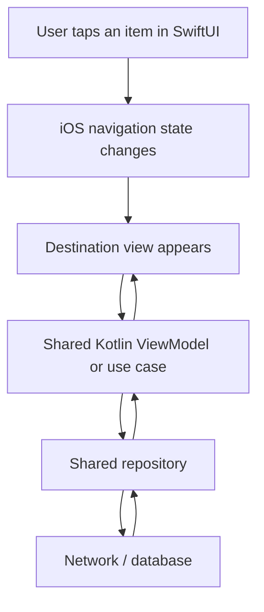

<div align="center">

# Chapter 15 — Navigation
## Part 3: iOS

**Kotlin Multiplatform Tutorial Series**

Build native-feeling navigation for iOS while keeping shared business logic, domain models, and application state portable.


</div>

---

## Table of Contents

- [1. What Navigation Means on iOS in a KMP App](#1-what-navigation-means-on-ios-in-a-kmp-app)
- [2. The Recommended Boundary](#2-the-recommended-boundary)
- [3. Choose a Navigation Model](#3-choose-a-navigation-model)
- [4. Create an iOS Navigation Structure](#4-create-an-ios-navigation-structure)
- [5. Model Routes Explicitly](#5-model-routes-explicitly)
- [6. Build a SwiftUI Navigation Stack](#6-build-a-swiftui-navigation-stack)
- [7. Navigate from Screen to Screen](#7-navigate-from-screen-to-screen)
- [8. Pass Arguments Without Coupling Screens](#8-pass-arguments-without-coupling-screens)
- [9. Coordinate Shared ViewModels with SwiftUI](#9-coordinate-shared-viewmodels-with-swiftui)
- [10. Handle Back Navigation](#10-handle-back-navigation)
- [11. Deep Links and Universal Links](#11-deep-links-and-universal-links)
- [12. Authentication Flows and Nested Navigation](#12-authentication-flows-and-nested-navigation)
- [13. State Restoration and Lifecycle](#13-state-restoration-and-lifecycle)
- [14. Dependency Injection at the Navigation Boundary](#14-dependency-injection-at-the-navigation-boundary)
- [15. Testing iOS Navigation](#15-testing-ios-navigation)
- [16. Common Mistakes](#16-common-mistakes)
- [17. Production Checklist](#17-production-checklist)
- [18. Summary](#18-summary)
- [References](#references)

---

## 1. What Navigation Means on iOS in a KMP App

Navigation determines which screen is visible, how the user moves between destinations, what data is carried to a destination, and what happens when the user goes back.

In a Kotlin Multiplatform application, the iOS application does not need to use the same navigation implementation as Android. A shared Kotlin module can provide business rules and data, while the iOS application uses native SwiftUI navigation.

This is often the most maintainable choice because iOS navigation has its own interaction conventions:

- Navigation bars and back buttons follow platform expectations.
- Swipe-back gestures are familiar to iOS users.
- Deep links enter the application through native URL handling.
- SwiftUI manages view identity and rendering through its state system.
- App lifecycle and scene restoration are handled using Apple platform APIs.

The goal is not to force identical UI code onto every platform. The goal is to share the right responsibilities while preserving a native experience.

### A practical KMP navigation flow



The navigation stack belongs to the iOS presentation layer. Shared Kotlin code can expose the state and actions required by a screen, but it should not need to know whether that screen was pushed using `NavigationStack`, presented as a sheet, or opened through a deep link.

> **Core principle:** Share application behavior where it creates value; let SwiftUI own iOS navigation and presentation.

---

## 2. The Recommended Boundary

A clean KMP architecture separates navigation decisions from business rules.

| Responsibility | Recommended owner |
|---|---|
| SwiftUI `NavigationStack` and `NavigationPath` | iOS application |
| iOS destination views and presentation styles | iOS application |
| Universal Link and URL entry handling | iOS application |
| Screen-specific presentation state | Usually iOS presentation layer |
| Shared business rules and validation | `commonMain` |
| Reusable domain models and use cases | `commonMain` |
| Repositories and shared data logic | `commonMain`, where appropriate |
| Platform-specific services | Platform source sets |
| Which route to open after a business event | iOS coordinator, informed by shared state or results |

The exact boundary depends on the project. Some teams share a screen state holder or ViewModel in Kotlin; others keep most presentation state in SwiftUI. Both can work. The important part is to avoid two independent navigation systems trying to control the same stack.

### A useful architecture

```text
iosApp/
├── App/
│   ├── MyApp.swift
│   └── AppContainer.swift
├── Navigation/
│   ├── AppRoute.swift
│   ├── AppNavigator.swift
│   ├── AppNavigationHost.swift
│   └── DeepLinkHandler.swift
├── Features/
│   ├── home/
│   │   ├── HomeView.swift
│   │   └── HomeViewModel.swift
│   ├── product/
│   │   ├── ProductView.swift
│   │   └── ProductViewModel.swift
│   └── profile/
│       └── ProfileView.swift
└── Shared/
    └── SharedViewModelAdapter.swift

shared/
└── src/
    ├── commonMain/
    │   ├── domain/
    │   ├── data/
    │   └── presentation/
    └── iosMain/
        └── platform/
```

This is an example organization, not a mandatory directory structure. Keep navigation types close to the iOS application unless there is a concrete reason to share them.

---

## 3. Choose a Navigation Model

SwiftUI provides several navigation and presentation tools. Choose based on the interaction rather than trying to route every interaction through one universal mechanism.

| Requirement | SwiftUI approach |
|---|---|
| Hierarchical push navigation | `NavigationStack` |
| A small, fixed navigation hierarchy | `NavigationLink` with a value or destination |
| Programmatic push and pop | State-backed `NavigationStack` path |
| Modal workflow | `.sheet` or `.fullScreenCover` |
| Short-lived confirmation | `.alert` or `.confirmationDialog` |
| Tabs with independent sections | `TabView` with separate navigation state per tab |
| URL entry | Parse URL, then update navigation state |
| Large, adaptive navigation layouts | Consider `NavigationSplitView` |

For modern iOS applications, `NavigationStack` is generally the right starting point for a push-based hierarchy. `NavigationView` belongs to older SwiftUI navigation APIs and should not be the default for new implementations.

### Avoid one giant navigation abstraction

A route enum and a small navigation owner are often enough. Add a more elaborate coordinator only when the app needs centralized flow orchestration, cross-feature transitions, or complex restoration.

---

## 4. Create an iOS Navigation Structure

The examples below use SwiftUI and target an iOS version that supports `NavigationStack` (iOS 16 or later). Adjust deployment targets and APIs to match the application.

A typical SwiftUI entry point:

```swift
import SwiftUI

@main
struct ExampleApp: App {
    var body: some Scene {
        WindowGroup {
            AppNavigationHost()
        }
    }
}
```

Create a host that owns the navigation path:

```swift
import SwiftUI

struct AppNavigationHost: View {
    @State private var path: [AppRoute] = []

    var body: some View {
        NavigationStack(path: $path) {
            HomeView(
                onOpenProduct: { productID in
                    path.append(.product(id: productID))
                },
                onOpenProfile: {
                    path.append(.profile)
                }
            )
            .navigationDestination(for: AppRoute.self) { route in
                switch route {
                case .product(let id):
                    ProductView(productID: id)

                case .profile:
                    ProfileView()
                }
            }
        }
    }
}
```

This design has a clear ownership rule: `AppNavigationHost` owns the stack, while feature views communicate user intent through callbacks.

For a larger application, move path mutations into an `ObservableObject` or another dedicated navigation owner. Do not add abstraction only to wrap a single `path.append` call.

---

## 5. Model Routes Explicitly

A route should describe the destination and the minimum data required to identify it. It should not contain a SwiftUI `View`, a repository, or a live ViewModel.

```swift
import Foundation

enum AppRoute: Hashable {
    case product(id: String)
    case profile
}
```

SwiftUI can use a `Hashable` route as the value stored in a navigation path.

### Why routes should be lightweight

A route such as `.product(id: "sku-123")` identifies the destination. The destination can load the product from a repository or shared use case. This avoids carrying a potentially stale model object through the navigation stack.

Prefer:

```swift
path.append(.product(id: product.id))
```

Instead of:

```swift
// Avoid passing a large mutable model as the route value.
path.append(.productObject(product))
```

A route identifier is usually more resilient to refreshes, state restoration, and changes in data.

### Add routes as the application grows

```swift
enum AppRoute: Hashable {
    case product(id: String)
    case category(id: String)
    case order(id: String)
    case profile
    case settings
}
```

Keep this enum manageable. If feature teams need separate route ownership, split navigation into feature-level route types or define a deliberate app-level route boundary. Avoid turning a route enum into a container for every UI state.

---

## 6. Build a SwiftUI Navigation Stack

`NavigationStack` can be driven by a binding to a path. This enables programmatic navigation, deep-link handling, and deterministic tests.

```swift
import SwiftUI

struct AppNavigationHost: View {
    @State private var path: [AppRoute] = []

    var body: some View {
        NavigationStack(path: $path) {
            HomeView(
                onOpenProduct: { id in
                    path.append(.product(id: id))
                },
                onOpenProfile: {
                    path.append(.profile)
                }
            )
            .navigationDestination(for: AppRoute.self) { route in
                destination(for: route)
            }
        }
    }

    @ViewBuilder
    private func destination(for route: AppRoute) -> some View {
        switch route {
        case .product(let id):
            ProductView(productID: id)

        case .profile:
            ProfileView()
        }
    }
}
```

### Keep destination registration stable

Register `.navigationDestination` on a stable container within the stack. Avoid placing destination registrations inside rows of a `List` or `LazyVStack`; this can make destination discovery and navigation behavior harder to reason about.

### Keep screen construction focused

```swift
struct HomeView: View {
    let onOpenProduct: (String) -> Void
    let onOpenProfile: () -> Void

    var body: some View {
        List {
            Button("Open product") {
                onOpenProduct("sku-123")
            }

            Button("Open profile") {
                onOpenProfile()
            }
        }
        .navigationTitle("Home")
    }
}
```

The view does not know how the app stores its path. It only reports what the user wants to do.

---

## 7. Navigate from Screen to Screen

A callback-based approach is simple and testable for small flows.

```swift
struct ProductView: View {
    let productID: String
    let onOpenProfile: () -> Void

    var body: some View {
        VStack(spacing: 16) {
            Text("Product")
                .font(.title)

            Text("ID: \(productID)")

            Button("View profile") {
                onOpenProfile()
            }
        }
        .navigationTitle("Product")
    }
}
```

Register the callback at the navigation boundary:

```swift
case .product(let id):
    ProductView(
        productID: id,
        onOpenProfile: {
            path.append(.profile)
        }
    )
```

This keeps the feature view independent from the global navigation implementation.

### When to use a navigation owner

For applications with many features, a dedicated object can make navigation mutations easier to organize.

```swift
import SwiftUI

@MainActor
final class AppNavigator: ObservableObject {
    @Published var path: [AppRoute] = []

    func push(_ route: AppRoute) {
        path.append(route)
    }

    func pop() {
        guard !path.isEmpty else { return }
        path.removeLast()
    }

    func popToRoot() {
        path.removeAll()
    }
}
```

Use it with `@StateObject` at the owner boundary:

```swift
struct AppNavigationHost: View {
    @StateObject private var navigator = AppNavigator()

    var body: some View {
        NavigationStack(path: $navigator.path) {
            HomeView(
                onOpenProduct: { id in
                    navigator.push(.product(id: id))
                },
                onOpenProfile: {
                    navigator.push(.profile)
                }
            )
            .navigationDestination(for: AppRoute.self) { route in
                switch route {
                case .product(let id):
                    ProductView(productID: id)
                case .profile:
                    ProfileView()
                }
            }
        }
    }
}
```

Do not create a new navigator inside every destination. That would create disconnected stacks and make back navigation unpredictable.

---

## 8. Pass Arguments Without Coupling Screens

Pass stable identifiers through routes and let the destination retrieve the data it needs.

```swift
enum AppRoute: Hashable {
    case product(id: String)
    case order(id: String)
}
```

A destination can receive the identifier:

```swift
struct ProductView: View {
    let productID: String

    var body: some View {
        ProductContent(productID: productID)
            .navigationTitle("Product")
    }
}
```

The screen can then call a shared use case or observe a shared ViewModel to load the product.

### Do not put sensitive data in routes

Routes may appear in logs, restoration data, analytics, or debugging output. Avoid embedding passwords, access tokens, payment details, or other sensitive data in route values or URLs.

### Validate route arguments

A deep link or restored navigation path may contain an identifier for an item that no longer exists. Treat route values as input, not proof that the requested resource is valid. Handle missing records, permission failures, and deleted content in the destination's loading state.

---

## 9. Coordinate Shared ViewModels with SwiftUI

A shared Kotlin ViewModel can own business-related screen state, while SwiftUI owns navigation and view rendering. The iOS integration depends on how the project exports Kotlin types and observes `Flow` or `StateFlow`.

There is no single interop wrapper that fits every KMP setup. Some projects use a small Swift adapter, some use a library that bridges Kotlin flows to Swift concurrency, and others expose suspend functions through generated Objective-C/Swift APIs.

The stable design principle is to keep navigation on the Swift side and translate shared state into presentation decisions.

### Example interaction

```text
SwiftUI ProductView
       |
       | calls shared ViewModel action
       v
Kotlin ProductViewModel
       |
       | invokes shared use case
       v
Repository
       |
       v
Product result / screen state
```

A screen might request an operation and then react to the resulting state:

```swift
struct ProductView: View {
    let productID: String
    @State private var showSignIn = false

    var body: some View {
        ProductContent(productID: productID)
            .onReceive(NotificationCenter.default.publisher(
                for: .requiresAuthentication
            )) { _ in
                showSignIn = true
            }
            .sheet(isPresented: $showSignIn) {
                SignInView()
            }
    }
}
```

This is only an illustration of a SwiftUI presentation boundary. A production application should prefer a typed event bridge or observable adapter over a global notification when practical. The shared ViewModel should not import SwiftUI or call `NavigationStack` APIs.

### Keep state and navigation intent distinct

Not every state change should navigate. For example:

- `Loading` is UI state.
- `ProductLoaded` is UI state.
- `AuthenticationRequired` may be a domain or presentation event that asks the iOS layer to present sign-in.
- `PaymentCompleted` may result in a navigation decision owned by the iOS flow coordinator.

Avoid inferring navigation from arbitrary state values on every render. Otherwise, SwiftUI updates can accidentally trigger the same navigation more than once.

---

## 10. Handle Back Navigation

With a state-driven `NavigationStack`, popping a destination means removing it from the path. SwiftUI also provides the standard navigation bar back button and interactive back gesture.

```swift
@MainActor
final class AppNavigator: ObservableObject {
    @Published var path: [AppRoute] = []

    func pop() {
        guard path.isEmpty == false else { return }
        path.removeLast()
    }

    func popToRoot() {
        path = []
    }
}
```

### Prefer the platform back behavior

Use the default back button and swipe gesture unless the product has a clear reason to customize them. If a custom back action is needed, it should update the same path that drives the stack.

Do not maintain a separate `currentScreen` variable alongside a path unless there is a specific, well-defined reason. Two independent sources of navigation truth can disagree.

### Unsaved changes

If a form has unsaved changes, decide how the user should be warned before leaving. Keep the confirmation behavior in the presentation layer and ensure it works for both the navigation bar back button and any custom back action. Test interactive swipe-back behavior carefully because gesture-driven navigation is not identical to tapping a custom button.

---

## 11. Deep Links and Universal Links

A deep link lets the user enter the app at a specific destination. On iOS, the app may receive a custom URL scheme or a Universal Link.

Examples:

```text
myapp://product/sku-123
https://example.com/product/sku-123
```

A custom scheme is easy to configure but can be claimed by other applications. Universal Links use a verified website-to-app association and are generally preferred for links that should open reliably from the web.

### Parse URLs into routes

Keep URL parsing separate from the view code:

```swift
import Foundation

enum AppDeepLink {
    case product(id: String)
    case profile

    static func parse(_ url: URL) -> AppDeepLink? {
        let components = url.pathComponents.filter { $0 != "/" }

        if url.host == "product", let id = components.first {
            return .product(id: id)
        }

        if url.host == "profile" {
            return .profile
        }

        return nil
    }
}
```

This example demonstrates a custom URL shape such as `myapp://product/sku-123`, where `product` is the host and `sku-123` is the first path component. URL structures vary; adjust parsing to match the scheme and host configuration you actually use.

Apply the parsed result to the existing navigation owner:

```swift
func open(_ deepLink: AppDeepLink, navigator: AppNavigator) {
    switch deepLink {
    case .product(let id):
        navigator.path = [.product(id: id)]

    case .profile:
        navigator.path = [.profile]
    }
}
```

SwiftUI can deliver incoming URLs with `.onOpenURL`:

```swift
struct AppNavigationHost: View {
    @StateObject private var navigator = AppNavigator()

    var body: some View {
        NavigationStack(path: $navigator.path) {
            HomeView(
                onOpenProduct: { navigator.push(.product(id: $0)) },
                onOpenProfile: { navigator.push(.profile) }
            )
            .navigationDestination(for: AppRoute.self) { route in
                switch route {
                case .product(let id):
                    ProductView(productID: id)
                case .profile:
                    ProfileView()
                }
            }
        }
        .onOpenURL { url in
            guard let link = AppDeepLink.parse(url) else { return }
            open(link, navigator: navigator)
        }
    }
}
```

The snippets are intended to show the integration points; combine them with the final `AppRoute` and navigator definitions used by your project.

### Deep-link safety checklist

- Validate the scheme, host, and path.
- Validate identifiers and reject malformed values.
- Verify authentication and authorization before showing protected content.
- Handle links to deleted or unavailable resources.
- Decide whether a link replaces the current stack or pushes onto it.
- Avoid placing secrets or credentials in URLs.
- Test cold-start and already-running-app scenarios.
- Configure Universal Links on the website and in the iOS app when using them.

A deep link is a request to open content, not an authorization grant.

---

## 12. Authentication Flows and Nested Navigation

Authentication often requires a different flow from the main application. A signed-out user may need sign-in or onboarding, while a signed-in user should enter the primary experience.

A simple root switch can express this:

```swift
struct RootView: View {
    let isAuthenticated: Bool

    var body: some View {
        if isAuthenticated {
            AppNavigationHost()
        } else {
            AuthenticationFlowView()
        }
    }
}
```

In a real application, `isAuthenticated` should come from an observable session state rather than being a fixed initializer value.

### Reset navigation after sign-out

When the session ends, protected destinations should not remain reachable through the existing path. Clear the protected navigation state and present the signed-out flow.

```swift
func handleSignOut(navigator: AppNavigator) {
    navigator.popToRoot()
}
```

The app should also update its root presentation based on the authoritative session state. Clearing a stack alone is not a substitute for enforcing authorization in repositories and backend APIs.

### Tabs with separate stacks

When each tab represents an independent section, give each section its own navigation stack where appropriate. This allows users to switch tabs without unexpectedly losing their position.

Conceptually:

```text
TabView
├── Home tab
│   └── Home NavigationStack
├── Search tab
│   └── Search NavigationStack
└── Profile tab
    └── Profile NavigationStack
```

Do not share one mutable path across all tabs unless the product intentionally defines a single global stack.

---

## 13. State Restoration and Lifecycle

SwiftUI state can preserve navigation while the view hierarchy remains alive, but durable restoration requires an explicit policy. Decide which parts of the path should survive process termination and which should be reconstructed from the current session.

For example, a product route identified by a stable ID may be restorable. A temporary payment-confirmation screen may not be appropriate to restore after a restart.

### Persist only safe, meaningful state

If you persist route identifiers:

1. Version the stored format if its structure may change.
2. Validate the restored routes before applying them.
3. Remove routes that require an expired session.
4. Do not persist secrets or full sensitive domain objects.
5. Define behavior when a destination no longer exists.
6. Keep restoration consistent with the active account and permissions.

A simple persistence approach can encode a route enum if it conforms to `Codable`, but that should be added only when the route model and restoration requirements justify it. Do not assume every navigation path should be persisted.

### Lifecycle responsibilities

- SwiftUI owns the rendering lifecycle of its views.
- Shared Kotlin ViewModels should expose predictable state and release resources according to their own lifecycle strategy.
- Network requests should not depend on a destination remaining visible unless that is intentional.
- Re-entering a screen should not accidentally duplicate subscriptions or repeat irreversible actions.

Test restoration with both a warm app and a cold launch.

---

## 14. Dependency Injection at the Navigation Boundary

Navigation should not instantiate repositories or build domain dependencies directly. The app composition root should create shared dependencies and supply them to feature-level view models or adapters.

```text
MyApp
  └── AppContainer
       ├── Shared dependency graph
       ├── Session / authentication state
       ├── Feature ViewModel factories
       └── AppNavigationHost
            └── Destination view
```

A lightweight Swift-side container could look like:

```swift
@MainActor
final class AppContainer {
    // Supply generated shared-module dependencies or adapters here.
    // Keep construction details out of individual SwiftUI screens.
}
```

The actual implementation depends on how the KMP project creates shared dependencies—manual factories, a dependency-injection framework, or generated bindings. Keep platform-specific setup in the platform layer and avoid making `commonMain` depend on SwiftUI.

### Avoid global mutable navigation

A global singleton navigator may seem convenient, but it makes tests harder and can cause multiple windows or scenes to share navigation unexpectedly. Prefer a navigator scoped to the relevant app scene or flow.

---

## 15. Testing iOS Navigation

Navigation should be tested at more than one level.

### Route parsing tests

Test supported URL shapes, malformed URLs, missing identifiers, and unknown routes.

```swift
import XCTest

final class DeepLinkParserTests: XCTestCase {
    func testProductDeepLinkParsesIdentifier() {
        let url = URL(string: "myapp://product/sku-123")!

        let result = AppDeepLink.parse(url)

        guard case .product(let id) = result else {
            return XCTFail("Expected product deep link")
        }

        XCTAssertEqual(id, "sku-123")
    }

    func testUnknownDeepLinkIsRejected() {
        let url = URL(string: "myapp://unknown/path")!

        XCTAssertNil(AppDeepLink.parse(url))
    }
}
```

The exact parser and URL shape in the tests must match the implementation in the app.

### Navigator unit tests

If navigation state is held in a dedicated type, test its path transitions without launching SwiftUI:

```swift
func testPopRemovesLastRoute() {
    let navigator = AppNavigator()
    navigator.push(.profile)

    navigator.pop()

    XCTAssertTrue(navigator.path.isEmpty)
}
```

Depending on the project's Swift concurrency settings, mark the test or test method `@MainActor` because the navigator is main-actor isolated.

### UI tests

UI tests should cover user-visible flows:

- Tap a list item and verify the destination appears.
- Use the back button and verify the previous screen returns.
- Open a supported deep link.
- Verify a signed-out user cannot access protected content.
- Confirm that changing tabs preserves the expected section state.
- Exercise the unsaved-changes confirmation.
- Verify that a missing item shows a recoverable error state.

### Shared Kotlin tests

Use common tests for business rules, use cases, and shared ViewModel state transitions. Do not duplicate those tests in Swift solely because the same state is displayed by a SwiftUI screen.

A useful division is:

| Test layer | Main responsibility |
|---|---|
| `commonTest` | Business rules, use cases, repositories, shared state |
| Swift unit tests | URL parsing, route transitions, iOS adapters |
| SwiftUI UI tests | User-visible navigation and platform behavior |

---

## 16. Common Mistakes

### 16.1 Rebuilding Android navigation on iOS

Trying to make iOS use the same navigation implementation as Android often adds interop complexity without creating meaningful reuse. Share route meaning or domain behavior only when it provides clear value; use SwiftUI for native iOS presentation.

### 16.2 Putting SwiftUI types in `commonMain`

Types such as `NavigationStack`, `NavigationPath`, and SwiftUI `View` belong to the iOS application. Shared Kotlin code should remain platform-independent unless the project has a deliberate platform abstraction.

### 16.3 Passing complete models through routes

Large mutable models can become stale and complicate restoration. Prefer stable IDs and load the latest data at the destination.

### 16.4 Creating multiple navigation owners

If every feature creates its own global-style navigator, back behavior and deep links can become inconsistent. Define which object owns each stack and scope it to the relevant flow or scene.

### 16.5 Triggering navigation repeatedly from state rendering

A state observer may receive the same state more than once. If every observation pushes a route, users can end up with duplicate screens. Represent one-time navigation events explicitly or make the transition idempotent.

### 16.6 Treating a deep link as trusted input

Validate the URL and the resource identifier. Check access rights in the application and backend. Never rely on the fact that a link was opened by the app as proof of permission.

### 16.7 Forgetting iOS interaction conventions

Custom back buttons, modal transitions, and tab behavior should be intentional. Preserve familiar gestures and accessibility semantics unless a product requirement calls for something different.

### 16.8 Assuming all Kotlin flows bridge to Swift automatically

The interop approach depends on Kotlin, Swift, and library versions. Define and test the actual state-observation bridge rather than assuming a Kotlin `Flow` is directly consumable as a native Swift `AsyncSequence`.

---

## 17. Production Checklist

Use this checklist when reviewing iOS navigation in a KMP project.

- [ ] `NavigationStack` or another navigation API is chosen to fit the supported iOS version.
- [ ] The navigation path has one clear owner per stack.
- [ ] Feature views express intent through callbacks, bindings, or a documented navigation interface.
- [ ] Routes contain stable identifiers rather than unnecessary mutable objects.
- [ ] Shared Kotlin code contains no accidental SwiftUI dependency.
- [ ] Shared ViewModels expose state and actions through a tested interop layer.
- [ ] One-time navigation events cannot push duplicate destinations.
- [ ] Back navigation and interactive swipe-back behavior are verified.
- [ ] Tabs preserve the intended per-tab state.
- [ ] Deep links are parsed and validated.
- [ ] Universal Links are configured and tested if supported.
- [ ] Authentication changes invalidate protected navigation state.
- [ ] Restoration is deliberate and does not persist secrets.
- [ ] Missing, deleted, and unauthorized resources have recoverable UI states.
- [ ] Route parsing and navigator transitions have unit tests.
- [ ] Critical user journeys have UI tests.
- [ ] Accessibility labels and navigation titles are present where needed.
- [ ] Multiple scenes or windows do not accidentally share navigation state.

---

## 18. Summary

iOS navigation in a Kotlin Multiplatform application does not need to duplicate Android's navigation stack. A native SwiftUI implementation can coexist cleanly with shared Kotlin business logic.

The key decisions are straightforward:

1. Let SwiftUI own iOS navigation and presentation.
2. Keep shared Kotlin code focused on domain behavior, data, and reusable state.
3. Use lightweight, explicit routes with stable identifiers.
4. Keep navigation state in one clearly defined owner per stack.
5. Parse deep links into validated routes before changing navigation.
6. Test route logic, shared behavior, and user-visible flows at the appropriate layers.

A good KMP architecture does not try to make every platform identical. It gives each platform room to behave naturally while keeping shared logic consistent and maintainable.

---

## References

Use official documentation as the source of truth for API details and platform requirements. Check the deployment target and library versions used by your project before adopting a specific API.

- [Apple — NavigationStack](https://developer.apple.com/documentation/swiftui/navigationstack)
- [Apple — NavigationPath](https://developer.apple.com/documentation/swiftui/navigationpath)
- [Apple — NavigationLink](https://developer.apple.com/documentation/swiftui/navigationlink)
- [Apple — Handling URLs in SwiftUI](https://developer.apple.com/documentation/swiftui/view/onopenurl(perform:))
- [Apple — Supporting Universal Links](https://developer.apple.com/documentation/xcode/supporting-universal-links-in-your-app)
- [Kotlin Multiplatform — Share code between platforms](https://kotlinlang.org/docs/multiplatform-share-on-platforms.html)
- [Kotlin Multiplatform — Swift/Objective-C interoperability](https://kotlinlang.org/docs/native-objc-interop.html)
- [Kotlin Multiplatform — iOS integration](https://kotlinlang.org/docs/multiplatform-ios-integration-overview.html)

---

<div align="center">

**Chapter 15 · Navigation · Part 3 — iOS**

*Native navigation. Shared logic. Clear boundaries.*

</div>
