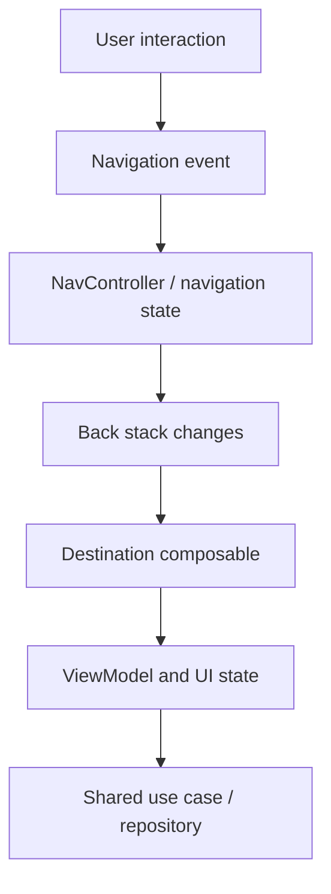
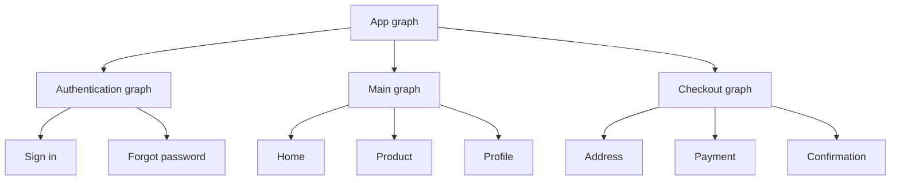

<div align="center">

# Chapter 15 — Navigation
## Part 4: Navigation with Jetpack Compose

**Kotlin Multiplatform Tutorial Series**

Design predictable, testable navigation for Compose applications while keeping navigation state, UI state, and shared business logic clearly separated.


</div>

---

## Table of Contents

- [1. Navigation in a Compose Application](#1-navigation-in-a-compose-application)
- [2. Navigation Boundaries in KMP](#2-navigation-boundaries-in-kmp)
- [3. Choose the Right Navigation Approach](#3-choose-the-right-navigation-approach)
- [4. Add Navigation Compose](#4-add-navigation-compose)
- [5. Model Destinations with Type Safety](#5-model-destinations-with-type-safety)
- [6. Build a Navigation Host](#6-build-a-navigation-host)
- [7. Navigate Between Screens](#7-navigate-between-screens)
- [8. Pass Arguments Safely](#8-pass-arguments-safely)
- [9. Back Stack and Back Navigation](#9-back-stack-and-back-navigation)
- [10. Nested Graphs and Authentication](#10-nested-graphs-and-authentication)
- [11. Bottom Navigation and Multiple Back Stacks](#11-bottom-navigation-and-multiple-back-stacks)
- [12. Deep Links](#12-deep-links)
- [13. State, ViewModels, and Lifecycle](#13-state-viewmodels-and-lifecycle)
- [14. Navigation in Compose Multiplatform](#14-navigation-in-compose-multiplatform)
- [15. Testing Navigation](#15-testing-navigation)
- [16. Common Mistakes](#16-common-mistakes)
- [17. Production Checklist](#17-production-checklist)
- [18. Summary](#18-summary)
- [References](#references)

---

## 1. Navigation in a Compose Application

Navigation is more than switching one composable for another. A production navigation system needs to represent destinations, manage a back stack, pass route arguments, support deep links, respect lifecycle boundaries, and make user journeys testable.

Jetpack Compose is declarative: UI is rendered from state. Navigation should follow the same principle. A navigation controller manages the stack, while composables render the destination associated with the current entry.

A typical flow looks like this:



In a Kotlin Multiplatform project, distinguish between two decisions:

- **Where the navigation UI is implemented:** Android-only Compose, Compose Multiplatform, or a platform-native UI.
- **Where application behavior is shared:** common Kotlin business logic, repositories, models, and possibly screen state holders.

Do not assume that using Compose automatically means every navigation detail must live in `commonMain`. The appropriate location depends on the target platforms and the navigation library selected.

> **Core principle:** Navigation is presentation orchestration. Keep domain logic independent from navigation APIs.

---

## 2. Navigation Boundaries in KMP

A clear boundary prevents the navigation system from becoming coupled to repositories, API clients, and business rules.

| Responsibility | Typical owner |
|---|---|
| Android Navigation Compose APIs | Android presentation layer |
| Compose Multiplatform navigation APIs | Shared UI layer, when chosen |
| Destination composables | UI module for the target platform |
| Navigation events and back-stack operations | Navigation host or coordinator |
| Screen state and user actions | ViewModel or state holder |
| Domain models and use cases | `commonMain` |
| Repository contracts and shared data logic | `commonMain`, where appropriate |
| Platform-specific APIs | Platform source sets |
| Authentication and authorization enforcement | Shared domain/session logic and backend |

A common architecture might look like this:

```text
composeApp/
├── src/
│   ├── commonMain/
│   │   ├── app/
│   │   ├── navigation/       # Only if navigation is shared
│   │   ├── feature/
│   │   └── presentation/
│   ├── androidMain/
│   │   └── platform/
│   └── iosMain/
│       └── platform/
└── build.gradle.kts

shared/
└── src/
    └── commonMain/
        ├── domain/
        ├── data/
        └── core/
```

If the Android app uses AndroidX Navigation Compose and the iOS app uses SwiftUI navigation, Android-specific navigation classes should remain in Android source sets. If the application uses Compose Multiplatform UI across platforms, a multiplatform navigation library may be a better fit.

### A practical rule

Share route concepts only when they have genuine cross-platform value. Do not move Android-specific `NavController`, `NavHost`, or `NavBackStackEntry` types into shared domain code.

---

## 3. Choose the Right Navigation Approach

Navigation libraries and APIs evolve. Select an approach based on your UI targets, deployment requirements, and desired route model.

| Approach | Best fit | Important consideration |
|---|---|---|
| AndroidX Navigation Compose | Android app using Jetpack Compose | Android-focused navigation APIs |
| Type-safe routes in AndroidX Navigation | Android app needing structured destinations | Requires compatible Navigation and Kotlin serialization setup |
| Compose Multiplatform navigation library | Shared Compose UI across platforms | Verify supported targets, lifecycle behavior, and library maturity |
| Simple state-driven destination switching | Small flows or prototypes | Can become difficult to maintain for complex stacks |
| Platform-native navigation | Native UI on each platform | Share business logic rather than forcing a common UI navigation API |

For an Android-only Compose application, AndroidX Navigation Compose is a common choice. For a shared Compose Multiplatform UI, evaluate a navigation library that explicitly supports the targets you ship. Avoid treating Android-only APIs as portable merely because the UI uses Kotlin.

---

## 4. Add Navigation Compose

For an Android application using AndroidX Navigation Compose, add the dependency through the version catalog or your module's Gradle configuration.

Example using a version catalog:

```toml
[versions]
navigationCompose = "YOUR_COMPATIBLE_NAVIGATION_VERSION"

[libraries]
androidx-navigation-compose = {
    module = "androidx.navigation:navigation-compose",
    version.ref = "navigationCompose"
}
```

Then add the library to the relevant module:

```kotlin
dependencies {
    implementation(libs.androidx.navigation.compose)
}
```

Replace the placeholder with a version compatible with your project's Android Gradle Plugin, Kotlin, and other AndroidX dependencies. Keep versions centralized in `libs.versions.toml` where the project uses a version catalog.

If you use type-safe routes, configure Kotlin serialization according to the current Navigation and Kotlin plugin documentation. Do not copy plugin versions independently from the rest of the build.

---

## 5. Model Destinations with Type Safety

Routes should represent destinations and the minimal information required to identify them. Avoid passing repositories, ViewModels, composable lambdas, or large mutable object graphs through navigation.

### 5.1 Type-safe routes

Recent AndroidX Navigation versions support type-safe routes using serializable Kotlin types. The following illustrates the route model:

```kotlin
import kotlinx.serialization.Serializable

@Serializable
data object HomeRoute

@Serializable
data class ProductRoute(
    val productId: String
)

@Serializable
data object ProfileRoute
```

A route is now a Kotlin type rather than a manually constructed string such as `"product/$id"`.

This improves readability and reduces mistakes involving route names and argument formatting. Ensure the Kotlin serialization plugin and Navigation version are configured as required by your project.

### 5.2 Why identifiers are better than full objects

Prefer:

```kotlin
navController.navigate(ProductRoute(productId = product.id))
```

Avoid designing navigation around passing a full product object. A full object may be stale, difficult to serialize, unnecessarily large, or unsuitable for process restoration.

The destination can use the ID to load current data through a ViewModel or use case.

### 5.3 Keep route models small

A route might contain:

- A stable resource ID.
- A small filter or tab identifier.
- A validated primitive needed to initialize the destination.

A route should generally not contain:

- Authentication tokens or passwords.
- A repository or service.
- A ViewModel instance.
- A large response object.
- Mutable UI state that belongs to the destination.

Treat route arguments as input that must be validated. A valid route does not imply that the resource still exists or that the current user can access it.

---

## 6. Build a Navigation Host

`NavHost` connects a navigation controller to the composable destinations available in a graph.

```kotlin
import androidx.compose.runtime.Composable
import androidx.navigation.compose.NavHost
import androidx.navigation.compose.composable
import androidx.navigation.compose.rememberNavController

@Composable
fun AppNavigationHost() {
    val navController = rememberNavController()

    NavHost(
        navController = navController,
        startDestination = HomeRoute
    ) {
        composable<HomeRoute> {
            HomeScreen(
                onOpenProduct = { productId ->
                    navController.navigate(
                        ProductRoute(productId = productId)
                    )
                },
                onOpenProfile = {
                    navController.navigate(ProfileRoute)
                }
            )
        }

        composable<ProductRoute> {
            ProductScreen()
        }

        composable<ProfileRoute> {
            ProfileScreen()
        }
    }
}
```

This example uses the type-safe route DSL available in compatible versions of AndroidX Navigation. In older versions, the graph may use string routes and explicit argument declarations instead. Do not mix APIs from incompatible versions.

### Destination registration should stay organized

As the application grows, avoid one enormous graph full of feature implementation details. Organize graph construction by feature or flow while retaining a clear app-level entry point.

For example:

```kotlin
NavHost(
    navController = navController,
    startDestination = HomeRoute
) {
    homeGraph(navController)
    productGraph(navController)
    profileGraph(navController)
}
```

The exact graph extension functions depend on the navigation API and version. The architectural goal is to keep the app host readable and make feature destinations independently maintainable.

### Keep composables unaware of graph construction

A screen should report user intent:

```kotlin
@Composable
fun HomeScreen(
    onOpenProduct: (String) -> Unit,
    onOpenProfile: () -> Unit
) {
    // Render UI and invoke callbacks from user interactions.
}
```

The host decides what a callback means in navigation terms. This separation makes the screen easier to preview and test.

---

## 7. Navigate Between Screens

A screen should usually expose callbacks for navigation actions instead of accepting a `NavController` directly.

```kotlin
@Composable
fun HomeScreen(
    onOpenProduct: (String) -> Unit,
    onOpenProfile: () -> Unit
) {
    Column {
        Button(
            onClick = { onOpenProduct("sku-123") }
        ) {
            Text("Open product")
        }

        Button(
            onClick = onOpenProfile
        ) {
            Text("Open profile")
        }
    }
}
```

The navigation host connects those callbacks to route operations:

```kotlin
composable<HomeRoute> {
    HomeScreen(
        onOpenProduct = { id ->
            navController.navigate(ProductRoute(id))
        },
        onOpenProfile = {
            navController.navigate(ProfileRoute)
        }
    )
}
```

### Why not pass `NavController` to every screen?

Passing the controller everywhere is convenient at first, but it couples feature UI to the navigation framework. It also makes isolated tests and previews harder because screens require a live navigation environment.

Prefer:

- Callbacks for small, local navigation needs.
- A narrow navigation interface for larger applications.
- Direct controller access only at a deliberate navigation boundary.

Do not create a generic navigation abstraction that hides every framework detail if it makes ordinary navigation harder to understand. Abstraction should reduce coupling, not add ceremony.

---

## 8. Pass Arguments Safely

With type-safe routes, a destination can declare the route type it consumes. Depending on the Navigation version, the route can be retrieved through the back-stack entry's typed route API.

For example, a destination can be declared as:

```kotlin
composable<ProductRoute> { backStackEntry ->
    val route = backStackEntry.toRoute<ProductRoute>()

    ProductScreen(
        productId = route.productId
    )
}
```

Use the required imports for the Navigation version in your project. Type-safe route APIs and imports can vary across versions.

The screen can then use the ID to load its data:

```kotlin
@Composable
fun ProductScreen(
    productId: String
) {
    // Obtain state from a ViewModel or state holder.
    // Render loading, success, empty, and error states.
}
```

### Validate arguments at the boundary

Even with type-safe routes, a route can contain a malformed or outdated identifier. Validate it before making assumptions about the resource.

Consider these cases:

- The product was deleted.
- The user no longer has permission to view it.
- The link contains an empty or malformed ID.
- The resource belongs to a different signed-in account.
- A restored stack refers to a route no longer supported by the app.

The destination should show an appropriate loading, unavailable, or error state rather than crashing.

---

## 9. Back Stack and Back Navigation

The navigation back stack represents the user's path through the app. `NavController` provides operations to navigate forward, pop the current destination, and modify the stack when a flow finishes.

### 9.1 Navigate back

For ordinary back behavior, prefer the platform's default back handling. When a screen needs an explicit back button, the host can expose a callback:

```kotlin
@Composable
fun ProductScreen(
    productId: String,
    onBack: () -> Unit
) {
    Column {
        Text("Product: $productId")

        Button(onClick = onBack) {
            Text("Back")
        }
    }
}
```

The destination wiring can use:

```kotlin
ProductScreen(
    productId = route.productId,
    onBack = { navController.popBackStack() }
)
```

Use the route extraction pattern appropriate to the Navigation version in your project.

### 9.2 Pop to a known destination

When a flow finishes, you may need to remove intermediate destinations. AndroidX Navigation provides `popUpTo` options as part of navigation configuration.

Conceptually:

```kotlin
navController.navigate(HomeRoute) {
    popUpTo<HomeRoute> {
        inclusive = false
    }
    launchSingleTop = true
}
```

Verify that the type-safe `popUpTo` overload is supported by your selected Navigation version. String-route projects use the corresponding string-based overload.

Use stack-clearing behavior deliberately. A checkout completion, sign-out, or onboarding completion may need a different back-stack policy.

### 9.3 Avoid duplicate destinations

If a user repeatedly taps a button, the same destination can be added multiple times. Use the appropriate `launchSingleTop`, `popUpTo`, or UI-level interaction handling when the product behavior requires it.

Do not apply one universal stack policy to every route. Opening two different products may be valid; opening the same root destination repeatedly may not be.

---

## 10. Nested Graphs and Authentication

Larger applications often contain independent flows such as onboarding, authentication, checkout, and the main application. Nested graphs help group those destinations.

A conceptual structure:



The exact graph declaration depends on the route API and Navigation version. The key is to give each flow a clear entry point and exit policy.

### Authentication is state, not merely a destination

Do not treat opening the home screen as proof that a user is authenticated. Authentication state should come from the session layer and be enforced by repositories and backend services.

On sign-out:

1. Invalidate or clear the session using the appropriate shared/domain logic.
2. Remove protected destinations from the back stack.
3. Switch to the signed-out flow.
4. Ensure Back cannot reopen protected screens.
5. Ensure deep links cannot bypass authentication checks.

Navigation controls the visible flow; it is not the security boundary.

### Checkout and other multi-step flows

A checkout flow may contain address, delivery, payment, and confirmation destinations. Decide which screens should remain in the back stack after completion and whether users can return to an earlier step.

Keep payment processing and order validation in domain/data layers, not in route graph code.

---

## 11. Bottom Navigation and Multiple Back Stacks

A tab-based application often needs to preserve navigation independently for each tab. A user may navigate from Home to Product, switch to Profile, then return to Home and expect to see the previous destination.

AndroidX Navigation supports patterns for saving and restoring state across top-level destinations. A common approach uses `popUpTo`, `saveState`, `restoreState`, and `launchSingleTop`.

The exact route and API overloads depend on the route model and Navigation version. Conceptually, a tab selection should:

- Navigate to the selected top-level destination.
- Avoid adding duplicate copies of the same top-level destination.
- Save state for the tab being left when appropriate.
- Restore the selected tab's previous stack when returning.

### Keep tab state intentional

Not every app needs independent back stacks. For a simple app, switching tabs may reset each section to its root. Choose behavior based on user expectations and test it explicitly.

### Avoid one controller per recomposition

Create the navigation controller with `rememberNavController()` at a stable host boundary. Do not create it inside frequently recomposing destination content, because that can discard the expected stack.

---

## 12. Deep Links

A deep link allows an external URL or notification to open a particular destination. AndroidX Navigation can associate deep links with destinations, but URL configuration and parsing must match the actual application setup.

Example URL shapes:

```text
https://example.com/product/sku-123
myapp://product/sku-123
```

A route should receive a stable identifier, then load and authorize the resource normally.

### Deep-link design checklist

- Define supported URL schemes, hosts, and paths.
- Configure Android intent filters or verified App Links as required.
- Validate identifiers and query parameters.
- Decide whether opening a link creates a new stack or joins an existing flow.
- Handle cold-start and warm-start delivery.
- Handle deleted or inaccessible resources.
- Require authentication for protected content.
- Never include secrets or credentials in a URL.

### Deep links in multiplatform projects

The URL may enter through platform-specific app lifecycle APIs, even if the resulting route is represented by a shared type. Keep platform URL registration in the platform module and translate the validated request into the navigation model used by the UI.

A shared business layer should not need to import Android intent classes just to decide whether a product is available to the current user.

---

## 13. State, ViewModels, and Lifecycle

Navigation state and screen state solve different problems.

| State type | Examples | Owner |
|---|---|---|
| Navigation state | Current destination, back stack, selected top-level section | Navigation host/controller |
| Screen UI state | Loading, content, validation error, selected filter | ViewModel or state holder |
| Domain state | User permissions, order status, business rules | Domain/session layer |
| Durable data | Cached products, saved preferences | Repository or persistence layer |

Avoid using navigation routes as a substitute for screen state. For example, `ProductRoute(id)` identifies the product screen; it should not also encode every loading flag, form field, and transient error.

### ViewModel scoping

A destination-specific ViewModel should normally be scoped to the appropriate navigation entry or lifecycle owner. This allows it to survive recompositions and to be cleared when its owner is removed from the back stack.

For shared Kotlin ViewModels, verify how your project handles lifecycle, cancellation, and state collection on each target. AndroidX lifecycle APIs may be Android-specific, while Compose Multiplatform projects may use a different lifecycle or state-management integration.

### Collect state lifecycle-aware

For Android Compose, use lifecycle-aware state collection where appropriate, such as `collectAsStateWithLifecycle` when the relevant Lifecycle Compose dependency and APIs are available.

```kotlin
@Composable
fun ProductRoute(
    viewModel: ProductViewModel
) {
    val uiState by viewModel.uiState.collectAsStateWithLifecycle()

    ProductScreen(
        uiState = uiState,
        onRetry = viewModel::retry
    )
}
```

This example assumes the Android Lifecycle Compose integration is configured. For shared Compose UI across platforms, choose state collection APIs that are supported by the targets and lifecycle model in use.

### Avoid navigation from every state emission

A state stream may emit the same logical state multiple times. If each emission triggers navigation, the app may push duplicate destinations. Model one-time effects explicitly, or make transitions idempotent and handle them at a clear presentation boundary.

---

## 14. Navigation in Compose Multiplatform

Compose Multiplatform enables UI sharing across supported targets, but navigation choices still require care. AndroidX Navigation Compose is Android-focused; do not assume it can be placed in `commonMain` and run unchanged on iOS.

If the project shares Compose UI across Android, iOS, desktop, or web, choose a navigation library that explicitly supports the required targets and aligns with the project's lifecycle and state model.

Evaluate a candidate library against these questions:

- Which targets are supported in the version you will ship?
- Are routes type-safe or string-based?
- How is the back stack represented?
- How are deep links handled on each platform?
- How are ViewModels and lifecycle owners integrated?
- Can navigation state be saved and restored?
- Are nested graphs and multiple back stacks supported?
- How straightforward are unit and UI tests?
- Is the project maintained and compatible with your Kotlin/Compose versions?

### Shared UI does not require shared platform plumbing

Even with a shared navigation layer, platform-specific entry points still exist:

- Android intents and App Links.
- iOS Universal Links and scene lifecycle events.
- Platform permissions and system dialogs.
- Platform-specific back gestures or system back handling.

Translate these events into the shared navigation or presentation model at the platform boundary. Keep platform APIs out of common domain code.

### When native navigation is better

If Android uses Compose and iOS uses SwiftUI, separate navigation implementations may be the clearest design. Share business rules and stable route meaning where useful, but let each platform use its natural presentation APIs.

---

## 15. Testing Navigation

Navigation bugs often appear at flow boundaries: deep links, authentication changes, repeated taps, back-stack clearing, and restoration. Test those explicitly.

### 15.1 Unit tests

Test route parsing, navigation decisions, and any pure navigation policy independently from composables. If a coordinator maps application events to routes, keep that mapping small and deterministic.

### 15.2 Compose UI tests

Use Compose UI testing to verify visible behavior. A screen can expose stable semantics:

```kotlin
@Composable
fun HomeScreen(
    onOpenProduct: (String) -> Unit
) {
    Button(
        onClick = { onOpenProduct("sku-123") }
    ) {
        Text("Open product")
    }
}
```

A UI test can tap the button and assert that the expected destination content appears. Use the testing dependencies and APIs compatible with your Compose version.

### 15.3 Test matrix

| Scenario | Expected behavior |
|---|---|
| Tap a product | Product destination appears with the correct ID |
| Press Back | Previous destination is restored |
| Tap a route repeatedly | No unintended duplicate destination |
| Open a deep link | Correct route is selected |
| Open an invalid link | Safe fallback or error state |
| Sign out from a protected screen | Protected back stack is cleared |
| Switch tabs | State follows the product's intended policy |
| Restore navigation state | Valid routes are restored safely |
| Resource is deleted | Destination displays a recoverable unavailable state |
| Shared ViewModel emits repeated state | No duplicate navigation transition |

### 15.4 Test shared business logic separately

Use `commonTest` for shared use cases, repository behavior, and ViewModel state transitions. Compose UI tests should focus on rendering and user-visible navigation rather than duplicating business tests.

---

## 16. Common Mistakes

### 16.1 Putting all navigation in `commonMain`

Android-specific Navigation Compose APIs are not automatically multiplatform. Keep them in the correct source set unless you deliberately choose a navigation library that supports all required targets.

### 16.2 Passing `NavController` into every composable

This creates unnecessary framework coupling. Prefer callbacks or a small, explicit navigation interface at feature boundaries.

### 16.3 Passing full domain objects as route arguments

Large mutable objects complicate serialization, restoration, and consistency. Prefer stable identifiers and load current data at the destination.

### 16.4 Mixing route state with screen UI state

A route identifies a destination. Loading indicators, form validation, and transient errors belong in screen state.

### 16.5 Creating controllers in unstable locations

A navigation controller should be created at a stable host boundary. Recreating it as part of destination rendering can lead to lost or inconsistent stack state.

### 16.6 Triggering navigation from repeated state emissions

Represent one-time navigation events explicitly and prevent duplicate transitions. Do not make a composable push a route merely because it recomposes.

### 16.7 Clearing the stack without a flow policy

Using `popUpTo` or replacing a route changes the user's ability to navigate backward. Define expected behavior for sign-out, checkout completion, onboarding, and deep links.

### 16.8 Treating navigation as authorization

Hiding a destination does not secure its data. Validate access in domain/data layers and on the backend.

### 16.9 Assuming AndroidX Navigation is portable to iOS

A shared Compose UI project needs a navigation solution that supports its targets. Verify the library's actual platform support and APIs instead of relying on similar package names.

### 16.10 Ignoring accessibility and semantics

Use meaningful button labels, accessible navigation controls, and predictable back behavior. UI tests should target semantic descriptions rather than brittle implementation details.

---

## 17. Production Checklist

Before shipping, verify the following:

- [ ] Navigation library matches the app's UI targets.
- [ ] Navigation dependencies and Kotlin plugins use compatible versions.
- [ ] Routes are explicit and contain minimal, stable arguments.
- [ ] Navigation state has one clear owner per flow.
- [ ] Feature composables communicate intent through callbacks or a documented interface.
- [ ] `NavController` is created at a stable host boundary.
- [ ] Back-stack behavior is intentional for each major flow.
- [ ] Repeated taps cannot create unwanted duplicate destinations.
- [ ] Deep links are parsed and validated.
- [ ] Protected routes require valid session and resource authorization.
- [ ] Sign-out removes protected navigation history.
- [ ] Tab stacks follow the expected product behavior.
- [ ] Screen UI state is separate from navigation state.
- [ ] ViewModels and state collectors respect lifecycle boundaries.
- [ ] Shared Kotlin code does not depend on Android-only navigation APIs.
- [ ] State restoration handles removed or invalid routes safely.
- [ ] Route policies and deep-link parsing have unit tests.
- [ ] Critical journeys have Compose UI tests.
- [ ] Accessibility semantics are included.
- [ ] Platform-specific URL and back handling is verified on every supported target.

---

## 18. Summary

A reliable Compose navigation architecture starts with clear ownership and small, explicit routes. The navigation host controls the back stack, feature composables expose user intent, and ViewModels or state holders manage screen state.

For Kotlin Multiplatform, the most important decision is not whether every platform uses the same navigation API. It is whether each platform's navigation implementation respects the shared architecture.

Remember these principles:

1. Use a navigation library that supports the UI targets you actually ship.
2. Keep AndroidX Navigation APIs in Android-specific code when the iOS UI is native.
3. Model destinations explicitly and pass stable identifiers.
4. Keep navigation state separate from screen and domain state.
5. Treat deep links as untrusted input and enforce authorization outside navigation.
6. Test back-stack behavior, repeated actions, authentication transitions, and deep links.
7. Share business behavior across platforms without forcing platform-specific presentation into the domain layer.

Good navigation is mostly about predictable transitions and clear boundaries. When those are explicit, the app becomes easier to extend, test, and maintain.

---

## References

Consult official documentation for the exact API and version used by your project.

- [Android Developers — Navigation with Compose](https://developer.android.com/develop/ui/compose/navigation)
- [Android Developers — Type safety in Navigation](https://developer.android.com/guide/navigation/design/type-safety)
- [Android Developers — Navigation and the back stack](https://developer.android.com/guide/navigation/backstack)
- [Android Developers — Deep links](https://developer.android.com/guide/navigation/design/deep-link)
- [Android Developers — Lifecycle-aware coroutines and flows](https://developer.android.com/topic/libraries/architecture/coroutines)
- [Kotlin — Serialization](https://kotlinlang.org/docs/serialization.html)
- [Kotlin Multiplatform — Share code between platforms](https://kotlinlang.org/docs/multiplatform-share-on-platforms.html)
- [Compose Multiplatform documentation](https://www.jetbrains.com/help/kotlin-multiplatform-dev/compose-multiplatform.html)

---

<div align="center">

**Chapter 15 · Navigation · Part 4 — Compose**

*Explicit routes. Predictable back stacks. Clear multiplatform boundaries.*

</div>
