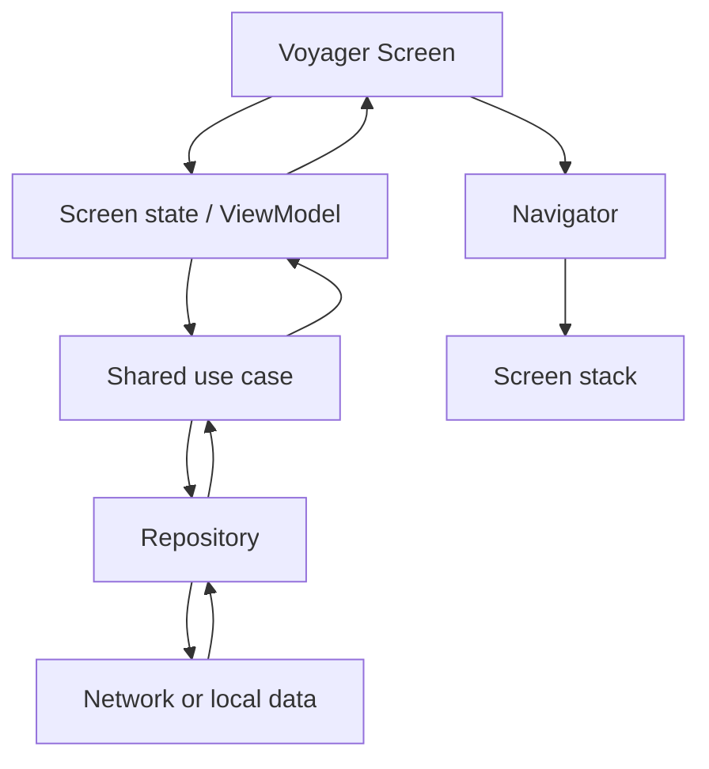
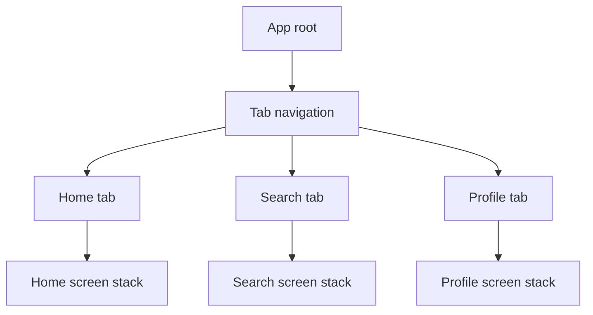
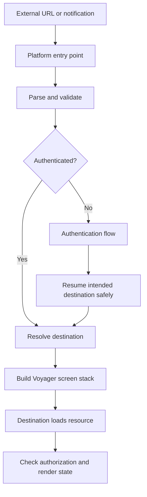

<div align="center">

# Chapter 15 — Navigation
## Part 5: Voyager

**Kotlin Multiplatform Tutorial Series**

Explore navigation with Voyager: a Kotlin-first navigation library designed for Compose Multiplatform applications, with screen-based navigation, transitions, tab navigation, and lifecycle-aware integration.


</div>

---

## Table of Contents

- [1. What Is Voyager?](#1-what-is-voyager)
- [2. Where Voyager Fits in KMP](#2-where-voyager-fits-in-kmp)
- [3. Core Concepts](#3-core-concepts)
- [4. Add Voyager Dependencies](#4-add-voyager-dependencies)
- [5. Create Your First Screen](#5-create-your-first-screen)
- [6. Set Up a Navigator](#6-set-up-a-navigator)
- [7. Navigate Between Screens](#7-navigate-between-screens)
- [8. Pass Data Between Screens](#8-pass-data-between-screens)
- [9. Back Navigation and Stack Operations](#9-back-navigation-and-stack-operations)
- [10. Screen Lifecycle and ViewModels](#10-screen-lifecycle-and-viewmodels)
- [11. Tabs and Nested Navigation](#11-tabs-and-nested-navigation)
- [12. Transitions and Presentation](#12-transitions-and-presentation)
- [13. Deep Links and External Entry Points](#13-deep-links-and-external-entry-points)
- [14. Dependency Injection](#14-dependency-injection)
- [15. Testing Voyager Navigation](#15-testing-voyager-navigation)
- [16. Common Mistakes](#16-common-mistakes)
- [17. Production Checklist](#17-production-checklist)
- [18. Summary](#18-summary)
- [References](#references)

---

## 1. What Is Voyager?

[Voyager](https://voyager.adriel.cafe/) is a navigation library for Compose Multiplatform. It models destinations as screen objects and provides navigation primitives for managing screen stacks, tabs, transitions, and screen lifecycle integration.

Voyager can be a useful fit when an application uses Compose UI across multiple targets and wants a Kotlin-first navigation model rather than maintaining separate navigation code for each platform.

Typical capabilities include:

- **Screen-based navigation** — represent a destination as a screen object.
- **Navigator** — push, pop, replace, or otherwise manipulate a screen stack.
- **Tab navigation** — organize independent sections of an app.
- **Transitions** — define how screens enter and leave.
- **Lifecycle integration** — connect screen lifecycles and supported ViewModel integrations.
- **Multiplatform orientation** — use a common navigation model with Compose Multiplatform, subject to the library version and supported targets.

Voyager is not a domain layer, routing backend, or replacement for authorization. It is a presentation/navigation tool.

> **Core principle:** Voyager owns the navigation stack. Shared domain code owns business rules. Screens render state and report user intent.

---

## 2. Where Voyager Fits in KMP

A KMP application should select navigation based on the UI architecture it intends to ship.

| Application approach | Voyager's role |
|---|---|
| Compose Multiplatform UI across supported targets | Can provide a shared navigation model |
| Android Compose UI with native SwiftUI on iOS | May be used on Android; iOS navigation can remain native |
| Shared domain with separate platform UIs | Usually unnecessary to share navigation implementation |
| Small single-screen shared UI | May be more abstraction than the app needs |

Voyager does not mean that all application code should move into `commonMain`. Keep platform APIs in platform-specific source sets, and confirm the exact library artifacts and target support for the version you choose.

### Recommended responsibility split



The navigation layer should not contain API calls, database operations, or business validation. A screen may invoke a ViewModel action; that ViewModel may call a use case; Voyager manages which screen is currently presented.

### Example source layout

```text
composeApp/
└── src/
    ├── commonMain/
    │   ├── navigation/
    │   │   ├── AppScreen.kt
    │   │   └── AppNavigation.kt
    │   ├── feature/
    │   │   ├── home/
    │   │   ├── product/
    │   │   └── profile/
    │   └── presentation/
    ├── androidMain/
    │   └── platform/
    └── iosMain/
        └── platform/

shared/
└── src/
    └── commonMain/
        ├── domain/
        ├── data/
        └── core/
```

This is one possible organization. Keep the navigation graph near the shared Compose UI when Voyager is used across targets; keep domain and data logic independent.

---

## 3. Core Concepts

Voyager uses a few concepts that are worth understanding before building a full navigation graph.

| Concept | Purpose |
|---|---|
| `Screen` | Represents a destination and renders its composable UI |
| `Navigator` | Manages the current screen stack |
| `Navigator` composable | Provides navigation context to descendants |
| `Tab` | Represents a top-level tab destination |
| `TabNavigator` | Coordinates tab selection and tab content |
| `ScreenModel` | Voyager's screen-state abstraction, when used |
| Lifecycle integration | Connects supported lifecycle-aware components to screen entry/exit |

The exact APIs and package names can vary between Voyager releases. Check the documentation for the version pinned by your project before adopting a snippet.

### Screen versus ViewModel

A `Screen` is a navigation destination, not a place to put all application logic. It should generally render UI and delegate behavior to a state holder or ViewModel.

A `ScreenModel` is a Voyager-provided state abstraction. It is not identical to Android's `ViewModel`, and it should not be assumed to have identical lifecycle semantics on every platform. Choose one state-management strategy deliberately and document how it is created, retained, and cleared.

---

## 4. Add Voyager Dependencies

Voyager is distributed as a set of artifacts. The exact modules required depend on whether the application needs core navigation, transitions, tabs, lifecycle integration, or a ViewModel integration.

Use the current installation guide as the source of truth:

- [Voyager — Getting Started](https://voyager.adriel.cafe/getting-started/)
- [Voyager — Setup](https://voyager.adriel.cafe/setup/)

A typical Gradle dependency setup may include the core navigation artifact and optional artifacts for features you actually use. Keep the version centralized in the project's version catalog or dependency management convention.

Example version-catalog shape:

```toml
[versions]
voyager = "YOUR_COMPATIBLE_VOYAGER_VERSION"

[libraries]
voyager-navigator = {
    module = "cafe.adriel.voyager:voyager-navigator",
    version.ref = "voyager"
}
```

Then use it in the appropriate Compose module:

```kotlin
dependencies {
    implementation(libs.voyager.navigator)
}
```

Replace the placeholder version with a version compatible with your Kotlin and Compose Multiplatform setup. Add tab, transition, or lifecycle artifacts only when required, using the coordinates documented for that release.

**Version note:** Do not mix snippets from different Voyager generations. Confirm the artifact names, imports, and lifecycle integration for the same release before copying code into a production project.

---

## 5. Create Your First Screen

A Voyager screen implements `Screen` and provides its UI through `Content()`.

```kotlin
import cafe.adriel.voyager.core.screen.Screen
import androidx.compose.material3.Button
import androidx.compose.material3.Text
import androidx.compose.runtime.Composable
import androidx.compose.foundation.layout.Column

class HomeScreen : Screen {

    @Composable
    override fun Content() {
        Column {
            Text("Home")

            Button(
                onClick = {
                    // Navigation is connected in the next section.
                }
            ) {
                Text("Open product")
            }
        }
    }
}
```

This screen is intentionally small. It renders UI and does not construct repositories, access a database, or make network calls.

### Prefer immutable screen arguments

A screen can carry simple information required to identify its destination:

```kotlin
data class ProductScreen(
    val productId: String
) : Screen {

    @Composable
    override fun Content() {
        Text("Product: $productId")
    }
}
```

For a screen used as a value in navigation, confirm the equality and serialization requirements of your selected Voyager version and restoration strategy. Keep constructor arguments stable and small.

Do not pass a live ViewModel, repository, database handle, or service object through a screen constructor. Obtain dependencies through the app's composition root or supported dependency-injection integration.

---

## 6. Set Up a Navigator

Voyager's `Navigator` composable establishes a navigation context for a screen stack.

```kotlin
import androidx.compose.runtime.Composable
import cafe.adriel.voyager.navigator.Navigator

@Composable
fun AppNavigation() {
    Navigator(HomeScreen())
}
```

The navigator displays the initial screen and allows child composables to access the navigation context using the supported Voyager API.

A simple application entry point can render the navigation root:

```kotlin
@Composable
fun App() {
    AppNavigation()
}
```

Keep this root stable. Avoid constructing independent root navigators inside every feature screen, since doing so creates separate stacks and makes back behavior difficult to reason about.

### Navigation context

A screen can access the current navigator through Voyager's navigator APIs. In common patterns, a composable uses the provided navigator context to push a destination.

The exact helper and import can differ by version, so keep all Voyager API calls consistent with the version in your build.

---

## 7. Navigate Between Screens

A common Voyager pattern is to obtain the current navigator and push a screen.

```kotlin
import androidx.compose.material3.Button
import androidx.compose.material3.Text
import androidx.compose.runtime.Composable
import cafe.adriel.voyager.core.screen.Screen
import cafe.adriel.voyager.navigator.LocalNavigator

class HomeScreen : Screen {

    @Composable
    override fun Content() {
        val navigator = LocalNavigator.current

        Button(
            onClick = {
                navigator?.push(ProductScreen(productId = "sku-123"))
            }
        ) {
            Text("Open product")
        }
    }
}
```

This example demonstrates the basic operation. In a larger codebase, prefer a clear boundary between the screen and navigation when that improves testability. For example, a feature composable can accept an `onOpenProduct` callback, and the Voyager screen can connect that callback to `navigator.push(...)`.

### Screen callbacks versus direct navigator access

Both approaches can be reasonable:

- **Direct navigator access:** convenient for simple screens and small projects.
- **Callbacks or navigation actions:** useful when feature UI should be independent from Voyager and easier to test.

Avoid passing the navigator deep into domain logic or repositories. Navigation should be triggered from the presentation boundary, based on user actions or well-defined application events.

### Replace instead of push

Pushing adds a destination on top of the current screen. Some flows should replace the current destination or clear earlier screens, such as completing onboarding or signing out.

Choose the correct stack operation for the flow. Do not use `push` for every transition by default, or users may return to screens that should no longer be reachable.

---

## 8. Pass Data Between Screens

A route should carry only the minimum information required to identify a destination. Voyager screen objects commonly express that information through constructor properties.

```kotlin
data class ProductScreen(
    val productId: String
) : Screen {

    @Composable
    override fun Content() {
        ProductRoute(productId = productId)
    }
}
```

The `ProductRoute` composable can connect to a ViewModel or state holder that loads the product.

### Prefer IDs over complete objects

Prefer:

```kotlin
ProductScreen(productId = product.id)
```

Avoid passing an entire mutable product response as a navigation argument when the destination can load the current product by ID.

Passing IDs helps with:

- Keeping navigation state lightweight.
- Avoiding stale object snapshots.
- Supporting state restoration.
- Handling missing or updated resources.
- Keeping feature dependencies explicit.

### Validate data at the destination

A route argument does not prove that the resource exists or that the current user has permission to access it. The destination should handle loading, success, empty, unavailable, and error states.

Never place passwords, access tokens, payment secrets, or other sensitive values in screen arguments or deep-link URLs.

---

## 9. Back Navigation and Stack Operations

Back navigation is one of the most visible parts of the user experience. Voyager's navigator manages the screen stack and provides operations to move backward or change the current stack.

### Pop the current screen

A destination can expose a back action that calls the appropriate Voyager pop operation:

```kotlin
@Composable
fun ProductContent(
    productId: String,
    onBack: () -> Unit
) {
    Column {
        Text("Product: $productId")

        Button(onClick = onBack) {
            Text("Back")
        }
    }
}
```

The Voyager screen can connect `onBack` to the navigator's supported pop API. This keeps the feature composable independently testable.

### Define stack behavior for important flows

| Flow | Typical navigation policy |
|---|---|
| Open product from a list | Push product |
| Return to previous screen | Pop current screen |
| Finish onboarding | Replace onboarding flow with main flow |
| Sign out | Clear protected screens and show authentication |
| Finish checkout | Remove intermediate checkout steps as required |
| Open a deep link | Build the stack that best matches the entry point |

Use the stack operations documented for your Voyager version. The exact API for replacing or clearing screens can differ, so do not copy an operation name from a different release without checking its documentation.

### Back handling is more than a button

Test hardware/system Back on Android, platform back gestures where supported, and the expected behavior when a modal or nested navigator is active. The visible back button, system Back, and a custom callback should not disagree about which stack they modify.

---

## 10. Screen Lifecycle and ViewModels

A screen may enter and leave the visible stack many times. Its UI state and dependencies need predictable ownership.

Voyager provides lifecycle-related integrations and supports different approaches to screen state, but the exact behavior depends on the selected artifact and library version.

### Keep the responsibilities separate

- **Voyager screen:** destination identity and composable content.
- **ScreenModel or ViewModel:** screen-level state and actions.
- **Use case:** application or domain operation.
- **Repository:** data access and coordination.
- **Navigation stack:** which destinations are currently active.

### A simple state-driven screen

```kotlin
data class ProductUiState(
    val isLoading: Boolean = true,
    val title: String? = null,
    val errorMessage: String? = null
)
```

The screen should render the state rather than owning all loading and repository logic directly.

```kotlin
@Composable
fun ProductContent(
    state: ProductUiState,
    onRetry: () -> Unit
) {
    when {
        state.isLoading -> {
            Text("Loading product…")
        }

        state.errorMessage != null -> {
            Column {
                Text(state.errorMessage)

                Button(onClick = onRetry) {
                    Text("Retry")
                }
            }
        }

        else -> {
            Text(state.title ?: "Product")
        }
    }
}
```

This is a UI-state illustration; connect it to your chosen shared ViewModel or ScreenModel implementation.

### Avoid lifecycle assumptions

Do not assume that a Voyager `ScreenModel`, Android `ViewModel`, and a common Kotlin state holder have identical lifecycle behavior. Verify:

- When the state holder is created.
- Whether it survives a configuration change or stack transition.
- When its resources and coroutines are cancelled.
- How it behaves on every supported target.
- Whether state restoration is supported and configured.

A screen leaving the visible area does not necessarily mean every operation should immediately stop. Define cancellation and retention policies for long-running work.

---

## 11. Tabs and Nested Navigation

Most production applications have top-level sections such as Home, Search, Orders, and Profile. Voyager provides tab-oriented navigation APIs for this style of UI.

A tab typically represents a top-level destination and supplies its content. A tab navigator coordinates which tab is active.

Conceptual structure:



The exact implementation uses Voyager's `Tab`, `TabNavigator`, and related APIs for the chosen release. Follow the official tab-navigation guide for imports and declarations.

### Design tab behavior first

Decide whether each tab should preserve its own navigation history. For example, a user might open a product from Home, switch to Profile, and return to Home expecting the product screen to remain visible.

Other apps may intentionally reset a tab to its root when it is selected again. Neither behavior is universal; implement the product's expected behavior and test it.

### Nested navigation

Nested flows may include:

- Authentication.
- Onboarding.
- Checkout.
- Multi-step forms.
- Settings.
- Product details.

Keep each flow's entry point and exit policy clear. Avoid deeply nested navigators unless they solve a real stack-ownership problem. Multiple navigators can be useful, but unclear ownership makes system Back behavior difficult to predict.

---

## 12. Transitions and Presentation

Voyager supports screen transitions through its navigation and transition APIs. Transitions should reinforce the navigation hierarchy rather than distract from the content.

Common patterns include:

- A horizontal transition for hierarchical push navigation.
- A reverse transition when returning.
- A subtle fade for a root-level flow change.
- A distinct presentation for a modal-style experience, when supported by the chosen integration.

The exact transition API and default behavior depend on the Voyager version. Check the current transition documentation before choosing a particular type or import.

### Transition guidelines

1. Keep transitions short and consistent.
2. Respect platform motion expectations.
3. Avoid combining several competing animations for one transition.
4. Ensure content remains readable during animation.
5. Test rapid navigation actions and repeated taps.
6. Consider reduced-motion accessibility preferences where applicable.

Do not put business logic inside animation callbacks. Navigation transitions are presentation behavior, not a place to perform payments, submit forms, or update durable application state.

---

## 13. Deep Links and External Entry Points

Deep links allow users to enter the application from a URL, notification, email, or another app. Voyager can manage the resulting screen stack, but receiving the external event is still a platform integration responsibility.

Typical entry points include:

- Android App Links and intent filters.
- iOS Universal Links and URL handling.
- Push notifications.
- In-app messages.
- Notification taps.

### A clean deep-link pipeline



### Keep platform registration outside common domain code

Android intent filters and iOS Universal Link setup belong in platform configuration. The platform layer can translate the incoming URL into a validated navigation request that the shared Compose layer understands.

### Validate every link

- Verify scheme, host, path, and expected parameters.
- Reject malformed identifiers.
- Confirm that the destination exists.
- Enforce authentication and resource authorization.
- Decide whether to push, replace, or reconstruct the stack.
- Handle cold-start and warm-start delivery.
- Never trust a URL as proof of permission.
- Do not include secrets or credentials in link parameters.

A deep link is an entry request, not an authorization grant.

---

## 14. Dependency Injection

Screens should not instantiate their own repositories, API clients, or database connections. Create application dependencies at a composition root and expose them through a deliberate dependency-injection mechanism.

Possible approaches include:

- Constructor factories.
- A DI framework that supports your KMP targets.
- A platform-owned app container.
- Voyager-compatible integration modules, when appropriate for the version.

### Keep construction separate from navigation

```text
Application entry point
        |
        v
Dependency container
        |
        +---- Shared repositories
        +---- Use cases
        +---- ViewModel / ScreenModel factories
        |
        v
Voyager navigation root
        |
        v
Feature screen
```

A screen should receive or resolve its presentation dependencies through the project's agreed pattern. Do not make every screen a service locator for arbitrary global objects.

### Scope dependencies intentionally

A repository may live for the application's lifetime, while a screen state holder may be scoped to a particular screen or flow. Align dependency scopes with actual ownership and lifecycle requirements.

For KMP, ensure that the DI library and its integration artifacts support every target in the project. A dependency working on Android does not automatically make it available in `commonMain` or iOS.

---

## 15. Testing Voyager Navigation

Test navigation at the level where each behavior belongs.

### 15.1 Test navigation decisions

If a coordinator or event mapper translates user actions into navigation commands, test those decisions independently from composables.

### 15.2 Test feature UI independently

Feature composables that accept callbacks are straightforward to preview and test:

```kotlin
@Composable
fun HomeContent(
    onOpenProduct: (String) -> Unit
) {
    Button(
        onClick = { onOpenProduct("sku-123") }
    ) {
        Text("Open product")
    }
}
```

A test can verify that the button invokes the expected callback. This does not require a real Voyager navigator.

### 15.3 Test navigation integration

Add integration or UI tests for:

- Opening a destination from the root screen.
- Returning with system Back.
- Passing the correct identifier.
- Repeated taps and duplicate destinations.
- Authentication-required links.
- Sign-out while a protected screen is visible.
- Tab switching and state retention.
- Restoring a stack when supported.
- Missing or deleted resources.

### Test-layer responsibilities

| Layer | What to test |
|---|---|
| `commonTest` | Shared business rules, use cases, repository logic, state transitions |
| Presentation unit tests | Event-to-navigation decisions and state mapping |
| Compose UI tests | Visible controls, screen rendering, callback behavior |
| Platform integration tests | URL delivery, system Back, lifecycle and deep-link entry |

Do not duplicate every common domain test in a Voyager UI test. Keep the test suite focused on the responsibilities of each layer.

---

## 16. Common Mistakes

### 16.1 Treating Voyager as a domain dependency

Domain logic should not import Voyager screen or navigator types. Use cases should return results or expose state; the presentation layer decides how to navigate.

### 16.2 Passing dependencies through screen constructors

Screen constructors should contain destination identity and lightweight arguments. Repositories, services, and live ViewModels should be created or supplied through the application's dependency-injection strategy.

### 16.3 Using one navigator for every unrelated flow

A single navigator can be sufficient for a small application. More complex apps may need distinct navigation ownership for tabs or flows. Choose deliberately and document how Back crosses those boundaries.

### 16.4 Assuming lifecycle behavior is identical on every target

Screen state, coroutine cancellation, and ViewModel integration can differ by platform and artifact. Test lifecycle behavior on every supported target.

### 16.5 Pushing on every state emission

Repeated emissions can create duplicate screens if navigation is triggered without an event policy. Distinguish persistent UI state from one-time navigation effects and make transitions idempotent where possible.

### 16.6 Passing entire domain objects as screen arguments

Large objects can become stale and make restoration harder. Pass stable identifiers and load current data at the destination.

### 16.7 Treating deep links as trusted

Validate the URL, authenticate the user, and authorize access to the requested resource. The navigation library does not replace security checks.

### 16.8 Adding abstractions without a concrete benefit

A custom navigator wrapper can help large teams and complex apps, but wrapping every library operation in a generic framework may make code harder to follow. Start with the simplest boundary that satisfies testability and ownership needs.

### 16.9 Mixing Voyager versions

Artifact coordinates, imports, lifecycle integrations, and APIs can change. Use one documented version consistently and compile examples against the project's actual dependency set.

### 16.10 Assuming a shared UI requires a shared navigation library

If iOS uses SwiftUI and Android uses Compose, native navigation on each platform may be the clearest choice. Share business behavior rather than forcing one presentation implementation onto both platforms.

---

## 17. Production Checklist

Before shipping a Voyager-based KMP application, verify the following:

- [ ] Voyager version is compatible with the project's Kotlin and Compose Multiplatform versions.
- [ ] Only the required Voyager artifacts are included.
- [ ] Navigation has one clear owner per stack or flow.
- [ ] Screen constructors contain stable, lightweight arguments.
- [ ] Feature UI is separated from repository and business logic.
- [ ] Navigation events are not triggered repeatedly by persistent state emissions.
- [ ] Back behavior is defined for root, nested, and modal-like flows.
- [ ] Tab state retention matches product expectations.
- [ ] Deep links are validated at the platform boundary.
- [ ] Protected destinations enforce session and authorization requirements.
- [ ] Sign-out clears or invalidates protected navigation history.
- [ ] ScreenModel/ViewModel lifecycle behavior is verified on each target.
- [ ] Shared code does not accidentally depend on platform-only APIs.
- [ ] State restoration behavior is understood and tested if enabled.
- [ ] Missing and deleted resources produce recoverable UI states.
- [ ] Navigation decisions have unit tests where appropriate.
- [ ] Important user journeys have Compose or platform UI tests.
- [ ] Accessibility and motion behavior are reviewed.
- [ ] Official documentation for the pinned Voyager version is part of the team's reference set.

---

## 18. Summary

Voyager provides a screen-based navigation model for Compose Multiplatform applications. It can simplify navigation by giving destinations a Kotlin representation and supplying primitives for stacks, tabs, transitions, and lifecycle integration.

Its value depends on clear architecture:

1. Let Voyager manage the presentation navigation stack.
2. Keep domain rules and data access outside navigation classes.
3. Pass stable identifiers rather than large mutable objects.
4. Choose one deliberate lifecycle and state-management strategy.
5. Treat deep links as untrusted entry points.
6. Verify library APIs and target support for the exact version you ship.
7. Test navigation behavior separately from shared business logic.

For applications that share Compose UI across platforms, Voyager can offer a common navigation model. For applications that use Compose on Android and SwiftUI on iOS, native navigation implementations may be a better fit. The right decision is the one that keeps platform behavior natural and architecture boundaries clear.

---

## References

Use the current official documentation for installation instructions, exact APIs, and version compatibility.

- [Voyager — Official Documentation](https://voyager.adriel.cafe/)
- [Voyager — Getting Started](https://voyager.adriel.cafe/getting-started/)
- [Voyager — Setup](https://voyager.adriel.cafe/setup/)
- [Voyager — Navigation](https://voyager.adriel.cafe/navigation/)
- [Voyager — Tab Navigation](https://voyager.adriel.cafe/tab-navigation/)
- [Voyager — Transitions](https://voyager.adriel.cafe/transitions/)
- [Kotlin Multiplatform — Share code between platforms](https://kotlinlang.org/docs/multiplatform-share-on-platforms.html)
- [Compose Multiplatform documentation](https://www.jetbrains.com/help/kotlin-multiplatform-dev/compose-multiplatform.html)

---

<div align="center">

**Chapter 15 · Navigation · Part 5 — Voyager**

*Screen-based navigation. Shared Compose UI. Clear architecture.*

</div>
