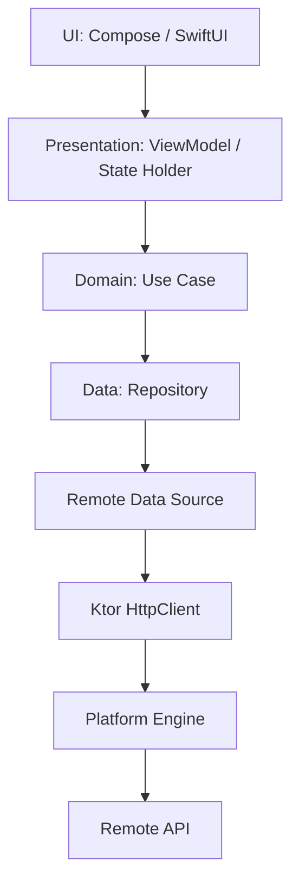
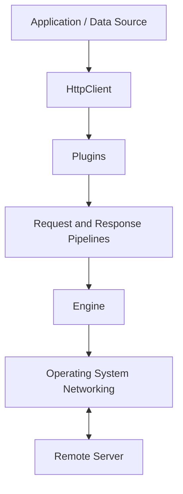
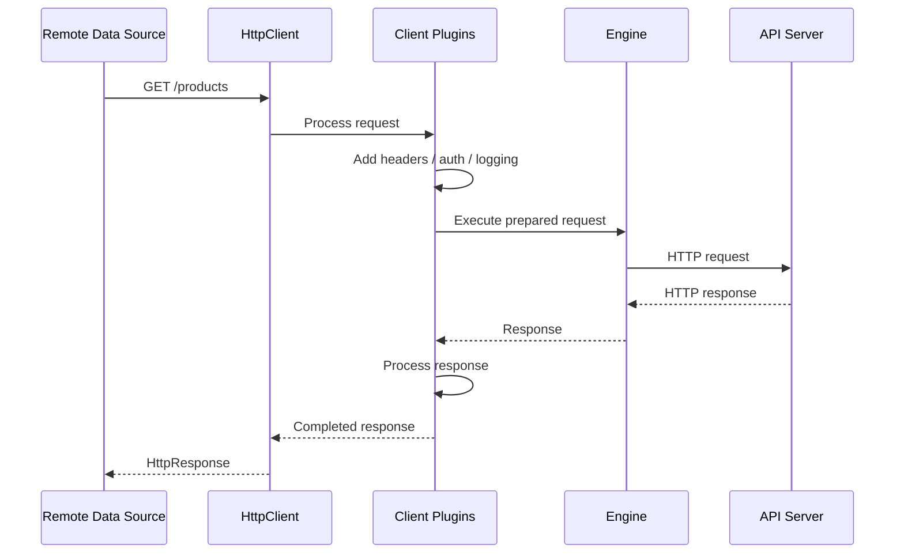
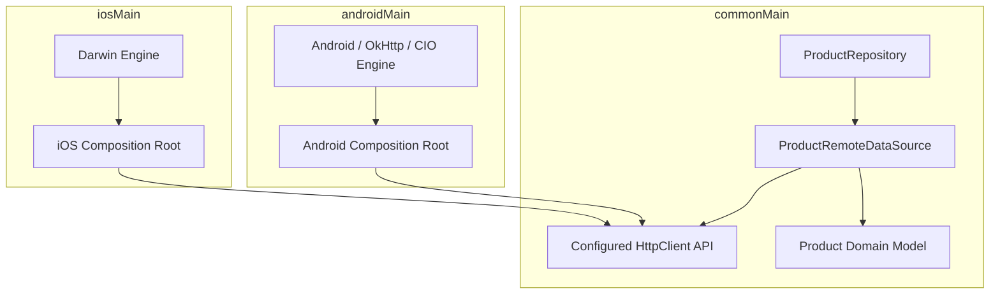

# Chapter 17 — Ktor Client

## Part 1 — The Parts: Understanding the Ktor Client Ecosystem

> **Series:** Kotlin Multiplatform (KMP) Architecture  
> **Chapter:** 17  
> **Part:** 1  
> **Focus:** HTTP fundamentals, Ktor Client architecture, engines, plugins, serialization, requests, responses, and multiplatform networking

---

## Table of Contents

- [1. Why Networking Needs an Architecture](#1-why-networking-needs-an-architecture)
- [2. What Is Ktor Client?](#2-what-is-ktor-client)
- [3. The Main Parts of Ktor Client](#3-the-main-parts-of-ktor-client)
- [4. Understanding the Request Pipeline](#4-understanding-the-request-pipeline)
- [5. HttpClient: The Central Entry Point](#5-httpclient-the-central-entry-point)
- [6. Engines: Platform-Specific Networking](#6-engines-platform-specific-networking)
- [7. Plugins: Extending Client Behaviour](#7-plugins-extending-client-behaviour)
- [8. Serialization and Content Negotiation](#8-serialization-and-content-negotiation)
- [9. Requests: Methods, URLs, Headers, and Bodies](#9-requests-methods-urls-headers-and-bodies)
- [10. Responses: Status, Headers, and Payloads](#10-responses-status-headers-and-payloads)
- [11. Timeouts, Retries, and Redirects](#11-timeouts-retries-and-redirects)
- [12. Authentication and Request Interception](#12-authentication-and-request-interception)
- [13. Logging and Observability](#13-logging-and-observability)
- [14. Error Handling as a Network Boundary](#14-error-handling-as-a-network-boundary)
- [15. Ktor Client in a KMP Architecture](#15-ktor-client-in-a-kmp-architecture)
- [16. A Practical Shared Client Setup](#16-a-practical-shared-client-setup)
- [17. Testing Network Code](#17-testing-network-code)
- [18. Common Mistakes](#18-common-mistakes)
- [19. Summary](#19-summary)

---

# 1. Why Networking Needs an Architecture

Almost every production application communicates with remote systems. A warehouse application may fetch picking tasks, a banking application may retrieve account information, and a commerce application may submit orders and track deliveries.

A network call looks simple:

```kotlin
val response = client.get("https://api.example.com/orders")
```

But production networking involves much more than sending a request:

- Creating requests and encoding parameters.
- Selecting the platform networking implementation.
- Serializing request and response bodies.
- Managing authentication and token refresh.
- Applying timeouts and safe retry policies.
- Mapping HTTP and transport failures.
- Protecting sensitive information in logs.
- Testing behaviour without a live backend.
- Sharing code across Android and iOS without leaking platform APIs.

Without clear boundaries, networking concerns spread into ViewModels, screens, and business logic. A maintainable architecture keeps these responsibilities in the networking and data layers. The domain layer should work with application concepts rather than HTTP details.



Ktor Client provides the HTTP communication layer. It does not replace repository design, domain modelling, or application error-handling decisions.

---

# 2. What Is Ktor Client?

Ktor Client is the asynchronous HTTP client provided by the Ktor framework. It allows Kotlin applications to make HTTP requests, process responses, and configure networking behaviour through a consistent API.

It is particularly useful in Kotlin Multiplatform because application code can share much of its networking implementation while using different engines on different platforms.

```kotlin
val response = httpClient.get("https://api.example.com/products")
```

The selected engine performs the platform-specific network operation.

## Ktor Client at a glance

| Capability | Responsibility |
|---|---|
| `HttpClient` | Main API used to execute HTTP requests |
| Engine | Performs actual network I/O on a platform |
| Plugins | Add reusable behaviour such as logging and authentication |
| Content negotiation | Converts supported payload formats to and from Kotlin objects |
| Serialization | Encodes and decodes structured data |
| Request builder | Configures method, URL, headers, parameters, and body |
| Response API | Exposes status, headers, and response content |
| Mock engine | Supports deterministic HTTP tests |

Ktor Client is modular. Applications can start with a small configuration and add capabilities as requirements grow.

---

# 3. The Main Parts of Ktor Client

A useful way to understand Ktor is to separate the responsibilities of its major parts.



## 3.1 HttpClient

`HttpClient` is the central object used to execute requests. It is configured with an engine and optional plugins.

```kotlin
val client = HttpClient {
    // Engine and plugin configuration
}
```

## 3.2 Engine

The engine connects Ktor's common client API to a platform-specific HTTP implementation.

Common choices include:

- Android/JVM: CIO, OkHttp, or Android engine, depending on project requirements.
- iOS: Darwin engine.
- JavaScript: JavaScript engine.
- WebAssembly: support depends on the target and Ktor version.

## 3.3 Plugins

Plugins add capabilities around requests and responses. Common examples include `ContentNegotiation`, `Logging`, `HttpTimeout`, `HttpRequestRetry`, `Auth`, `HttpCookies`, and `DefaultRequest`.

## 3.4 Serialization

Serialization maps between Kotlin types and wire formats such as JSON.

```kotlin
@Serializable
data class ProductDto(
    val id: String,
    val name: String,
    val price: Double
)
```

## 3.5 Request and response APIs

The request API configures the outgoing HTTP message. The response API provides access to the status, headers, and body returned by the server.

---

# 4. Understanding the Request Pipeline

Ktor Client uses pipelines and plugins to provide extensible request and response processing. A request passes through configured plugin behaviour before reaching the engine. The response travels back through response-processing phases.



This is a simplified conceptual flow. Actual phases and ordering depend on installed plugins and the Ktor version.

## Why the pipeline matters

The pipeline makes cross-cutting behaviour reusable. Without it, each API method might need to implement its own authentication, logging, timeout configuration, JSON conversion, and error handling.

Keep business rules out of the pipeline. Plugins should handle HTTP-level behaviour. Decisions such as whether an order can be cancelled belong in application or domain logic.

---

# 5. HttpClient: The Central Entry Point

`HttpClient` is the main API used to send requests. It can be configured with an engine and plugins.

```kotlin
val httpClient = HttpClient {
    // Configure required plugins
}
```

A client with JSON support:

```kotlin
val httpClient = HttpClient {
    install(ContentNegotiation) {
        json()
    }
}
```

The example assumes the required Ktor client and serialization dependencies are added to the relevant source set.

## Reuse the client

Creating a new client for every API call is usually a poor design. A reusable client can retain its configured engine and connection-related resources. It also provides one place to manage common networking behaviour.

```kotlin
class ProductRemoteDataSource(
    private val client: HttpClient
)
```

The composition root creates the client and injects it into the remote data source.

## Close the client when its owner ends

`HttpClient` can own resources. Its lifecycle should be managed deliberately. When the application or scope that owns the client is permanently disposed, close it using the API supported by the Ktor version in use.

Do not close a shared application client after every request.

---

# 6. Engines: Platform-Specific Networking

The engine performs the actual network operation. Ktor provides a common API while engines integrate with platform networking capabilities.

## 6.1 CIO

CIO is a coroutine-based engine available for JVM-oriented targets and other supported configurations.

```kotlin
val client = HttpClient(CIO) {
    // Shared client configuration
}
```

## 6.2 OkHttp

The OkHttp engine integrates Ktor Client with OkHttp on supported JVM and Android configurations.

```kotlin
val client = HttpClient(OkHttp) {
    // Configure Ktor plugins
}
```

It can be appropriate when an Android application already relies on OkHttp capabilities or needs compatibility with existing OkHttp infrastructure.

## 6.3 Android engine

Ktor also provides an Android engine for Android-specific networking integration.

```kotlin
val client = HttpClient(Android) {
    // Configure Ktor plugins
}
```

## 6.4 Darwin

Darwin uses Apple's networking stack and is intended for Apple platforms.

```kotlin
val client = HttpClient(Darwin) {
    // Configure Ktor plugins
}
```

## Engine comparison

| Engine | Typical target | Considerations |
|---|---|---|
| CIO | JVM and supported multiplatform targets | Ktor-native coroutine-based engine |
| OkHttp | Android/JVM | Useful when OkHttp integration is required |
| Android | Android | Integrates with Android networking |
| Darwin | iOS and Apple platforms | Uses Apple's networking stack |
| JS | JavaScript targets | Uses browser or platform networking facilities |

Engine availability, configuration options, and supported targets can change across Ktor releases. Verify the engine artifact and target compatibility for the version selected by the project.

## Keep engine selection at the platform boundary

Do not make shared business logic decide which engine to use. The platform composition root should select the engine and provide the configured client to shared code.

---

# 7. Plugins: Extending Client Behaviour

Ktor plugins provide reusable features that integrate with the client pipeline.

```kotlin
val client = HttpClient {
    install(ContentNegotiation) {
        json()
    }
}
```

The exact plugin APIs and options should be checked against the Ktor version used by the project.

| Plugin | Purpose |
|---|---|
| `ContentNegotiation` | Converts request and response bodies using configured converters |
| `Logging` | Logs request and response information |
| `HttpTimeout` | Configures request, connection, and socket timeouts |
| `HttpRequestRetry` | Configures retry behaviour |
| `Auth` | Supports authentication mechanisms such as bearer authentication |
| `HttpCookies` | Manages cookies |
| `DefaultRequest` | Adds common request defaults |
| `UserAgent` | Configures the User-Agent header |
| `WebSockets` | Adds WebSocket communication support |

Installing every available plugin increases configuration surface area and can make request behaviour harder to understand. Configure only the capabilities the application needs.

Retry behaviour, in particular, must respect request semantics. Automatically retrying a payment or order-creation request can create duplicate operations if the server does not support idempotency.

---

# 8. Serialization and Content Negotiation

HTTP payloads are transmitted as bytes. Application code generally works with Kotlin objects. Serialization bridges these representations.

## 8.1 Define a serializable DTO

```kotlin
@Serializable
data class ProductDto(
    val id: String,
    val name: String,
    val price: Double
)
```

The `@Serializable` annotation is provided by Kotlin serialization.

## 8.2 Configure JSON support

```kotlin
val client = HttpClient {
    install(ContentNegotiation) {
        json(
            Json {
                ignoreUnknownKeys = true
                isLenient = false
                encodeDefaults = true
            }
        )
    }
}
```

These options are examples, not universal defaults:

- `ignoreUnknownKeys` can make clients tolerant of additional server fields.
- `isLenient` controls acceptance of non-standard JSON syntax.
- `encodeDefaults` controls whether default-valued properties are encoded.

Choose settings based on the API contract. Lenient parsing should not replace a well-defined backend payload.

## 8.3 Deserialize a response

```kotlin
val product: ProductDto =
    client.get("https://api.example.com/products/42").body()
```

The `body()` call uses the configured response converter to decode the payload into the requested type.

## 8.4 Serialize a request body

```kotlin
@Serializable
data class CreateProductRequest(
    val name: String,
    val price: Double
)

val response = client.post("https://api.example.com/products") {
    contentType(ContentType.Application.Json)
    setBody(
        CreateProductRequest(
            name = "Keyboard",
            price = 79.99
        )
    )
}
```

Content negotiation and serialization reduce repetitive manual JSON conversion and keep DTO handling consistent.

## DTOs are not domain models

A backend response is an external contract. It may contain nullable fields, backend naming conventions, or values that do not match the application's domain language.

Map network DTOs into domain models at the data boundary rather than leaking API response types throughout the application.

---

# 9. Requests: Methods, URLs, Headers, and Bodies

An HTTP request contains a method, URL, headers, optional query parameters, and sometimes a body.

## 9.1 HTTP methods

```kotlin
client.get("/products")
client.post("/products")
client.put("/products/42")
client.patch("/products/42")
client.delete("/products/42")
```

| Method | Typical purpose |
|---|---|
| GET | Retrieve a resource |
| POST | Submit data or request processing |
| PUT | Replace a resource representation |
| PATCH | Partially update a resource |
| DELETE | Request resource deletion |

The server defines the actual API contract. Do not assume every backend follows idealized REST semantics.

## 9.2 Configure a base URL

`DefaultRequest` can define a common URL prefix and default headers.

```kotlin
val client = HttpClient {
    install(DefaultRequest) {
        url("https://api.example.com/")
        header(HttpHeaders.Accept, ContentType.Application.Json)
    }
}
```

Then request paths can be relative to that configured base URL:

```kotlin
val response = client.get("products")
```

Be deliberate about trailing slashes and URL resolution. For complex APIs, use Ktor's URL builder APIs.

## 9.3 Query parameters

```kotlin
val response = client.get("products") {
    parameter("category", "electronics")
    parameter("page", 2)
    parameter("pageSize", 20)
}
```

This is safer and more readable than manually concatenating query strings, especially when values contain reserved characters.

## 9.4 Headers

```kotlin
val response = client.get("profile") {
    header(HttpHeaders.Accept, ContentType.Application.Json)
    header("X-Client-Version", "2.4.0")
}
```

Use standard header constants where available. Keep custom header names consistent with the backend contract.

## 9.5 Request body

```kotlin
val response = client.post("orders") {
    contentType(ContentType.Application.Json)
    setBody(
        CreateOrderRequest(
            productId = "P-100",
            quantity = 3
        )
    )
}
```

The request body type must be supported by the installed content converter or another configured body mechanism.

---

# 10. Responses: Status, Headers, and Payloads

A successful network exchange does not necessarily mean the server accepted the business operation. Interpret the response status and body.

```kotlin
val response: HttpResponse =
    client.get("products/42")

val statusCode = response.status.value
val contentType = response.headers[HttpHeaders.ContentType]
```

## 10.1 Read a typed body

```kotlin
val product: ProductDto = response.body()
```

This requires a compatible content converter and a response payload matching the expected DTO.

## 10.2 Check status codes

| Range | Meaning |
|---|---|
| 2xx | Successful response |
| 3xx | Redirection |
| 4xx | Client-side request or authorization problem |
| 5xx | Server-side failure |

Examples include `200 OK`, `201 Created`, `204 No Content`, `400 Bad Request`, `401 Unauthorized`, `403 Forbidden`, `404 Not Found`, `409 Conflict`, `429 Too Many Requests`, `500 Internal Server Error`, and `503 Service Unavailable`.

The application should map these responses according to the backend contract.

## 10.3 Understand `expectSuccess`

Ktor's `expectSuccess` setting controls whether non-success HTTP status codes are treated as exceptions by the client.

```kotlin
val client = HttpClient {
    expectSuccess = true
}
```

With this behaviour, non-success responses can raise Ktor response exceptions. If the application needs to inspect error response bodies and map them into its own error model, handle those exceptions at the remote data source boundary.

Alternatively, inspect `response.status` directly and implement explicit status mapping. Choose one consistent approach rather than mixing styles unpredictably.

## 10.4 A response is not a domain result

Avoid returning `HttpResponse` from repositories or use cases. Convert it into a domain result or a data-layer result that the rest of the application understands.

---

# 11. Timeouts, Retries, and Redirects

Network calls can be delayed, interrupted, or redirected. These behaviours should be explicit.

## 11.1 Timeouts

```kotlin
val client = HttpClient {
    install(HttpTimeout) {
        requestTimeoutMillis = 30_000
        connectTimeoutMillis = 10_000
        socketTimeoutMillis = 30_000
    }
}
```

The values are illustrative. Choose limits based on the operation, backend behaviour, user experience, and platform constraints.

- **Request timeout:** maximum duration for the overall request.
- **Connection timeout:** time allowed to establish a connection.
- **Socket timeout:** time allowed for socket activity.

Not every engine supports every timeout in exactly the same way. Confirm engine-specific behaviour.

## 11.2 Retries

A retry policy may help with transient failures such as selected server errors or connection problems. However, retries must account for request semantics.

Potentially safe candidates:
- Idempotent GET requests.
- Operations with a server-supported idempotency key.
- Requests where the backend explicitly documents retry behaviour.

Potentially unsafe candidates:
- Payment submission.
- Order creation without idempotency protection.
- Inventory updates that may be applied more than once.

A retry policy should define which failures are retryable, maximum attempts, backoff, whether `Retry-After` is respected, and which operations are safe to repeat.

## 11.3 Redirects

Understand redirect behaviour when authentication, API gateways, or environment routing are involved. Be particularly careful about forwarding sensitive headers across origins. Confirm the engine and Ktor redirect behaviour for the version in use.

---

# 12. Authentication and Request Interception

Most protected APIs require credentials or access tokens. Authentication should be centralized rather than duplicated across every API call.

Ktor's `Auth` plugin supports common authentication flows, including bearer authentication.

```kotlin
val client = HttpClient {
    install(Auth) {
        bearer {
            loadTokens {
                // Load the current token from a token provider.
                null
            }

            refreshTokens {
                // Refresh credentials using the application's
                // refresh-token strategy.
                null
            }
        }
    }
}
```

The `null` values are placeholders, not a working authentication implementation. Production code must connect to a secure token provider and define refresh behaviour.

## Authentication responsibilities

A robust design should decide:

1. Where access tokens are stored.
2. How tokens are read safely.
3. How refresh is coordinated when multiple requests fail together.
4. What happens when refresh fails.
5. How sign-out invalidates session state.
6. How tokens are prevented from appearing in logs.

Repositories should not manually attach tokens to every request. The client configuration or a dedicated authentication layer should own this cross-cutting concern.

Ktor plugins can modify requests and observe responses. Use them for reusable HTTP-level behaviour, but avoid putting business-specific decisions into a global interceptor.

---

# 13. Logging and Observability

Networking logs are useful for diagnosing failures, but they can expose sensitive information.

```kotlin
val client = HttpClient {
    install(Logging) {
        logger = Logger.DEFAULT
        level = LogLevel.HEADERS
    }
}
```

The exact logger and level depend on the platform and Ktor version.

| Level | Typical information |
|---|---|
| `NONE` | No logging |
| `INFO` | High-level request information |
| `HEADERS` | Request and response headers |
| `BODY` | Request and response bodies |
| `ALL` | Broad request and response details |

Never casually log authorization headers, access or refresh tokens, passwords, payment details, personal or health information, or sensitive request and response bodies.

Use header sanitization and carefully selected log levels. Production logging should be designed around privacy and operational needs, not simply enabled at the most verbose level.

Useful network telemetry may include endpoint or route template, HTTP method, status code, duration, retry count, failure category, and correlation or trace identifier. Avoid logging raw URLs when query parameters may contain sensitive values.

---

# 14. Error Handling as a Network Boundary

Network failures are not all the same. A useful data layer distinguishes transport failures, HTTP failures, serialization failures, and unexpected application errors.

```kotlin
sealed interface NetworkError {
    data object NoConnection : NetworkError
    data object Timeout : NetworkError
    data class HttpFailure(
        val code: Int,
        val message: String?
    ) : NetworkError
    data object SerializationFailure : NetworkError
    data class Unknown(
        val cause: Throwable
    ) : NetworkError
}
```

This model is illustrative. Production code should decide whether to retain throwable causes, how much server detail to expose, and how to represent cancellation.

## Map errors at the remote boundary

```kotlin
suspend fun loadProducts(): Result<List<ProductDto>> {
    return try {
        val products: List<ProductDto> =
            client.get("products").body()

        Result.success(products)
    } catch (exception: CancellationException) {
        throw exception
    } catch (exception: Throwable) {
        Result.failure(exception)
    }
}
```

This demonstrates cancellation propagation. It does not yet map failures into `NetworkError`. Production code should catch and classify known exception types rather than treating every failure as indistinguishable.

## Do not swallow cancellation

Coroutine cancellation is part of structured concurrency. If a request is cancelled because a screen is gone or a parent job has ended, do not convert cancellation into an ordinary network error.

```kotlin
catch (exception: CancellationException) {
    throw exception
}
```

The UI should receive meaningful states such as content loaded, authentication required, network unavailable, request timed out, resource not found, or operation could not be completed. It should not need to understand Ktor's internal exception hierarchy.

---

# 15. Ktor Client in a KMP Architecture

One of Ktor Client's major advantages is that common networking code can be shared across supported Kotlin targets.

```text
shared/
├── commonMain/
│   ├── domain/
│   ├── data/
│   │   ├── model/
│   │   ├── remote/
│   │   └── repository/
│   └── di/
├── androidMain/
│   └── di/
└── iosMain/
    └── di/
```

## Shared responsibilities

`commonMain` can contain:
- DTOs and serialization models.
- API service or remote data source classes.
- Repository implementations.
- Shared `HttpClient` configuration where portable.
- Error mapping.
- Domain-facing repository contracts.

## Platform responsibilities

Platform source sets can provide:
- Engine selection.
- Platform-specific engine configuration.
- Platform-specific secure storage.
- Platform-specific logging integrations.
- Platform-specific network policy or certificate configuration where required.



The diagram represents the dependency relationship, not a literal source-code declaration. Shared client configuration must be constructed using an engine available to the selected target.

A shared repository should not need to know whether the request was executed by Darwin, OkHttp, or CIO. That decision belongs to the composition boundary.

---

# 16. A Practical Shared Client Setup

The following example shows a common configuration function that installs JSON support and timeouts. The engine is supplied by the platform.

```kotlin
fun createHttpClient(
    engine: HttpClientEngine
): HttpClient {
    return HttpClient(engine) {
        expectSuccess = false

        install(ContentNegotiation) {
            json(
                Json {
                    ignoreUnknownKeys = true
                    encodeDefaults = true
                }
            )
        }

        install(HttpTimeout) {
            requestTimeoutMillis = 30_000
            connectTimeoutMillis = 10_000
            socketTimeoutMillis = 30_000
        }

        install(DefaultRequest) {
            header(
                HttpHeaders.Accept,
                ContentType.Application.Json
            )
        }
    }
}
```

This is a shared configuration pattern. Add imports and engine dependencies for the Ktor version and targets used by the project.

A platform composition root supplies its engine:

```kotlin
// Android source set
fun createAndroidHttpClient(): HttpClient {
    return createHttpClient(
        engine = OkHttp.create()
    )
}
```

```kotlin
// iOS source set
fun createIosHttpClient(): HttpClient {
    return createHttpClient(
        engine = Darwin.create()
    )
}
```

The exact engine factory API can vary with the Ktor version and artifact. Keep these calls aligned with the dependencies used by the project.

## Inject the client into the remote data source

```kotlin
class ProductRemoteDataSource(
    private val client: HttpClient
) {
    suspend fun getProducts(): List<ProductDto> {
        return client
            .get("https://api.example.com/products")
            .body()
    }
}
```

For a larger application, centralize the base URL and avoid hardcoding full URLs in every data source.

## Repository boundary

```kotlin
interface ProductRepository {
    suspend fun getProducts(): List<Product>
}

class ProductRepositoryImpl(
    private val remoteDataSource: ProductRemoteDataSource
) : ProductRepository {

    override suspend fun getProducts(): List<Product> {
        return remoteDataSource.getProducts().map { dto ->
            Product(
                id = dto.id,
                title = dto.name,
                price = dto.price
            )
        }
    }
}
```

The domain-facing repository returns a domain model, not a Ktor response or transport DTO.

---

# 17. Testing Network Code

Network code should be testable without depending on a live backend. Ktor provides a mock engine that allows tests to define responses and inspect outgoing requests.

```kotlin
@Test
fun `get products sends request to expected path`() = runTest {
    val mockEngine = MockEngine { request ->
        assertEquals("/products", request.url.encodedPath)

        respond(
            content = ByteReadChannel(
                """[{"id":"P-1","name":"Keyboard","price":79.99}]"""
            ),
            status = HttpStatusCode.OK,
            headers = headersOf(
                HttpHeaders.ContentType,
                ContentType.Application.Json.toString()
            )
        )
    }

    val client = HttpClient(mockEngine) {
        install(ContentNegotiation) {
            json()
        }
    }

    try {
        val products: List<ProductDto> =
            client.get("https://test.example.com/products").body()

        assertEquals("P-1", products.first().id)
    } finally {
        client.close()
    }
}
```

This example requires the Ktor mock-engine and serialization dependencies, plus the relevant test imports for the selected Ktor version.

## What to test

- Correct HTTP method and path.
- Query parameter encoding.
- Required headers.
- Request body serialization.
- Response deserialization.
- Non-success status handling.
- Timeout and retry policies where practical.
- Authentication behaviour without exposing real credentials.
- Error mapping and cancellation propagation.

Do not make unit tests depend on a live service, real access tokens, or unpredictable network conditions. Use a mock engine for HTTP-level behaviour and fakes for repository-level business tests.

---

# 18. Common Mistakes

| Mistake | Why it is a problem | Better approach |
|---|---|---|
| Creating a client for every request | Wastes resources and fragments configuration | Reuse a lifecycle-managed client |
| Putting Ktor calls in ViewModels | Couples presentation to transport details | Use a repository or remote data source |
| Returning `HttpResponse` to domain code | Leaks HTTP concerns across layers | Map to domain or application results |
| Hardcoding URLs in every method | Makes environment changes difficult | Centralize base URL configuration |
| Logging full request bodies in production | Can expose private information | Redact sensitive values and use safe levels |
| Retrying every failed request | May duplicate non-idempotent operations | Retry only under an explicit policy |
| Swallowing cancellation | Breaks coroutine lifecycle behaviour | Rethrow `CancellationException` |
| Using DTOs as domain models | Couples business logic to backend contracts | Map DTOs to domain models |
| Selecting an engine in common business logic | Introduces platform coupling | Select engines in platform composition roots |
| Ignoring client cleanup | Can retain resources unnecessarily | Assign ownership and close at the right lifecycle boundary |
| Assuming singleton means thread-safe | Shared mutable state can race | Define concurrency guarantees explicitly |

---

# 19. Summary

Ktor Client gives Kotlin applications a flexible HTTP client with a consistent API and a modular plugin system. In Kotlin Multiplatform, it allows teams to share much of the networking and data-layer implementation while selecting suitable engines for each platform.

The key parts to understand are:

1. **`HttpClient`:** the central object used to execute requests.
2. **Engines:** platform-specific implementations that perform network I/O.
3. **Plugins:** reusable features for authentication, logging, timeouts, retries, and defaults.
4. **Content negotiation and serialization:** conversion between Kotlin objects and wire formats.
5. **Request APIs:** methods, URLs, query parameters, headers, and bodies.
6. **Response APIs:** status codes, headers, and typed payloads.
7. **Error boundaries:** mapping transport failures into application-friendly results.
8. **KMP composition roots:** selecting platform engines without leaking platform details into shared business logic.
9. **Mock engine:** testing HTTP behaviour without a live backend.

The important architectural principle is simple: **Ktor should handle HTTP communication, while the application's data and domain layers decide what that communication means.**

> **A good networking layer does more than call APIs. It isolates the application from transport complexity and keeps platform differences at the boundary.**

---

<div align="center">

### Chapter 17 · Part 1

**Ktor Client — The Parts**

*One Kotlin API. Pluggable networking. Shared multiplatform architecture.*

</div>
