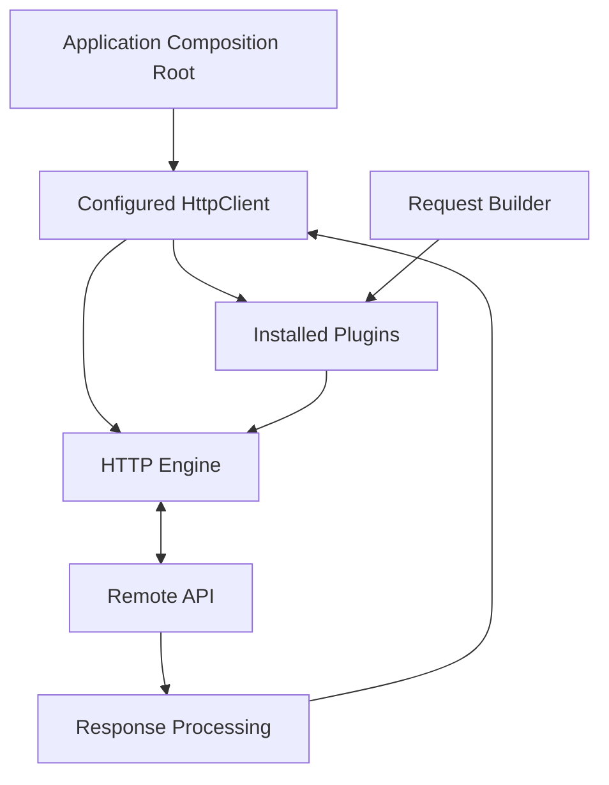
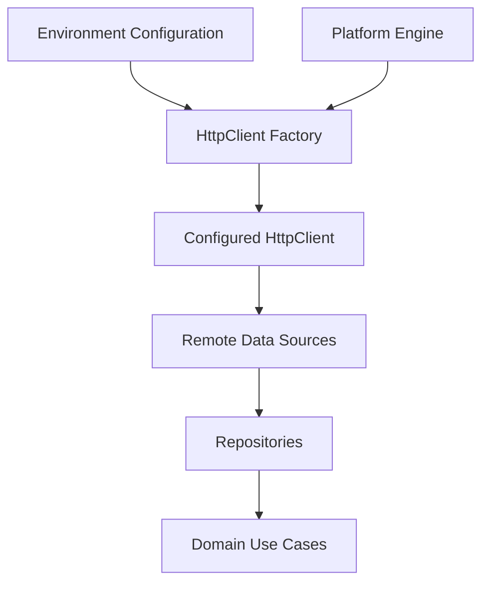

# Chapter 17 — Ktor Client

## Part 2 — HttpClient: The Heart of Ktor Networking

> **Series:** Kotlin Multiplatform (KMP) Architecture  
> **Chapter:** 17  
> **Part:** 2  
> **Focus:** HttpClient lifecycle, configuration, engines, plugins, request execution, dependency injection, platform setup, and production design

---

## Table of Contents

- [1. HttpClient Is More Than a Request Sender](#1-httpclient-is-more-than-a-request-sender)
- [2. Understanding the HttpClient Object](#2-understanding-the-httpclient-object)
- [3. Creating an HttpClient](#3-creating-an-httpclient)
- [4. Choosing and Supplying an Engine](#4-choosing-and-supplying-an-engine)
- [5. Configuring the Client](#5-configuring-the-client)
- [6. Installing Plugins](#6-installing-plugins)
- [7. Default Request Configuration](#7-default-request-configuration)
- [8. Executing Requests](#8-executing-requests)
- [9. Understanding HttpResponse](#9-understanding-httpresponse)
- [10. Managing Client Lifecycle](#10-managing-client-lifecycle)
- [11. HttpClient in Kotlin Multiplatform](#11-httpclient-in-kotlin-multiplatform)
- [12. Injecting HttpClient with Dependency Injection](#12-injecting-httpclient-with-dependency-injection)
- [13. Multiple HttpClient Instances](#13-multiple-httpclient-instances)
- [14. Testing HttpClient Configuration](#14-testing-httpclient-configuration)
- [15. Production-Ready Client Design](#15-production-ready-client-design)
- [16. Common Mistakes](#16-common-mistakes)
- [17. Summary](#17-summary)

---

# 1. HttpClient Is More Than a Request Sender

In a small example, an HTTP client may look like a simple object:

```kotlin
val response = client.get("https://api.example.com/products")
```

In a production application, however, the client is responsible for much more than executing a request. It is the central place where the networking behaviour of an application is assembled.

A configured `HttpClient` can coordinate:

- The engine that performs network I/O.
- Request and response pipeline processing.
- JSON serialization and deserialization.
- Common headers and URL defaults.
- Authentication and token refresh.
- Connection, socket, and request timeouts.
- Logging and request diagnostics.
- Redirect and retry behaviour.
- Response validation and error handling.

This makes `HttpClient` an important infrastructure dependency. It should be configured deliberately, owned by a clear lifecycle, and injected into the components that need to communicate with remote services.



The client is infrastructure. It should not become a place for business rules such as calculating order totals, deciding whether a warehouse task can be completed, or determining whether a user is allowed to perform an operation.

---

# 2. Understanding the HttpClient Object

`HttpClient` is the main entry point for making HTTP requests with Ktor Client.

It provides a consistent API regardless of the underlying engine:

```kotlin
val response = httpClient.get("/products")
```

The engine determines how that request is executed on the current platform. Plugins extend how requests and responses are processed.

## 2.1 The client has configuration and runtime responsibilities

It is useful to think about the client in two stages.

| Stage | Responsibility |
|---|---|
| Construction | Select engine, install plugins, configure defaults |
| Runtime | Execute requests, process responses, manage network resources |

Configuration should normally happen at an application or platform composition boundary. Runtime request execution happens in remote data sources or API clients.

## 2.2 The client is reusable

A configured client is generally intended to be reused. Reusing it avoids repeatedly constructing networking infrastructure and ensures common behaviour is applied consistently.

```kotlin
class ProductRemoteDataSource(
    private val httpClient: HttpClient
) {
    suspend fun getProducts(): List<ProductDto> {
        return httpClient
            .get("products")
            .body()
    }
}
```

The remote data source receives an already-configured client. It does not need to know how the engine was selected or which logging and timeout plugins were installed.

## 2.3 Keep the abstraction at the correct level

Ktor's `HttpClient` is a concrete infrastructure type. It is perfectly reasonable for a data-layer remote source to depend on it.

The domain layer should not depend on `HttpClient`, `HttpRequestBuilder`, `HttpResponse`, or Ktor exception types. Those are transport details.

---

# 3. Creating an HttpClient

The simplest client can be created with the default constructor:

```kotlin
val httpClient = HttpClient()
```

For a real application, configure the engine and required plugins explicitly.

## 3.1 Client with JSON support

```kotlin
val httpClient = HttpClient {
    install(ContentNegotiation) {
        json()
    }
}
```

This enables the configured JSON converter for request and response bodies.

## 3.2 Client with an explicit engine

```kotlin
val httpClient = HttpClient(CIO) {
    install(ContentNegotiation) {
        json()
    }
}
```

Here, CIO is selected as the engine. The engine dependency must be available in the source set where this code is compiled.

## 3.3 Keep configuration in one factory

For a larger application, avoid scattering client configuration across multiple feature classes.

```kotlin
fun createHttpClient(
    engine: HttpClientEngine
): HttpClient {
    return HttpClient(engine) {
        install(ContentNegotiation) {
            json()
        }

        expectSuccess = false
    }
}
```

This function creates a client with shared behaviour while allowing the platform to supply its engine.

The example is intentionally small. Production configuration can add timeouts, safe logging, authentication, and other required plugins.

## 3.4 Avoid hidden configuration

A client factory should make important choices visible. Avoid reading unrelated global variables or silently selecting environments deep inside the networking layer.

Prefer explicit configuration:

```kotlin
data class ApiConfig(
    val baseUrl: String,
    val requestTimeoutMillis: Long
)
```

Then pass `ApiConfig` into the client factory or a focused configuration component.

---

# 4. Choosing and Supplying an Engine

An engine performs the actual network operations. `HttpClient` provides the common API; the engine integrates that API with the platform's networking implementation.

Common engine choices include:

| Engine | Typical use |
|---|---|
| CIO | Ktor-native coroutine-based engine for supported targets |
| OkHttp | Android/JVM projects that need OkHttp integration |
| Android | Android-specific networking integration |
| Darwin | Apple platforms, including iOS |
| JS | JavaScript targets |

The available engines and exact APIs depend on the Ktor release and target configuration.

## 4.1 Supply the engine to a shared factory

A shared factory can accept an `HttpClientEngine`:

```kotlin
fun createSharedHttpClient(
    engine: HttpClientEngine
): HttpClient {
    return HttpClient(engine) {
        // Shared plugins and defaults
    }
}
```

This separates portable client configuration from platform-specific engine selection.

## 4.2 Android engine selection

An Android source set can create a client with a supported Android, OkHttp, or CIO engine.

Illustrative OkHttp setup:

```kotlin
fun createAndroidHttpClient(): HttpClient {
    return HttpClient(OkHttp) {
        // Android-specific engine configuration if required
    }
}
```

Add the matching Ktor engine artifact to the Android source set. Do not add an engine dependency to `commonMain` if it is not available to all targets.

## 4.3 iOS engine selection

The iOS source set commonly uses Darwin:

```kotlin
fun createIosHttpClient(): HttpClient {
    return HttpClient(Darwin) {
        // Apple-platform client configuration
    }
}
```

Darwin integrates with Apple's networking stack.

## 4.4 Why engine selection belongs at the boundary

The repository should not contain platform checks:

```kotlin
// Avoid platform selection inside business-facing data operations.
if (isIos) {
    // Create Darwin client
} else {
    // Create Android client
}
```

Instead, the Android and iOS composition roots should provide a client configured for their platform. Shared remote data sources then depend only on `HttpClient`.

---

# 5. Configuring the Client

The `HttpClient` configuration block is where the engine and plugins are assembled.

A practical configuration can include:

```kotlin
val client = HttpClient(CIO) {
    expectSuccess = false

    install(ContentNegotiation) {
        json(
            Json {
                ignoreUnknownKeys = true
                encodeDefaults = true
            }
        )
    }

    install(HttpTimeout) {
        requestTimeoutMillis = 30_000
        connectTimeoutMillis = 10_000
        socketTimeoutMillis = 30_000
    }
}
```

The values are examples. Select timeout values according to the API's expected response time, user experience, operation type, and engine support.

## 5.1 `expectSuccess`

`expectSuccess` controls whether non-success HTTP status codes are automatically treated as response exceptions.

```kotlin
HttpClient {
    expectSuccess = true
}
```

With `true`, non-2xx responses are surfaced through Ktor response exceptions. This can be useful when the application centralizes exception mapping.

With `false`, code can inspect `response.status` and decide how to handle each response explicitly.

Neither option is universally correct. Choose one approach and make error mapping consistent across remote data sources.

## 5.2 JSON configuration

```kotlin
install(ContentNegotiation) {
    json(
        Json {
            ignoreUnknownKeys = true
            isLenient = false
            encodeDefaults = true
        }
    )
}
```

Important choices include:

- `ignoreUnknownKeys`: tolerate additional JSON properties not represented in the DTO.
- `isLenient`: control acceptance of non-standard JSON syntax.
- `encodeDefaults`: control serialization of properties with default values.
- `explicitNulls`: control how nullable properties are represented, subject to the serialization library version and API contract.

Do not enable permissive parsing options without understanding the server contract. Tolerant parsing can help with additive API changes, but it should not hide incompatible payload changes.

## 5.3 Separate configuration by concern

A very large configuration block can become difficult to maintain. Extract focused functions where that improves readability:

```kotlin
fun HttpClientConfig<*>.configureJson() {
    install(ContentNegotiation) {
        json()
    }
}

fun HttpClientConfig<*>.configureTimeouts() {
    install(HttpTimeout) {
        requestTimeoutMillis = 30_000
        connectTimeoutMillis = 10_000
        socketTimeoutMillis = 30_000
    }
}
```

These extensions are illustrative; imports and generic types should match the Ktor version in the project.

---

# 6. Installing Plugins

Plugins extend the client's behaviour. They are installed during client configuration and can participate in request and response processing.

```kotlin
val client = HttpClient {
    install(ContentNegotiation) {
        json()
    }

    install(Logging) {
        logger = Logger.DEFAULT
        level = LogLevel.INFO
    }
}
```

## 6.1 ContentNegotiation

Converts request and response bodies using configured serializers or converters.

```kotlin
install(ContentNegotiation) {
    json()
}
```

## 6.2 HttpTimeout

Sets supported timeout limits:

```kotlin
install(HttpTimeout) {
    requestTimeoutMillis = 30_000
    connectTimeoutMillis = 10_000
    socketTimeoutMillis = 30_000
}
```

## 6.3 Logging

Provides request and response logging:

```kotlin
install(Logging) {
    logger = Logger.DEFAULT
    level = LogLevel.HEADERS
}
```

Be careful with headers and body logging. Authentication tokens and private data must not be exposed.

## 6.4 Auth

Supports authentication flows such as bearer authentication:

```kotlin
install(Auth) {
    bearer {
        loadTokens {
            // Return the current token pair from a secure provider.
            null
        }
    }
}
```

The `null` is a placeholder. A working implementation must supply tokens and define refresh behaviour.

## 6.5 DefaultRequest

Adds common request properties:

```kotlin
install(DefaultRequest) {
    header(
        HttpHeaders.Accept,
        ContentType.Application.Json
    )
}
```

## 6.6 Plugin installation should be deliberate

A production client should not install plugins simply because they exist. Every plugin adds behaviour that the team must understand, configure, and test.

For each plugin, document:
- Why it is installed.
- Which requests it affects.
- Whether it changes request or response behaviour.
- Whether it has platform-specific constraints.
- How it is tested.

---

# 7. Default Request Configuration

Applications commonly share a base URL, accepted content type, application version, or other headers.

`DefaultRequest` can provide defaults:

```kotlin
val client = HttpClient {
    install(DefaultRequest) {
        url("https://api.example.com/")
        header(
            HttpHeaders.Accept,
            ContentType.Application.Json
        )
        header("X-Client-Name", "KmpStore")
    }
}
```

A remote data source can then make relative requests:

```kotlin
val products = client
    .get("products")
    .body<List<ProductDto>>()
```

## 7.1 Environment configuration

Do not scatter production and staging URLs across API methods.

```kotlin
enum class AppEnvironment {
    DEVELOPMENT,
    STAGING,
    PRODUCTION
}

data class ApiConfig(
    val baseUrl: String
)
```

The composition root selects the configuration:

```kotlin
fun apiConfigFor(
    environment: AppEnvironment
): ApiConfig {
    return when (environment) {
        AppEnvironment.DEVELOPMENT ->
            ApiConfig("https://dev-api.example.com/")

        AppEnvironment.STAGING ->
            ApiConfig("https://staging-api.example.com/")

        AppEnvironment.PRODUCTION ->
            ApiConfig("https://api.example.com/")
    }
}
```

The example URLs are placeholders. Real endpoints should come from the project's environment configuration.

## 7.2 Do not put secrets in default headers

A base URL and a public application identifier may be suitable defaults. User-specific access tokens should come from the authentication layer, not a hardcoded global header.

---

# 8. Executing Requests

Once the client is configured, it can execute HTTP requests using Ktor's request APIs.

## 8.1 GET request

```kotlin
val response = client.get("products")
```

With query parameters:

```kotlin
val response = client.get("products") {
    parameter("page", 1)
    parameter("pageSize", 25)
    parameter("category", "tools")
}
```

## 8.2 POST request

```kotlin
val response = client.post("orders") {
    contentType(ContentType.Application.Json)
    setBody(
        CreateOrderRequest(
            productId = "P-100",
            quantity = 2
        )
    )
}
```

## 8.3 PUT and PATCH

```kotlin
client.put("profile/42") {
    contentType(ContentType.Application.Json)
    setBody(updateProfileRequest)
}

client.patch("profile/42") {
    contentType(ContentType.Application.Json)
    setBody(profileChanges)
}
```

## 8.4 DELETE request

```kotlin
val response = client.delete("orders/ORD-100")
```

## 8.5 Use typed body conversion

With `ContentNegotiation` configured:

```kotlin
val products: List<ProductDto> =
    client.get("products").body()
```

The expected type must match the server response and the installed converter.

## 8.6 Keep request execution in a remote data source

```kotlin
class ProductRemoteDataSource(
    private val client: HttpClient
) {
    suspend fun fetchProducts(): List<ProductDto> {
        return client
            .get("products")
            .body()
    }
}
```

The remote data source owns endpoint-level HTTP interaction. The repository decides how the returned data is mapped, cached, or combined with local sources.

---

# 9. Understanding HttpResponse

A request returns an `HttpResponse`, which exposes the response status, headers, and body.

```kotlin
val response: HttpResponse = client.get("products")

val status = response.status
val statusCode = response.status.value
val contentType = response.headers[HttpHeaders.ContentType]
```

## 9.1 Read the response body

```kotlin
val products: List<ProductDto> = response.body()
```

A response body should be consumed according to the response API and converter configuration. Avoid trying to consume the same body repeatedly without explicitly handling the relevant response APIs.

## 9.2 Status-driven handling

```kotlin
when (response.status) {
    HttpStatusCode.OK -> {
        // Handle successful response
    }

    HttpStatusCode.Unauthorized -> {
        // Handle authentication failure
    }

    HttpStatusCode.NotFound -> {
        // Handle missing resource
    }

    else -> {
        // Map other responses
    }
}
```

For a real application, prefer a centralized mapping function over repeating status handling in every endpoint method.

## 9.3 Keep transport responses inside the data layer

Do not expose `HttpResponse` to a ViewModel or domain use case. Translate it into application-level models or errors before crossing the data boundary.

---

# 10. Managing Client Lifecycle

An `HttpClient` may own engine resources, connection pools, and plugin state. Its lifecycle must have a clear owner.

## 10.1 Avoid creating a client per request

```kotlin
// Avoid
suspend fun fetchProducts(): List<ProductDto> {
    val client = HttpClient()
    return client.get("https://api.example.com/products").body()
}
```

This repeatedly constructs infrastructure and makes consistent configuration difficult.

## 10.2 Prefer a long-lived managed client

```kotlin
class NetworkComponent(
    val httpClient: HttpClient
)
```

The application composition root creates the client and supplies it to remote data sources.

## 10.3 Close it when ownership ends

```kotlin
class NetworkComponent(
    val httpClient: HttpClient
) {
    fun close() {
        httpClient.close()
    }
}
```

This is a simple ownership example. In a real application, connect cleanup to the lifecycle that owns the component.

Do not close an application-wide client when a single screen is destroyed. Conversely, do not keep a feature-scoped client alive indefinitely if it owns resources that should be released.

## 10.4 Cancellation is not client disposal

Cancelling a coroutine that is performing a request should cancel that operation according to coroutine and engine behaviour. Closing the entire client is a broader lifecycle action and should not be used as a substitute for cancelling one request.

---

# 11. HttpClient in Kotlin Multiplatform

KMP projects can share request logic and client configuration while supplying platform-specific engines.

A typical layout:

```text
shared/
├── commonMain/
│   ├── data/
│   │   ├── remote/
│   │   ├── repository/
│   │   └── model/
│   ├── domain/
│   └── di/
├── androidMain/
│   └── di/
└── iosMain/
    └── di/
```

## 11.1 Shared client configuration

Keep portable plugin configuration in `commonMain` where the APIs and dependencies support the configured targets.

```kotlin
fun createCommonConfiguredClient(
    engine: HttpClientEngine
): HttpClient {
    return HttpClient(engine) {
        install(ContentNegotiation) {
            json(
                Json {
                    ignoreUnknownKeys = true
                }
            )

            // Add shared plugin configuration here.
        }
    }
}
```

## 11.2 Android factory

```kotlin
fun createPlatformHttpClient(): HttpClient {
    return createCommonConfiguredClient(
        engine = OkHttp.create()
    )
}
```

## 11.3 iOS factory

```kotlin
fun createPlatformHttpClient(): HttpClient {
    return createCommonConfiguredClient(
        engine = Darwin.create()
    )
}
```

These platform functions are declared in their respective source sets. The exact engine factory syntax depends on the selected Ktor artifacts and version.

## 11.4 Shared code should not know the engine

A shared remote data source should depend on `HttpClient`, not on `Darwin`, `OkHttp`, or Android-specific APIs.

```kotlin
class OrderRemoteDataSource(
    private val client: HttpClient
)
```

This keeps platform differences at the composition boundary.

---

# 12. Injecting HttpClient with Dependency Injection

`HttpClient` is infrastructure and is a natural dependency for a remote data source. It can be provided through manual DI or a DI framework such as Koin or Kotlin Inject.

## 12.1 Constructor injection

```kotlin
class OrderRemoteDataSource(
    private val client: HttpClient
)
```

The remote source does not create the client. It receives the configured instance.

## 12.2 Manual composition

```kotlin
class AppGraph(
    engine: HttpClientEngine
) {
    val httpClient: HttpClient =
        createCommonConfiguredClient(engine)

    val orderRemoteDataSource =
        OrderRemoteDataSource(httpClient)

    val orderRepository: OrderRepository =
        OrderRepositoryImpl(orderRemoteDataSource)
}
```

The graph owns the client and the objects constructed with it. The application lifecycle should close the graph's client when the graph is no longer needed.

## 12.3 Koin-style registration

A simplified registration could look like:

```kotlin
val networkModule = module {
    single<HttpClient> {
        createPlatformHttpClient()
    }

    single {
        OrderRemoteDataSource(
            client = get()
        )
    }
}
```

This is an illustrative Koin module. `createPlatformHttpClient()` must be available from the relevant platform composition setup. Avoid registering a platform-specific factory in a source set where its engine is unavailable.

## 12.4 Avoid injecting the container

Inject the `HttpClient` or a focused API abstraction into the remote data source. Do not inject the DI container and ask it to locate the client from inside each method.

---

# 13. Multiple HttpClient Instances

Most applications can use one primary client for a common API environment. Some systems legitimately need more than one client.

Examples include:
- A public API and a separately authenticated API.
- A service with a different certificate or network policy.
- A file upload client with different timeout requirements.
- A third-party service with a different base URL.
- A client that must not share cookies or authentication state.

## 13.1 Use named or qualified dependencies

When using DI, distinguish clients by purpose rather than relying on registration order or ambiguous types.

Conceptual names:

```text
PublicApiHttpClient
AuthenticatedApiHttpClient
FileTransferHttpClient
```

## 13.2 Avoid unnecessary client duplication

Do not create a separate client for every repository simply to keep classes isolated. If the clients share the same engine, plugins, authentication policy, and lifecycle, a common client is usually simpler.

## 13.3 Separate security boundaries

A client that carries a privileged token should not automatically be reused for an unrelated third-party host. Keep credentials and origin boundaries explicit.

---

# 14. Testing HttpClient Configuration

A client factory is infrastructure code and should be testable. Ktor's MockEngine allows tests to execute requests without making real network calls.

## 14.1 Test request construction

```kotlin
@Test
fun `client sends expected accept header`() = runTest {
    val engine = MockEngine { request ->
        assertEquals(
            ContentType.Application.Json.toString(),
            request.headers[HttpHeaders.Accept]
        )

        respond(
            content = ByteReadChannel("""{"id":"P-1","name":"Keyboard","price":79.99}"""),
            status = HttpStatusCode.OK,
            headers = headersOf(
                HttpHeaders.ContentType,
                ContentType.Application.Json.toString()
            )
        )
    }

    val client = HttpClient(engine) {
        install(ContentNegotiation) {
            json()
        }

        install(DefaultRequest) {
            header(
                HttpHeaders.Accept,
                ContentType.Application.Json
            )
        }
    }

    try {
        val product: ProductDto =
            client.get("https://test.example.com/products/P-1").body()

        assertEquals("P-1", product.id)
    } finally {
        client.close()
    }
}
```

The test requires the Ktor mock-engine, content-negotiation, JSON serialization, and test dependencies matching the project's Ktor version. Imports are omitted for readability.

## 14.2 What should be tested?

| Concern | Example assertion |
|---|---|
| Base URL | Request targets the configured host |
| Default headers | Required headers are present |
| Serialization | Request body matches the expected JSON |
| Deserialization | JSON becomes the expected DTO |
| Timeouts | Timeout configuration is applied as expected |
| Authentication | Token is attached only to intended requests |
| Error handling | Status codes map to expected failures |
| Cleanup | Test closes the client it created |

## 14.3 Test configuration without real credentials

Use fake token providers and mock responses. Never put production credentials into unit tests or test fixtures.

---

# 15. Production-Ready Client Design

A production client should be easy to configure, inspect, test, and replace.

A useful design separates configuration values, client construction, and request execution.



## 15.1 A focused configuration model

```kotlin
data class NetworkConfig(
    val baseUrl: String,
    val requestTimeoutMillis: Long,
    val connectTimeoutMillis: Long,
    val socketTimeoutMillis: Long
)
```

## 15.2 A client factory

```kotlin
fun createHttpClient(
    engine: HttpClientEngine,
    config: NetworkConfig
): HttpClient {
    return HttpClient(engine) {
        expectSuccess = false

        install(DefaultRequest) {
            url(config.baseUrl)
            header(
                HttpHeaders.Accept,
                ContentType.Application.Json
            )
        }

        install(ContentNegotiation) {
            json(
                Json {
                    ignoreUnknownKeys = true
                }
            )
        }

        install(HttpTimeout) {
            requestTimeoutMillis =
                config.requestTimeoutMillis
            connectTimeoutMillis =
                config.connectTimeoutMillis
            socketTimeoutMillis =
                config.socketTimeoutMillis
        }
    }
}
```

This factory demonstrates separation of engine selection and environment configuration. Confirm that the configured URL format and plugin APIs match the Ktor version used by the project.

## 15.3 Production design principles

- Build the client once per intended networking scope.
- Reuse it across compatible remote data sources.
- Select the engine at the platform boundary.
- Keep URLs and timeouts in configuration.
- Install only required plugins.
- Redact credentials and sensitive values from logs.
- Define retry behaviour based on idempotency.
- Map Ktor exceptions and HTTP responses at the data boundary.
- Preserve coroutine cancellation.
- Close clients according to explicit ownership.
- Test client configuration with MockEngine.
- Keep Ktor types out of domain and presentation layers.

---

# 16. Common Mistakes

| Mistake | Why it causes trouble | Better practice |
|---|---|---|
| Creating a client for every API call | Repeated setup and resource overhead | Reuse a managed client |
| Creating the client inside a repository | Mixes construction with data access | Inject it from the composition root |
| Selecting engines in `commonMain` business code | Introduces platform coupling | Supply an engine from each platform |
| Installing every plugin | Adds unnecessary behaviour and complexity | Install only required plugins |
| Hardcoding base URLs | Makes environment changes error-prone | Supply explicit configuration |
| Closing a shared client after one request | Breaks other users of the client | Close it only when its owner ends |
| Never closing owned clients | Can retain resources unnecessarily | Define lifecycle ownership |
| Using one privileged client for every host | Can expose credentials across boundaries | Separate clients by security purpose |
| Logging all headers and bodies | May expose secrets and private data | Redact and restrict logging |
| Returning `HttpResponse` to domain code | Leaks transport details | Map to application-level results |
| Swallowing coroutine cancellation | Breaks structured concurrency | Rethrow cancellation |
| Treating singleton as thread-safe | Lifetime does not guarantee safe concurrent access | Review shared mutable state separately |

---

# 17. Summary

`HttpClient` is the central networking component in Ktor Client. It combines an engine, plugins, defaults, and request execution into one reusable infrastructure dependency.

The essential practices are:

1. **Create deliberately:** centralize client construction in a factory or composition root.
2. **Choose the engine at the boundary:** use a suitable engine for Android, iOS, and other supported targets.
3. **Configure consistently:** define serialization, timeouts, headers, and other common behaviour in one place.
4. **Install plugins intentionally:** every plugin should serve a clear requirement.
5. **Reuse and manage lifecycle:** share compatible clients and close them when their owner ends.
6. **Inject dependencies:** remote data sources receive the client rather than constructing it.
7. **Keep Ktor out of domain logic:** translate HTTP responses and failures at the data boundary.
8. **Test without a server:** use MockEngine to validate request construction and response handling.

A well-designed `HttpClient` becomes a stable foundation for the application's networking layer. It keeps transport configuration consistent while allowing Android and iOS to use the networking engines best suited to their platforms.

> **Configure once, reuse intentionally, and keep HTTP concerns behind the data boundary.**

---

<div align="center">

### Chapter 17 · Part 2

**Ktor Client — HttpClient**

*One configured client. Clear ownership. Consistent networking across platforms.*

</div>
