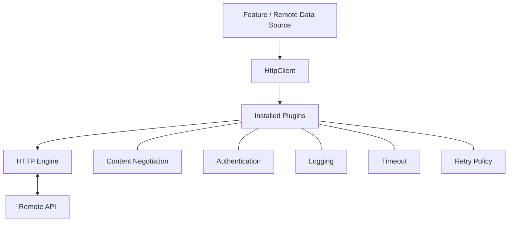
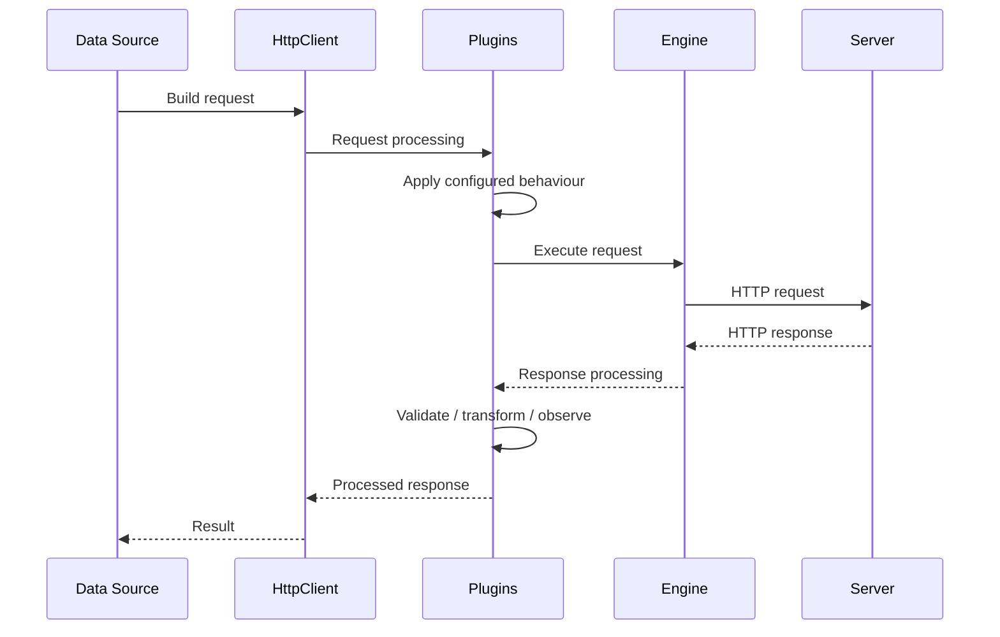
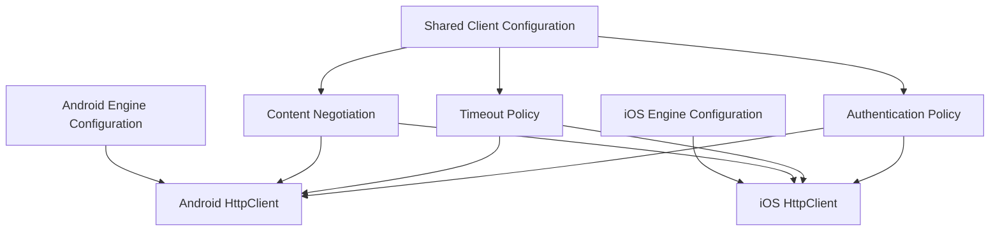

# Chapter 17 — Ktor Client

## Part 3 — Plugins: Extending the HTTP Client Pipeline

> **Series:** Kotlin Multiplatform (KMP) Architecture  
> **Chapter:** 17  
> **Part:** 3  
> **Focus:** Ktor plugins, request and response pipelines, configuration, authentication, logging, timeouts, retries, custom plugins, and KMP integration

---

## Table of Contents

- [1. Why Plugins Matter](#1-why-plugins-matter)
- [2. What Is a Ktor Client Plugin?](#2-what-is-a-ktor-client-plugin)
- [3. How Plugins Participate in the Pipeline](#3-how-plugins-participate-in-the-pipeline)
- [4. Installing and Configuring Plugins](#4-installing-and-configuring-plugins)
- [5. ContentNegotiation](#5-contentnegotiation)
- [6. Logging](#6-logging)
- [7. HttpTimeout](#7-httptimeout)
- [8. Auth: Authentication and Bearer Tokens](#8-auth-authentication-and-bearer-tokens)
- [9. DefaultRequest](#9-defaultrequest)
- [10. HttpRequestRetry](#10-httprequestretry)
- [11. HttpCookies](#11-httpcookies)
- [12. UserAgent and Other Useful Plugins](#12-useragent-and-other-useful-plugins)
- [13. Plugin Ordering and Configuration Boundaries](#13-plugin-ordering-and-configuration-boundaries)
- [14. Building a Custom Client Plugin](#14-building-a-custom-client-plugin)
- [15. Plugins in Kotlin Multiplatform](#15-plugins-in-kotlin-multiplatform)
- [16. Testing Plugin Behaviour](#16-testing-plugin-behaviour)
- [17. Security and Production Considerations](#17-security-and-production-considerations)
- [18. Common Mistakes](#18-common-mistakes)
- [19. Summary](#19-summary)

---

# 1. Why Plugins Matter

A production HTTP client needs more than the ability to send a GET or POST request. Every request may need common headers, authentication, timeout rules, logging, serialization, retry policies, and response processing.

One approach is to implement these behaviours separately in every API method:

```kotlin
suspend fun getProducts(): List<ProductDto> {
    // Add authorization header
    // Configure timeout
    // Log request
    // Execute request
    // Handle response
    // Decode JSON
    // Map failures
}
```

Repeating this logic creates duplication and makes networking behaviour inconsistent.

Ktor Client solves much of this problem through **plugins**. A plugin adds reusable behaviour to the client and participates in request or response processing.



Plugins keep cross-cutting HTTP concerns out of individual endpoint methods. They do not replace application architecture: repositories, domain rules, and business error handling still belong in their respective layers.

---

# 2. What Is a Ktor Client Plugin?

A Ktor client plugin is an extension mechanism that adds functionality to an `HttpClient`.

Plugins can:
- Observe or modify outgoing requests.
- Process responses.
- Convert request and response bodies.
- Apply authentication behaviour.
- Configure timeouts.
- Retry eligible requests.
- Add common request defaults.
- Provide logging and diagnostics.

A plugin is installed during client configuration:

```kotlin
val client = HttpClient {
    install(ContentNegotiation) {
        json()
    }
}
```

The `ContentNegotiation` plugin is installed once on the client. Remote data sources can then use typed request and response bodies without manually encoding and decoding JSON in every method.

## 2.1 Built-in plugins

Ktor provides plugins for common networking requirements.

| Plugin | Main responsibility |
|---|---|
| `ContentNegotiation` | Serialization and content conversion |
| `Logging` | Request and response diagnostics |
| `HttpTimeout` | Request, connection, and socket timeout settings |
| `Auth` | Authentication flows such as bearer authentication |
| `DefaultRequest` | Common URL and request defaults |
| `HttpRequestRetry` | Configurable retry behaviour |
| `HttpCookies` | Cookie storage and handling |
| `UserAgent` | User-Agent header configuration |
| `WebSockets` | WebSocket communication |
| `HttpSend` | Custom control over request sending |

The exact plugin set and configuration APIs depend on the Ktor version and the target platform.

## 2.2 Plugins are client-level infrastructure

A plugin should usually be configured when the client is created, rather than installed repeatedly in repository methods.

```kotlin
fun createHttpClient(
    engine: HttpClientEngine
): HttpClient {
    return HttpClient(engine) {
        install(ContentNegotiation) {
            json()
        }

        install(HttpTimeout) {
            requestTimeoutMillis = 30_000
        }
    }
}
```

The client factory owns common networking policy. Individual remote data sources focus on endpoint operations.

---

# 3. How Plugins Participate in the Pipeline

Ktor's client architecture uses pipelines to process requests and responses. Plugins can hook into relevant pipeline phases to add behaviour.

A simplified conceptual flow:



This is a conceptual diagram, not a guarantee of a fixed execution order for every plugin. Actual processing depends on the installed plugins, pipeline phases, and Ktor version.

## 3.1 Request-side behaviour

A plugin may:
- Add an authorization header.
- Apply a default header.
- Log request metadata.
- Set or enforce request behaviour.
- Participate in retry handling.

## 3.2 Response-side behaviour

A plugin may:
- Decode a response body.
- Observe status codes.
- Process authentication challenges.
- Log response metadata.
- Participate in retry decisions.

## 3.3 Keep business decisions outside generic plugins

A plugin should not decide whether a warehouse picker can complete a task or whether a user is eligible for a business operation.

Those are application rules. Plugins should implement reusable transport-level behaviour.

---

# 4. Installing and Configuring Plugins

Plugins are installed inside the `HttpClient` configuration block.

```kotlin
val client = HttpClient(CIO) {
    install(ContentNegotiation) {
        json()
    }

    install(Logging) {
        logger = Logger.DEFAULT
        level = LogLevel.INFO
    }

    install(HttpTimeout) {
        requestTimeoutMillis = 30_000
        connectTimeoutMillis = 10_000
        socketTimeoutMillis = 30_000
    }
}
```

The example assumes the corresponding Ktor artifacts are included in the source set.

## 4.1 Separate plugin configuration by concern

When the configuration grows, extract focused functions:

```kotlin
fun HttpClientConfig<*>.configureSerialization() {
    install(ContentNegotiation) {
        json()
    }
}

fun HttpClientConfig<*>.configureTimeouts() {
    install(HttpTimeout) {
        requestTimeoutMillis = 30_000
        connectTimeoutMillis = 10_000
        socketTimeoutMillis = 30_000
    }
}
```

Then compose them:

```kotlin
val client = HttpClient(CIO) {
    configureSerialization()
    configureTimeouts()
}
```

These extension signatures are illustrative; use the exact configuration types and imports supported by the Ktor version in your project.

## 4.2 Install only what the application needs

A plugin adds behaviour and configuration. Installing every available plugin without a requirement increases complexity and can make request behaviour difficult to reason about.

For each plugin, understand:
- Which requests it affects.
- Whether it modifies requests or responses.
- Whether it owns state.
- Whether it behaves differently across engines.
- How its behaviour will be tested.

---

# 5. ContentNegotiation

`ContentNegotiation` handles conversion between supported content types and Kotlin objects. It is commonly used with `kotlinx.serialization` for JSON APIs.

## 5.1 Add serialization support

```kotlin
@Serializable
data class ProductDto(
    val id: String,
    val name: String,
    val price: Double
)
```

## 5.2 Install the plugin

```kotlin
val client = HttpClient {
    install(ContentNegotiation) {
        json()
    }
}
```

For explicit JSON configuration:

```kotlin
val client = HttpClient {
    install(ContentNegotiation) {
        json(
            Json {
                ignoreUnknownKeys = true
                encodeDefaults = true
                isLenient = false
            }
        )
    }
}
```

Choose serialization settings according to the API contract. For example, `ignoreUnknownKeys` can tolerate additive fields, but it should not hide incompatible server changes.

## 5.3 Deserialize a response

```kotlin
val product: ProductDto =
    client.get("https://api.example.com/products/P-100").body()
```

The converter reads the response payload and decodes it into the requested type.

## 5.4 Serialize a request

```kotlin
@Serializable
data class CreateProductRequest(
    val name: String,
    val price: Double
)

val response = client.post("https://api.example.com/products") {
    contentType(ContentType.Application.Json)
    setBody(
        CreateProductRequest(
            name = "Keyboard",
            price = 79.99
        )
    )
}
```

The plugin makes body conversion reusable and consistent.

## 5.5 Do not confuse DTOs with domain models

A response DTO represents the backend contract. Convert it into a domain model in the data layer rather than allowing network-specific fields and naming conventions to spread into business logic.

---

# 6. Logging

The `Logging` plugin provides visibility into HTTP requests and responses. It is useful during development and troubleshooting.

```kotlin
val client = HttpClient {
    install(Logging) {
        logger = Logger.DEFAULT
        level = LogLevel.INFO
    }
}
```

## 6.1 Logging levels

| Level | Typical information |
|---|---|
| `NONE` | No logging |
| `INFO` | High-level request information |
| `HEADERS` | Request and response headers |
| `BODY` | Request and response bodies |
| `ALL` | Broad request and response details |

Exact output depends on the platform logger and Ktor version.

## 6.2 Configure safe logging

Headers and bodies can contain sensitive values. Use sanitization:

```kotlin
val client = HttpClient {
    install(Logging) {
        logger = Logger.DEFAULT
        level = LogLevel.HEADERS

        sanitizeHeader { header ->
            header.equals(
                HttpHeaders.Authorization,
                ignoreCase = true
            )
        }
    }
}
```

Verify the sanitizer API against the Ktor version in use. If the project has custom credential headers, redact those too.

## 6.3 Development and production logging

A sensible policy might be:

| Environment | Logging approach |
|---|---|
| Local development | Useful request metadata; body logging only with safe test data |
| QA | Controlled diagnostics with sensitive values redacted |
| Production | Minimal structured telemetry and privacy-safe diagnostics |

Never casually log:
- Access or refresh tokens.
- Passwords.
- Payment information.
- Personal or health information.
- Sensitive request or response bodies.

Logging is an observability feature, not permission to record every byte sent by the application.

---

# 7. HttpTimeout

The `HttpTimeout` plugin configures timeout limits for supported request operations.

```kotlin
val client = HttpClient {
    install(HttpTimeout) {
        requestTimeoutMillis = 30_000
        connectTimeoutMillis = 10_000
        socketTimeoutMillis = 30_000
    }
}
```

## 7.1 Understand the timeout types

| Timeout | Meaning |
|---|---|
| Request timeout | Maximum duration for the overall request |
| Connection timeout | Time allowed to establish a connection |
| Socket timeout | Time allowed for socket activity |

Timeout support and exact behaviour can vary by engine.

## 7.2 Configure according to operation type

A small metadata request and a large file upload may need different limits. Ktor also supports request-level timeout configuration in supported versions and engines.

```kotlin
val response = client.get("reports/summary") {
    timeout {
        requestTimeoutMillis = 10_000
    }
}
```

Use request-specific settings only where the operation genuinely needs them. Avoid making every endpoint override global defaults without a reason.

## 7.3 Timeouts are not retries

A timeout means an operation did not complete within the configured limit. It does not automatically mean the request is safe to repeat.

A retry policy must separately consider operation semantics, idempotency, and backend guarantees.

---

# 8. Auth: Authentication and Bearer Tokens

The `Auth` plugin supports authentication strategies such as bearer authentication. It can load credentials and participate in token refresh flows.

## 8.1 Basic bearer configuration

```kotlin
val client = HttpClient {
    install(Auth) {
        bearer {
            loadTokens {
                // Read the current token pair from a secure provider.
                null
            }
        }
    }
}
```

The `null` is a placeholder. A production implementation must return the appropriate token data.

## 8.2 Token provider abstraction

Keep token storage behind an interface:

```kotlin
data class TokenPair(
    val accessToken: String,
    val refreshToken: String
)

interface TokenProvider {
    suspend fun loadTokens(): TokenPair?
    suspend fun saveTokens(tokens: TokenPair)
    suspend fun clearTokens()
}
```

The implementation can use platform-appropriate secure storage. Do not store sensitive credentials in plain preferences or hardcode them into the client.

## 8.3 Bearer token refresh

A conceptual configuration:

```kotlin
install(Auth) {
    bearer {
        loadTokens {
            tokenProvider.loadTokens()?.let { tokens ->
                BearerTokens(
                    accessToken = tokens.accessToken,
                    refreshToken = tokens.refreshToken
                )
            }
        }

        refreshTokens {
            val oldTokens = oldTokens ?: return@refreshTokens null

            // Call the authentication endpoint using a carefully
            // designed refresh flow and persist the new token pair.
            refreshTokenPair(oldTokens)
        }
    }
}
```

`tokenProvider` and `refreshTokenPair` represent application-specific implementations. A real refresh flow must avoid recursively using the same authenticated client in a way that triggers another refresh loop.

## 8.4 Handle concurrent refresh attempts

Several API calls may receive an unauthorized response at nearly the same time. If each call independently refreshes the token, the application can send multiple refresh requests and create race conditions.

Coordinate refresh operations so that one refresh result can be shared by waiting requests. The coordination mechanism should respect coroutine cancellation and session changes.

## 8.5 Keep authentication scoped

Do not attach a privileged access token to unrelated third-party requests. Authentication should be limited to the intended API origin and security boundary.

---

# 9. DefaultRequest

`DefaultRequest` applies common request configuration, such as a base URL and standard headers.

```kotlin
val client = HttpClient {
    install(DefaultRequest) {
        url("https://api.example.com/")

        header(
            HttpHeaders.Accept,
            ContentType.Application.Json
        )

        header("X-Client-Name", "KmpStore")
    }
}
```

Remote data sources can then use relative paths:

```kotlin
val products: List<ProductDto> =
    client.get("products").body()
```

## 9.1 Use explicit environment configuration

```kotlin
data class ApiEnvironment(
    val baseUrl: String
)
```

The composition root supplies the correct value for development, staging, or production.

## 9.2 Avoid hardcoded user credentials

Default headers are appropriate for common non-secret metadata. User access tokens should be supplied through the authentication mechanism and secure token provider.

## 9.3 Be careful with URL resolution

Relative URL resolution can be affected by trailing slashes and path segments. Test the final request URL rather than assuming concatenation behaviour.

---

# 10. HttpRequestRetry

The `HttpRequestRetry` plugin provides configurable retry behaviour for eligible requests.

Retries can help with temporary network or server failures, but they can also cause duplicate operations when applied carelessly.

## 10.1 A basic retry policy

An illustrative configuration:

```kotlin
val client = HttpClient {
    install(HttpRequestRetry) {
        retryOnServerErrors(maxRetries = 3)
        exponentialDelay()
    }
}
```

The exact helpers and configuration APIs should be checked against the Ktor version used by the project.

## 10.2 Decide what can be retried

| Operation | Retry consideration |
|---|---|
| GET product details | Often safe if the operation is idempotent |
| GET inventory status | Usually safe, subject to API semantics |
| POST create order | Requires idempotency protection |
| POST payment | Must follow payment API retry guarantees |
| PATCH inventory quantity | Depends on operation semantics |
| DELETE resource | Depends on endpoint idempotency and server behaviour |

## 10.3 Use idempotency keys when supported

For operations such as order creation or payment submission, the backend may support an idempotency key:

```kotlin
client.post("orders") {
    header("Idempotency-Key", requestId)
    contentType(ContentType.Application.Json)
    setBody(createOrderRequest)
}
```

The key must be stable across retries of the same logical operation and unique for distinct operations. Its semantics must be agreed with the backend.

## 10.4 Backoff and retry limits

A responsible policy should define:
- Maximum retry attempts.
- Retryable status codes and exceptions.
- Backoff strategy.
- Maximum total elapsed time.
- Whether `Retry-After` is respected.
- Which HTTP methods or operations are eligible.

Avoid retrying every failure. Authentication errors, validation failures, and most client-side errors usually need a different response.

---

# 11. HttpCookies

The `HttpCookies` plugin provides cookie handling for applications that communicate with cookie-based services.

```kotlin
val client = HttpClient {
    install(HttpCookies)
}
```

Cookie storage and behaviour should be chosen according to the platform, privacy requirements, and server contract.

## 11.1 When cookies are useful

- Session-based authentication.
- Web endpoints that rely on cookies.
- Services that maintain server-side sessions.
- APIs that explicitly require cookie exchange.

## 11.2 Cookies and bearer tokens are different

Bearer authentication commonly sends a token in an `Authorization` header. Cookie-based authentication uses cookie values managed by the client.

Do not enable cookie handling simply because another API uses bearer authentication. Select the mechanism required by the service.

## 11.3 Protect cookie state

Cookies can contain session credentials. Avoid logging them, sharing them across unrelated API origins, or retaining them longer than required.

---

# 12. UserAgent and Other Useful Plugins

Ktor provides additional plugins for common networking requirements.

## 12.1 UserAgent

The User-Agent plugin configures the request's User-Agent header.

```kotlin
val client = HttpClient {
    install(UserAgent) {
        agent = "KmpStore/2.4.0"
    }
}
```

Use a meaningful application identifier and avoid including private user information.

## 12.2 WebSockets

The WebSockets plugin supports WebSocket communication where the selected engine and target support it.

```kotlin
val client = HttpClient {
    install(WebSockets)
}
```

WebSocket communication has a different lifecycle and message model from ordinary request-response HTTP. Manage connection ownership, reconnection, heartbeat, and cancellation deliberately.

## 12.3 HttpSend

`HttpSend` can be used for advanced control over request sending. It is a lower-level extension point and should be used only when the standard plugins or request APIs do not meet the requirement.

## 12.4 Choose the right abstraction

Do not create a custom plugin for a problem already solved by a stable built-in plugin. Custom pipeline logic increases maintenance and needs dedicated tests.

---

# 13. Plugin Ordering and Configuration Boundaries

Plugins participate in client pipelines, but developers should not assume that the order of `install` calls is a universal execution-order contract.

The actual processing order depends on plugin implementation and pipeline phases.

## 13.1 Avoid relying on accidental order

If one plugin depends on a value produced by another, verify the documented behaviour for the Ktor version. Write an integration test for the interaction rather than assuming installation order guarantees it.

## 13.2 Separate shared and platform-specific configuration

A KMP project can keep portable plugin configuration in `commonMain` and apply platform-specific engine configuration at the platform boundary.



The diagram is conceptual. Only APIs and plugin implementations available to the target can be shared.

## 13.3 Keep policy ownership clear

A useful division is:

| Concern | Owner |
|---|---|
| Engine selection | Platform composition root |
| Base URL and environment | Application configuration |
| JSON conversion | Client configuration |
| Authentication | Authentication infrastructure |
| Retry policy | Networking policy, coordinated with backend semantics |
| Business error interpretation | Data/domain boundary |
| UI error presentation | Presentation layer |

---

# 14. Building a Custom Client Plugin

Most applications can use built-in plugins. A custom plugin is appropriate when a cross-cutting requirement cannot be handled cleanly by existing features.

Examples might include:
- Adding a correlation identifier.
- Attaching a controlled client metadata header.
- Recording request timing.
- Applying an organization-specific transport convention.

Do not create a plugin for a single endpoint's business rule.

## 14.1 A simple custom plugin concept

The following example illustrates the modern client plugin shape conceptually. Exact APIs can vary between Ktor versions, so check the matching Ktor documentation before adopting it in production.

```kotlin
class CorrelationIdPluginConfig {
    var headerName: String = "X-Correlation-ID"
    var idProvider: () -> String = { "generated-id" }
}

val CorrelationIdPlugin = createClientPlugin(
    name = "CorrelationIdPlugin",
    createConfiguration = ::CorrelationIdPluginConfig
) {
    val headerName = pluginConfig.headerName
    val idProvider = pluginConfig.idProvider

    onRequest { request, _ ->
        if (request.headers[headerName] == null) {
            request.headers.append(
                headerName,
                idProvider()
            )
        }
    }
}
```

Install it:

```kotlin
val client = HttpClient {
    install(CorrelationIdPlugin) {
        headerName = "X-Correlation-ID"
        idProvider = { generateCorrelationId() }
    }
}
```

`generateCorrelationId()` is an application-provided function. Replace the placeholder provider with a reliable identifier generator suitable for the project.

## 14.2 Why use a plugin?

Without a plugin, every remote data source might add the same correlation header. A plugin centralizes the behaviour and reduces duplication.

## 14.3 Custom plugin design checklist

- Does the behaviour apply to multiple requests?
- Is it truly transport-level behaviour?
- Can a built-in plugin already solve it?
- Is configuration explicit?
- Is sensitive information protected?
- Does it behave correctly across all target engines?
- Can its request and response behaviour be tested?
- Does it preserve cancellation and normal pipeline semantics?

---

# 15. Plugins in Kotlin Multiplatform

KMP makes plugin compatibility especially important. A plugin may be available for one target but not another, or an engine may support only part of a feature's behaviour.

## 15.1 Keep portable plugins in common code

Commonly shared configuration can include:
- JSON content negotiation.
- Common request headers.
- Portable timeout settings where supported.
- Authentication policy where the required APIs are available.
- Shared request metadata.

## 15.2 Keep engine-specific behaviour in platform source sets

Some network features depend on the underlying platform stack. Examples include certificate configuration, proxy settings, client identity, and platform-specific logging.

Do not assume a setting configured for OkHttp has the same implementation or effect under Darwin.

## 15.3 Validate each target

A plugin compiling in `commonMain` is not the only compatibility check. Build and test every supported target, and verify engine behaviour on real platforms for security-sensitive networking features.

---

# 16. Testing Plugin Behaviour

Plugins affect all requests that use a configured client. Their behaviour should be tested directly.

Ktor's MockEngine allows tests to inspect outgoing requests and return controlled responses without contacting a live service.

## 16.1 Test a default header

```kotlin
@Test
fun `default request adds accept header`() = runTest {
    val engine = MockEngine { request ->
        assertEquals(
            ContentType.Application.Json.toString(),
            request.headers[HttpHeaders.Accept]
        )

        respond(
            content = """{"id":"P-1","name":"Keyboard","price":79.99}""",
            status = HttpStatusCode.OK,
            headers = headersOf(
                HttpHeaders.ContentType,
                ContentType.Application.Json.toString()
            )
        )
    }

    val client = HttpClient(engine) {
        install(DefaultRequest) {
            header(
                HttpHeaders.Accept,
                ContentType.Application.Json
            )
        }

        install(ContentNegotiation) {
            json()
        }
    }

    try {
        val product: ProductDto =
            client.get("https://test.example.com/products/P-1").body()

        assertEquals("P-1", product.id)
    } finally {
        client.close()
    }
}
```

Imports and dependencies are omitted for readability. Use the MockEngine and test APIs corresponding to the project's Ktor version.

## 16.2 Plugin test matrix

| Plugin | Useful tests |
|---|---|
| ContentNegotiation | JSON request encoding and response decoding |
| Logging | Redaction and selected log output |
| HttpTimeout | Timeout settings and timeout mapping |
| Auth | Token loading, refresh, and unauthorized behaviour |
| DefaultRequest | Base URL and common headers |
| HttpRequestRetry | Attempt count, eligible failures, and backoff policy |
| HttpCookies | Cookie persistence and isolation |
| Custom plugin | Header or metadata behaviour |

Some engine-level behaviours, especially timing and platform security features, require integration tests on the actual platform rather than only MockEngine tests.

---

# 17. Security and Production Considerations

Plugins can make networking consistent, but they can also apply mistakes consistently. Review their security implications.

## 17.1 Authentication

- Store tokens using platform-appropriate secure storage.
- Redact authorization and custom credential headers.
- Scope tokens to the intended host and API.
- Coordinate token refresh.
- Clear session credentials on sign-out.

## 17.2 Logging

- Avoid body logging in production unless explicitly justified.
- Redact secrets and personal information.
- Avoid exposing query parameters that contain credentials or private data.
- Restrict diagnostic access and retention.

## 17.3 Retry policy

- Do not blindly retry non-idempotent operations.
- Use idempotency keys when supported by the backend.
- Limit attempts and total elapsed time.
- Respect server retry guidance where appropriate.

## 17.4 Timeouts

- Configure realistic limits.
- Consider upload and download characteristics.
- Verify engine-specific behaviour.
- Map timeout failures into useful application states.

## 17.5 Platform differences

- Validate plugin and engine support for Android and iOS.
- Test security-sensitive configuration on real devices.
- Do not assume identical TLS, proxy, cookie, or certificate behaviour across engines.

---

# 18. Common Mistakes

| Mistake | Why it is a problem | Better approach |
|---|---|---|
| Installing every plugin | Adds unused behaviour and complexity | Install only required plugins |
| Logging all headers and bodies | Can expose credentials and private data | Redact sensitive values and limit logging |
| Retrying every request | Can duplicate non-idempotent operations | Define an explicit retry policy |
| Refreshing tokens independently for every failure | Can create concurrent refresh races | Coordinate refresh operations |
| Putting business rules in plugins | Couples transport infrastructure to domain behaviour | Keep business rules in domain/application layers |
| Assuming plugin install order controls every phase | Pipeline behaviour may be more nuanced | Verify documented semantics and test interactions |
| Using platform-specific APIs in common code | Breaks multiplatform portability | Separate shared and platform configuration |
| Creating a custom plugin for one endpoint | Adds unnecessary abstraction | Use request-level configuration |
| Sharing credentials across unrelated hosts | Can leak privileged tokens | Scope authentication by origin |
| Treating MockEngine as proof of platform behaviour | It does not exercise real platform networking | Add platform integration tests |

---

# 19. Summary

Ktor plugins make the HTTP client extensible and keep common networking behaviour out of individual API methods.

The most important plugins and their responsibilities are:

1. **ContentNegotiation:** converts Kotlin objects to and from supported payload formats.
2. **Logging:** provides diagnostics while requiring careful redaction.
3. **HttpTimeout:** establishes time limits for network operations.
4. **Auth:** centralizes authentication and token refresh behaviour.
5. **DefaultRequest:** applies common URL and request defaults.
6. **HttpRequestRetry:** retries only operations that are safe under an explicit policy.
7. **HttpCookies:** supports cookie-based session behaviour.
8. **UserAgent and WebSockets:** support additional HTTP client capabilities.
9. **Custom plugins:** provide reusable transport behaviour when built-in plugins are insufficient.

For KMP applications, share portable plugin configuration where possible and keep engine-specific behaviour in Android and iOS composition roots.

The goal is not to install the maximum number of plugins. The goal is to build a client whose behaviour is predictable, secure, testable, and consistent across platforms.

> **Plugins should remove repeated networking code—not hide application behaviour behind a complicated HTTP pipeline.**

---

<div align="center">

### Chapter 17 · Part 3

**Ktor Client — Plugins**

*Reusable networking behaviour. Safer requests. Consistent multiplatform communication.*

</div>
