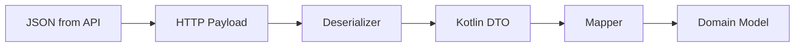
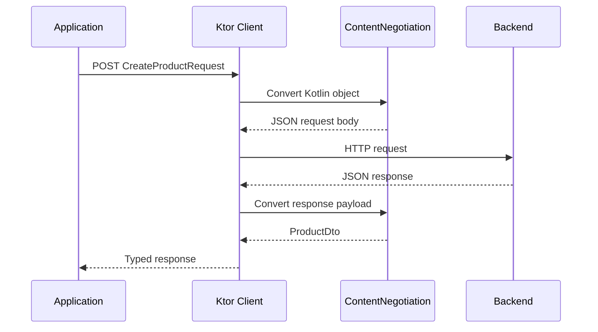

# Chapter 17 — Ktor Client

## Part 4 — Serialization: From Kotlin Objects to HTTP Payloads

> **Series:** Kotlin Multiplatform (KMP) Architecture  
> **Chapter:** 17  
> **Part:** 4  
> **Focus:** Kotlin serialization, ContentNegotiation, JSON configuration, DTO design, request and response conversion, custom serializers, polymorphism, error payloads, and KMP compatibility

---

## Table of Contents

- [1. Why Serialization Matters in Networking](#1-why-serialization-matters-in-networking)
- [2. Serialization and Deserialization](#2-serialization-and-deserialization)
- [3. The Role of ContentNegotiation](#3-the-role-of-contentnegotiation)
- [4. Adding Kotlin Serialization to a KMP Project](#4-adding-kotlin-serialization-to-a-kmp-project)
- [5. Configuring JSON in Ktor Client](#5-configuring-json-in-ktor-client)
- [6. Designing Network DTOs](#6-designing-network-dtos)
- [7. Deserializing API Responses](#7-deserializing-api-responses)
- [8. Serializing Request Bodies](#8-serializing-request-bodies)
- [9. Handling Field Names and Missing Values](#9-handling-field-names-and-missing-values)
- [10. Nullability, Defaults, and Optional Fields](#10-nullability-defaults-and-optional-fields)
- [11. Dates, Times, and Custom Types](#11-dates-times-and-custom-types)
- [12. Enum and Polymorphic Serialization](#12-enum-and-polymorphic-serialization)
- [13. Nested Objects and Generic API Responses](#13-nested-objects-and-generic-api-responses)
- [14. Error Response Serialization](#14-error-response-serialization)
- [15. Mapping DTOs to Domain Models](#15-mapping-dtos-to-domain-models)
- [16. Serialization in Kotlin Multiplatform](#16-serialization-in-kotlin-multiplatform)
- [17. Testing Serialization](#17-testing-serialization)
- [18. Common Serialization Failures](#18-common-serialization-failures)
- [19. Production Best Practices](#19-production-best-practices)
- [20. Summary](#20-summary)

---

# 1. Why Serialization Matters in Networking

Applications communicate with servers using data formats such as JSON. The server sends bytes over the network, while application code usually works with Kotlin objects.

Consider a response from a product API:

```json
{
  "id": "P-100",
  "name": "Wireless Keyboard",
  "price": 79.99,
  "available": true
}
```

A Kotlin application would rather work with a typed object:

```kotlin
val product = ProductDto(
    id = "P-100",
    name = "Wireless Keyboard",
    price = 79.99,
    available = true
)
```

Serialization provides the conversion between these two representations.

Without a serialization library, developers would need to parse JSON manually, read each field, handle missing values, convert nested objects, and build Kotlin instances. That approach quickly becomes difficult to maintain.

In Ktor Client, serialization is commonly integrated through the `ContentNegotiation` plugin and `kotlinx.serialization`.



Serialization is not just a convenience. It is part of the boundary between an external API contract and the application's internal model.

---

# 2. Serialization and Deserialization

The two primary operations are serialization and deserialization.

## 2.1 Serialization

Serialization converts a Kotlin object into a format that can be transmitted or stored.

```kotlin
@Serializable
data class CreateProductRequest(
    val name: String,
    val price: Double
)

val request = CreateProductRequest(
    name = "Wireless Keyboard",
    price = 79.99
)

val jsonString = Json.encodeToString(request)
```

Conceptual output:

```json
{
  "name": "Wireless Keyboard",
  "price": 79.99
}
```

The exact output formatting can vary according to JSON configuration.

## 2.2 Deserialization

Deserialization converts a payload into a Kotlin object.

```kotlin
val jsonString = """
    {
        "id": "P-100",
        "name": "Wireless Keyboard",
        "price": 79.99
    }
""".trimIndent()

@Serializable
data class ProductDto(
    val id: String,
    val name: String,
    val price: Double
)

val product = Json.decodeFromString<ProductDto>(jsonString)
```

## 2.3 The networking lifecycle



The application works with Kotlin types. The serialization layer handles the wire representation.

---

# 3. The Role of ContentNegotiation

Ktor Client uses the `ContentNegotiation` plugin to connect content types with serialization libraries.

For JSON using Kotlin serialization:

```kotlin
val httpClient = HttpClient {
    install(ContentNegotiation) {
        json()
    }
}
```

The JSON converter is responsible for encoding and decoding supported JSON payloads.

## 3.1 Why is it called content negotiation?

HTTP uses headers to describe the representation a client can send or accept.

Two important headers are:

- `Content-Type`: describes the format of the request body.
- `Accept`: describes the response formats the client can accept.

For a JSON API, these commonly use:

```http
Content-Type: application/json
Accept: application/json
```

Ktor's content negotiation support helps coordinate the configured converters and the request/response content types.

## 3.2 Install the required converter

```kotlin
install(ContentNegotiation) {
    json(
        Json {
            ignoreUnknownKeys = true
        }
    )
}
```

The `json()` extension is supplied by the Ktor serialization integration for Kotlin serialization. Ensure the matching artifact is included in the relevant source set.

## 3.3 ContentNegotiation does not define your API contract

The plugin can convert payloads, but it cannot decide what a field means, whether a price is valid, or whether an order is allowed to move to another state.

Those responsibilities belong to DTO validation, mapping, and domain logic.

---

# 4. Adding Kotlin Serialization to a KMP Project

Kotlin serialization requires the serialization compiler plugin and the serialization runtime.

A typical Gradle setup uses the Kotlin serialization plugin and the JSON runtime.

```kotlin
plugins {
    kotlin("multiplatform")
    kotlin("plugin.serialization")
}
```

A version-catalog-based project may declare the plugin through `libs.plugins` instead. Keep Kotlin plugin versions aligned with the Kotlin version used by the project.

## 4.1 Add dependencies

A simplified version-catalog example:

```toml
[versions]
ktor = "YOUR_KTOR_VERSION"
kotlin = "YOUR_KOTLIN_VERSION"

[libraries]
ktor-client-core = { module = "io.ktor:ktor-client-core", version.ref = "ktor" }
ktor-client-content-negotiation = { module = "io.ktor:ktor-client-content-negotiation", version.ref = "ktor" }
ktor-serialization-kotlinx-json = { module = "io.ktor:ktor-serialization-kotlinx-json", version.ref = "ktor" }
kotlinx-serialization-json = { module = "org.jetbrains.kotlinx:kotlinx-serialization-json", version = "YOUR_SERIALIZATION_VERSION" }
```

The version strings are placeholders. Use versions compatible with the Kotlin and Ktor versions selected by the project. Do not copy placeholder values into a production build.

## 4.2 Add dependencies to the shared source set

```kotlin
kotlin {
    sourceSets {
        commonMain.dependencies {
            implementation(libs.ktor.client.core)
            implementation(libs.ktor.client.content.negotiation)
            implementation(libs.ktor.serialization.kotlinx.json)
            implementation(libs.kotlinx.serialization.json)
        }
    }
}
```

The exact accessor names depend on the project's `libs.versions.toml` aliases.

## 4.3 Why commonMain?

Kotlin serialization is designed to work in multiplatform Kotlin code. DTOs and serializers can therefore live in `commonMain`, allowing Android and iOS to share the same API models.

---

# 5. Configuring JSON in Ktor Client

A JSON configuration controls how Kotlin values are encoded and decoded.

```kotlin
val json = Json {
    ignoreUnknownKeys = true
    encodeDefaults = true
    explicitNulls = false
    isLenient = false
}
```

Install it:

```kotlin
val httpClient = HttpClient {
    install(ContentNegotiation) {
        json(json)
    }
}
```

The options should be selected according to the API contract, not copied blindly.

## 5.1 `ignoreUnknownKeys`

When enabled, unknown JSON properties are ignored.

Suppose the backend returns:

```json
{
  "id": "P-100",
  "name": "Keyboard",
  "price": 79.99,
  "warehouseCode": "BLR-01"
}
```

But the DTO contains only:

```kotlin
@Serializable
data class ProductDto(
    val id: String,
    val name: String,
    val price: Double
)
```

With `ignoreUnknownKeys = true`, the additional `warehouseCode` property does not cause decoding to fail.

This is useful when APIs add fields without changing the fields the client consumes. It does not protect against missing required fields or incompatible type changes.

## 5.2 `encodeDefaults`

Controls whether properties with default values are included when encoding.

```kotlin
@Serializable
data class SearchRequest(
    val query: String,
    val page: Int = 1
)
```

Depending on configuration, encoding `SearchRequest("keyboard")` may include or omit the default `page` value.

Choose based on what the server expects.

## 5.3 `explicitNulls`

Controls whether null-valued properties are represented explicitly during serialization and how nullable properties are handled during decoding.

This setting can change the meaning of an API payload, especially when the backend distinguishes between an omitted property and an explicit `null`.

Do not change it without checking the backend contract.

## 5.4 `isLenient`

Controls acceptance of non-standard JSON syntax. Strict JSON is generally preferable for well-defined APIs. Enable lenient parsing only when the external contract requires it.

## 5.5 A practical configuration

```kotlin
val apiJson = Json {
    ignoreUnknownKeys = true
    encodeDefaults = false
    explicitNulls = true
    isLenient = false
}
```

This is one possible policy, not a universal recommendation. Document the chosen settings and cover important edge cases with tests.

---

# 6. Designing Network DTOs

DTO means Data Transfer Object. A DTO represents data crossing a boundary, such as an HTTP API.

```kotlin
@Serializable
data class ProductDto(
    val id: String,
    val name: String,
    val price: Double,
    val available: Boolean
)
```

## 6.1 Keep DTOs close to the API contract

The DTO should accurately represent the payload:
- Field names.
- Types.
- Nullability.
- Default values.
- Nested structures.
- Enum representations.

Do not change a field's type merely to make the model look cleaner. Convert it during mapping if the domain model needs a different representation.

## 6.2 Use separate request and response DTOs

A create request may not contain server-generated fields:

```kotlin
@Serializable
data class CreateProductRequestDto(
    val name: String,
    val price: Double
)
```

A response may include generated values:

```kotlin
@Serializable
data class ProductResponseDto(
    val id: String,
    val name: String,
    val price: Double,
    val createdAt: String
)
```

Using separate DTOs makes the API contract clearer and avoids accidentally sending response-only fields.

## 6.3 Organize DTOs by feature or API

A feature-oriented structure can keep related models together:

```text
data/
└── product/
    ├── remote/
    │   ├── ProductApi.kt
    │   ├── ProductDto.kt
    │   ├── CreateProductRequestDto.kt
    │   └── ProductRemoteDataSource.kt
    ├── mapper/
    │   └── ProductMapper.kt
    └── repository/
        └── ProductRepositoryImpl.kt
```

The best package structure is the one that makes API ownership and change impact easy to understand.

---

# 7. Deserializing API Responses

With `ContentNegotiation` installed, Ktor can deserialize a response body into a Kotlin type.

## 7.1 Single object

```kotlin
val product: ProductDto =
    httpClient.get("products/P-100").body()
```

## 7.2 List response

```kotlin
val products: List<ProductDto> =
    httpClient.get("products").body()
```

## 7.3 Wrapped response

Many APIs wrap results in an envelope:

```json
{
  "success": true,
  "data": {
    "id": "P-100",
    "name": "Keyboard",
    "price": 79.99
  }
}
```

Model the envelope explicitly:

```kotlin
@Serializable
data class ApiResponse<T>(
    val success: Boolean,
    val data: T
)
```

Then request a typed response:

```kotlin
val response: ApiResponse<ProductDto> =
    httpClient.get("products/P-100").body()
```

Generic serialization requires a concrete type at the call site so the serializer can be resolved. If the API's generic envelope has optional fields or different success/error shapes, model those shapes explicitly.

## 7.4 Handle empty responses

An endpoint may return `204 No Content`. Do not attempt to deserialize a body that does not exist.

```kotlin
val response = httpClient.delete("products/P-100")

if (response.status == HttpStatusCode.NoContent) {
    // Successful operation with no response payload.
}
```

Response handling should follow the endpoint contract.

---

# 8. Serializing Request Bodies

Ktor uses the configured converter when a supported Kotlin object is supplied as a request body.

```kotlin
@Serializable
data class CreateOrderRequestDto(
    val productId: String,
    val quantity: Int
)
```

Send it:

```kotlin
val response = httpClient.post("orders") {
    contentType(ContentType.Application.Json)

    setBody(
        CreateOrderRequestDto(
            productId = "P-100",
            quantity = 2
        )
    )
}
```

## 8.1 Why set Content-Type?

The `Content-Type` header identifies the format of the outgoing body. It tells the server how to interpret the payload.

When using content negotiation, Ktor can participate in selecting the appropriate converter. Explicitly setting the content type is useful when the endpoint contract requires it and makes the intended representation clear.

## 8.2 Do not serialize manually without a reason

This is usually unnecessary when ContentNegotiation is configured:

```kotlin
val jsonBody = Json.encodeToString(request)

httpClient.post("orders") {
    contentType(ContentType.Application.Json)
    setBody(jsonBody)
}
```

Manual serialization can be useful for special cases, but it bypasses some of the convenience and type-driven conversion offered by the configured converter.

Prefer passing the typed request object:

```kotlin
httpClient.post("orders") {
    contentType(ContentType.Application.Json)
    setBody(request)
}
```

---

# 9. Handling Field Names and Missing Values

Backend field names do not always follow Kotlin naming conventions.

For example, an API may return:

```json
{
  "product_id": "P-100",
  "product_name": "Keyboard"
}
```

Use `@SerialName` to map JSON field names to Kotlin properties.

```kotlin
@Serializable
data class ProductDto(
    @SerialName("product_id")
    val productId: String,

    @SerialName("product_name")
    val productName: String
)
```

## 9.1 Why use `@SerialName`?

It keeps Kotlin naming readable while preserving the external API contract.

Avoid renaming backend fields in the DTO and then relying on undocumented assumptions about naming strategies.

## 9.2 Missing required fields

Consider:

```kotlin
@Serializable
data class ProductDto(
    val id: String,
    val name: String,
    val price: Double
)
```

If the response omits `price`, deserialization normally fails because the property is required.

If the API legitimately allows it to be missing, model that explicitly:

```kotlin
@Serializable
data class ProductDto(
    val id: String,
    val name: String,
    val price: Double? = null
)
```

Do not make every property nullable just to suppress parsing errors. Nullability should represent the actual API contract.

---

# 10. Nullability, Defaults, and Optional Fields

JSON has several ways to represent absence or lack of a value:

- A property is present with a value.
- A property is present with `null`.
- A property is omitted entirely.
- A property is present with an empty value such as `""` or `[]`.

These cases are not necessarily equivalent.

## 10.1 Nullable property

```kotlin
@Serializable
data class UserDto(
    val middleName: String?
)
```

This property can contain a string or null. Without a default value, the property is still expected to be present according to the serializer's normal rules.

## 10.2 Nullable property with a default

```kotlin
@Serializable
data class UserDto(
    val middleName: String? = null
)
```

The property can be omitted and will use the default value.

## 10.3 Non-null property with a default

```kotlin
@Serializable
data class ProductDto(
    val id: String,
    val name: String,
    val active: Boolean = true
)
```

If `active` is absent, the default can be used.

## 10.4 Be careful with PATCH semantics

For update APIs, omitted and explicit null can have different meanings:

- Omitted: leave the existing value unchanged.
- Explicit null: clear the value.
- Supplied value: replace the existing value.

A simple nullable property may not express all three states clearly. Use a request model or serialization strategy that matches the backend's PATCH contract.

---

# 11. Dates, Times, and Custom Types

JSON does not have a native date or time type. APIs usually represent date/time values as strings or numeric timestamps.

Example:

```json
{
  "created_at": "2026-10-30T08:30:00Z"
}
```

A DTO can initially preserve the API representation as a string:

```kotlin
@Serializable
data class ProductDto(
    val id: String,
    @SerialName("created_at")
    val createdAt: String
)
```

The data layer can then parse it into an appropriate date/time type.

## 11.1 Keep wire representation separate from domain representation

```kotlin
data class Product(
    val id: String,
    val createdAt: Instant
)
```

The mapper converts the string into the application's chosen date/time representation.

The exact `Instant` type depends on the date/time library used by the KMP project.

## 11.2 Custom serializers

When a type needs a specific JSON representation, a custom serializer can define how to encode and decode it.

A serializer implements `KSerializer<T>` and provides a descriptor, serialization logic, and deserialization logic. The implementation should be written against the exact serialization API version used by the project.

A simplified conceptual shape:

```kotlin
object ProductCodeSerializer : KSerializer<ProductCode> {
    override val descriptor: SerialDescriptor =
        PrimitiveSerialDescriptor(
            "ProductCode",
            PrimitiveKind.STRING
        )

    override fun serialize(
        encoder: Encoder,
        value: ProductCode
    ) {
        encoder.encodeString(value.value)
    }

    override fun deserialize(
        decoder: Decoder
    ): ProductCode {
        return ProductCode(
            decoder.decodeString()
        )
    }
}
```

The example assumes a value type:

```kotlin
@JvmInline
value class ProductCode(
    val value: String
)
```

Use a custom serializer only when the wire representation requires it. For ordinary DTO fields, built-in serializers are simpler and easier to maintain.

---

# 12. Enum and Polymorphic Serialization

APIs often return a fixed set of values, such as order status or product category.

## 12.1 Enum serialization

```kotlin
@Serializable
enum class OrderStatus {
    CREATED,
    PICKING,
    SHIPPED,
    DELIVERED
}
```

A JSON value must match the serializer's expected representation.

If the backend uses different names, map them explicitly:

```kotlin
@Serializable
enum class OrderStatus {
    @SerialName("created")
    CREATED,

    @SerialName("picking_in_progress")
    PICKING,

    @SerialName("shipped")
    SHIPPED,

    @SerialName("delivered")
    DELIVERED
}
```

## 12.2 Unknown enum values

An API may introduce a new status before an older mobile application is updated. A strict enum serializer may fail when it encounters an unknown value.

Possible approaches include:
- A tolerant representation using a string in the DTO and mapping known values.
- A dedicated unknown state in the application's model.
- A custom serializer when the contract requires it.

For evolving APIs, preserving the raw string can be safer:

```kotlin
@Serializable
data class OrderDto(
    val id: String,
    val status: String
)
```

Then map known values:

```kotlin
fun String.toOrderStatus(): OrderStatus =
    when (lowercase()) {
        "created" -> OrderStatus.CREATED
        "picking_in_progress" -> OrderStatus.PICKING
        "shipped" -> OrderStatus.SHIPPED
        "delivered" -> OrderStatus.DELIVERED
        else -> OrderStatus.UNKNOWN
    }
```

This example assumes `UNKNOWN` exists in the domain enum.

## 12.3 Polymorphic payloads

Some APIs return different object shapes under one response field. Kotlin serialization supports polymorphic serialization, including sealed hierarchies.

```kotlin
@Serializable
sealed interface PaymentMethodDto

@Serializable
@SerialName("card")
data class CardPaymentDto(
    val lastFourDigits: String
) : PaymentMethodDto

@Serializable
@SerialName("wallet")
data class WalletPaymentDto(
    val provider: String
) : PaymentMethodDto
```

Configure a discriminator if the API uses a type field:

```kotlin
val json = Json {
    classDiscriminator = "type"
}
```

Example payload:

```json
{
  "type": "card",
  "lastFourDigits": "4242"
}
```

The discriminator name and values must match the backend contract. Polymorphic registration requirements depend on the hierarchy and serializer configuration.

---

# 13. Nested Objects and Generic API Responses

Real API responses are often nested.

```json
{
  "id": "ORD-100",
  "customer": {
    "id": "C-10",
    "name": "Asha"
  },
  "items": [
    {
      "product_id": "P-100",
      "quantity": 2
    }
  ]
}
```

Represent the structure with nested DTOs:

```kotlin
@Serializable
data class OrderDto(
    val id: String,
    val customer: CustomerDto,
    val items: List<OrderItemDto>
)

@Serializable
data class CustomerDto(
    val id: String,
    val name: String
)

@Serializable
data class OrderItemDto(
    @SerialName("product_id")
    val productId: String,
    val quantity: Int
)
```

## 13.1 Generic pagination response

```kotlin
@Serializable
data class PageDto<T>(
    val items: List<T>,
    val page: Int,
    val pageSize: Int,
    val totalItems: Int
)
```

Usage:

```kotlin
val page: PageDto<ProductDto> =
    httpClient.get("products?page=1").body()
```

The concrete generic type provides the serializer information required for decoding.

## 13.2 Keep pagination metadata in the right layer

The data layer can map `PageDto<ProductDto>` into a domain pagination model. The domain layer should not need to depend on Ktor or the backend's exact envelope structure.

---

# 14. Error Response Serialization

Successful and unsuccessful API responses may have different payload shapes.

A backend might return:

```json
{
  "code": "PRODUCT_NOT_FOUND",
  "message": "The requested product does not exist"
}
```

Create a dedicated error DTO:

```kotlin
@Serializable
data class ApiErrorDto(
    val code: String,
    val message: String
)
```

## 14.1 Do not assume every error body is valid JSON

A server, gateway, or proxy may return:
- An empty body.
- HTML instead of JSON.
- Plain text.
- A different error schema.
- A malformed payload.

Error parsing should therefore be defensive.

## 14.2 Map errors into application types

```kotlin
sealed interface ApiFailure {
    data class Http(
        val statusCode: Int,
        val code: String?,
        val message: String?
    ) : ApiFailure

    data object InvalidPayload : ApiFailure
    data object NetworkUnavailable : ApiFailure
    data object TimedOut : ApiFailure
    data class Unexpected(
        val cause: Throwable
    ) : ApiFailure
}
```

This is an application-level example. Keep Ktor exception types and raw response details inside the data layer.

## 14.3 Preserve cancellation

When handling serialization or network exceptions in suspend functions, do not convert `CancellationException` into a normal API failure.

```kotlin
try {
    // Execute request and decode response.
} catch (exception: CancellationException) {
    throw exception
} catch (exception: Exception) {
    // Map known failures.
}
```

---

# 15. Mapping DTOs to Domain Models

Serialization should stop at the data boundary. Domain models should represent application concepts, not the backend's JSON layout.

DTO:

```kotlin
@Serializable
data class ProductDto(
    val id: String,
    @SerialName("product_name")
    val productName: String,
    val price: Double,
    val available: Boolean
)
```

Domain model:

```kotlin
data class Product(
    val id: String,
    val title: String,
    val price: Money,
    val isAvailable: Boolean
)
```

Mapper:

```kotlin
fun ProductDto.toDomain(): Product {
    return Product(
        id = id,
        title = productName,
        price = Money(price),
        isAvailable = available
    )
}
```

`Money` is an illustrative domain value type. A real implementation should define currency and precision requirements rather than assuming every amount is a plain decimal number.

## 15.1 Why keep models separate?

| Network DTO | Domain model |
|---|---|
| Mirrors the API contract | Represents business meaning |
| May contain backend-specific names | Uses application terminology |
| May be nullable for API compatibility | Enforces domain invariants |
| Can change when the server changes | Changes when business requirements change |
| Uses serialization annotations | Does not need transport annotations |

This separation protects business logic from backend schema changes.

---

# 16. Serialization in Kotlin Multiplatform

Kotlin serialization is designed for multiplatform use, which makes it suitable for shared KMP DTOs.

A typical source-set layout:

```text
shared/
├── commonMain/
│   ├── data/
│   │   ├── dto/
│   │   ├── mapper/
│   │   └── remote/
│   └── domain/
├── androidMain/
└── iosMain/
```

## 16.1 Keep common DTOs in commonMain

```kotlin
@Serializable
data class WarehouseTaskDto(
    val taskId: String,
    val location: String,
    val status: String
)
```

The same DTO and generated serializer can be used by Android and iOS shared networking code.

## 16.2 Avoid platform-specific types in DTOs

A shared DTO should not contain Android `Uri`, `Context`, UIKit types, or other platform-only values.

Represent transport data using portable Kotlin types, then convert it into platform-specific values at the appropriate boundary.

## 16.3 Keep serialization dependencies aligned

The Kotlin serialization compiler plugin should align with the Kotlin compiler version. The serialization runtime and Ktor serialization integration should also use compatible versions.

A dependency mismatch can cause compilation errors, missing serializers, or runtime decoding problems.

## 16.4 Test on all supported targets

Shared source code does not guarantee that every target behaves identically in every environment. Compile and test the serialization path for each supported target, especially when using custom serializers or platform-specific date/time libraries.

---

# 17. Testing Serialization

Serialization tests should verify the API contract independently from the live backend.

## 17.1 Test encoding

```kotlin
@Test
fun `create product request encodes expected fields`() {
    val request = CreateProductRequestDto(
        name = "Keyboard",
        price = 79.99
    )

    val json = Json.encodeToString(request)

    assertTrue(json.contains("\"name\":\"Keyboard\""))
    assertTrue(json.contains("\"price\":79.99"))
}
```

Exact string formatting can depend on JSON configuration. For more robust tests, decode the result into a JSON structure and assert its fields rather than depending on property order or whitespace.

## 17.2 Test decoding

```kotlin
@Test
fun `product response decodes expected fields`() {
    val payload = """
        {
            "id": "P-100",
            "name": "Keyboard",
            "price": 79.99
        }
    """.trimIndent()

    val product = Json.decodeFromString<ProductDto>(payload)

    assertEquals("P-100", product.id)
    assertEquals("Keyboard", product.name)
    assertEquals(79.99, product.price)
}
```

## 17.3 Test compatibility cases

Include test payloads for:
- Unknown fields.
- Missing optional fields.
- Explicit null values.
- Empty arrays and strings.
- Unexpected enum values.
- Nested objects.
- Malformed JSON.
- Empty response bodies.
- Error payloads.
- Date/time formats.

## 17.4 Test Ktor integration with MockEngine

Serialization unit tests validate DTO behaviour. MockEngine tests validate that the configured Ktor client uses the converter correctly during actual request execution.

```kotlin
@Test
fun `client decodes product response`() = runTest {
    val engine = MockEngine {
        respond(
            content = ByteReadChannel(
                """{"id":"P-100","name":"Keyboard","price":79.99}"""
            ),
            status = HttpStatusCode.OK,
            headers = headersOf(
                HttpHeaders.ContentType,
                ContentType.Application.Json.toString()
            )
        )
    }

    val client = HttpClient(engine) {
        install(ContentNegotiation) {
            json()
        }
    }

    try {
        val product: ProductDto =
            client.get("https://test.example.com/products/P-100").body()

        assertEquals("P-100", product.id)
    } finally {
        client.close()
    }
}
```

The test requires the matching Ktor MockEngine and serialization dependencies. Imports are omitted for readability.

---

# 18. Common Serialization Failures

| Problem | Likely reason | Recommended check |
|---|---|---|
| Serializer not found | Missing `@Serializable` or serialization plugin | Check compiler plugin and model annotation |
| Unknown JSON key error | Payload has fields not represented by the DTO | Review API contract and `ignoreUnknownKeys` policy |
| Missing field error | Required property is absent | Correct DTO nullability/defaults or fix backend payload |
| Type mismatch | JSON value differs from declared Kotlin type | Inspect actual payload and field type |
| Invalid enum value | Backend added or changed an enum string | Use an API-compatible mapping strategy |
| Content type error | Response uses an unexpected content type | Inspect response headers and converter configuration |
| Empty-body decoding failure | Endpoint returned no content | Handle status before calling `body()` |
| Date parsing failure | Backend date format differs from parser expectation | Validate format and use a tested parser |
| Request field omitted | Default/null encoding configuration or annotation | Inspect serialized JSON and API expectations |
| Works on Android but fails on iOS | Dependency or target compatibility issue | Check common dependencies and target compilation |

A good debugging sequence is:

1. Inspect the raw response safely.
2. Confirm the response status and `Content-Type`.
3. Compare the payload with the DTO.
4. Check nullability and defaults.
5. Verify serializer generation and dependency versions.
6. Reproduce the payload in a unit test.
7. Confirm the same code compiles and behaves on all targets.

---

# 19. Production Best Practices

### DTO design
- [ ] Keep DTOs aligned with the backend contract.
- [ ] Use `@SerialName` for external field names.
- [ ] Separate request and response models when their shapes differ.
- [ ] Model nullability and defaults intentionally.
- [ ] Handle unknown enum values where APIs evolve.
- [ ] Keep platform-only types out of shared DTOs.

### JSON configuration
- [ ] Document `ignoreUnknownKeys` and null-handling decisions.
- [ ] Use strict parsing unless the API requires otherwise.
- [ ] Avoid enabling permissive options just to hide contract problems.
- [ ] Test default-value and null encoding.
- [ ] Keep JSON configuration centralized.

### Ktor integration
- [ ] Install `ContentNegotiation` once in the client factory.
- [ ] Add the matching serialization converter dependency.
- [ ] Set request content types according to the API contract.
- [ ] Handle no-content responses without decoding a body.
- [ ] Map error payloads defensively.

### Architecture and KMP
- [ ] Keep DTOs in the data layer.
- [ ] Map DTOs to domain models.
- [ ] Keep Ktor types out of domain and presentation layers.
- [ ] Share portable serializers in `commonMain`.
- [ ] Align Kotlin, serialization, and Ktor versions.
- [ ] Build and test every supported target.

### Testing
- [ ] Test encoding and decoding independently.
- [ ] Cover missing, null, unknown, and malformed values.
- [ ] Test nested and generic payloads.
- [ ] Use MockEngine for Ktor integration tests.
- [ ] Never depend on a live backend for serializer unit tests.

---

# 20. Summary

Serialization is the bridge between the API's wire format and the Kotlin types used by the application.

In Ktor Client, `ContentNegotiation` connects the HTTP client to converters such as Kotlin serialization. Once configured, the client can encode request objects and decode response payloads into typed DTOs.

The important concepts are:

1. **Serialization:** converts Kotlin objects into payload formats such as JSON.
2. **Deserialization:** converts payloads into Kotlin objects.
3. **ContentNegotiation:** integrates serialization with Ktor request and response processing.
4. **JSON configuration:** controls unknown keys, defaults, nulls, and parsing behaviour.
5. **DTO design:** represents the external API contract accurately.
6. **Custom serializers:** handle special wire representations when necessary.
7. **Polymorphism:** supports payloads with multiple possible data shapes.
8. **Error serialization:** models backend failures without assuming every error body is valid JSON.
9. **Domain mapping:** prevents transport models from leaking into business logic.
10. **KMP compatibility:** allows shared DTOs and serializers across supported Kotlin targets.

A reliable serialization layer does not simply make JSON parsing work. It makes the boundary between an evolving backend and a stable application explicit, testable, and maintainable.

> **Treat JSON as an external contract. Deserialize it into DTOs, validate and map it at the data boundary, and keep domain logic independent of the wire format.**

---

<div align="center">

### Chapter 17 · Part 4

**Ktor Client — Serialization**

*Reliable payload conversion. Explicit API contracts. Shared Kotlin models.*

</div>
