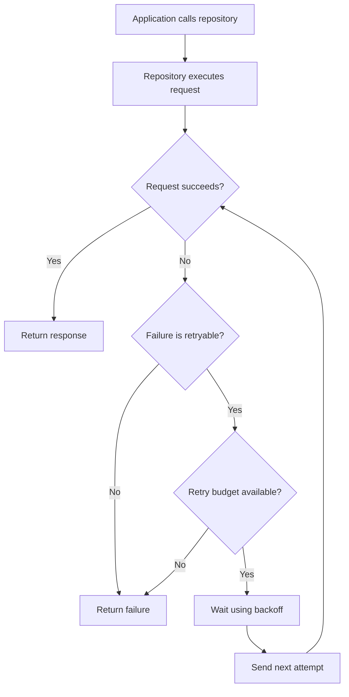

<div align="center">

# Chapter 17 — Ktor Client

### Part 5 · Retry
**Building resilient HTTP communication without creating duplicate work**

[](https://kotlinlang.org/)
[](https://ktor.io/)
[](#)

*An implementation-focused guide to retry policies, backoff, idempotency, failure classification, and testing in shared KMP networking code.*

</div>

---

> **Chapter goal**
>
> A retry is not simply “send the request again.” It is a controlled recovery decision. In this part, we will build a retry strategy that understands transient failures, respects server instructions, avoids retrying unsafe operations blindly, and remains testable across Android, iOS, and other Kotlin Multiplatform targets.

## Table of contents

- [1. Why retries exist](#1-why-retries-exist)
- [2. What should and should not be retried](#2-what-should-and-should-not-be-retried)
- [3. Retry terminology](#3-retry-terminology)
- [4. Ktor's HttpRequestRetry plugin](#4-ktors-httprequestretry-plugin)
- [5. A production-oriented retry policy](#5-a-production-oriented-retry-policy)
- [6. Exponential backoff and jitter](#6-exponential-backoff-and-jitter)
- [7. Respecting Retry-After](#7-respecting-retry-after)
- [8. Idempotency and duplicate operations](#8-idempotency-and-duplicate-operations)
- [9. Retry policy by HTTP method and endpoint](#9-retry-policy-by-http-method-and-endpoint)
- [10. Timeouts, cancellation, and retry budgets](#10-timeouts-cancellation-and-retry-budgets)
- [11. Authentication refresh is not a generic retry](#11-authentication-refresh-is-not-a-generic-retry)
- [12. Observability and diagnostics](#12-observability-and-diagnostics)
- [13. KMP architecture and configuration](#13-kmp-architecture-and-configuration)
- [14. Testing retries with MockEngine](#14-testing-retries-with-mockengine)
- [15. Common mistakes](#15-common-mistakes)
- [16. Production checklist](#16-production-checklist)
- [17. Final thoughts](#17-final-thoughts)

---

## 1. Why retries exist

A mobile application communicates over networks that are not fully under its control. A request may fail because a device temporarily loses connectivity, a connection is reset, a gateway is overloaded, or a server asks the client to slow down.

Some failures are temporary. Repeating the request after a short delay may succeed.

Consider a warehouse application confirming that a picker has completed a task. The device sends a request, but the connection drops before the response reaches the app. There are two possible realities:

1. The server never received the request.
2. The server processed the request, but the response was lost.

The client cannot infer which reality occurred merely from a connection error. Retrying without understanding the operation can therefore create duplicate work.

A sound retry policy needs to answer four questions:

- Is this failure likely to be temporary?
- Is repeating this operation safe?
- How many attempts are permitted?
- How long may the complete operation take?

### The request lifecycle



The important distinction is that retries are bounded recovery, not an infinite loop.

## 2. What should and should not be retried

A retry policy should classify failures instead of treating every exception as temporary.

### Usually retryable

| Failure | Why a retry may help |
|---|---|
| Connection reset | The connection may have been interrupted temporarily |
| Temporary DNS or socket failure | The network path may recover |
| Request timeout | A transient delay may have caused the timeout |
| HTTP `408` | The server or intermediary timed out |
| HTTP `429` | The server is rate-limiting the client; respect its guidance |
| HTTP `500` | The server may have encountered a temporary internal failure |
| HTTP `502` | A gateway received an invalid upstream response |
| HTTP `503` | The service may be temporarily unavailable |
| HTTP `504` | A gateway timed out waiting for an upstream service |

These are candidates, not guarantees. The endpoint contract and operation semantics still matter.

### Usually not retryable

| Failure | Why repeating usually does not help |
|---|---|
| HTTP `400` | The request is malformed or invalid |
| HTTP `401` | Authentication must be repaired, not blindly repeated |
| HTTP `403` | The caller is not permitted to perform the operation |
| HTTP `404` | The requested resource was not found |
| HTTP `409` | The request conflicts with current server state; application-level resolution may be needed |
| HTTP `422` | The server understood the request but rejected its content |
| Serialization failure | The client cannot correctly construct or parse the payload |
| Validation failure | The input itself must be corrected |
| Explicit coroutine cancellation | The caller has asked the operation to stop |

A server can define endpoint-specific behavior that differs from these defaults. Treat the API contract as the source of truth.

### Transport errors are not all equal

A broad `catch (Throwable)` is dangerous. It can accidentally convert programming errors, fatal runtime failures, or cancellation into retry candidates.

In coroutine code, preserve cancellation:

```kotlin
try {
    api.loadSummary()
} catch (cause: CancellationException) {
    throw cause
} catch (cause: IOException) {
    // A transport failure may be eligible for retry.
    throw cause
}
```

The exact transport exception types vary by Ktor version and engine. Keep platform-specific exception interpretation behind a small networking boundary when necessary.

## 3. Retry terminology

Before configuring Ktor, distinguish the terms used in retry design.

| Term | Meaning |
|---|---|
| Initial attempt | The first request |
| Retry | An additional attempt after the initial attempt |
| Maximum retries | Number of additional attempts permitted |
| Maximum attempts | Initial attempt plus all retries |
| Backoff | Delay between attempts |
| Exponential backoff | A delay that grows after each failed attempt |
| Jitter | Random variation added to a delay |
| Retry condition | A rule that decides whether another attempt is allowed |
| Retry budget | A limit on retry activity over time or for an operation |
| Idempotency | Repeating an operation has the same intended effect as performing it once |

For example, `maxRetries = 3` means up to four total attempts:

```text
Attempt 1 → initial request
Attempt 2 → retry 1
Attempt 3 → retry 2
Attempt 4 → retry 3
```

This distinction matters when logging, testing, and communicating operational limits.

## 4. Ktor's HttpRequestRetry plugin

Ktor provides the `HttpRequestRetry` client plugin for retrying requests based on configured conditions.

Add the plugin dependency using the same Ktor version as the rest of the client:

```kotlin
commonMain.dependencies {
    implementation("io.ktor:ktor-client-core:$ktorVersion")
    implementation("io.ktor:ktor-client-content-negotiation:$ktorVersion")
    implementation("io.ktor:ktor-client-retry:$ktorVersion")
}
```

The `ktor-client-retry` artifact provides the retry plugin. Keep all Ktor artifacts aligned to one version to avoid dependency incompatibilities.

### Basic installation

```kotlin
import io.ktor.client.HttpClient
import io.ktor.client.plugins.HttpRequestRetry
import io.ktor.client.plugins.retry

fun createHttpClient(): HttpClient =
    HttpClient {
        install(HttpRequestRetry) {
            retryOnServerErrors(maxRetries = 3)
            exponentialDelay()
        }
    }
```

This is a useful starting point, but it is not a complete production policy. It does not by itself express every application's rules for safe methods, request bodies, server-directed delays, or operation-specific idempotency.

### Configure explicit conditions

Ktor's retry plugin supports conditions such as response-based and exception-based retry decisions. A policy can be made more explicit:

```kotlin
install(HttpRequestRetry) {
    maxRetries = 3

    retryIf { request, response ->
        response.status.value in setOf(408, 429, 500, 502, 503, 504)
    }

    retryOnExceptionIf { request, cause ->
        cause is IOException
    }

    exponentialDelay()
}
```

This example is intentionally illustrative. Confirm the exact imports, receiver properties, and overloads against the Ktor version pinned by your project. In particular, exception types can differ between engines and platforms.

A key design point: do not configure a generic exception retry unless you have verified which exceptions it can receive and whether the request is safe to repeat.

## 5. A production-oriented retry policy

A production policy should make its limits visible and its decisions understandable.

A reasonable starting policy for safe, read-only requests might be:

| Setting | Example value | Purpose |
|---|---:|---|
| Maximum retries | 2 or 3 | Prevent unbounded attempts |
| Initial delay | 300 ms | Avoid immediate repeated traffic |
| Backoff multiplier | 2× | Increase delay after repeated failures |
| Maximum delay | 5 seconds | Keep an individual wait bounded |
| Retryable statuses | 408, 429, 500, 502, 503, 504 | Focus on likely transient responses |
| Exception handling | Known transient transport failures | Avoid retrying arbitrary failures |
| Cancellation | Never retry | Respect the caller's intent |

These are starting values, not universal defaults. Tune them using endpoint latency, service limits, mobile network behavior, and the user experience expected by the product.

### A reusable configuration function

```kotlin
import io.ktor.client.HttpClientConfig
import io.ktor.client.plugins.HttpRequestRetry

fun HttpClientConfig<*>.installReadRetryPolicy() {
    install(HttpRequestRetry) {
        maxRetries = 3

        retryIf { _, response ->
            response.status.value in setOf(
                408,
                429,
                500,
                502,
                503,
                504
            )
        }

        exponentialDelay(
            base = 2.0,
            maxDelayMs = 5_000,
            randomizationMs = 250
        )
    }
}
```

The `exponentialDelay` parameters and accepted numeric types are version-sensitive. Check the API documentation for your selected Ktor release before copying this function unchanged.

### Keep policy names honest

The function above is named `installReadRetryPolicy`, but the plugin configuration itself does not inspect the HTTP method. A global installation can affect more than reads unless conditions explicitly constrain it.

Use a method-aware condition where the Ktor version exposes the request method in the retry predicate, or separate clients/policies for different operation classes. Do not rely on a function name to enforce a safety guarantee.

## 6. Exponential backoff and jitter

Retrying immediately can make an overloaded service even less healthy.

Imagine a service becomes unavailable and 50,000 mobile devices retry at exactly the same interval. When the service recovers, all clients may send another wave of requests simultaneously. This is often called a retry storm.

### Exponential backoff

A common delay formula is:

\[
d_n = \min(d_{\max}, d_0 \times r^{n-1})
\]

Where:

- \(d_n\) is the delay before retry \(n\)
- \(d_0\) is the initial delay
- \(r\) is the growth multiplier
- \(d_{\max}\) is the maximum delay

For an initial delay of 300 ms and multiplier of 2:

| Retry number | Delay before jitter |
|---:|---:|
| 1 | 300 ms |
| 2 | 600 ms |
| 3 | 1,200 ms |
| 4 | 2,400 ms |
| 5 | 4,800 ms |

The cap prevents the delay from growing indefinitely.

### Why jitter matters

Jitter introduces randomness so clients do not retry in lockstep.

A simple bounded-jitter model is:

\[
d'_n = \max(0, d_n + U(-j, j))
\]

Here, \(U(-j,j)\) is a random value between negative and positive jitter limit \(j\).

A commonly used alternative is *full jitter*:

\[
d'_n = U(0, \min(d_{\max}, d_0 \times 2^{n-1}))
\]

Both approaches spread retry traffic. Choose a policy that is supported by your Ktor version and consistent with your backend's guidance.

### Avoid stacking retry loops

If Ktor retries three times, a repository retries three times, and a higher-level use case retries three times, one user action can produce many more requests than expected.

For nested retry layers, the worst-case attempt count multiplies:

\[
A_{\text{total}} = A_1 \times A_2 \times \cdots \times A_k
\]

Prefer one clearly owned retry boundary for a given request. If multiple layers genuinely need retries, document the combined budget.

## 7. Respecting Retry-After

HTTP servers can send a `Retry-After` response header, commonly with `429 Too Many Requests` or `503 Service Unavailable`.

It can communicate either:

- A delay in seconds, such as `Retry-After: 5`.
- An HTTP date indicating when the client may retry.

The client should not ignore this guidance and retry earlier than requested.

### Policy considerations

1. Parse the header according to the HTTP specification.
2. Support both delay-seconds and HTTP-date forms if your API requires them.
3. Apply a reasonable maximum wait.
4. If the header is invalid, fall back to the configured backoff.
5. Do not retry sooner than the server's requested delay merely because the local backoff is shorter.

A simplified parser for the delay-seconds form:

```kotlin
fun retryAfterSeconds(value: String?): Long? =
    value
        ?.trim()
        ?.toLongOrNull()
        ?.takeIf { it >= 0 }
```

This parser intentionally does not handle the HTTP-date form. A production implementation that needs full support should use a standards-compliant HTTP-date parser and a reliable clock abstraction.

### Ktor integration

Ktor's retry plugin provides hooks for retry decisions and delay configuration. The precise callback surface can vary between releases. If the selected version does not expose a convenient way to read the previous response header and control the delay, implement a dedicated retry policy around the request execution boundary rather than silently ignoring `Retry-After`.

Do not add an independent delay outside the plugin without checking whether the plugin already waits. Otherwise, delays may be applied twice.

## 8. Idempotency and duplicate operations

This is the most important safety concern in retry design.

An operation is idempotent when repeating it produces the same intended server-side effect as performing it once.

### HTTP method semantics

| Method | Typical semantics | Retry guidance |
|---|---|---|
| `GET` | Safe and idempotent | Usually a good retry candidate |
| `HEAD` | Safe and idempotent | Usually a good retry candidate |
| `OPTIONS` | Safe and idempotent | Usually a good retry candidate |
| `PUT` | Idempotent by HTTP semantics | Retry only when the API honors those semantics |
| `DELETE` | Idempotent by HTTP semantics | Retry only when endpoint behavior is understood |
| `POST` | Not generally idempotent | Require an idempotency contract before automatic retry |
| `PATCH` | Not generally idempotent | Depends on patch semantics and API contract |

HTTP method semantics are a useful baseline, not proof that a particular backend implements the operation safely.

### Example: unsafe task completion

```http
POST /picker/tasks/complete
Content-Type: application/json

{
  "taskId": "TASK-1042"
}
```

If the server completes the task but the response is lost, repeating the request might create a duplicate event, duplicate inventory update, or duplicate audit record.

### Add an idempotency key

When the backend supports idempotency keys, generate one per logical operation and reuse it for every attempt:

```http
POST /picker/tasks/complete
Idempotency-Key: 6b3d2d0e-6a2f-4a6c-8d0b-8b9f7e4c1201
Content-Type: application/json
```

The server should store the key with the operation result and return the same logical result for repeated submissions using that key.

Important rules:

- Generate the key once when the user starts the logical operation.
- Reuse the same key for every retry of that operation.
- Do not generate a new key inside the retry callback.
- Define how long the server retains keys.
- Define what happens if the same key is reused with a different payload.
- Make the behavior part of the API contract.

Client-side retry configuration cannot create idempotency on its own. The server must enforce it.

## 9. Retry policy by HTTP method and endpoint

A global retry rule is easy to install but can be too broad.

A safer design classifies operations at the API boundary:

```kotlin
interface TaskApi {
    suspend fun getTask(taskId: String): TaskDto

    suspend fun updateTask(
        taskId: String,
        request: UpdateTaskRequest
    ): TaskDto

    suspend fun completeTask(
        taskId: String,
        idempotencyKey: String
    ): CompletionDto
}
```

Then make retry eligibility explicit in the networking design:

- `getTask`: normally eligible for bounded retries on transient failures.
- `updateTask`: eligible only if the backend guarantees repeat-safe update semantics.
- `completeTask`: eligible only when the idempotency key is supported and stable across attempts.

### Separate clients or request-level policies?

There are two reasonable approaches.

**Separate clients**

Use separate `HttpClient` instances when operation groups have materially different requirements, such as public reads, authenticated writes, or a service with a distinct retry contract.

Advantages:
- Policies are visible at construction time.
- Configuration is easier to audit.
- Different service boundaries can have independent limits.

Trade-offs:
- More clients to manage.
- Engine and connection resources must be owned and closed correctly.
- Shared configuration must not drift.

**Request-level policy**

Use request-level metadata or a dedicated execution wrapper when a small number of endpoints need different retry behavior.

Advantages:
- One shared client can serve many operations.
- Policy stays close to the operation.
- Less duplicated client configuration.

Trade-offs:
- The implementation must reliably identify the operation.
- Hidden request attributes can make behavior harder to inspect.
- Avoid coupling domain code to Ktor internals.

Choose the least complex design that makes retry safety explicit.

## 10. Timeouts, cancellation, and retry budgets

A retry policy is incomplete without a total time budget.

Suppose a request has:

- A 5-second request timeout.
- Three retries.
- Delays of 300 ms, 600 ms, and 1,200 ms.

The operation can take substantially longer than five seconds if the timeout applies to each attempt rather than the complete logical operation.

### Per-attempt timeout vs total deadline

| Limit | What it controls |
|---|---|
| Connect timeout | Time allowed to establish a connection |
| Socket timeout | Time allowed while waiting for socket activity |
| Request timeout | Time allowed for a request attempt, according to client configuration |
| Retry delay | Time spent waiting between attempts |
| Total operation deadline | Maximum time the caller is willing to wait for all attempts |

Ktor's `HttpTimeout` plugin can configure request, connection, and socket timeouts. The exact behavior and supported timeout options depend on the engine and platform.

```kotlin
import io.ktor.client.plugins.HttpTimeout

install(HttpTimeout) {
    requestTimeoutMillis = 10_000
    connectTimeoutMillis = 5_000
    socketTimeoutMillis = 10_000
}
```

A timeout configured for each request should not be mistaken for an end-to-end deadline across all retries.

### Use coroutine cancellation

A caller should be able to stop the whole operation:

```kotlin
suspend fun loadTask(taskId: String): Task {
    return withTimeout(15_000) {
        taskApi.getTask(taskId).toDomain()
    }
}
```

`withTimeout` cancels the coroutine when the deadline is reached. Cancellation must propagate through the repository and networking layers.

Never turn cancellation into another retry:

```kotlin
try {
    performRequest()
} catch (cause: CancellationException) {
    throw cause
} catch (cause: Exception) {
    // Classify only known retryable failures.
    throw cause
}
```

### Retry budget

A retry budget limits the additional load generated by retries. At the simplest level, a per-operation maximum retry count is a budget.

For high-traffic applications, teams may also use a process-wide or service-wide retry budget. For example, retries might be permitted only while retry traffic remains below a defined fraction of successful request volume.

A global budget needs concurrency-safe accounting and careful lifecycle design. Do not introduce one casually in shared KMP code.

## 11. Authentication refresh is not a generic retry

A `401 Unauthorized` response usually indicates that credentials are missing, invalid, or expired.

The correct flow is often:

1. Detect an authentication failure.
2. Coordinate token refresh.
3. Store the refreshed credentials safely.
4. Replay the original request only if replay is safe.
5. Avoid multiple simultaneous refresh operations.
6. Stop if refresh fails.

This is different from retrying a server error. Keep token refresh logic in the authentication layer, not in a generic “retry every failed request” rule.

For concurrent requests, use a single-flight refresh strategy so that many requests do not all refresh the same expired token at once.

Also consider:
- Whether the request body can be replayed.
- Whether the original operation is idempotent.
- Whether the backend accepts the refreshed token.
- Whether the user has signed out while refresh is in progress.

## 12. Observability and diagnostics

A retry policy that cannot be observed is difficult to tune.

Record structured events such as:

| Field | Example | Why it matters |
|---|---|---|
| Request identifier | `req-8f21` | Correlates attempts |
| Endpoint template | `/tasks/{id}` | Avoids logging sensitive path values |
| HTTP method | `GET` | Helps classify operation safety |
| Attempt number | `2` | Shows retry progression |
| Status code | `503` | Explains response-based retry |
| Failure category | `connect_timeout` | Explains transport retry |
| Delay | `600 ms` | Makes backoff visible |
| Final outcome | `success` / `exhausted` | Measures effectiveness |

### Avoid sensitive logging

Do not log:
- Authorization headers.
- Access or refresh tokens.
- Passwords.
- Full payment or personal data payloads.
- Sensitive query parameters.
- Unredacted request or response bodies.

Prefer endpoint templates and correlation identifiers over full URLs containing user data.

### Useful metrics

Track:
- Total requests.
- Requests that required at least one retry.
- Retry attempts by status code and failure category.
- Success-after-retry rate.
- Retry exhaustion rate.
- Added latency caused by retries.
- Rate-limit responses.
- Duplicate-operation conflicts, where the backend exposes them.

A high retry success rate can indicate useful resilience. A rapidly increasing retry rate can indicate a backend incident or a client configuration problem. Both signals matter.

## 13. KMP architecture and configuration

Retry policy belongs in the shared networking layer when the behavior is consistent across platforms. Platform-specific engine setup should remain separate from application-level policy.

A possible source-set structure:

```text
shared/
└── src/
    ├── commonMain/
    │   └── kotlin/
    │       └── network/
    │           ├── HttpClientFactory.kt
    │           ├── RetryPolicy.kt
    │           ├── ApiClient.kt
    │           └── NetworkResult.kt
    ├── androidMain/
    │   └── kotlin/
    │       └── network/
    │           └── PlatformHttpClient.kt
    └── iosMain/
        └── kotlin/
            └── network/
                └── PlatformHttpClient.kt
```

### Shared policy

```kotlin
data class RetrySettings(
    val maxRetries: Int = 3,
    val maxDelayMillis: Long = 5_000,
    val retryableStatusCodes: Set<Int> = setOf(
        408, 429, 500, 502, 503, 504
    )
)
```

This data class expresses application policy without exposing Ktor types to domain code.

### Shared client construction

```kotlin
fun createSharedHttpClient(
    engine: HttpClientEngine,
    retrySettings: RetrySettings
): HttpClient =
    HttpClient(engine) {
        expectSuccess = false

        install(HttpRequestRetry) {
            maxRetries = retrySettings.maxRetries

            retryIf { _, response ->
                response.status.value in
                    retrySettings.retryableStatusCodes
            }

            exponentialDelay(
                maxDelayMs = retrySettings.maxDelayMillis
            )
        }
    }
```

This is a compact example of shared configuration. The exact `exponentialDelay` signature should be verified against the Ktor version used by the project. Also remember that this response-based policy is not method-aware; production code must enforce operation safety separately.

### Platform engines

The platform engine is selected at the platform boundary:

```kotlin
// androidMain
fun createPlatformHttpClient(
    retrySettings: RetrySettings
): HttpClient =
    createSharedHttpClient(
        engine = OkHttp.create(),
        retrySettings = retrySettings
    )
```

```kotlin
// iosMain
fun createPlatformHttpClient(
    retrySettings: RetrySettings
): HttpClient =
    createSharedHttpClient(
        engine = Darwin.create(),
        retrySettings = retrySettings
    )
```

These snippets assume the corresponding engine dependencies and imports are configured in their platform source sets. Keep engine selection out of shared domain and repository contracts.

### Where should retry policy live?

| Layer | Responsibility |
|---|---|
| UI | Show loading, success, and recoverable failure states |
| Use case | Define the user operation and its overall deadline |
| Repository | Coordinate data sources and map failures |
| API client | Execute HTTP calls |
| Ktor retry plugin | Apply configured transport-level retry behavior |
| Platform engine | Provide platform networking implementation |

The retry plugin should not decide business questions such as whether a warehouse task can be completed twice. That belongs to the API contract and application architecture.

## 14. Testing retries with MockEngine

Retry behavior should be tested deterministically. Ktor's `MockEngine` allows tests to return controlled responses without real network access.

Add the test dependency:

```kotlin
commonTest.dependencies {
    implementation("io.ktor:ktor-client-mock:$ktorVersion")
    implementation(kotlin("test"))
}
```

### Test a transient server failure followed by success

```kotlin
import io.ktor.client.HttpClient
import io.ktor.client.engine.mock.MockEngine
import io.ktor.client.engine.mock.respond
import io.ktor.client.plugins.HttpRequestRetry
import io.ktor.client.request.get
import io.ktor.http.HttpHeaders
import io.ktor.http.HttpStatusCode
import io.ktor.http.headersOf
import kotlin.test.Test
import kotlin.test.assertEquals

class RetryPolicyTest {

    @Test
    fun retriesServerErrorAndEventuallySucceeds() {
        var requestCount = 0

        val engine = MockEngine {
            requestCount++

            if (requestCount == 1) {
                respond(
                    content = "temporary failure",
                    status = HttpStatusCode.ServiceUnavailable
                )
            } else {
                respond(
                    content = """{"status":"ok"}""",
                    status = HttpStatusCode.OK,
                    headers = headersOf(
                        HttpHeaders.ContentType,
                        "application/json"
                    )
                )
            }
        }

        val client = HttpClient(engine) {
            install(HttpRequestRetry) {
                maxRetries = 1
                retryIf { _, response ->
                    response.status == HttpStatusCode.ServiceUnavailable
                }
                // Keep tests fast and deterministic; avoid real backoff waits.
                delayMillis { 0L }
            }
        }

        // In a real test, close the client in a finally block or use
        // a lifecycle helper so the engine is always released.
        // Execute the request and assert both the result and requestCount.
    }
}
```

The example shows the test arrangement; complete it with the response assertion appropriate to the serialization setup in your project. Ktor's retry DSL has evolved, so verify the delay callback name and signature against the pinned release. If your version does not expose a zero-delay hook, inject a delay strategy at your own policy boundary or use a test-specific configuration.

### Test the policy matrix

Do not stop at a single “503 then 200” test.

| Scenario | Expected behavior |
|---|---|
| First response is `200` | One request |
| `503`, then `200` | One retry, then success |
| `503` on every attempt | Stop at configured retry limit |
| `400` | No retry |
| `401` | No generic retry; authentication layer handles it |
| `429` with `Retry-After` | Respect server delay when supported |
| Caller cancels during backoff | Stop; do not send another request |
| Non-idempotent `POST` without key | No automatic retry |
| Idempotent `POST` with server contract | Retry only according to that contract |
| Serialization failure | No transport retry |

### Verify attempt counts

A useful test should assert:
- The final status or mapped result.
- The number of requests sent.
- The number of retries.
- The final failure when the retry budget is exhausted.
- That cancellation prevents another attempt.

Avoid tests that sleep for several seconds. Injecting or controlling delay behavior makes the suite faster and more reliable.

## 15. Common mistakes

### 15.1 Retrying every exception

A broad exception handler may retry serialization errors, programming defects, cancellation, and permanent failures.

**Better:** classify known transient failures and rethrow cancellation immediately.

### 15.2 Retrying every HTTP status

A `400` or `403` is not fixed by sending the same request again.

**Better:** define an explicit status policy and refine it per endpoint.

### 15.3 Retrying every POST

A repeated `POST` may create duplicate records or trigger the same business action twice.

**Better:** require a server-supported idempotency mechanism or an explicit repeat-safe API contract.

### 15.4 Ignoring `Retry-After`

The backend may be asking the client to wait. Retrying earlier can worsen rate limiting.

**Better:** honor the header within a bounded policy.

### 15.5 No maximum retry count

An unbounded retry loop can keep work alive long after the user has moved on.

**Better:** define maximum retries and an overall operation deadline.

### 15.6 Nested retry policies

Multiple retry layers multiply attempts and latency.

**Better:** establish one owner for retries and document any intentional layering.

### 15.7 Retrying after cancellation

Cancellation is a control signal, not a transient network failure.

**Better:** preserve structured concurrency and propagate `CancellationException`.

### 15.8 Testing only the happy path

A client that succeeds on the first attempt has not demonstrated retry correctness.

**Better:** test exhaustion, non-retryable statuses, cancellation, rate limiting, and idempotency assumptions.

### 15.9 Treating client retries as exactly-once delivery

A client cannot know whether a request reached the server when the response is lost.

**Better:** use server-side idempotency keys, deduplication, and operation status APIs where required.

## 16. Production checklist

Use this checklist before enabling retries in a production KMP application.

- [ ] Retry only failures that are plausibly transient.
- [ ] Define the retryable HTTP status codes.
- [ ] Classify transport exceptions per supported engine.
- [ ] Preserve coroutine cancellation.
- [ ] Set a maximum retry count.
- [ ] Use bounded backoff and jitter.
- [ ] Respect `Retry-After` where required.
- [ ] Define a total operation deadline.
- [ ] Verify request replayability, especially for streaming bodies.
- [ ] Do not automatically retry non-idempotent operations without a server contract.
- [ ] Reuse the same idempotency key across attempts.
- [ ] Avoid duplicated retry layers.
- [ ] Redact sensitive information from retry logs.
- [ ] Measure retry rate, success-after-retry, and exhaustion.
- [ ] Test the policy with MockEngine.
- [ ] Verify behavior on Android and iOS engines.
- [ ] Pin and verify Ktor API usage against the project's selected version.

## 17. Final thoughts

Retries are valuable because mobile networks and distributed services fail in ways that applications cannot always predict. But retrying without limits or operation awareness can turn a temporary problem into duplicate business actions, unnecessary load, and longer user waits.

A reliable Ktor retry design combines four things:

1. **Failure classification** — retry only failures that may recover.
2. **Controlled timing** — use bounded backoff, jitter, and server guidance.
3. **Operation safety** — understand idempotency and request replayability.
4. **A finite budget** — respect cancellation, timeouts, and maximum attempts.

In Kotlin Multiplatform, keep the shared retry policy consistent while allowing Android and iOS engines to retain their platform-specific responsibilities. Most importantly, treat retries as part of the API and system design contract—not as a switch that makes every request reliable.

---

<div align="center">

**End of Chapter 17 · Part 5 — Retry**

*Next in the Ktor Client series: continue building a resilient, observable, and testable networking layer.*

</div>
