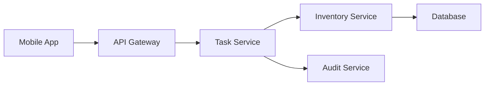
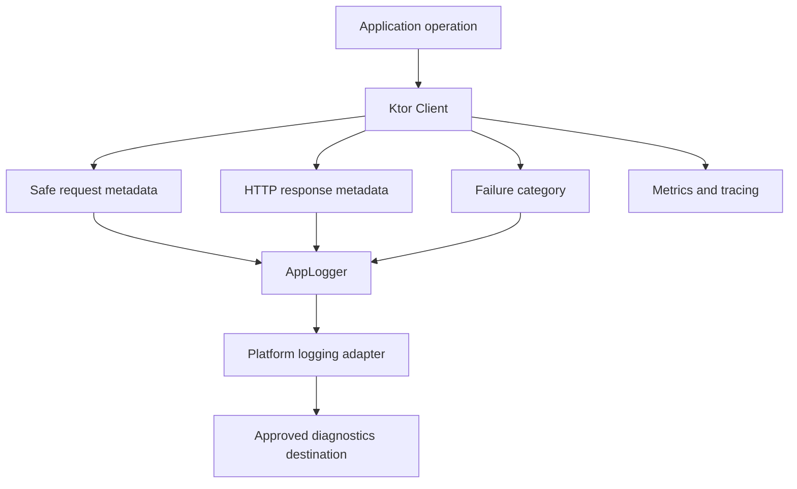

<div align="center">

# Chapter 17 — Ktor Client

### Part 6 · Logging
**Making network behavior observable without exposing sensitive data**

[](https://kotlinlang.org/)
[](https://ktor.io/)
[](#)

*An implementation-focused guide to Ktor logging, structured diagnostics, redaction, correlation IDs, platform logging, and safe production observability.*

</div>

---

> **Chapter goal**
>
> Network logging helps developers understand what an application sends, what a server returns, and where a request fails. But HTTP logs can also contain access tokens, personal information, session identifiers, and business data. This chapter explores how to make Ktor Client observable while keeping sensitive information protected.

## Table of contents

- [1. Why network logging matters](#1-why-network-logging-matters)
- [2. What should be logged](#2-what-should-be-logged)
- [3. What must not be logged](#3-what-must-not-be-logged)
- [4. Ktor Logging plugin](#4-ktor-logging-plugin)
- [5. Configuring log levels](#5-configuring-log-levels)
- [6. Header and body redaction](#6-header-and-body-redaction)
- [7. Logging request and response metadata](#7-logging-request-and-response-metadata)
- [8. Correlation IDs and distributed tracing](#8-correlation-ids-and-distributed-tracing)
- [9. A custom logging abstraction](#9-a-custom-logging-abstraction)
- [10. Platform-specific logging in KMP](#10-platform-specific-logging-in-kmp)
- [11. Logging failures and exceptions](#11-logging-failures-and-exceptions)
- [12. Performance and body logging](#12-performance-and-body-logging)
- [13. Testing logging behavior](#13-testing-logging-behavior)
- [14. Production observability strategy](#14-production-observability-strategy)
- [15. Common mistakes](#15-common-mistakes)
- [16. Production checklist](#16-production-checklist)
- [17. Final thoughts](#17-final-thoughts)

---

## 1. Why network logging matters

A network request passes through several boundaries:

1. The application creates a request.
2. The Ktor client applies default configuration and plugins.
3. The platform engine sends the request.
4. A server or gateway processes it.
5. The response travels back through the engine and client pipeline.
6. The repository maps the response into application data.

When something goes wrong, a developer needs enough evidence to identify the failing boundary.

For example, a warehouse application may show a picker that cannot load the next task. Possible causes include:

- The device has no usable network connection.
- DNS resolution failed.
- The request timed out.
- The API gateway returned `502`.
- The server returned `200` with an unexpected payload.
- Serialization failed while reading the response.
- The repository rejected a valid response during mapping.

A useful log helps distinguish these cases. A log that only says `API failed` does not.

### Logging is not the same as monitoring

| Capability | Main question |
|---|---|
| Logging | What happened during this operation? |
| Metrics | How often does this happen, and how long does it take? |
| Tracing | Which services and operations participated in this request? |
| Crash reporting | What caused the application to terminate unexpectedly? |
| Auditing | Which important business or security action occurred, and who initiated it? |

These capabilities complement one another. HTTP logs are valuable diagnostics, but they are not a replacement for metrics, tracing, or server-side audit records.

## 2. What should be logged

A good network log captures operational metadata rather than indiscriminately copying the entire HTTP exchange.

### Recommended request fields

| Field | Example | Why it helps |
|---|---|---|
| Correlation ID | `req-7f92a1` | Connects related logs |
| HTTP method | `GET` | Identifies the operation type |
| Endpoint template | `/tasks/{taskId}` | Identifies the API without exposing IDs |
| Host or service name | `warehouse-api` | Identifies the destination |
| Start time | `2026-10-30T10:15:00Z` | Establishes when the request began |
| Duration | `420 ms` | Helps investigate latency |
| Attempt number | `2` | Shows retry activity |
| Response status | `503` | Shows the server outcome |
| Result category | `success`, `timeout`, `http_error` | Makes filtering easier |

### Example structured event

```json
{
  "event": "http_request_completed",
  "requestId": "req-7f92a1",
  "method": "GET",
  "endpoint": "/tasks/{taskId}",
  "statusCode": 200,
  "durationMs": 420,
  "attempt": 1,
  "outcome": "success"
}
```

The example deliberately uses an endpoint template rather than a full URL with query parameters. Identifiers and query values can contain sensitive information.

### Keep logs consistent

Define a small set of event names and field names across the application. Consistency makes logs easier to search and helps teams build dashboards and alerts.

For example:

- `http_request_started`
- `http_request_completed`
- `http_request_failed`
- `http_request_retry`
- `http_response_parse_failed`

Avoid inventing a different naming convention in every feature module.

## 3. What must not be logged

HTTP requests and responses can contain sensitive data. A production logging policy should explicitly identify data that must be excluded or redacted.

### Sensitive information

Never log these values in plaintext:

- `Authorization` headers.
- Access tokens and refresh tokens.
- Cookies and session identifiers.
- Passwords, PINs, and one-time passcodes.
- API keys and client secrets.
- Payment card data and financial credentials.
- Personal information unless there is a documented, lawful, and necessary reason to process it.
- Healthcare or other regulated data.
- Full request or response bodies containing confidential business information.
- Sensitive query parameters.
- Device identifiers where they can identify or track a person.

A field being technically available does not mean it is appropriate to log.

### Data classification

| Classification | Example | Logging approach |
|---|---|---|
| Public | Public API version | Usually safe |
| Operational | HTTP method, status, duration | Usually safe after review |
| Internal | Warehouse or order reference | Minimize, mask, or use approved identifiers |
| Confidential | Business payload, customer details | Do not log by default |
| Secret | Tokens, passwords, API keys | Never log |

The exact classification scheme should follow the organization's security and privacy standards.

### Redaction is not deletion

Replacing a token with `***` is useful, but it does not make every other field safe. A request body may contain personal information even after the authorization header is hidden.

Use an allowlist for fields that are permitted in logs. Redaction should be a second line of defense, not the entire privacy strategy.

## 4. Ktor Logging plugin

Ktor provides the `Logging` client plugin for observing HTTP requests and responses.

Add the logging dependency using the same Ktor version as the rest of the client:

```kotlin
commonMain.dependencies {
    implementation("io.ktor:ktor-client-core:$ktorVersion")
    implementation("io.ktor:ktor-client-logging:$ktorVersion")
}
```

The plugin provides:

- Configurable log levels.
- A logger implementation.
- Header filtering.
- Request and response logging.
- Integration with Ktor's client pipeline.

### Basic installation

```kotlin
import io.ktor.client.HttpClient
import io.ktor.client.plugins.logging.LogLevel
import io.ktor.client.plugins.logging.Logging
import io.ktor.client.plugins.logging.Logger

fun createHttpClient(): HttpClient =
    HttpClient {
        install(Logging) {
            logger = Logger.DEFAULT
            level = LogLevel.HEADERS
        }
    }
```

This is a minimal setup. It should not automatically be treated as a production-safe configuration. Review the logger destination, headers, and level before enabling it in a release build.

### Use a custom logger

Ktor's logging plugin accepts a logger implementation. This allows the application to route messages through its own logging abstraction.

```kotlin
import io.ktor.client.plugins.logging.Logger

class AppKtorLogger(
    private val appLogger: AppLogger
) : Logger {

    override fun log(message: String) {
        appLogger.debug(
            tag = "KtorClient",
            message = message
        )
    }
}
```

`AppLogger` is an application-defined interface in this example. Its implementation can route messages to Android Logcat, Apple's unified logging system, a test collector, or an approved diagnostics platform.

The application logger should enforce redaction and release-build policy independently of Ktor.

## 5. Configuring log levels

Ktor's logging plugin supports different levels so teams can choose how much detail is collected.

| Level | Typical content | Appropriate use |
|---|---|---|
| `NONE` | No plugin output | Production default when HTTP detail is not required |
| `INFO` | Request and response summary information | Controlled diagnostics |
| `HEADERS` | Request and response headers | Development with redaction |
| `BODY` | Headers and bodies | Local debugging with synthetic data |
| `ALL` | Fullest plugin-level detail | Temporary, tightly controlled investigation |

The exact messages and coverage depend on Ktor's version and pipeline behavior.

### Environment-based configuration

```kotlin
enum class NetworkLogMode {
    OFF,
    INFO,
    HEADERS,
    BODY
}

data class NetworkConfig(
    val logMode: NetworkLogMode,
    val isDebugBuild: Boolean
)
```

Use the configuration to select a safe level:

```kotlin
fun NetworkConfig.toKtorLogLevel(): LogLevel =
    when {
        !isDebugBuild -> LogLevel.NONE

        else -> when (logMode) {
            NetworkLogMode.OFF -> LogLevel.NONE
            NetworkLogMode.INFO -> LogLevel.INFO
            NetworkLogMode.HEADERS -> LogLevel.HEADERS
            NetworkLogMode.BODY -> LogLevel.BODY
        }
    }
```

Install it:

```kotlin
install(Logging) {
    logger = AppKtorLogger(appLogger)
    level = networkConfig.toKtorLogLevel()
    sanitizeHeader { header ->
        header in sensitiveHeaders
    }
}
```

The example uses a project-defined `sensitiveHeaders` collection. Verify the exact `sanitizeHeader` callback signature in the Ktor version pinned by your project.

### Important: debug builds are not automatically safe

Debug builds may contain real user data, production endpoints, or credentials. A debug flag should not be the only privacy control.

Prefer:
- Synthetic data in development.
- Redaction in every build type.
- Explicit opt-in for verbose body logging.
- No secret logging in any environment.
- Release defaults that minimize diagnostic detail.

## 6. Header and body redaction

Ktor's logging plugin supports header sanitization. Use it to hide known sensitive header values.

### Sanitize sensitive headers

```kotlin
private val sensitiveHeaders = setOf(
    HttpHeaders.Authorization,
    HttpHeaders.Cookie,
    HttpHeaders.SetCookie,
    "X-Api-Key"
)

install(Logging) {
    logger = AppKtorLogger(appLogger)
    level = LogLevel.HEADERS

    sanitizeHeader { header ->
        header in sensitiveHeaders
    }
}
```

This example demonstrates the intended configuration. Check the imports and callback signature for your Ktor release.

Header names are case-insensitive under HTTP semantics. If you maintain your own comparison logic, normalize names or use a case-insensitive collection.

### Do not assume header sanitization protects bodies

Consider this request:

```json
{
  "username": "alex@example.com",
  "password": "example-password",
  "accessToken": "secret-token"
}
```

No header filter can remove these fields from a body log.

For production, the safest default is to avoid body logging. If body diagnostics are genuinely required, design an explicit body-sanitization strategy around known DTOs and approved fields. Do not attempt to solve arbitrary JSON redaction with a fragile regular expression.

### Prefer allowlisted diagnostic DTOs

Instead of logging an entire request object:

```kotlin
data class TaskUpdateRequest(
    val taskId: String,
    val quantity: Int,
    val employeeToken: String,
    val notes: String?
)
```

Create a separate safe diagnostic representation:

```kotlin
data class TaskUpdateLog(
    val operation: String,
    val quantity: Int,
    val hasNotes: Boolean
)

fun TaskUpdateRequest.toSafeLog(): TaskUpdateLog =
    TaskUpdateLog(
        operation = "task_update",
        quantity = quantity,
        hasNotes = !notes.isNullOrBlank()
    )
```

The safe representation deliberately excludes the token, task identifier, and note content.

This approach is explicit, reviewable, and less likely to leak data when DTOs evolve.

## 7. Logging request and response metadata

For many production investigations, a concise request summary is more useful than a complete body dump.

### Example application-level event

```kotlin
data class HttpLogEvent(
    val requestId: String?,
    val method: String,
    val endpoint: String,
    val statusCode: Int?,
    val durationMs: Long?,
    val outcome: String
)
```

A logger interface can accept structured events:

```kotlin
interface NetworkEventLogger {
    fun log(event: HttpLogEvent)
}
```

The platform implementation can serialize these fields into the organization's approved logging format.

### Measuring duration

Use a monotonic time source for elapsed duration rather than subtracting wall-clock timestamps. Wall clocks can change while a request is running.

A simplified Kotlin example:

```kotlin
suspend fun <T> measureNetworkOperation(
    operation: String,
    logger: NetworkEventLogger,
    block: suspend () -> T
): T {
    val startedAt = TimeSource.Monotonic.markNow()

    return try {
        block().also {
            logger.log(
                HttpLogEvent(
                    requestId = null,
                    method = "UNKNOWN",
                    endpoint = operation,
                    statusCode = null,
                    durationMs = startedAt.elapsedNow().inWholeMilliseconds,
                    outcome = "success"
                )
            )
        }
    } catch (cause: CancellationException) {
        throw cause
    } catch (cause: Exception) {
        logger.log(
            HttpLogEvent(
                requestId = null,
                method = "UNKNOWN",
                endpoint = operation,
                statusCode = null,
                durationMs = startedAt.elapsedNow().inWholeMilliseconds,
                outcome = "failure"
            )
        )
        throw cause
    }
}
```

This wrapper measures an application operation, not necessarily an individual HTTP attempt. If Ktor retries internally, the measured duration includes the retry delays and attempts.

The sample uses Kotlin's `TimeSource.Monotonic`; ensure the Kotlin version and imports are aligned with your project. A production implementation should also record a safe failure category without logging exception messages blindly.

## 8. Correlation IDs and distributed tracing

A mobile request often passes through multiple services:



If every service creates unrelated log identifiers, connecting the events becomes difficult.

A correlation ID provides a shared identifier that can travel through the request chain.

### Add a request ID

```kotlin
fun createRequestId(): String =
    generateCorrelationId()
```

`generateCorrelationId()` is a project-specific placeholder. Use a suitable UUID or approved identifier generator.

Attach it to requests:

```kotlin
install(DefaultRequest) {
    headers {
        append("X-Correlation-ID", createRequestId())
    }
}
```

This simplified example generates the value while configuring a default request. Depending on the plugin lifecycle and desired semantics, it may be evaluated at client configuration time rather than once per outgoing request. For a unique ID per request, generate it in a request-level interceptor or API execution wrapper.

### Correlation ID vs trace ID

| Identifier | Purpose |
|---|---|
| Request ID | Identifies one HTTP request or attempt |
| Correlation ID | Connects related operations across application and services |
| Trace ID | Identifies a distributed trace |
| Span ID | Identifies one operation within a trace |

Do not use these terms interchangeably if your observability platform follows distributed tracing conventions.

### W3C Trace Context

Distributed tracing commonly uses the W3C Trace Context standard, including the `traceparent` header. If your backend and observability platform support it, use a compatible tracing implementation rather than inventing a custom propagation format.

A trace context must be propagated consistently across service boundaries. Avoid generating a new trace ID for every retry if the retries are part of the same logical operation; represent attempts as separate spans or events under the same trace where your tracing design supports that model.

## 9. A custom logging abstraction

A shared KMP module should not depend directly on Android Logcat or Apple's logging APIs.

Define a small common interface:

```kotlin
interface AppLogger {
    fun debug(tag: String, message: String)
    fun info(tag: String, message: String)
    fun warn(tag: String, message: String)
    fun error(
        tag: String,
        message: String,
        cause: Throwable? = null
    )
}
```

Provide a no-op implementation:

```kotlin
object NoOpAppLogger : AppLogger {
    override fun debug(tag: String, message: String) = Unit
    override fun info(tag: String, message: String) = Unit
    override fun warn(tag: String, message: String) = Unit

    override fun error(
        tag: String,
        message: String,
        cause: Throwable?
    ) = Unit
}
```

A no-op logger is useful for tests, restricted builds, or applications that inject a different logging implementation.

### Use the abstraction in Ktor

```kotlin
class KtorAppLogger(
    private val logger: AppLogger
) : Logger {

    override fun log(message: String) {
        logger.debug(
            tag = "KtorClient",
            message = message
        )
    }
}
```

Install it:

```kotlin
install(Logging) {
    logger = KtorAppLogger(appLogger)
    level = LogLevel.INFO
}
```

Ktor's plugin messages are formatted strings. If you need reliable structured events, use an application-level event logger alongside the plugin instead of trying to parse formatted log text.

### Why not expose Ktor's logger everywhere?

The repository and domain layers should not need to know about Ktor's logging types. A small application abstraction keeps the networking implementation replaceable and makes unit testing easier.

## 10. Platform-specific logging in KMP

Kotlin Multiplatform lets the shared networking layer describe what should be logged while platform source sets decide where approved events go.

### Android implementation

A simplified Android implementation can use Logcat:

```kotlin
class AndroidAppLogger : AppLogger {

    override fun debug(tag: String, message: String) {
        Log.d(tag, message)
    }

    override fun info(tag: String, message: String) {
        Log.i(tag, message)
    }

    override fun warn(tag: String, message: String) {
        Log.w(tag, message)
    }

    override fun error(
        tag: String,
        message: String,
        cause: Throwable?
    ) {
        Log.e(tag, message, cause)
    }
}
```

Import `android.util.Log` in `androidMain`. Apply the application's redaction policy before forwarding any message.

### iOS implementation

On iOS, use Apple's unified logging system through an appropriate Kotlin/Native interop wrapper or a multiplatform logging library configured for the project.

A common abstraction keeps the shared code independent:

```kotlin
class IosAppLogger : AppLogger {

    override fun debug(tag: String, message: String) {
        iosLogDebug(tag, message)
    }

    override fun info(tag: String, message: String) {
        iosLogInfo(tag, message)
    }

    override fun warn(tag: String, message: String) {
        iosLogWarning(tag, message)
    }

    override fun error(
        tag: String,
        message: String,
        cause: Throwable?
    ) {
        iosLogError(
            tag = tag,
            message = message,
            causeDescription = cause?.let(::safeErrorCategory)
        )
    }
}
```

The `iosLogDebug`, `iosLogInfo`, `iosLogWarning`, `iosLogError`, and `safeErrorCategory` functions are project-specific adapters, not built-in Kotlin APIs. Implement them using the iOS logging mechanism selected by your team.

Apple's unified logging supports privacy-aware fields. Configure sensitive values as private rather than assuming that a message is safe because it is written to the device console.

### Dependency injection

Inject the logger into the shared client factory:

```kotlin
class NetworkClientFactory(
    private val appLogger: AppLogger,
    private val networkConfig: NetworkConfig
) {
    fun create(
        engine: HttpClientEngine
    ): HttpClient =
        HttpClient(engine) {
            install(Logging) {
                logger = KtorAppLogger(appLogger)
                level = networkConfig.toKtorLogLevel()
            }
        }
}
```

The platform composition root supplies the appropriate logger and engine. This follows the same dependency-injection principles used elsewhere in a KMP application.

## 11. Logging failures and exceptions

A failure log should explain the category of failure without exposing secrets or dumping arbitrary exception messages.

### Classify failures

```kotlin
enum class NetworkFailureCategory {
    TIMEOUT,
    CONNECTION,
    HTTP_ERROR,
    SERIALIZATION,
    CANCELLATION,
    UNKNOWN
}
```

A simplified classifier:

```kotlin
fun classifyFailure(
    cause: Throwable
): NetworkFailureCategory =
    when (cause) {
        is CancellationException ->
            NetworkFailureCategory.CANCELLATION

        is SerializationException ->
            NetworkFailureCategory.SERIALIZATION

        is HttpRequestTimeoutException ->
            NetworkFailureCategory.TIMEOUT

        is IOException ->
            NetworkFailureCategory.CONNECTION

        else ->
            NetworkFailureCategory.UNKNOWN
    }
```

The imports and exception hierarchy depend on the Ktor and Kotlin versions in use. On different engines, a transport failure may be wrapped in a platform-specific exception. Avoid assuming that every connection problem is always represented by one common exception type.

### Do not swallow failures while logging

Logging should be a side effect, not a replacement for error handling.

```kotlin
suspend fun loadDashboard(): Dashboard {
    return try {
        dashboardApi.loadDashboard().toDomain()
    } catch (cause: CancellationException) {
        throw cause
    } catch (cause: Exception) {
        appLogger.error(
            tag = "DashboardRepository",
            message = "Dashboard request failed: ${safeErrorCategory(cause)}"
        )
        throw cause
    }
}
```

`safeErrorCategory` should return a controlled category or safe diagnostic code. Avoid interpolating arbitrary exception messages because they may include URLs, query parameters, payload fragments, or other sensitive data.

### Logging HTTP errors

If `expectSuccess = true`, Ktor can throw for non-success HTTP responses. If it is false, the application can inspect the response status directly.

Choose one approach deliberately. Do not log the same failure in the Ktor plugin, API wrapper, repository, and UI without a clear reason. Duplicate logs make incidents harder to investigate.

## 12. Performance and body logging

Logging has a cost. It can increase CPU usage, allocations, disk writes, and network usage if events are uploaded remotely.

Body logging is particularly expensive for large responses, file downloads, streaming APIs, and frequently refreshed endpoints.

### Practical guidelines

- Keep body logging disabled by default.
- Avoid logging binary, image, video, and file content.
- Do not buffer large streaming responses just to log them.
- Avoid expensive string formatting when the log level is disabled.
- Keep log messages bounded in size.
- Use structured events for high-volume telemetry.
- Batch remote diagnostics according to product and privacy requirements.
- Avoid synchronous disk or network writes on the request execution path.
- Apply sampling to noisy, repetitive events where appropriate.

### Logging and streaming bodies

A response body may be consumed as a stream. Reading it for logging can change how it is consumed, require buffering, or interfere with memory usage.

Before enabling body logging, understand:
- Whether the body is replayable.
- Whether the plugin or engine buffers it.
- Whether the response is large or unbounded.
- Whether the content contains sensitive information.
- Whether logging changes the timing or behavior of the request.

For production APIs, metadata is usually sufficient.

## 13. Testing logging behavior

Logging is part of the application's security boundary. Test it just as you test authentication and serialization.

### Test with a recording logger

```kotlin
class RecordingAppLogger : AppLogger {

    val messages = mutableListOf<String>()

    override fun debug(tag: String, message: String) {
        messages += "DEBUG:$tag:$message"
    }

    override fun info(tag: String, message: String) {
        messages += "INFO:$tag:$message"
    }

    override fun warn(tag: String, message: String) {
        messages += "WARN:$tag:$message"
    }

    override fun error(
        tag: String,
        message: String,
        cause: Throwable?
    ) {
        messages += "ERROR:$tag:$message"
    }
}
```

This fake logger allows tests to inspect what the application sends to its logging boundary.

### Test redaction

```kotlin
@Test
fun authorizationHeaderIsNotExposed() {
    val logger = RecordingAppLogger()

    val secret = "Bearer very-secret-token"

    val safeMessage = redactSensitiveHeader(
        headerName = HttpHeaders.Authorization,
        value = secret
    )

    logger.debug("Network", safeMessage)

    assertFalse(
        logger.messages.any { it.contains("very-secret-token") }
    )
}
```

`redactSensitiveHeader` is an application-defined function in this example. It should be tested independently and used consistently by the logging adapter.

### Essential test cases

| Test | Expected result |
|---|---|
| Authorization header | Secret value is redacted |
| Cookie header | Cookie value is redacted |
| API key header | Key value is redacted |
| Sensitive query parameter | Value is excluded or masked |
| Request body | Not logged by default |
| Response body | Not logged by default |
| Release configuration | Verbose logging is disabled |
| Cancellation | Not reported as an ordinary network error |
| Logger failure | Does not change the HTTP result |
| Large payload | Does not create an unbounded log event |

Also test that the logging layer does not alter request behavior or consume a response body unexpectedly.

## 14. Production observability strategy

A practical production approach combines a small number of safe client events with server-side telemetry.

### Suggested event flow



The diagnostics destination may be local logs, an approved crash/diagnostics platform, or a centralized observability service. Choose it according to the application's security and retention requirements.

### Separate diagnostic logging from audit logging

Network diagnostics answer technical questions. Audit logs record important business or security events.

For example:

- Diagnostic: `POST /tasks/{id}` returned `503` after 2 attempts.
- Audit: A picker completed task `TASK-1042` at a recorded time.

Do not treat a client-side diagnostic log as authoritative proof that a business operation succeeded. The server should own authoritative audit records for server-side actions.

### Retention and access

Define:
- Which events are collected.
- Which environments collect them.
- Who can access them.
- How long they are retained.
- Whether users can request data deletion.
- Whether data is transferred outside the device or region.
- How access to diagnostic systems is audited.

Logging is a data-processing activity. Follow applicable privacy, security, and organizational requirements.

## 15. Common mistakes

### 15.1 Enabling `LogLevel.ALL` in production

Full request logging can expose credentials and business data.

**Better:** use `NONE` or a deliberately limited production mode, with approved structured events.

### 15.2 Redacting only the authorization header

Tokens can also appear in query parameters, cookies, or request bodies.

**Better:** use data classification, field allowlists, and comprehensive redaction.

### 15.3 Logging entire DTOs

DTOs change over time. A field added months later may contain sensitive information and silently begin appearing in logs.

**Better:** create explicit safe diagnostic representations.

### 15.4 Logging arbitrary exception messages

Exception messages can include URLs, payload fragments, or platform details.

**Better:** log a controlled failure category and safe error code.

### 15.5 Mixing logging with business logic

Repositories should not contain repeated formatting and platform-specific logging code.

**Better:** use a shared logging abstraction and focused diagnostic events.

### 15.6 Treating debug mode as a privacy policy

Debug builds can still use real accounts and production services.

**Better:** enforce redaction in every build and keep verbose logging explicitly controlled.

### 15.7 Logging the same failure at every layer

The same request can produce multiple nearly identical entries.

**Better:** define which layer owns each event. Log once at the boundary that has the most useful context.

### 15.8 Ignoring log volume

Large payloads and frequent polling can generate huge amounts of output.

**Better:** prefer metadata, sampling, bounded messages, and metrics.

### 15.9 Generating a new correlation ID at the wrong time

A client-wide ID may be reused across unrelated requests, or a new ID may be generated for every retry when the system expects one logical trace.

**Better:** define identifier scope explicitly: per operation, per request, or per attempt.

## 16. Production checklist

- [ ] Use one aligned Ktor version for all client artifacts.
- [ ] Install `Logging` only with an intentional configuration.
- [ ] Use an application-owned logger abstraction.
- [ ] Disable verbose body logging by default.
- [ ] Redact authorization, cookie, API-key, and other sensitive headers.
- [ ] Avoid logging request and response bodies by default.
- [ ] Use allowlisted diagnostic fields.
- [ ] Exclude secrets and sensitive query parameters.
- [ ] Log status, duration, method, endpoint template, and safe failure category.
- [ ] Define correlation and trace identifier scope.
- [ ] Preserve cancellation semantics.
- [ ] Avoid logging the same failure repeatedly at multiple layers.
- [ ] Keep log events bounded and inexpensive.
- [ ] Test redaction and release-build behavior.
- [ ] Review retention, access control, and data-transfer requirements.
- [ ] Verify behavior on Android and iOS.
- [ ] Revisit the policy when API DTOs or security requirements change.

## 17. Final thoughts

Network logging is essential for diagnosing failures in a distributed application, but collecting more data does not automatically create better observability.

A good Ktor logging setup captures the information engineers need—request method, endpoint, status, duration, retry attempt, and failure category—while deliberately excluding credentials and sensitive payloads.

For Kotlin Multiplatform, keep the logging contract in shared code and let Android and iOS provide their platform-specific destinations. Use structured events for operational insight, tracing for cross-service journeys, metrics for trends, and server-side audit logs for authoritative business records.

The guiding principle is simple:

> **Log enough to understand what happened, but never expose more data than the investigation requires.**

---

<div align="center">

**End of Chapter 17 · Part 6 — Logging**

*Reliable networking is not only about sending requests. It is also about understanding them safely.*

</div>
