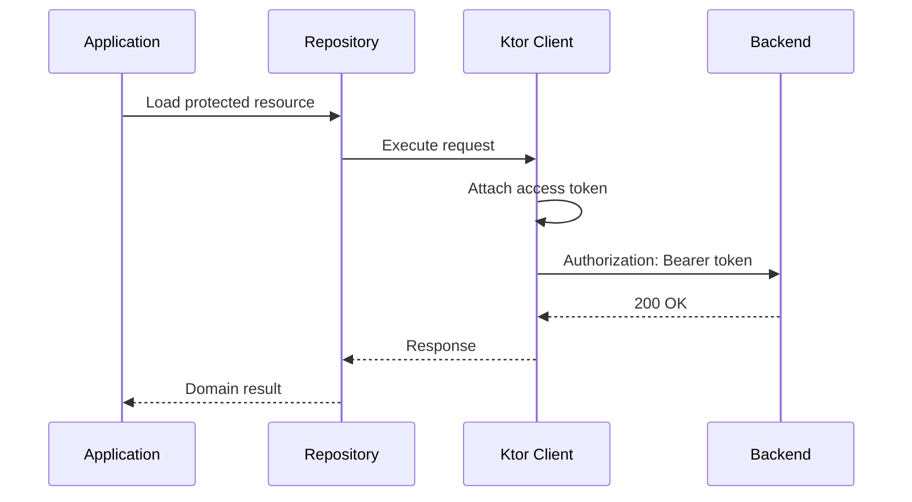
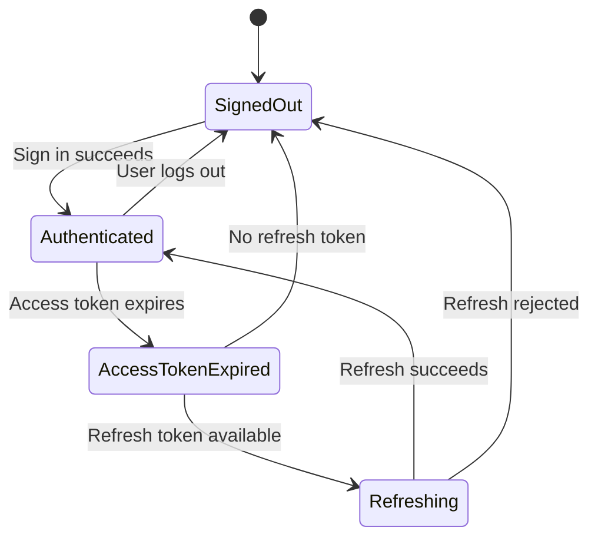
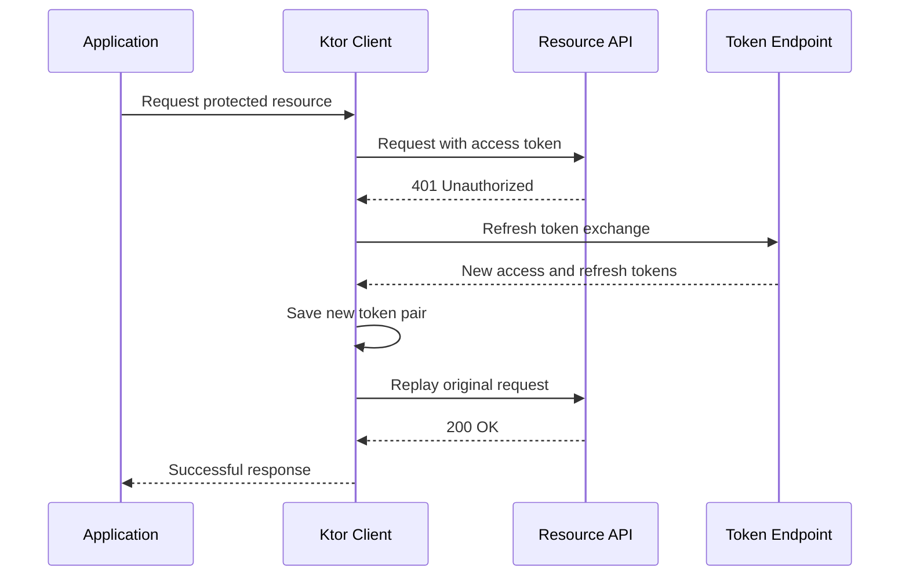
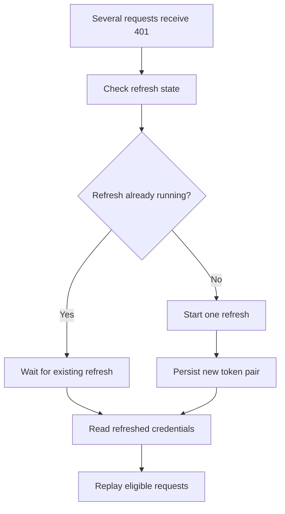

<div align="center">

# Chapter 17 — Ktor Client

### Part 7 · Authentication
**Protecting API access with tokens, refresh flows, and secure session handling**

[](https://kotlinlang.org/)
[](https://ktor.io/)
[](#)

*An implementation-focused guide to Ktor authentication, bearer tokens, refresh coordination, secure storage boundaries, request replay, and KMP architecture.*

</div>

---

> **Chapter goal**
>
> Authentication is more than attaching an `Authorization` header. A production client must obtain credentials, attach them safely, handle expiration, coordinate refresh across concurrent requests, protect tokens at rest, and respond correctly when a session is revoked. This chapter builds those responsibilities around Ktor Client without leaking authentication concerns into domain code.

## Table of contents

- [1. Authentication and authorization](#1-authentication-and-authorization)
- [2. Common API authentication mechanisms](#2-common-api-authentication-mechanisms)
- [3. Bearer token authentication](#3-bearer-token-authentication)
- [4. Ktor Auth plugin](#4-ktor-auth-plugin)
- [5. Configuring bearer authentication](#5-configuring-bearer-authentication)
- [6. Token storage and security boundaries](#6-token-storage-and-security-boundaries)
- [7. Access token and refresh token lifecycle](#7-access-token-and-refresh-token-lifecycle)
- [8. Refreshing expired tokens](#8-refreshing-expired-tokens)
- [9. Concurrent refresh and single-flight coordination](#9-concurrent-refresh-and-single-flight-coordination)
- [10. Replaying the original request safely](#10-replaying-the-original-request-safely)
- [11. Authentication failure handling](#11-authentication-failure-handling)
- [12. Logout, revocation, and session expiry](#12-logout-revocation-and-session-expiry)
- [13. KMP architecture](#13-kmp-architecture)
- [14. Testing authentication with MockEngine](#14-testing-authentication-with-mockengine)
- [15. Security best practices](#15-security-best-practices)
- [16. Common mistakes](#16-common-mistakes)
- [17. Production checklist](#17-production-checklist)
- [18. Final thoughts](#18-final-thoughts)

---

## 1. Authentication and authorization

Authentication and authorization are related, but they solve different problems.

- **Authentication** answers: Who is making this request?
- **Authorization** answers: Is this identity allowed to perform this action?

For example, a warehouse picker signs in to an application. The identity provider authenticates the picker and issues credentials. The backend then checks whether that picker is permitted to access a particular warehouse, task, or inventory operation.

The mobile client can present credentials, but the backend must enforce authorization. Hiding a button in the UI is not an authorization control.

### Typical authenticated request flow



When the token is expired, a refresh flow may be required before the original operation can complete.

## 2. Common API authentication mechanisms

Different APIs use different authentication mechanisms. Select the mechanism based on the identity provider and backend contract.

| Mechanism | How it works | Common use |
|---|---|---|
| Basic authentication | Encodes username and password in an HTTP header | Limited legacy or internal APIs over TLS |
| Bearer token | Sends a token in the `Authorization` header | OAuth 2.0 access tokens and many API platforms |
| API key | Sends a service or application key | Service identification, quotas, or restricted APIs |
| OAuth 2.0 | Delegated authorization framework | User authorization and access to protected resources |
| OpenID Connect | Identity layer built on OAuth 2.0 | User sign-in and identity claims |
| Mutual TLS | Both sides authenticate using certificates | High-trust service communication |
| Signed requests | Request components are cryptographically signed | Some cloud and partner APIs |

An API key embedded in a mobile application is not a secret: an attacker can extract it from the application package or runtime. Do not use a static client-side API key as proof of a user's identity.

For user sign-in, native applications commonly use an authorization flow designed for public clients, such as OAuth 2.0 Authorization Code with PKCE through the system browser or an approved identity SDK. Do not collect a user's identity-provider password directly in a custom embedded login screen unless the identity provider explicitly supports that approach.

## 3. Bearer token authentication

A bearer token grants access to whoever possesses it. The client sends it in the HTTP authorization header:

```http
GET /api/profile
Authorization: Bearer eyJ...
Accept: application/json
```

The token should be transmitted only over TLS. A bearer token must be treated like a password: anyone who obtains it may be able to use it until it expires or is revoked.

### Access token vs refresh token

| Property | Access token | Refresh token |
|---|---|---|
| Purpose | Access protected APIs | Obtain a new access token |
| Typical lifetime | Shorter | Longer, according to provider policy |
| Sent to resource API | Yes | No |
| Sent to token endpoint | Usually no | Yes |
| Storage | Protected storage | Strongly protected storage |
| Exposure impact | Unauthorized API access | Potentially prolonged session compromise |

Never attach a refresh token to ordinary resource-server requests. It should be sent only to the trusted token endpoint using the provider's required protocol.

### JWT is not automatically encrypted

A JSON Web Token (JWT) is often signed, not encrypted. Its claims may be readable by anyone who obtains the token. Do not put secrets or unnecessary personal data in JWT claims, and do not treat client-side decoding as proof that a token is valid. The resource server must validate the signature, issuer, audience, expiration, and relevant claims.

## 4. Ktor Auth plugin

Ktor provides the `Auth` client plugin for authentication mechanisms such as bearer and basic authentication.

Add the required dependency using the same Ktor version as the other client artifacts:

```kotlin
commonMain.dependencies {
    implementation("io.ktor:ktor-client-core:$ktorVersion")
    implementation("io.ktor:ktor-client-auth:$ktorVersion")
}
```

The bearer provider can:
- Load credentials.
- Attach a bearer token to requests.
- Respond to an authentication challenge.
- Refresh credentials through a configured callback.
- Use refreshed credentials for an eligible request retry.

The exact behavior depends on the provider configuration, server response, and Ktor version.

### Why use the plugin?

Without a shared authentication boundary, every API function can end up doing this:

```kotlin
suspend fun loadProfile(): ProfileDto {
    val token = tokenStore.getAccessToken()

    return client.get("/profile") {
        header(
            HttpHeaders.Authorization,
            "Bearer $token"
        )
    }.body()
}
```

This duplicates token handling and makes expiration behavior inconsistent.

With a central authentication plugin, repositories can call the API without manually attaching credentials to every request.

## 5. Configuring bearer authentication

A typical bearer setup uses a token store and a refresh operation.

### Define a token model

```kotlin
data class AuthTokens(
    val accessToken: String,
    val refreshToken: String,
    val expiresAtEpochSeconds: Long
)
```

Avoid logging this object or using its generated `toString()` output in diagnostics.

### Define a token store

```kotlin
interface TokenStore {
    suspend fun readTokens(): AuthTokens?

    suspend fun saveTokens(tokens: AuthTokens)

    suspend fun clearTokens()
}
```

The interface belongs in shared code. Platform-specific implementations decide how tokens are stored securely.

### Configure the bearer provider

```kotlin
import io.ktor.client.HttpClient
import io.ktor.client.plugins.auth.Auth
import io.ktor.client.plugins.auth.providers.BearerTokens
import io.ktor.client.plugins.auth.providers.bearer

fun createAuthenticatedClient(
    engine: HttpClientEngine,
    tokenStore: TokenStore,
    authApi: AuthApi
): HttpClient =
    HttpClient(engine) {
        install(Auth) {
            bearer {
                loadTokens {
                    tokenStore.readTokens()?.let { tokens ->
                        BearerTokens(
                            accessToken = tokens.accessToken,
                            refreshToken = tokens.refreshToken
                        )
                    }
                }

                refreshTokens {
                    val current = tokenStore.readTokens()
                        ?: return@refreshTokens null

                    val refreshed = authApi.refresh(
                        refreshToken = current.refreshToken
                    )

                    tokenStore.saveTokens(refreshed)

                    BearerTokens(
                        accessToken = refreshed.accessToken,
                        refreshToken = refreshed.refreshToken
                    )
                }
            }
        }
    }
```

`AuthApi`, `TokenStore`, and `AuthTokens` are application-defined types. The example focuses on the Ktor integration; the refresh endpoint must be implemented according to the identity provider's protocol.

In a real client, also configure:
- The trusted token endpoint.
- Which requests receive bearer credentials.
- Whether credentials are sent preemptively or after a challenge.
- How refresh failures clear or preserve the session.
- How concurrent refresh attempts are coordinated.
- How the original request is safely replayed.

### Do not send credentials to every host

If a client can call multiple hosts, do not allow a bearer token to be attached indiscriminately. Restrict authenticated requests to the expected origin or use separate clients for different trust boundaries.

A useful architecture is:
- An authenticated resource client for the protected API.
- A separate authentication client for sign-in and token refresh.
- A public client for unauthenticated endpoints, if needed.

This prevents accidental credential leakage to unrelated hosts and avoids recursive authentication behavior in the refresh call.

## 6. Token storage and security boundaries

The shared `TokenStore` interface should not decide how secrets are persisted. Secure storage is platform-specific.

### Android

Use Android Keystore-backed cryptographic protection through an appropriate secure-storage implementation. A common design stores encrypted token data in private application storage while protecting the encryption key with Android Keystore.

Consider:
- Key invalidation and recovery behavior.
- Device backup rules.
- Whether tokens should be excluded from backups.
- Device lock and biometric requirements where applicable.
- Logout cleanup.
- Rooted-device threat assumptions.

Do not assume that ordinary preferences or a plain local database are secure token stores merely because they are private to the application sandbox.

### iOS

Use the Keychain for sensitive credentials. Select an accessibility class that matches the product's security and background-access requirements.

Consider:
- Whether credentials should be available only while the device is unlocked.
- Whether they should migrate to another device through backup.
- Access groups and app extensions.
- Keychain item cleanup on logout.
- Behavior after reinstall, restore, or device migration.

### Shared contract, platform implementations

```kotlin
// commonMain
interface TokenStore {
    suspend fun readTokens(): AuthTokens?
    suspend fun saveTokens(tokens: AuthTokens)
    suspend fun clearTokens()
}
```

```kotlin
// androidMain
class AndroidTokenStore(
    private val secureStorage: AndroidSecureStorage
) : TokenStore {
    override suspend fun readTokens(): AuthTokens? =
        secureStorage.readAuthTokens()

    override suspend fun saveTokens(tokens: AuthTokens) {
        secureStorage.writeAuthTokens(tokens)
    }

    override suspend fun clearTokens() {
        secureStorage.deleteAuthTokens()
    }
}
```

```kotlin
// iosMain
class IosTokenStore(
    private val keychain: IosKeychainStorage
) : TokenStore {
    override suspend fun readTokens(): AuthTokens? =
        keychain.readAuthTokens()

    override suspend fun saveTokens(tokens: AuthTokens) {
        keychain.writeAuthTokens(tokens)
    }

    override suspend fun clearTokens() {
        keychain.deleteAuthTokens()
    }
}
```

`AndroidSecureStorage` and `IosKeychainStorage` are project-specific adapters. They are not standard Kotlin APIs. Their implementations should use reviewed platform libraries or native secure-storage APIs.

## 7. Access token and refresh token lifecycle

A token lifecycle should be explicit rather than scattered across repositories.



### Token lifecycle responsibilities

| Operation | Responsibility |
|---|---|
| Sign in | Obtain credentials through the approved identity flow |
| Persist | Save tokens through protected storage |
| Load | Read credentials when creating an authenticated request |
| Attach | Add the access token to a trusted resource request |
| Refresh | Exchange the refresh token at the token endpoint |
| Replace | Persist the new token pair atomically |
| Revoke | Call the provider's revocation endpoint when supported |
| Logout | Clear local credentials and application session state |

### Expiration time

If the identity provider returns `expires_in`, calculate an expiration time using a trusted time source:

```kotlin
data class TokenResponse(
    val accessToken: String,
    val refreshToken: String,
    val expiresInSeconds: Long
)

fun TokenResponse.toAuthTokens(
    nowEpochSeconds: Long
): AuthTokens =
    AuthTokens(
        accessToken = accessToken,
        refreshToken = refreshToken,
        expiresAtEpochSeconds = nowEpochSeconds + expiresInSeconds
    )
```

Use a small refresh safety window to avoid starting a request at the exact expiration boundary. The window should account for clock skew and expected request duration, but should not trigger excessive refreshes.

The server remains authoritative. A client-side expiration estimate cannot guarantee that the server will accept a token.

## 8. Refreshing expired tokens

A common access-token flow looks like this:



### Important refresh rules

1. Refresh only when the response indicates an authentication problem that the provider defines as refreshable.
2. Do not refresh on every `401` without checking the API contract.
3. Do not treat `403 Forbidden` as an expired token by default.
4. Use a separate client or a clearly isolated path for the refresh endpoint.
5. Replace access and refresh tokens together when the provider rotates refresh tokens.
6. If refresh fails permanently, transition the session to a signed-out or reauthentication-required state.
7. Do not retry indefinitely.

### Refresh token rotation

Some identity providers rotate refresh tokens. Each successful refresh returns a new refresh token, and the previous token becomes invalid.

The client must persist the new pair before another operation tries to refresh. If the application stores only the new access token and loses the rotated refresh token, the next refresh may fail and force the user to sign in again.

Treat saving the new pair as one logical operation. The storage implementation should avoid exposing a partially updated token state.

## 9. Concurrent refresh and single-flight coordination

One of the most common authentication bugs appears when multiple requests fail at the same time.

Imagine a screen loads five resources concurrently. All five requests use an expired access token and receive `401`.

Without coordination:

```text
Request A → refresh token
Request B → refresh token
Request C → refresh token
Request D → refresh token
Request E → refresh token
```

If refresh-token rotation is enabled, one refresh may invalidate the token used by the others. The result can be a cascade of authentication failures.

### Single-flight refresh

A single-flight mechanism ensures that concurrent requests share one refresh operation.



### A coordinator abstraction

```kotlin
interface TokenRefreshCoordinator {
    suspend fun refreshIfNeeded(): AuthTokens?
}
```

The coordinator owns synchronization and token replacement. The Ktor authentication callback delegates to it rather than implementing refresh logic inline.

A simplified coroutine implementation can use a `Mutex`:

```kotlin
class DefaultTokenRefreshCoordinator(
    private val tokenStore: TokenStore,
    private val authApi: AuthApi,
    private val mutex: Mutex
) : TokenRefreshCoordinator {

    override suspend fun refreshIfNeeded(): AuthTokens? =
        mutex.withLock {
            val latest = tokenStore.readTokens()
                ?: return@withLock null

            // Another request may already have refreshed the token
            // while this caller was waiting for the lock.
            if (!latest.isExpired()) {
                return@withLock latest
            }

            val refreshed = authApi.refresh(latest.refreshToken)
            tokenStore.saveTokens(refreshed)
            refreshed
        }
}
```

`isExpired()` is a project-defined helper that should include an appropriate safety window. The sample assumes the coordinator can distinguish a genuinely expired token from a token that another request has already refreshed.

A `Mutex` serializes refresh attempts, but the implementation still needs a correct stale-token check. If the provider uses token rotation, compare the token version or current credential state before starting a second exchange.

### Scope and lifecycle matter

The coordinator must be shared by all requests that participate in the same session. Creating a new coordinator for every repository or request defeats single-flight behavior.

At the same time, do not use one global coordinator for unrelated user sessions or accounts. Scope it to the authenticated session and replace it when the identity changes.

## 10. Replaying the original request safely

After a successful refresh, the client may need to send the original request again.

This introduces a critical question: can the request body be replayed?

### Replayable and non-replayable requests

| Request type | Replay considerations |
|---|---|
| Small JSON `GET` | Usually straightforward |
| JSON `PUT` | Usually replayable if the body is repeatable and operation semantics are safe |
| JSON `POST` | Requires an idempotency contract for safe replay |
| Multipart upload | Depends on how the content is produced and whether it can be recreated |
| File stream | May not be replayable after consumption |
| WebSocket handshake | Requires a separate reconnection strategy |

Ktor's authentication plugin can manage supported request replay behavior, but it cannot make every arbitrary body repeatable or every business operation idempotent.

### Idempotency for write operations

For an operation that changes server state, use an idempotency key when the backend supports it:

```http
POST /orders
Authorization: Bearer <access-token>
Idempotency-Key: 3a5c...
Content-Type: application/json
```

The key must remain the same for the logical operation, including authentication replay. Do not generate a new key for the retry.

The server must enforce deduplication. A client-generated key without server support provides no guarantee.

### Avoid recursive refresh

The refresh request itself should not pass through the same expired-token refresh flow. Otherwise:

```text
Original request gets 401
    → refresh request gets 401
        → refresh request tries to refresh
            → recursive authentication loop
```

Use a dedicated authentication client or explicitly exclude the token endpoint from the refresh mechanism.

## 11. Authentication failure handling

Not every authentication-related response means the same thing.

| Response or condition | Typical meaning | Client behavior |
|---|---|---|
| `401 Unauthorized` | Missing, invalid, or expired credentials | Follow the API's authentication challenge and refresh contract |
| `403 Forbidden` | Authenticated caller lacks permission | Show an access-denied state; do not blindly refresh |
| Refresh token rejected | Session can no longer be renewed | Clear credentials and require sign-in |
| Token endpoint unavailable | Temporary identity-provider issue | Apply a bounded policy appropriate to the token endpoint |
| User revoked consent | Authorization is no longer valid | Stop protected operations and reauthorize |
| Local token storage failure | Credentials cannot be safely read or saved | Fail securely; do not send an untrusted or stale token |

### Model authentication state

The UI should receive a meaningful session state rather than interpreting raw HTTP responses.

```kotlin
sealed interface SessionState {
    data object SignedOut : SessionState
    data object Authenticated : SessionState
    data object Refreshing : SessionState
    data object ReauthenticationRequired : SessionState
}
```

A session manager or authentication repository can expose this state through `StateFlow`.

```kotlin
interface SessionManager {
    val state: StateFlow<SessionState>

    suspend fun signOut()
}
```

The UI observes state and reacts accordingly. It should not receive refresh tokens or perform refresh logic itself.

### Do not turn every `401` into logout immediately

A single `401` may be recoverable through refresh. Conversely, repeated refresh attempts after a permanent refresh failure can make the situation worse.

Centralize the decision:
- Attempt the provider-defined refresh flow once for the relevant credential state.
- If refresh succeeds, retry the original request when safe.
- If refresh fails permanently, clear the session and publish a signed-out state.
- If the identity provider is temporarily unavailable, preserve only the state that the product's security policy allows and communicate the failure clearly.

## 12. Logout, revocation, and session expiry

Logout should be a deliberate session transition.

A robust logout flow may include:

1. Prevent new authenticated operations.
2. Cancel or invalidate session-bound work where appropriate.
3. Call the provider's revocation endpoint if supported and required.
4. Clear local access and refresh tokens.
5. Clear user-specific cached data according to the application's data-retention policy.
6. Reset in-memory authenticated state.
7. Navigate to the signed-out experience.

### Local logout vs server revocation

Clearing tokens locally does not necessarily invalidate a token that has already been copied elsewhere. Server-side revocation or short token lifetimes may be required to reduce that risk.

The correct behavior depends on the identity provider:
- Some providers support refresh-token revocation.
- Some access tokens remain valid until expiration.
- Some systems maintain a server-side session that can be terminated.
- Some applications use device-specific session records.

Do not claim that local token deletion revokes credentials at the server.

### Avoid stale requests after logout

A request may be in flight while the user signs out. The application should prevent its result from repopulating user-specific state after logout.

Use a session generation or identity scope to reject stale results, cancel session-bound work where possible, and clear cached data consistently.

## 13. KMP architecture

Authentication should be shared as a policy and contract, while secure storage and identity-provider integration can have platform-specific implementations.

### Suggested structure

```text
shared/
└── src/
    ├── commonMain/
    │   └── kotlin/
    │       ├── auth/
    │       │   ├── AuthTokens.kt
    │       │   ├── TokenStore.kt
    │       │   ├── AuthApi.kt
    │       │   ├── TokenRefreshCoordinator.kt
    │       │   └── SessionManager.kt
    │       └── network/
    │           ├── PublicHttpClient.kt
    │           ├── AuthenticatedHttpClient.kt
    │           └── HttpClientFactory.kt
    ├── androidMain/
    │   └── kotlin/
    │       └── auth/
    │           └── AndroidTokenStore.kt
    └── iosMain/
        └── kotlin/
            └── auth/
                └── IosTokenStore.kt
```

### Responsibility boundaries

| Layer | Responsibility |
|---|---|
| UI | Display signed-in, signed-out, and access-denied states |
| Use case | Express user operations |
| Repository | Coordinate data and session-aware behavior |
| Auth repository | Sign-in, token exchange, and session operations |
| Token refresh coordinator | Serialize refresh and update credentials |
| Token store | Securely persist credentials |
| Ktor Auth plugin | Attach credentials and handle configured authentication challenges |
| Platform layer | Secure storage and platform identity integration |

### Separate resource and authentication clients

```kotlin
class HttpClientFactory(
    private val engineFactory: HttpClientEngineFactory<*>,
    private val tokenStore: TokenStore,
    private val refreshCoordinator: TokenRefreshCoordinator
) {
    fun createPublicClient(): HttpClient =
        HttpClient(engineFactory) {
            // Install serialization, timeout, and safe logging plugins.
        }

    fun createAuthenticatedClient(): HttpClient =
        HttpClient(engineFactory) {
            // Install serialization, timeout, safe logging,
            // and the configured Auth provider.
        }
}
```

This is an architectural sketch. Engine-factory types and constructors differ by Ktor engine and version. In many projects, injecting a concrete `HttpClientEngine` into each client factory is simpler and more explicit.

The refresh coordinator should use the public/authentication client path that does not recursively invoke the protected-resource refresh mechanism.

### Dependency injection

Register one session-scoped token store and refresh coordinator. Share them between the authenticated client and session manager.

Do not create a new token store or coordinator every time a ViewModel is created. Their lifecycle should match the authenticated application session.

## 14. Testing authentication with MockEngine

Authentication tests should verify both successful flows and security-sensitive failure paths.

Add the mock engine dependency:

```kotlin
commonTest.dependencies {
    implementation("io.ktor:ktor-client-mock:$ktorVersion")
    implementation(kotlin("test"))
}
```

### Test token attachment

```kotlin
@Test
fun attachesBearerTokenToProtectedRequest() = runTest {
    var authorizationHeader: String? = null

    val engine = MockEngine { request ->
        authorizationHeader = request.headers[HttpHeaders.Authorization]

        respond(
            content = """{"id":"user-1"}""",
            status = HttpStatusCode.OK,
            headers = headersOf(
                HttpHeaders.ContentType,
                "application/json"
            )
        )
    }

    val client = createTestAuthenticatedClient(
        engine = engine,
        tokenStore = FakeTokenStore(
            AuthTokens(
                accessToken = "test-access-token",
                refreshToken = "test-refresh-token",
                expiresAtEpochSeconds = Long.MAX_VALUE
            )
        )
    )

    client.get("https://api.example.test/profile")

    assertEquals(
        "Bearer test-access-token",
        authorizationHeader
    )
}
```

`createTestAuthenticatedClient` and `FakeTokenStore` are test helpers to be implemented using the application's client factory and test fixtures. The tokens above are synthetic values and must never be used outside tests.

### Test refresh and replay

A useful refresh test should simulate this sequence:

1. The resource endpoint returns `401`.
2. The token endpoint returns a new token pair.
3. The resource request is repeated with the new access token.
4. The resource endpoint returns `200`.
5. The token store contains the rotated token pair.

Also assert:
- The refresh endpoint was called exactly once.
- The old refresh token was not reused after rotation.
- The new access token was attached to the replay.
- No token value appeared in captured logs.

### Test concurrent requests

Start multiple protected requests with the same expired token. Make the mock token endpoint count refresh calls.

Expected behavior for a correctly coordinated session:
- One refresh operation is performed for that stale credential state.
- Waiting requests use the updated credentials.
- Each eligible request completes or returns a meaningful failure.
- A failed refresh does not create an infinite loop.

Use coroutine test utilities to control scheduling. Avoid timing-based sleeps.

### Authentication test matrix

| Scenario | Expected behavior |
|---|---|
| Valid access token | Request succeeds without refresh |
| Expired access token | Refresh according to provider contract |
| Refresh succeeds | New token pair is persisted |
| Refresh token rotated | New refresh token replaces old token |
| Refresh rejected | Session moves to reauthentication-required |
| `403 Forbidden` | No generic token refresh |
| Multiple simultaneous `401` responses | Single-flight refresh |
| User signs out during request | Stale result does not restore session state |
| Refresh endpoint returns `401` | No recursive refresh |
| Request body cannot be replayed | Do not blindly resend |
| Sensitive headers logged | Values are redacted |

## 15. Security best practices

Authentication code is security-sensitive. Treat the following as baseline requirements, not optional polish.

### Transport security

- Require HTTPS for authenticated APIs.
- Do not disable certificate validation to work around connectivity issues.
- Use certificate pinning only with a documented rotation and recovery strategy.
- Never send credentials over cleartext HTTP.
- Restrict credentials to trusted API origins.

### Token handling

- Store tokens using platform-appropriate secure storage.
- Keep access tokens short-lived according to provider policy.
- Protect refresh tokens more strongly than ordinary application preferences.
- Never log tokens or include them in crash reports.
- Avoid exposing tokens to UI state, analytics, or domain models.
- Clear credentials on logout and permanent refresh failure.
- Handle token rotation atomically.
- Avoid unnecessary copies of secrets in memory.

### OAuth and identity flows

- Use Authorization Code with PKCE for native public clients when required by the identity provider.
- Use the system browser or approved authentication SDK for interactive sign-in.
- Validate redirect URIs and state parameters through the identity implementation.
- Do not embed a confidential client secret in a mobile application.
- Request only the scopes the application needs.
- Follow provider guidance for refresh-token rotation and revocation.

### Logging and diagnostics

- Redact authorization and cookie headers.
- Do not log token endpoint request or response bodies.
- Do not log raw authentication exceptions without review.
- Use safe error categories and correlation identifiers.
- Keep production logging minimal and access-controlled.

### Threat-model the client

A mobile application runs on a device the organization does not fully control. Secure storage reduces exposure but cannot make a token impossible to extract from a compromised device or runtime.

Use short lifetimes, server-side authorization, revocation, risk-based controls, and monitoring as appropriate. Never rely on client-side checks as the only security boundary.

## 16. Common mistakes

### 16.1 Storing tokens in plain preferences

Private application storage is not equivalent to a protected credential store.

**Better:** use Android Keystore-backed protection and iOS Keychain through reviewed implementations.

### 16.2 Refreshing on every `401`

Some `401` responses represent invalid credentials, wrong audience, or other permanent problems.

**Better:** follow the identity provider's challenge and refresh contract.

### 16.3 Refreshing on `403`

A `403` normally means the authenticated identity lacks permission.

**Better:** handle authorization failures separately from token expiration.

### 16.4 Running multiple refresh requests

Concurrent requests can invalidate one another when refresh-token rotation is enabled.

**Better:** use a session-scoped single-flight coordinator.

### 16.5 Using the same client for token refresh without exclusions

The refresh request can recursively trigger the same authentication flow.

**Better:** isolate the token endpoint with a dedicated client or explicit exclusion.

### 16.6 Generating a new refresh token key for each retry

A changed idempotency key can turn one logical operation into multiple server-side operations.

**Better:** preserve operation identity across retries and authentication replay.

### 16.7 Logging credentials

A single verbose network log can expose a session.

**Better:** redact secrets at the logging boundary and avoid body logging.

### 16.8 Treating JWT decoding as validation

Reading JWT claims locally does not prove that the token is authentic or authorized.

**Better:** rely on server-side signature and claim validation.

### 16.9 Clearing tokens without clearing user data

A signed-out UI can still display cached information from the previous account.

**Better:** define session-scoped cache cleanup and prevent stale in-flight results from repopulating state.

### 16.10 Assuming secure storage prevents all token theft

A compromised device or instrumented runtime may expose credentials while they are in use.

**Better:** combine secure storage with short-lived tokens, revocation, server authorization, and a realistic threat model.

## 17. Production checklist

- [ ] Use the identity provider's approved native-app authentication flow.
- [ ] Keep confidential client secrets out of the application package.
- [ ] Use HTTPS for every authenticated endpoint.
- [ ] Restrict bearer tokens to trusted API origins.
- [ ] Separate authentication and resource API clients where appropriate.
- [ ] Use the Ktor `Auth` plugin for centralized bearer handling.
- [ ] Store credentials through Android Keystore-backed and iOS Keychain-backed implementations.
- [ ] Keep refresh tokens away from ordinary resource requests.
- [ ] Persist rotated access and refresh tokens together.
- [ ] Coordinate concurrent refresh with a session-scoped single-flight mechanism.
- [ ] Do not refresh on `403` by default.
- [ ] Prevent recursive refresh calls.
- [ ] Replay only requests whose bodies and business semantics are safe to replay.
- [ ] Use server-supported idempotency keys for repeatable write operations.
- [ ] Clear local credentials and user-scoped data on logout.
- [ ] Handle refresh rejection and revocation explicitly.
- [ ] Prevent stale in-flight results from restoring a signed-out session.
- [ ] Redact tokens from logs, analytics, and crash reports.
- [ ] Test valid, expired, rotated, revoked, and concurrent token scenarios.
- [ ] Verify Ktor API behavior against the exact version used by the project.

## 18. Final thoughts

Authentication in a Ktor-based KMP application is a collaboration between the identity provider, backend, shared networking layer, secure platform storage, and application session management.

Ktor's `Auth` plugin gives the networking layer a central place to attach bearer credentials and handle configured authentication challenges. It does not replace secure storage, a correct OAuth flow, server-side authorization, or careful session lifecycle management.

A production-ready design should make five things explicit:

1. **Credential ownership** — where tokens are obtained and stored.
2. **Request protection** — which trusted APIs receive access tokens.
3. **Refresh coordination** — how expiration and concurrent requests are handled.
4. **Replay safety** — when an original operation can be sent again.
5. **Session lifecycle** — how logout, revocation, and permanent failures are represented.

In Kotlin Multiplatform, share the authentication policy and contracts, but keep secure storage and platform identity integration behind platform-specific boundaries.

> **Authentication is not just attaching a token. It is protecting the entire session lifecycle.**

---

<div align="center">

**End of Chapter 17 · Part 7 — Authentication**

*Build secure networking by making credential handling explicit, bounded, and testable.*

</div>
