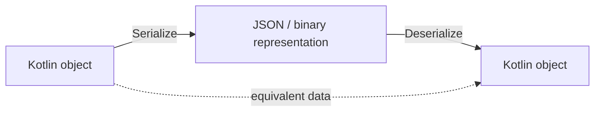
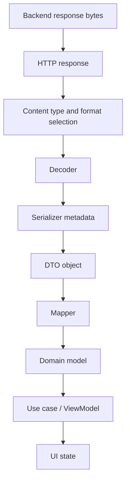
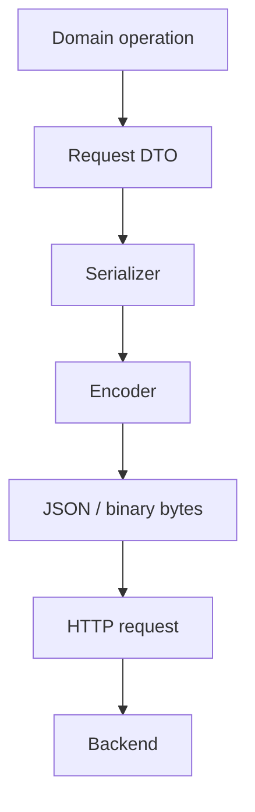
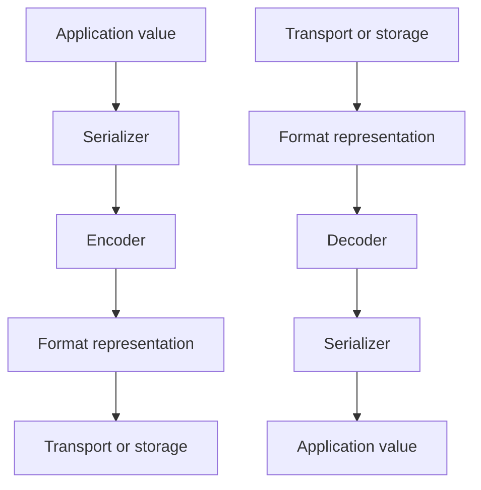
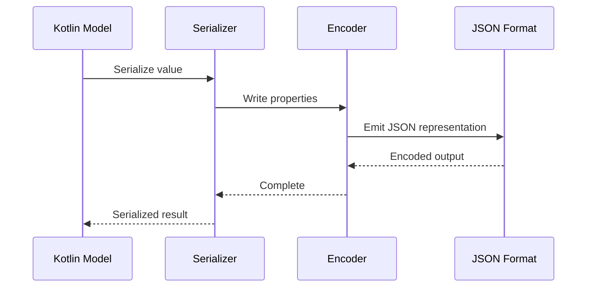

<div align="center">

# Chapter 18 — Serialization

### Part 1 · The Parts
**Understanding how Kotlin data becomes a format that systems can exchange**

[](https://kotlinlang.org/)
[](#)
[](#)

*An architectural and implementation-focused guide to serialization concepts, formats, serializers, schemas, compatibility, and multiplatform data exchange.*

</div>

---

> **Chapter goal**
>
> Serialization is the bridge between in-memory Kotlin objects and data formats understood by APIs, databases, files, queues, and other platforms. This chapter breaks that bridge into its essential parts: models, formats, encoders, decoders, serializers, schemas, and compatibility rules. We will build the mental model before exploring specific libraries and implementations in later parts.

## Table of contents

- [1. What serialization solves](#1-what-serialization-solves)
- [2. Serialization and deserialization](#2-serialization-and-deserialization)
- [3. The complete serialization pipeline](#3-the-complete-serialization-pipeline)
- [4. The main parts of a serialization system](#4-the-main-parts-of-a-serialization-system)
- [5. Kotlin objects and wire formats](#5-kotlin-objects-and-wire-formats)
- [6. Common serialization formats](#6-common-serialization-formats)
- [7. JSON as an API interchange format](#7-json-as-an-api-interchange-format)
- [8. Serializers and deserializers](#8-serializers-and-deserializers)
- [9. Encoding and decoding](#9-encoding-and-decoding)
- [10. Schema and data contracts](#10-schema-and-data-contracts)
- [11. Type mapping and model boundaries](#11-type-mapping-and-model-boundaries)
- [12. Serialization in Kotlin Multiplatform](#12-serialization-in-kotlin-multiplatform)
- [13. Failure modes and error handling](#13-failure-modes-and-error-handling)
- [14. Performance and memory considerations](#14-performance-and-memory-considerations)
- [15. Security considerations](#15-security-considerations)
- [16. Testing serialization](#16-testing-serialization)
- [17. Common misconceptions](#17-common-misconceptions)
- [18. Production checklist](#18-production-checklist)
- [19. Final thoughts](#19-final-thoughts)

---

## 1. What serialization solves

A Kotlin object exists inside a running process. It has a type, properties, references to other objects, and behavior defined by its class. Another process—perhaps a backend written in Java, Go, Node.js, Python, or .NET—cannot directly access that in-memory object.

The two systems need a shared representation.

Serialization converts an in-memory value into a representation that can be stored or transmitted. Deserialization reconstructs a value from that representation.

Consider a mobile application that needs to display a warehouse task:

```kotlin
data class WarehouseTask(
    val taskId: String,
    val productCode: String,
    val quantity: Int,
    val completed: Boolean
)
```

The application can work with this type naturally. An HTTP API, however, may expect a JSON document:

```json
{
  "taskId": "TASK-1042",
  "productCode": "SKU-9001",
  "quantity": 12,
  "completed": false
}
```

Serialization defines how the Kotlin value becomes that JSON representation. Deserialization defines how an incoming representation becomes a Kotlin value.

### Why this matters

Serialization is used in more places than HTTP APIs:

- REST and GraphQL payloads.
- Local persistence and database snapshots.
- Preferences and configuration files.
- Offline queues and background work.
- Message brokers and event streams.
- Inter-process communication.
- File import and export.
- Cache storage.
- Data exchange between Android, iOS, web, and backend systems.

Whenever data crosses a process, storage, or platform boundary, a representation contract is needed.

## 2. Serialization and deserialization

The two operations are related but not identical.

### Serialization

Serialization converts a value into a representation.

```kotlin
val task = WarehouseTask(
    taskId = "TASK-1042",
    productCode = "SKU-9001",
    quantity = 12,
    completed = false
)

// Conceptual operation:
// Kotlin object → JSON text
```

The result could be:

```json
{
  "taskId": "TASK-1042",
  "productCode": "SKU-9001",
  "quantity": 12,
  "completed": false
}
```

### Deserialization

Deserialization reads a representation and constructs a value:

```kotlin
// Conceptual operation:
// JSON text → Kotlin object

val task = WarehouseTask(
    taskId = "TASK-1042",
    productCode = "SKU-9001",
    quantity = 12,
    completed = false
)
```

In a real implementation, a serialization library performs this mapping and validates whether the input can be represented by the target type.

### The round-trip concept

A round trip means serializing a value and then deserializing the result:



Ideally, the reconstructed value is equivalent to the original value:

\[
decode(encode(x)) \approx x
\]

The equivalence symbol matters. The reconstructed object may not be identical in memory. Object identity, transient state, derived properties, and unsupported values may not survive the process.

A round trip is only guaranteed when the serializer and format can represent the relevant data and both operations use compatible rules.

## 3. The complete serialization pipeline

A typical API response travels through multiple stages before the UI can use it.



For an outgoing request, the direction is reversed:



Serialization is only one part of the data pipeline. It should not own HTTP status handling, business validation, repository decisions, or UI state.

### Example: API response to UI

Suppose the backend returns:

```json
{
  "task_id": "TASK-1042",
  "item_code": "SKU-9001",
  "requested_quantity": 12,
  "is_completed": false
}
```

The API DTO can represent the wire contract:

```kotlin
data class WarehouseTaskDto(
    val taskId: String,
    val itemCode: String,
    val requestedQuantity: Int,
    val isCompleted: Boolean
)
```

A mapper translates it into a domain model:

```kotlin
data class Task(
    val id: String,
    val productCode: String,
    val quantity: Int,
    val isCompleted: Boolean
)

fun WarehouseTaskDto.toDomain(): Task =
    Task(
        id = taskId,
        productCode = itemCode,
        quantity = requestedQuantity,
        isCompleted = isCompleted
    )
```

The DTO is shaped around the external contract. The domain model is shaped around application meaning. Keeping these separate prevents backend naming and schema changes from spreading through the application.

## 4. The main parts of a serialization system

A serialization system is easier to understand when its responsibilities are separated.

| Part | Responsibility | Example |
|---|---|---|
| Source value | The value being converted | `WarehouseTask` |
| Target format | The representation used outside the process | JSON |
| Serializer | Defines how a type maps to the format | `WarehouseTask` serializer |
| Encoder | Writes values into the target representation | JSON encoder |
| Decoder | Reads values from the representation | JSON decoder |
| Descriptor or metadata | Describes the serializable structure | Property names and kinds |
| Schema or contract | Defines expected fields and rules | API specification |
| Configuration | Controls naming, defaults, unknown fields, and other behavior | JSON settings |
| Adapter | Connects serialization to a transport or storage API | Ktor ContentNegotiation |

These parts may be packaged together by a library, but their conceptual responsibilities remain distinct.

### A useful mental model



A serializer knows the structure of a type. An encoder and decoder work with the selected format. A format implementation decides how values are represented.

## 5. Kotlin objects and wire formats

Kotlin types provide a convenient application representation, but they do not automatically define a portable wire format.

Consider:

```kotlin
data class Product(
    val id: String,
    val name: String,
    val price: Double,
    val tags: List<String>
)
```

A JSON representation might be:

```json
{
  "id": "P-100",
  "name": "Scanner",
  "price": 249.99,
  "tags": ["warehouse", "hardware"]
}
```

The serializer needs rules for each property:

| Kotlin type | Common JSON representation |
|---|---|
| `String` | String |
| `Int` | Number |
| `Long` | Number |
| `Double` | Number |
| `Boolean` | Boolean |
| `List<T>` | Array |
| `Map<K, V>` | Object, subject to key constraints |
| Nullable type | Value or `null`, depending on configuration and model |
| Enum | Usually a string or configured representation |
| Nested data class | JSON object |

These are common mappings, not universal rules. A serializer can customize how a type is represented.

### Kotlin types that need special attention

Some Kotlin concepts do not map directly to every format:

- `Instant`, `LocalDate`, and other date/time types.
- `BigDecimal` or precise financial values.
- `ByteArray`.
- `Map` with non-string keys.
- Sealed class hierarchies.
- Generic types.
- Platform-specific types.
- Classes containing behavior or external resources.
- Cyclic object graphs.

For example, a date/time value might be represented as an ISO-8601 string, an epoch number, or a structured object. The API contract must define which one is expected.

## 6. Common serialization formats

JSON is popular in mobile applications, but it is not the only format.

<details>
<summary><strong>JSON (JavaScript Object Notation)</strong></summary>

JSON is a text-based format built around objects, arrays, strings, numbers, booleans, and `null`.

```json
{
  "id": "P-100",
  "available": true,
  "quantity": 25
}
```

**Strengths**
- Human-readable.
- Widely supported.
- Easy to inspect during development.
- Common for HTTP APIs.

**Trade-offs**
- Text parsing and allocation overhead.
- No built-in schema enforcement.
- Numeric and date conventions need agreement.
- Payloads can be larger than compact binary formats.

</details>

<details>
<summary><strong>Protocol Buffers</strong></summary>

Protocol Buffers is a schema-based binary serialization format.

```protobuf
syntax = "proto3";

message Product {
  string id = 1;
  string name = 2;
  int32 quantity = 3;
}
```

**Strengths**
- Compact representation.
- Efficient encoding and decoding.
- Explicit schema and field identifiers.
- Useful for service-to-service communication.

**Trade-offs**
- Requires schema and code-generation workflows.
- Binary payloads are not directly human-readable.
- Schema evolution rules must be followed carefully.

</details>

<details>
<summary><strong>CBOR</strong></summary>

CBOR is a compact binary data format designed to represent data models similar to JSON.

**Strengths**
- More compact than typical text JSON.
- Supports a range of data types.
- Useful in constrained or bandwidth-sensitive environments.

**Trade-offs**
- Less convenient to inspect manually.
- Requires compatible encoder and decoder implementations.

</details>

<details>
<summary><strong>XML</strong></summary>

XML represents structured data using elements and attributes.

```xml
<product>
    <id>P-100</id>
    <name>Scanner</name>
    <quantity>25</quantity>
</product>
```

**Strengths**
- Mature tooling and schema technologies.
- Common in enterprise integrations and legacy systems.
- Supports namespaces and document-oriented structures.

**Trade-offs**
- More verbose than many JSON payloads.
- Parsing and mapping can be more involved.
- Namespace and schema rules need careful handling.

</details>

<details>
<summary><strong>CSV</strong></summary>

CSV represents tabular data as rows and columns.

```csv
id,name,quantity
P-100,Scanner,25
P-101,Label Printer,8
```

**Strengths**
- Useful for tabular export and import.
- Supported by spreadsheet tools.
- Simple for many flat datasets.

**Trade-offs**
- Nested structures are awkward.
- Escaping and delimiter rules matter.
- Type information is limited.
- Null and empty-string semantics need agreement.

</details>

### Format comparison

| Format | Human-readable | Schema support | Typical use |
|---|---|---|---|
| JSON | Yes | External contract or schema | Mobile and web APIs |
| Protocol Buffers | No, not as wire bytes | Yes | Efficient service communication |
| CBOR | Usually no | Data model based | Compact data exchange |
| XML | Yes | XSD and related schemas | Enterprise integrations |
| CSV | Yes | Usually external | Tabular import/export |

Choose a format based on interoperability, performance, tooling, compatibility, and the requirements of the systems exchanging data.

## 7. JSON as an API interchange format

JSON is common in KMP applications because it is supported by most backend languages and HTTP API platforms.

A JSON document is composed of a limited set of value types:

```text
JSON value
├── Object
├── Array
├── String
├── Number
├── Boolean
└── null
```

### Object

An object is a collection of name/value pairs:

```json
{
  "taskId": "TASK-1042",
  "quantity": 12
}
```

### Array

An array is an ordered collection:

```json
{
  "items": [
    { "id": "P-100", "quantity": 5 },
    { "id": "P-101", "quantity": 8 }
  ]
}
```

### Nested objects

```json
{
  "taskId": "TASK-1042",
  "location": {
    "warehouseId": "WH-01",
    "zone": "A-12"
  }
}
```

The Kotlin model should represent the nesting when it is meaningful:

```kotlin
data class TaskLocationDto(
    val warehouseId: String,
    val zone: String
)

data class TaskDto(
    val taskId: String,
    val location: TaskLocationDto
)
```

### JSON does not define your business meaning

JSON can say that `quantity` is a number. It cannot tell the client whether negative values are valid, whether the quantity is measured in units or cases, or whether zero means unavailable.

Those rules belong to the API and domain contracts.

## 8. Serializers and deserializers

A serializer maps a Kotlin type to a format. A deserializer reconstructs that type from the format.

In many libraries, both responsibilities are represented by one serializer abstraction.

Conceptually:

```kotlin
interface ConceptualSerializer<T> {
    fun serialize(value: T): EncodedValue

    fun deserialize(value: EncodedValue): T
}
```

This is pseudocode for the concept, not an API from a Kotlin library.

### Generated serializers

Some libraries generate serializers from Kotlin declarations at compile time.

A class may be annotated:

```kotlin
@Serializable
data class ProductDto(
    val id: String,
    val name: String,
    val quantity: Int
)
```

The compiler plugin or code-generation system produces the metadata and serializer implementation required by the library.

Benefits include:
- Less handwritten mapping code.
- Compile-time visibility of supported structures.
- Better integration with Kotlin types.
- Potentially efficient serialization.

### Handwritten serializers

A custom serializer is useful when the external representation differs from the Kotlin type.

Examples:
- A date stored as a string.
- A domain value represented by a primitive.
- A legacy API with unusual field encoding.
- A polymorphic value with a custom discriminator.
- A type from a library that cannot be modified.

Custom serializers provide control, but they also create code that must be tested and maintained.

## 9. Encoding and decoding

Encoding and decoding are format-level operations.

### Encoding

The encoder receives structured values from the serializer and writes them in the selected format.

For JSON, it produces JSON tokens or text. For a binary format, it produces bytes according to that format's rules.

### Decoding

The decoder reads the representation and exposes structured values to the serializer, which constructs the Kotlin object.



The reverse path reads JSON and constructs the Kotlin model.

### Why the distinction matters

A serializer should describe a type's structure, while an encoder or decoder handles the selected representation.

That separation allows the same type metadata to work with different formats when the library supports them.

It also explains why a custom serializer is not necessarily a custom JSON parser. A serializer can define how a type maps to the library's format abstraction without implementing the entire format.

## 10. Schema and data contracts

A schema describes the expected structure of exchanged data. It may define:
- Field names.
- Field types.
- Required and optional fields.
- Allowed values.
- Nested structures.
- Validation constraints.
- Versioning and compatibility rules.

For a mobile application, the API contract is often documented using OpenAPI or another schema/documentation system.

### A simple contract

```yaml
WarehouseTask:
  type: object
  required:
    - taskId
    - quantity
  properties:
    taskId:
      type: string
    quantity:
      type: integer
    completed:
      type: boolean
```

This schema describes the external contract. It does not automatically guarantee that the Kotlin DTO or backend implementation follows it. Contract validation and tests are still needed.

### Required vs optional vs nullable

These concepts must not be confused.

| Concept | Meaning |
|---|---|
| Required | The field must be present |
| Optional | The field may be omitted |
| Nullable | The field may explicitly contain `null` |
| Defaulted | The Kotlin property can use a declared default when supported by the serializer configuration |

For example:

```kotlin
@Serializable
data class ProductDto(
    val id: String,
    val description: String? = null,
    val enabled: Boolean = true
)
```

This model expresses:
- `id` is required.
- `description` is nullable and has a default.
- `enabled` has a default value.

Whether a missing field is accepted, whether explicit `null` is accepted, and whether a default is applied depends on the serializer and its configuration. Do not infer wire-contract behavior from Kotlin syntax alone; test it.

## 11. Type mapping and model boundaries

An API DTO should represent the external data contract. A domain model should represent the concepts the application needs.

These models may look similar, but they have different responsibilities.

### DTO

```kotlin
@Serializable
data class ProductResponseDto(
    val product_id: String,
    val display_name: String,
    val available_units: Int
)
```

### Domain model

```kotlin
data class Product(
    val id: ProductId,
    val name: String,
    val availableQuantity: Int
)
```

### Mapper

```kotlin
fun ProductResponseDto.toDomain(): Product =
    Product(
        id = ProductId(product_id),
        name = display_name,
        availableQuantity = available_units
    )
```

`ProductId` is a project-defined value class or domain type in this example.

### Why not use DTOs everywhere?

Using API DTOs directly in the UI or domain layer creates several forms of coupling:

- Backend field names leak into application code.
- API nullability becomes application nullability.
- Backend-specific representations influence business logic.
- A backend migration can affect unrelated features.
- Test fixtures become tied to transport details.

A mapper creates a deliberate boundary. It is not unnecessary boilerplate when it protects a meaningful architectural separation.

### When can models be shared?

For small applications or stable internal APIs, a DTO may be reused in more than one layer when its semantics genuinely match. The decision should be intentional.

Avoid creating duplicate classes solely to satisfy a diagram. Separate models when their responsibilities, lifecycles, or evolution requirements differ.

## 12. Serialization in Kotlin Multiplatform

Kotlin Multiplatform makes serialization especially valuable because shared business logic can exchange data consistently across Android, iOS, desktop, and web targets.

A common source set can define:
- Shared DTOs.
- Serialization annotations.
- Custom serializers.
- JSON configuration.
- API contract tests.
- Mapping to shared domain models.

Platform source sets may still be needed for platform-specific formats, libraries, storage, or APIs.

### Typical source-set organization

```text
shared/
└── src/
    ├── commonMain/
    │   └── kotlin/
    │       ├── data/
    │       │   ├── dto/
    │       │   ├── serializer/
    │       │   └── mapper/
    │       └── domain/
    ├── commonTest/
    │   └── kotlin/
    │       └── serialization/
    ├── androidMain/
    └── iosMain/
```

### Why common serialization matters

Without shared serialization rules, Android and iOS can drift:

- Android accepts a missing field while iOS rejects it.
- One platform formats a date differently.
- Enum values are mapped differently.
- A custom number representation behaves differently.
- A backend contract change is handled on only one platform.

Shared models and tests reduce this risk.

### Common does not mean every dependency is portable

A library used in `commonMain` must support the project's target platforms. A JVM-only serializer or parser cannot simply be imported into common code and expected to compile for iOS.

Check:
- Kotlin Multiplatform target support.
- Compiler plugin compatibility.
- Runtime library compatibility.
- Native and JavaScript behavior.
- Version alignment between compiler plugin and runtime artifacts.

## 13. Failure modes and error handling

Deserialization can fail for many reasons.

### Common failure categories

| Failure | Example |
|---|---|
| Missing required field | `taskId` is absent |
| Wrong value type | `quantity` is a string instead of a number |
| Invalid syntax | Malformed JSON |
| Unknown enum value | Backend introduces a new status |
| Invalid date | Date string does not match the expected format |
| Nullability mismatch | API sends `null` for a non-null property |
| Polymorphic mismatch | Discriminator or subtype is unknown |
| Numeric overflow | Input value exceeds the target type's range |
| Incompatible schema | Client and server expect different structures |

### Example: type mismatch

Expected:

```json
{
  "quantity": 12
}
```

Received:

```json
{
  "quantity": "twelve"
}
```

A strict integer property cannot be constructed from the string `"twelve"` without a custom conversion rule.

### Do not hide every failure with defaults

This pattern can be dangerous:

```kotlin
val quantity = response.quantity ?: 0
```

If `null` indicates a broken backend contract, silently turning it into zero may display incorrect inventory information.

Defaults should represent valid business semantics, not simply suppress exceptions.

### Keep error boundaries clear

A useful architecture distinguishes:
- Transport failures.
- HTTP status failures.
- Serialization failures.
- DTO-to-domain mapping failures.
- Domain validation failures.

These failures need different diagnostics and recovery strategies.

## 14. Performance and memory considerations

Serialization affects request latency, memory usage, CPU consumption, and battery life—especially on mobile devices.

### Important factors

**Payload size**

Large responses require more memory and parsing work. Paginate large collections and avoid downloading data that the screen does not need.

**Allocation**

Parsing creates strings, collections, and objects. Repeatedly decoding large payloads can increase garbage collection pressure.

**Format**

Text formats such as JSON are easy to inspect and widely interoperable. Binary formats may reduce payload size or parsing cost, but they introduce schema and tooling requirements.

**Model design**

Deeply nested structures and very large object graphs can increase decoding complexity. Model the API contract clearly and avoid unnecessary transformations.

**Streaming**

For large files or unbounded data, use streaming APIs rather than reading the entire response into memory before processing.

### Measure before optimizing

Do not choose a serialization format based only on assumptions about speed. Measure representative payloads on the target platforms.

Useful measurements include:
- Payload size.
- Encode duration.
- Decode duration.
- Peak memory.
- Allocation count where available.
- Battery impact for repeated operations.
- Behavior on lower-end devices.

## 15. Security considerations

Serialized data is external input. Even a response from a trusted backend should be treated as data that can be malformed, outdated, or unexpectedly large.

### Protect the application

- Validate business-critical values after deserialization.
- Avoid logging raw payloads containing personal or confidential data.
- Set reasonable response-size limits at the transport or application boundary.
- Avoid unsafe polymorphic deserialization configurations.
- Do not deserialize untrusted data into arbitrary runtime classes.
- Treat file and import formats as untrusted input.
- Avoid storing secrets in serialized preferences or diagnostic snapshots.
- Handle deeply nested or unusually large input defensively.
- Keep serializer and parser dependencies updated.

### Deserialization is not authorization

A successfully decoded object is not automatically valid or permitted.

For example, a response may deserialize into:

```kotlin
data class TransferRequest(
    val sourceWarehouseId: String,
    val destinationWarehouseId: String,
    val quantity: Int
)
```

The application still needs to validate whether the transfer is allowed, whether the quantity is positive, and whether the user has permission. The backend must enforce authorization and business rules independently.

## 16. Testing serialization

Serialization tests should verify both directions and important compatibility cases.

### Round-trip test

```kotlin
@Test
fun productRoundTripPreservesValues() {
    val original = ProductDto(
        id = "P-100",
        name = "Scanner",
        quantity = 25
    )

    val encoded = Json.encodeToString(original)
    val decoded = Json.decodeFromString<ProductDto>(encoded)

    assertEquals(original, decoded)
}
```

This example uses `kotlinx.serialization` APIs and assumes the appropriate imports, plugin, and test dependency are configured.

### Test the wire contract

A round-trip test alone is not enough. If the serializer writes the wrong field name and reads the same wrong field name, the round trip may still pass.

Also assert the actual JSON representation:

```kotlin
@Test
fun productUsesExpectedJsonFieldNames() {
    val product = ProductDto(
        id = "P-100",
        name = "Scanner",
        quantity = 25
    )

    val json = Json.encodeToString(product)

    assertTrue(json.contains("\"id\""))
    assertTrue(json.contains("\"name\""))
    assertTrue(json.contains("\"quantity\""))
}
```

For stable contracts, prefer parsing the encoded JSON and asserting its structure rather than relying on property order or fragile string matching.

### Essential test matrix

| Test | What it verifies |
|---|---|
| Encode a model | Expected wire representation |
| Decode a valid payload | Correct object construction |
| Round trip | Data preservation |
| Missing field | Required/default behavior |
| Explicit `null` | Nullability behavior |
| Unknown field | Forward-compatibility configuration |
| Unknown enum | Enum evolution policy |
| Nested object | Nested mapping |
| Empty collection | Empty-list semantics |
| Custom date | Date format contract |
| Malformed JSON | Failure handling |
| Large payload | Performance and resource behavior |

Run common serialization tests in the shared test source set and add platform-specific tests where behavior depends on a target-specific implementation.

## 17. Common misconceptions

### 17.1 Serialization is the same as JSON

JSON is one format. Serialization is the broader process of converting values into a representation.

**Better:** distinguish the serialization concept from the selected format and library.

### 17.2 A Kotlin data class is automatically serializable

A data class provides generated functions such as `equals`, `hashCode`, and `copy`. It does not automatically provide a portable wire representation.

**Better:** configure and annotate models according to the selected serialization library.

### 17.3 Serialization validates business rules

A serializer can validate structure and type compatibility, but it does not know every business invariant.

**Better:** validate domain rules after decoding.

### 17.4 A round-trip test proves API compatibility

The same incorrect field mapping can be used for both encoding and decoding.

**Better:** assert exact wire-contract behavior using representative API fixtures.

### 17.5 Unknown fields are always safe to ignore

Ignoring unknown fields can help forward compatibility, but it may also hide an unexpected contract change.

**Better:** choose strictness intentionally based on the API's versioning and compatibility policy.

### 17.6 DTOs and domain models must always be identical

They serve different boundaries and may evolve independently.

**Better:** map between them when their semantics differ.

### 17.7 Binary formats are always faster

Performance depends on payload structure, library implementation, platform, and workload.

**Better:** benchmark realistic data on the actual targets.

## 18. Production checklist

- [ ] Identify the serialization format for each external boundary.
- [ ] Document the API or storage contract.
- [ ] Keep DTOs separate from domain models where responsibilities differ.
- [ ] Define required, optional, nullable, and defaulted fields explicitly.
- [ ] Define date, time, decimal, and enum representations.
- [ ] Decide how unknown fields and unknown enum values are handled.
- [ ] Use a serializer supported by every required KMP target.
- [ ] Keep compiler plugin and runtime versions aligned.
- [ ] Add round-trip tests.
- [ ] Add wire-contract tests using real or representative fixtures.
- [ ] Test malformed and incompatible payloads.
- [ ] Validate business invariants after decoding.
- [ ] Avoid logging sensitive serialized data.
- [ ] Apply response-size and resource limits where appropriate.
- [ ] Benchmark large or frequently decoded payloads.
- [ ] Review schema evolution and backward compatibility.

## 19. Final thoughts

Serialization is one of the most important boundaries in a multiplatform application. It turns Kotlin values into representations that other systems can understand and turns external data back into application values.

The important parts are not limited to an annotation or a call to `encodeToString`. A reliable serialization design requires a clear format, a well-defined contract, correct type mapping, deliberate compatibility rules, safe error handling, and tests that verify the actual wire representation.

For KMP, shared serialization rules help Android and iOS interpret the same data consistently. Keep external DTOs at the boundary, map them into domain concepts, and treat every incoming payload as data that must be interpreted and validated—not as unquestionable application truth.

> **Serialization is the contract between what your application understands and what the outside world can exchange.**

---

<div align="center">

**End of Chapter 18 · Part 1 — The Parts**

*First understand the data contract. Then choose the tools that implement it.*

</div>
