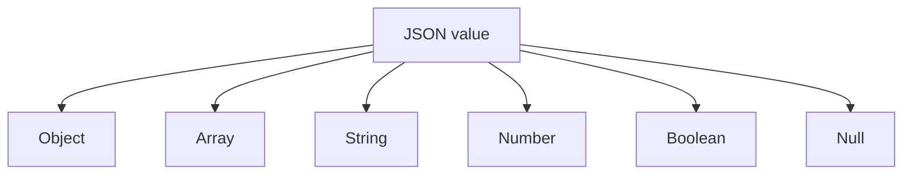

<div align="center">

# Chapter 18 — Serialization

### Part 2 · JSON
**Understanding the format that connects Kotlin applications to the wider API ecosystem**

[](https://kotlinlang.org/)
[](#)
[](#)

*A practical deep dive into JSON structure, syntax, data types, object mapping, compatibility, and the decisions that matter when consuming JSON across Kotlin Multiplatform targets.*

</div>

---

> **Part objective**
>
> JSON is easy to read, but reliable JSON integration requires more than matching property names. This part examines the format itself: its grammar, value types, object and array structures, nullability, number handling, escaping, compatibility, and common API design pitfalls. The next implementation steps can then build on a precise understanding of what the wire format actually guarantees.

## Table of contents

- [1. What JSON is](#1-what-json-is)
- [2. The six JSON value types](#2-the-six-json-value-types)
- [3. Objects and key-value pairs](#3-objects-and-key-value-pairs)
- [4. Arrays and ordered collections](#4-arrays-and-ordered-collections)
- [5. Strings and escaping](#5-strings-and-escaping)
- [6. Numbers and precision](#6-numbers-and-precision)
- [7. Boolean and null values](#7-boolean-and-null-values)
- [8. Nested JSON structures](#8-nested-json-structures)
- [9. JSON syntax rules](#9-json-syntax-rules)
- [10. JSON and Kotlin type mapping](#10-json-and-kotlin-type-mapping)
- [11. Missing, null, and default values](#11-missing-null-and-default-values)
- [12. Naming conventions and field mapping](#12-naming-conventions-and-field-mapping)
- [13. Dates, time, and special values](#13-dates-time-and-special-values)
- [14. Polymorphic and versioned JSON](#14-polymorphic-and-versioned-json)
- [15. JSON in HTTP APIs](#15-json-in-http-apis)
- [16. JSON compatibility and schema evolution](#16-json-compatibility-and-schema-evolution)
- [17. Security and robustness](#17-security-and-robustness)
- [18. Testing JSON contracts](#18-testing-json-contracts)
- [19. Common mistakes](#19-common-mistakes)
- [20. Production checklist](#20-production-checklist)
- [21. Final thoughts](#21-final-thoughts)

---

## 1. What JSON is

JSON stands for **JavaScript Object Notation**. Despite its name, JSON is language-independent. It is a text-based data interchange format used by mobile applications, web applications, backend services, databases, configuration systems, and many other tools.

JSON represents structured data using a small set of values:

- Objects
- Arrays
- Strings
- Numbers
- Booleans
- `null`

A JSON document can be transmitted as text, stored in a file, or encoded as bytes using a character encoding such as UTF-8.

Example:

```json
{
  "taskId": "TASK-1042",
  "warehouse": "WH-01",
  "quantity": 12,
  "completed": false
}
```

This document represents one object with four properties. It does not define what a warehouse task means, whether quantity can be negative, or who is allowed to complete it. Those rules belong to the API contract and application domain.

### Why JSON became common

- It is relatively easy for humans to inspect.
- It is supported by nearly every programming language.
- It maps naturally to objects, arrays, and primitive values.
- It works well with HTTP APIs.
- It has a compact and well-defined grammar.
- It has a mature ecosystem of parsers, validators, and schema tools.

JSON's simplicity is a strength, but it also means that some application-level details—such as dates, decimals, optional fields, and polymorphic types—need explicit conventions.

## 2. The six JSON value types

Every JSON value belongs to one of six categories.



| JSON type | Example | Meaning |
|---|---|---|
| Object | `{"id":"P-100"}` | Collection of named properties |
| Array | `["A","B"]` | Ordered sequence of values |
| String | `"Scanner"` | Text |
| Number | `42` or `19.95` | Numeric value |
| Boolean | `true` | Logical true or false |
| Null | `null` | Explicit absence of a value |

A JSON document may contain any valid JSON value at its root. Many APIs choose an object or array as the root, but the format itself does not require that convention.

### Root object

```json
{
  "id": "P-100",
  "name": "Scanner"
}
```

### Root array

```json
[
  { "id": "P-100", "name": "Scanner" },
  { "id": "P-101", "name": "Label Printer" }
]
```

### Root primitive

```json
"warehouse-ready"
```

A client should follow the endpoint's documented response shape rather than assume every response is an object.

## 3. Objects and key-value pairs

A JSON object is an unordered collection of name/value pairs. Each property name is a string, followed by a colon and its value.

```json
{
  "productId": "P-100",
  "productName": "Scanner",
  "available": true
}
```

The general shape is:

```json
{
  "propertyName": "propertyValue"
}
```

An object can contain values of different JSON types:

```json
{
  "id": "P-100",
  "quantity": 25,
  "available": true,
  "description": null,
  "tags": ["hardware", "warehouse"]
}
```

### Object property names

Property names must be quoted strings:

```json
{
  "firstName": "Alex",
  "lastName": "Morgan"
}
```

This is invalid JSON:

```text
{
  firstName: "Alex"
}
```

### Duplicate property names

JSON object member names are expected to be unique. In practice, parsers may handle duplicate names differently: some keep the last value, some keep the first, and some may reject the document.

Avoid duplicate keys entirely:

```json
{
  "quantity": 10,
  "quantity": 20
}
```

An API should never rely on parser-specific duplicate-key behavior.

### Property order

JSON objects are conceptually unordered. Do not make application logic depend on the order of object properties.

This means these objects represent the same set of properties:

```json
{
  "id": "P-100",
  "name": "Scanner"
}
```

```json
{
  "name": "Scanner",
  "id": "P-100"
}
```

Array order, in contrast, is meaningful.

## 4. Arrays and ordered collections

A JSON array is an ordered sequence of values. Values are separated by commas and enclosed in square brackets.

```json
{
  "taskIds": [
    "TASK-1001",
    "TASK-1002",
    "TASK-1003"
  ]
}
```

Arrays can contain objects:

```json
{
  "tasks": [
    {
      "taskId": "TASK-1001",
      "quantity": 5
    },
    {
      "taskId": "TASK-1002",
      "quantity": 8
    }
  ]
}
```

They can also contain mixed JSON types:

```json
[
  "scanner",
  25,
  true,
  null,
  {
    "location": "A-12"
  }
]
```

Although mixed arrays are valid JSON, application APIs should generally use predictable element types. A collection of mixed shapes is harder to model, validate, and evolve.

### Array order matters

If an API returns picking steps in a specific sequence, the array order can carry business meaning:

```json
{
  "steps": [
    { "sequence": 1, "action": "Scan item" },
    { "sequence": 2, "action": "Confirm quantity" },
    { "sequence": 3, "action": "Complete task" }
  ]
}
```

Do not sort or convert such an array into a set unless the API contract says order is irrelevant.

## 5. Strings and escaping

A JSON string is enclosed in double quotation marks.

```json
{
  "message": "Task completed successfully"
}
```

JSON strings use Unicode text. Certain characters must be escaped.

| Character | JSON representation |
|---|---|
| Double quote | `\"` |
| Backslash | `\\` |
| Backspace | `\b` |
| Form feed | `\f` |
| Newline | `\n` |
| Carriage return | `\r` |
| Tab | `\t` |
| Control character | `\uXXXX` |

Example:

```json
{
  "message": "Picker said: \"Task is complete\"",
  "path": "warehouse\\tasks\\active",
  "notes": "First line\nSecond line"
}
```

The JSON text contains escape sequences. After parsing, the Kotlin string contains the corresponding characters.

### Unicode

JSON supports Unicode characters:

```json
{
  "productName": "Café Scanner",
  "localName": "ಮುದ್ರಕ",
  "symbol": "₹"
}
```

A serializer should preserve valid Unicode text. Avoid manually escaping or transforming text unless a specific external contract requires it.

### Common string mistakes

Invalid JSON:

```text
{
  "message": 'Hello'
}
```

JSON strings require double quotes, not single quotes.

Also invalid:

```text
{
  "message": "Line one
Line two"
}
```

A literal newline cannot appear unescaped inside a JSON string. It must be represented as `\n`.

## 6. Numbers and precision

JSON has one number grammar. It does not define separate integer, long, float, or decimal types.

Valid examples:

```json
{
  "count": 25,
  "temperature": -2.5,
  "ratio": 0.75,
  "largeValue": 6.02e23
}
```

Invalid examples:

```text
{
  "count": 025,
  "price": .99,
  "amount": 10.,
  "notANumber": NaN,
  "infinity": Infinity
}
```

JSON numbers cannot have leading zeroes (except for zero itself), must have digits around the decimal point as required by the grammar, and do not support `NaN` or infinity as standard numeric literals.

### Kotlin numeric mapping

| Kotlin type | Typical JSON representation |
|---|---|
| `Byte` | Number |
| `Short` | Number |
| `Int` | Number |
| `Long` | Number |
| `Float` | Number |
| `Double` | Number |
| `BigDecimal` | Library-specific/custom representation |

### Precision concerns

JavaScript's standard `Number` type represents integers exactly only up to:

\[
2^{53} - 1
\]

This matters when JSON passes through JavaScript systems. A large Kotlin `Long` identifier may lose precision if it is treated as a JavaScript number.

For identifiers that can exceed the safe integer range, many APIs represent them as strings:

```json
{
  "transactionId": "9223372036854775807"
}
```

This preserves the exact digits across systems that use floating-point numeric representations.

### Financial values

Binary floating-point types such as `Double` cannot exactly represent every decimal fraction. For monetary values, agree on a representation with the backend.

Common choices include:

```json
{
  "amountMinorUnits": 24999,
  "currency": "INR"
}
```

or:

```json
{
  "amount": "249.99",
  "currency": "INR"
}
```

The first uses an integer number of minor units. The second uses a decimal string. Either can work when the API contract defines the currency scale and parsing rules. Do not assume a JSON decimal parsed into `Double` is suitable for exact financial arithmetic.

## 7. Boolean and null values

### Boolean

JSON has exactly two boolean literals:

```json
{
  "enabled": true,
  "archived": false
}
```

They are lowercase. `True`, `FALSE`, and `"true"` are not equivalent JSON booleans.

A Kotlin `Boolean` maps naturally to a JSON boolean.

### Null

`null` represents an explicit absence of a value:

```json
{
  "middleName": null
}
```

It is different from:
- A missing property.
- An empty string (`""`).
- An empty array (`[]`).
- The number zero (`0`).
- Boolean false (`false`).

These states can have different meanings in an API.

For example:

| Representation | Possible meaning |
|---|---|
| Property omitted | No update or value not supplied |
| `"middleName": null` | Explicitly no middle name |
| `"middleName": ""` | Present but empty text |
| `"tags": []` | Present collection with no entries |

The backend contract must define the semantics.

## 8. Nested JSON structures

Real API responses often contain nested objects and arrays.

Example:

```json
{
  "taskId": "TASK-1042",
  "status": "IN_PROGRESS",
  "picker": {
    "employeeId": "EMP-17",
    "displayName": "Alex"
  },
  "items": [
    {
      "sku": "SKU-9001",
      "requestedQuantity": 12,
      "pickedQuantity": 8
    },
    {
      "sku": "SKU-9002",
      "requestedQuantity": 5,
      "pickedQuantity": 5
    }
  ]
}
```

A Kotlin model can mirror the external structure:

```kotlin
@Serializable
data class PickerDto(
    val employeeId: String,
    val displayName: String
)

@Serializable
data class TaskItemDto(
    val sku: String,
    val requestedQuantity: Int,
    val pickedQuantity: Int
)

@Serializable
data class WarehouseTaskDto(
    val taskId: String,
    val status: String,
    val picker: PickerDto,
    val items: List<TaskItemDto>
)
```

This structure is useful when the JSON contract and DTO structure align.

### Avoid unnecessary flattening

Flattening a nested object may be appropriate for a domain model, but the API DTO should usually preserve the external structure. The mapper can then translate it into the shape the application needs.

### Deep nesting

Very deeply nested JSON can make models difficult to understand and may increase parsing complexity. If the backend contract is under your control, prefer a clear, bounded structure.

## 9. JSON syntax rules

JSON has a strict grammar. A document that looks familiar may still be invalid.

### Valid JSON example

```json
{
  "id": "P-100",
  "quantity": 25,
  "available": true,
  "tags": [
    "hardware",
    "warehouse"
  ],
  "metadata": null
}
```

### Common syntax errors

| Mistake | Invalid example | Correction |
|---|---|---|
| Single quotes | `'name': 'Alex'` | Use double quotes |
| Unquoted key | `name: "Alex"` | Quote the key |
| Trailing comma | `{"id": 1,}` | Remove trailing comma |
| Comment | `{"id": 1 // id}` | JSON does not support comments |
| Assignment syntax | `{"id" = 1}` | Use a colon |
| `undefined` | `{"value": undefined}` | Use `null` or omit the field |
| `NaN` | `{"value": NaN}` | Use a valid number or agreed string representation |

### JSON vs JSON-like configuration

Some configuration formats extend JSON with comments, trailing commas, or unquoted keys. Those extensions are not standard JSON.

Do not send JSON5, JavaScript object literals, or hand-written configuration syntax to an endpoint expecting strict JSON.

## 10. JSON and Kotlin type mapping

A JSON value must be mapped to a Kotlin type.

| JSON shape | Common Kotlin type |
|---|---|
| String | `String` |
| Integer number | `Int`, `Long`, or another numeric type |
| Decimal number | `Double`, `Float`, or custom decimal type |
| Boolean | `Boolean` |
| Object | `@Serializable` data class or another supported type |
| Array | `List<T>` or another collection |
| Nullable value | `T?` |
| Arbitrary JSON object | Library-specific JSON element type |

The mapping is not automatic merely because the names look similar. The serializer needs metadata or a custom rule.

### A concrete DTO

```kotlin
@Serializable
data class InventoryDto(
    val warehouseId: String,
    val sku: String,
    val availableQuantity: Int,
    val isAvailable: Boolean
)
```

Matching JSON:

```json
{
  "warehouseId": "WH-01",
  "sku": "SKU-9001",
  "availableQuantity": 12,
  "isAvailable": true
}
```

If the backend changes `availableQuantity` from a number to a string, a strict decoder may fail. The client should not silently guess unless the contract explicitly supports both forms.

### Arbitrary JSON

Sometimes an endpoint contains dynamic or user-defined content. A JSON tree representation can be useful:

```kotlin
val payload = Json.parseToJsonElement(
    """
    {
      "type": "inventory",
      "data": {
        "sku": "SKU-9001",
        "quantity": 12
      }
    }
    """.trimIndent()
)
```

With `kotlinx.serialization`, `JsonElement`, `JsonObject`, `JsonArray`, and `JsonPrimitive` represent JSON trees. Use this approach when the structure is genuinely dynamic; prefer typed DTOs for stable API contracts.

## 11. Missing, null, and default values

One of the most important JSON integration details is distinguishing a missing property from a property whose value is `null`.

Consider these payloads:

```json
{}
```

```json
{
  "description": null
}
```

```json
{
  "description": ""
}
```

They are three different representations.

### Kotlin example

```kotlin
@Serializable
data class ProductDto(
    val id: String,
    val description: String? = null,
    val enabled: Boolean = true
)
```

Typical behavior with `kotlinx.serialization` default settings:

- Missing required `id` causes a decoding failure.
- Missing `description` uses its default (`null`).
- Explicit `description: null` is accepted.
- Missing `enabled` uses its default (`true`).
- Explicit `enabled: null` is invalid because `enabled` is non-nullable.

Exact behavior should be verified against the serializer configuration and library version used by the project.

### Why this matters for PATCH APIs

A partial update may distinguish:
- Omitted field: leave the current value unchanged.
- Explicit `null`: clear the current value.
- Non-null value: replace the current value.

A plain nullable Kotlin property may not represent all three states by itself. A dedicated patch model or explicit presence wrapper may be needed.

Do not collapse these states accidentally.

## 12. Naming conventions and field mapping

JSON field names are strings and are often defined by backend conventions such as camelCase, snake_case, or kebab-case.

Example backend payload:

```json
{
  "task_id": "TASK-1042",
  "requested_quantity": 12,
  "is_completed": false
}
```

Kotlin property names may use idiomatic camelCase:

```kotlin
@Serializable
data class TaskDto(
    @SerialName("task_id")
    val taskId: String,

    @SerialName("requested_quantity")
    val requestedQuantity: Int,

    @SerialName("is_completed")
    val isCompleted: Boolean
)
```

`@SerialName` defines the serialized name for the property when using `kotlinx.serialization`.

### Naming strategy vs explicit mapping

A global naming strategy can reduce annotations when the backend follows a consistent convention. Explicit field annotations are useful when:
- The API has inconsistent naming.
- A field has an unusual legacy name.
- A property needs a stable external name independent of Kotlin refactoring.
- Different endpoints use different conventions.

The wire name is part of the contract. Renaming a Kotlin property should not unintentionally change the JSON field name.

## 13. Dates, time, and special values

JSON has no native date, time, decimal, UUID, or binary value types. These values must be represented using one of the six JSON types and an agreed convention.

### ISO-8601 date/time string

```json
{
  "createdAt": "2026-11-02T14:30:00Z"
}
```

### Epoch timestamp

```json
{
  "createdAtEpochSeconds": 1793629800
}
```

The API must specify:
- Whether the timestamp uses seconds or milliseconds.
- Which time zone applies.
- Whether the value represents an instant or a local date/time.
- Whether fractional seconds are allowed.

### Date-only value

```json
{
  "deliveryDate": "2026-11-05"
}
```

A date-only value should not be casually converted into a timestamp. A calendar date and an instant are different concepts.

### UUID

```json
{
  "requestId": "d7b2c19a-0a2d-4e61-a92e-0f8d2c6a5c10"
}
```

A UUID is commonly represented as a string.

### Binary data

Binary content is often sent separately as a file or represented using Base64:

```json
{
  "fileName": "label.png",
  "contentBase64": "iVBORw0KGgo..."
}
```

Base64 increases payload size and requires decoding. For large files, multipart upload or a dedicated file-transfer endpoint is often more appropriate.

### Define one representation

Do not let Android and iOS independently decide how to format dates or decimals. Put the representation rule in the shared contract and test it with common fixtures.

## 14. Polymorphic and versioned JSON

An API may return different object shapes for one conceptual field.

For example, a notification can be a task notification or a stock alert:

```json
{
  "type": "task_assigned",
  "taskId": "TASK-1042"
}
```

```json
{
  "type": "stock_alert",
  "sku": "SKU-9001",
  "availableQuantity": 2
}
```

The `type` property is a discriminator. It identifies which concrete structure is present.

A Kotlin sealed hierarchy can model this concept:

```kotlin
@Serializable
sealed interface NotificationDto

@Serializable
@SerialName("task_assigned")
data class TaskAssignedDto(
    val taskId: String
) : NotificationDto

@Serializable
@SerialName("stock_alert")
data class StockAlertDto(
    val sku: String,
    val availableQuantity: Int
) : NotificationDto
```

The serializer must be configured to use the expected discriminator and subtype registration rules. The exact configuration is covered in a later implementation-focused part.

### Versioning

Some APIs include an explicit version:

```json
{
  "schemaVersion": 2,
  "taskId": "TASK-1042",
  "quantity": 12
}
```

Others use versioned endpoints or rely on additive schema evolution.

A version field is useful only when the server and client define what each version means and how unsupported versions are handled.

Do not introduce a version field without a compatibility policy.

## 15. JSON in HTTP APIs

When JSON is used as an HTTP request or response body, the HTTP layer and JSON layer work together.

### Content-Type

A JSON request commonly includes:

```http
Content-Type: application/json
```

This tells the server how to interpret the request body.

### Accept

A client can indicate that it expects JSON:

```http
Accept: application/json
```

This tells the server which response representation the client prefers.

### Example request

```http
POST /api/tasks/TASK-1042/complete
Content-Type: application/json
Accept: application/json

{
  "completedQuantity": 12
}
```

The HTTP method, status code, headers, and body each have separate responsibilities.

| HTTP component | Responsibility |
|---|---|
| Method | Describes the operation |
| URL | Identifies the resource or endpoint |
| Headers | Carry metadata and negotiation information |
| Status code | Communicates the HTTP outcome |
| JSON body | Carries structured application data |

A valid JSON body does not mean the HTTP request succeeded. A server can return valid JSON with `400`, `401`, `409`, or `500`. The client must handle HTTP status and body parsing as separate concerns.

## 16. JSON compatibility and schema evolution

Mobile applications are often not upgraded at the same time as backend services. An older application may communicate with a newer backend, or a newer application may encounter older cached data.

JSON contract evolution must account for that reality.

### Usually safer changes

- Adding an optional field with a well-defined default.
- Adding a new endpoint without changing existing behavior.
- Adding a new response field that older clients can safely ignore.
- Adding a new request field only when the server treats it as optional.

### Potentially breaking changes

- Renaming a field.
- Removing a field that clients require.
- Changing a field's type.
- Changing seconds to milliseconds without changing the field contract.
- Changing an enum value.
- Making an optional field required.
- Changing `null` semantics.
- Changing an array into an object or vice versa.

### Compatibility matrix

| Change | Risk to older clients | Notes |
|---|---|---|
| Add optional response field | Often low | Depends on unknown-field policy |
| Remove response field | High | Older clients may require it |
| Rename response field | High | Existing mapping stops working |
| Change number to string | High | Type mismatch |
| Add enum value | Medium to high | Strict enum decoding may fail |
| Add optional request field | Often low | Server must accept omission |
| Change meaning of a field | High | May decode successfully but behave incorrectly |

### Unknown fields

Some serializers can ignore unknown JSON properties. This is useful when a backend adds response fields that an older client does not use.

However, ignoring unknown fields does not solve every compatibility problem. It does not automatically handle changed types, renamed fields, or new enum values.

Compatibility is a contract-design concern, not just a parser setting.

## 17. Security and robustness

JSON is data, not trusted executable code. Parse it defensively.

### Protect the client

- Treat network and imported JSON as untrusted input.
- Validate important values after decoding.
- Limit response sizes where appropriate.
- Avoid unbounded recursive structures.
- Avoid logging raw payloads that contain personal or confidential data.
- Do not deserialize arbitrary runtime types based on untrusted class names.
- Configure polymorphic deserialization with an explicit set of supported subtypes.
- Reject unsupported or malformed representations clearly.
- Keep parser and serializer dependencies maintained.

### Avoid over-permissive parsing

A permissive parser may make an integration appear resilient while hiding backend defects. For example, silently coercing `"12"` into `12` can conceal an API type regression.

Choose coercion behavior only when the API contract explicitly permits it.

### Validate after decoding

Deserialization verifies that data can be mapped into a Kotlin structure. It does not guarantee that the values are meaningful.

```kotlin
fun validateTask(dto: WarehouseTaskDto): Result<WarehouseTaskDto> {
    if (dto.taskId.isBlank()) {
        return Result.failure(
            IllegalArgumentException("Task identifier is empty")
        )
    }

    if (dto.quantity < 0) {
        return Result.failure(
            IllegalArgumentException("Quantity cannot be negative")
        )
    }

    return Result.success(dto)
}
```

This is a simplified example. Production validation should use the application's error model and avoid exposing sensitive payload details in errors.

## 18. Testing JSON contracts

A JSON integration needs more than a test that proves one object can be encoded and decoded.

Test the contract itself.

### Valid fixture test

```kotlin
@Test
fun decodesWarehouseTaskFixture() {
    val json = """
        {
          "taskId": "TASK-1042",
          "quantity": 12,
          "completed": false
        }
    """.trimIndent()

    val task = Json.decodeFromString<WarehouseTaskDto>(json)

    assertEquals("TASK-1042", task.taskId)
    assertEquals(12, task.quantity)
    assertFalse(task.completed)
}
```

### Encoding contract test

```kotlin
@Test
fun encodesExpectedPropertyNames() {
    val task = WarehouseTaskDto(
        taskId = "TASK-1042",
        quantity = 12,
        completed = false
    )

    val encoded = Json.encodeToString(task)
    val decodedTree = Json.parseToJsonElement(encoded).jsonObject

    assertEquals(
        "TASK-1042",
        decodedTree["taskId"]?.jsonPrimitive?.content
    )
}
```

This test checks the actual JSON property rather than depending on property order.

### Compatibility fixtures

Keep representative payloads as test resources:

```text
commonTest/
└── resources/
    └── json/
        ├── task_success.json
        ├── task_missing_optional_field.json
        ├── task_unknown_field.json
        ├── task_unknown_status.json
        └── task_invalid_quantity.json
```

These fixtures become executable documentation of the API contract.

### Test matrix

| Scenario | Expected result |
|---|---|
| Valid object | Decodes successfully |
| Valid array | Decodes into expected collection |
| Missing required property | Controlled decoding failure |
| Missing defaulted property | Declared default is applied |
| Explicit null | Matches nullable contract |
| Wrong primitive type | Rejected or handled by an explicit rule |
| Unknown property | Matches configured compatibility policy |
| Unknown enum | Matches documented fallback or failure policy |
| Malformed JSON | Clear parsing failure |
| Large payload | Bounded and acceptable resource use |
| Unicode and escaped strings | Text is preserved |
| Numeric boundary | No unintended precision loss |

Run these tests in `commonTest` wherever possible so Android and iOS share the same contract expectations.

## 19. Common mistakes

### 19.1 Treating JSON as JavaScript

JSON does not support comments, single-quoted strings, `undefined`, or trailing commas.

**Better:** use a strict JSON serializer and validate fixtures before committing them.

### 19.2 Assuming object property order matters

JSON objects are unordered.

**Better:** compare parsed structures, not raw string order.

### 19.3 Confusing missing and null

A missing property and an explicit `null` can have different API meanings.

**Better:** define omission and null semantics for each important field.

### 19.4 Using `Double` for every number

Floating-point values are not exact for every decimal, and JavaScript has an integer precision boundary.

**Better:** choose numeric representations according to the data's meaning and interoperability requirements.

### 19.5 Using numbers for large identifiers

Large numeric IDs may lose precision in JavaScript-based systems.

**Better:** represent opaque identifiers as strings when the API contract allows it.

### 19.6 Assuming dates are built into JSON

JSON has no native date type.

**Better:** define an ISO-8601, epoch, or other explicit representation.

### 19.7 Ignoring every unknown value

Unknown fields, unknown enum values, and unknown polymorphic subtypes are different cases.

**Better:** define a separate compatibility policy for each.

### 19.8 Using API DTOs as domain models

External field names and nullability can spread throughout the application.

**Better:** map DTOs into domain models where the boundaries have different responsibilities.

### 19.9 Testing only round trips

The same incorrect field mapping can encode and decode successfully.

**Better:** assert actual JSON names, values, and representative backend fixtures.

### 19.10 Assuming valid JSON means valid business data

A payload can be syntactically correct but semantically impossible.

**Better:** validate domain invariants after decoding.

## 20. Production checklist

- [ ] Use strict, valid JSON for API communication.
- [ ] Know the root shape expected by each endpoint.
- [ ] Define object fields and array ordering in the API contract.
- [ ] Use double-quoted strings and correct escaping.
- [ ] Define numeric ranges and precision expectations.
- [ ] Represent large opaque identifiers safely.
- [ ] Define monetary value representation.
- [ ] Distinguish missing, `null`, empty, and default values.
- [ ] Define date/time and time-zone conventions.
- [ ] Map backend field names explicitly or through a documented strategy.
- [ ] Define unknown-field and unknown-enum behavior.
- [ ] Keep DTOs aligned with the wire contract.
- [ ] Validate business rules after decoding.
- [ ] Treat all external JSON as untrusted input.
- [ ] Avoid logging sensitive JSON bodies.
- [ ] Test valid, malformed, boundary, and compatibility fixtures.
- [ ] Run shared JSON contract tests across KMP targets.
- [ ] Document breaking and non-breaking schema changes.

## 21. Final thoughts

JSON is intentionally small: six value types, a clear grammar, and a structure that most programming languages can understand. That simplicity makes it an excellent interchange format, but it does not remove the need for careful API design.

Reliable JSON integration depends on precise decisions about field names, numbers, nullability, dates, nested structures, polymorphism, and compatibility. These decisions should live in an explicit contract and be protected by tests.

For Kotlin Multiplatform, a shared JSON contract helps Android and iOS interpret backend data consistently. Keep the wire representation at the data boundary, map it into meaningful domain types, and validate the values before the application relies on them.

> **JSON tells systems how data is shaped. Your contract tells them what that data means.**

---

<div align="center">

**End of Chapter 18 · Part 2 — JSON**

*Understand the format before configuring the serializer.*

</div>
