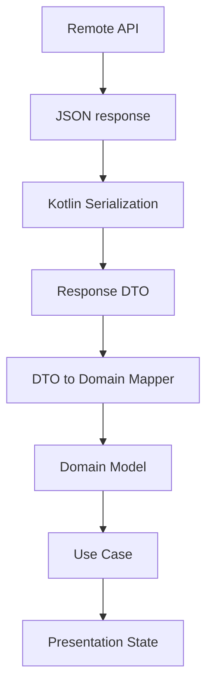
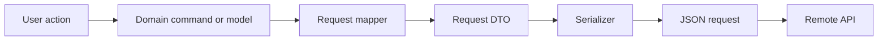
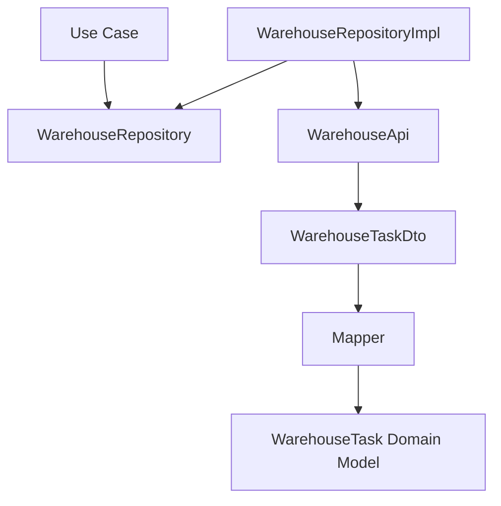

<div align="center">

# Chapter 18 — Serialization
## Part 3: Data Transfer Objects (DTOs)

[](https://kotlinlang.org/)
[](#)
[](#)
[](#)

**Designing reliable boundaries between remote data contracts and application models**

</div>

---

## Table of Contents

- [1. Why DTOs Exist](#1-why-dtos-exist)
- [2. What a DTO Actually Represents](#2-what-a-dto-actually-represents)
- [3. DTOs Are Not Domain Models](#3-dtos-are-not-domain-models)
- [4. The Data Flow: JSON to Domain](#4-the-data-flow-json-to-domain)
- [5. Designing DTOs from an API Contract](#5-designing-dtos-from-an-api-contract)
- [6. Kotlin DTO Design Fundamentals](#6-kotlin-dto-design-fundamentals)
- [7. Missing, Null, and Default Values](#7-missing-null-and-default-values)
- [8. Naming Differences and `@SerialName`](#8-naming-differences-and-serialname)
- [9. Nested Objects and Collections](#9-nested-objects-and-collections)
- [10. DTOs for API Envelopes and Pagination](#10-dtos-for-api-envelopes-and-pagination)
- [11. Handling Polymorphic Responses](#11-handling-polymorphic-responses)
- [12. Dates, Identifiers, and Special Types](#12-dates-identifiers-and-special-types)
- [13. Mapping DTOs to Domain Models](#13-mapping-dtos-to-domain-models)
- [14. Mapping Domain Models to Request DTOs](#14-mapping-domain-models-to-request-dtos)
- [15. DTOs in a Kotlin Multiplatform Project](#15-dtos-in-a-kotlin-multiplatform-project)
- [16. DTOs and Repository Boundaries](#16-dtos-and-repository-boundaries)
- [17. Error Response DTOs](#17-error-response-dtos)
- [18. DTO Evolution and API Compatibility](#18-dto-evolution-and-api-compatibility)
- [19. DTO Testing Strategy](#19-dto-testing-strategy)
- [20. Common DTO Design Mistakes](#20-common-dto-design-mistakes)
- [21. Production-Ready DTO Checklist](#21-production-ready-dto-checklist)
- [22. Final Thoughts](#22-final-thoughts)

---

## 1. Why DTOs Exist

An application rarely owns the format of the data it receives from a remote service. The backend defines an API contract, serializes its response into JSON or another wire format, and sends that representation over the network.

The mobile application must interpret that representation without allowing every backend decision to become an application-wide design decision.

That is the problem **Data Transfer Objects (DTOs)** help solve.

A DTO is a type designed to represent data crossing a boundary. In a typical mobile application, it represents the structure of an API request or response.

Consider an API response:

```json
{
  "employee_id": "EMP-1042",
  "display_name": "Aarav Sharma",
  "is_active": true,
  "warehouse": {
    "warehouse_code": "BLR-01",
    "warehouse_name": "Bengaluru Central"
  }
}
```

The backend's field names, nesting, and optionality are part of its contract. The application may prefer a different model:

```kotlin
data class Employee(
    val id: EmployeeId,
    val name: String,
    val active: Boolean,
    val warehouse: Warehouse
)
```

A DTO lets the data layer understand the remote contract while the domain layer works with concepts meaningful to the application.

Without that boundary, API changes can spread into UI state, business rules, use cases, and tests.

### The core idea

> A DTO describes how data travels. A domain model describes what that data means to the application.

These responsibilities are related, but they are not interchangeable.

---

## 2. What a DTO Actually Represents

DTO stands for **Data Transfer Object**. It is a data structure intended to carry information between two parts of a system.

In a client application, common DTO categories include:

| DTO category | Purpose | Example |
|---|---|---|
| Response DTO | Represents data returned by an API | `EmployeeResponseDto` |
| Request DTO | Represents data sent to an API | `UpdateEmployeeRequestDto` |
| Nested DTO | Represents a nested API object | `WarehouseDto` |
| Error DTO | Represents a structured API error | `ApiErrorDto` |
| Paging DTO | Represents pagination metadata | `PageInfoDto` |

A DTO should usually be simple and predictable. It should not own business decisions, perform network requests, access a database, or contain UI behavior.

A Kotlin response DTO might look like this:

```kotlin
import kotlinx.serialization.SerialName
import kotlinx.serialization.Serializable

@Serializable
data class EmployeeResponseDto(
    @SerialName("employee_id")
    val employeeId: String,

    @SerialName("display_name")
    val displayName: String,

    @SerialName("is_active")
    val isActive: Boolean
)
```

The `@Serializable` annotation makes the type available to the Kotlin serialization compiler plugin. `@SerialName` maps Kotlin property names to the names used in the serialized representation.

The DTO is deliberately close to the API contract. It does not need to imitate the naming conventions or value objects used by the domain layer.

### DTO design goals

A good DTO should:

- Represent the external contract accurately.
- Make optional and required fields explicit.
- Be straightforward to serialize and deserialize.
- Avoid embedding business rules.
- Be easy to replace when an API contract changes.
- Avoid exposing transport-specific details beyond the data boundary.

---

## 3. DTOs Are Not Domain Models

One of the most consequential design decisions in a data layer is whether to reuse API DTOs as domain models.

For a tiny prototype, sharing a type may appear convenient. In a production application, it often creates unnecessary coupling.

### Compare the responsibilities

| Concern | DTO | Domain model |
|---|---|---|
| Primary purpose | Represent a transfer contract | Represent application concepts |
| Owned by | Data/transport boundary | Domain |
| Naming | Often follows API fields | Follows business language |
| Nullability | Reflects API behavior | Reflects valid domain states |
| Serialization annotations | Common | Usually unnecessary |
| Backend-specific fields | May contain them | Should not need them |
| Business invariants | Avoids enforcing them | Can enforce or express them |

For example, the API may return a status as a string:

```json
{
  "order_id": "ORD-5001",
  "status": "READY_FOR_PICKUP"
}
```

The DTO can preserve the wire value:

```kotlin
@Serializable
data class OrderResponseDto(
    @SerialName("order_id")
    val orderId: String,

    val status: String
)
```

The domain model can express the application's supported states:

```kotlin
@JvmInline
value class OrderId(val value: String)

enum class OrderStatus {
    CREATED,
    PROCESSING,
    READY_FOR_PICKUP,
    COMPLETED,
    UNKNOWN
}

data class Order(
    val id: OrderId,
    val status: OrderStatus
)
```

This separation matters when the backend introduces a new status. The DTO can still receive the raw string, while the mapper decides how an unknown value should be represented.

### Why not annotate every domain model?

Serialization annotations in domain types couple the domain to a particular wire format and serialization library. That may be acceptable in a deliberately simple application, but it is not a neutral decision.

Keeping transport annotations in DTOs preserves the option to change the API, serializer, or transport mechanism without rewriting domain concepts.

---

## 4. The Data Flow: JSON to Domain

A typical data flow contains several distinct transformations:



Each step has a clear responsibility:

1. **Remote API** defines the contract.
2. **JSON** carries the data over the network.
3. **Serializer** converts the wire representation into Kotlin values.
4. **DTO** captures the API response shape.
5. **Mapper** translates transport data into application concepts.
6. **Domain model** represents data used by business logic.
7. **Use case and presentation** consume domain-oriented results.

The reverse direction is similar for requests:



Do not confuse serialization with mapping:

- **Serialization** converts an object into a wire representation.
- **Deserialization** converts a wire representation into an object.
- **Mapping** converts one application type into another.

A serializer should not decide business meaning. A mapper should not be responsible for parsing raw JSON.

---

## 5. Designing DTOs from an API Contract

DTOs should be designed from the actual API contract, not from assumptions about what the backend probably sends.

Before writing a DTO, inspect:

- Field names and casing.
- Required versus optional fields.
- Whether a field can explicitly contain `null`.
- Nested object structure.
- Array element types.
- Numeric representation and precision.
- Enum or discriminator values.
- Date and timestamp formats.
- Pagination and error conventions.
- Whether the contract is versioned.

Suppose an API returns:

```json
{
  "id": 501,
  "name": "Wireless Scanner",
  "description": null,
  "price": 1299.50,
  "tags": ["warehouse", "hardware"],
  "available": true
}
```

A matching DTO could be:

```kotlin
@Serializable
data class ProductResponseDto(
    val id: Long,
    val name: String,
    val description: String?,
    val price: Double,
    val tags: List<String>,
    val available: Boolean
)
```

This is a direct representation, but it still raises design questions:

- Is `id` guaranteed to fit in a `Long`?
- Does `price` require decimal precision?
- Can `tags` be omitted, or is it always present?
- Is `description` always present but nullable, or can it be missing?

DTO design is not just copying JSON keys into Kotlin properties. It is translating the API contract into an accurate type system representation.

### A practical contract review table

| API behavior | DTO decision |
|---|---|
| Field always present and non-null | Non-null property without a default |
| Field can be `null` | Nullable property |
| Field may be omitted | Consider a default or explicit presence model |
| Field is a list | `List<T>` with a deliberate missing-field policy |
| Field is an unknown string code | Keep raw string or use a tolerant mapping |
| Field is a precise monetary amount | Prefer a documented decimal representation strategy |

---

## 6. Kotlin DTO Design Fundamentals

Kotlin data classes are a natural fit for DTOs because they provide concise value-oriented structures.

### 6.1 Prefer immutable properties

```kotlin
@Serializable
data class UserResponseDto(
    val id: String,
    val name: String,
    val email: String?
)
```

Use `val` by default. Immutable DTOs are easier to reason about and safer to pass between layers.

Mutable properties (`var`) are sometimes required by a library or legacy integration, but should not be the default.

### 6.2 Use meaningful Kotlin names

The API may use snake_case, abbreviations, or legacy names. Kotlin properties can use idiomatic names and map to the wire names with `@SerialName`.

```kotlin
@Serializable
data class ShipmentResponseDto(
    @SerialName("shipment_ref")
    val shipmentReference: String,

    @SerialName("created_at")
    val createdAt: String
)
```

### 6.3 Keep DTOs focused

Avoid a giant DTO that represents unrelated API operations. Separate request and response contracts when their semantics differ.

```kotlin
@Serializable
data class CreateShipmentRequestDto(
    @SerialName("destination_code")
    val destinationCode: String
)

@Serializable
data class ShipmentResponseDto(
    @SerialName("shipment_id")
    val shipmentId: String,

    @SerialName("destination_code")
    val destinationCode: String,

    val status: String
)
```

A create request should not need response-only fields such as server-generated IDs or timestamps.

### 6.4 Avoid business logic in DTOs

This is a poor boundary:

```kotlin
@Serializable
data class CartResponseDto(
    val quantity: Int,
    val unitPrice: Double
) {
    fun calculateDiscountedTotal(): Double {
        // Business policy does not belong in a transport DTO.
        return quantity * unitPrice
    }
}
```

Keep transport structures focused on data. Put pricing rules in domain services or use cases.

---

## 7. Missing, Null, and Default Values

This is one of the most important DTO design topics.

These JSON documents are not equivalent:

```json
{ "name": "Aarav" }
```

```json
{ "name": "Aarav", "nickname": null }
```

```json
{ "name": "Aarav", "nickname": "Avi" }
```

They represent three different states:

1. The field is absent.
2. The field is present with `null`.
3. The field is present with a value.

A nullable Kotlin property represents the possibility of a null value, but does not automatically represent every distinction between absent and explicitly null.

### 7.1 Required, non-null field

```kotlin
@Serializable
data class ProfileDto(
    val id: String
)
```

If `id` is missing or null, deserialization normally fails because the property is required and non-null.

### 7.2 Nullable field

```kotlin
@Serializable
data class ProfileDto(
    val id: String,
    val nickname: String?
)
```

This allows `nickname` to be null, but without a default the field is still required to be present under the normal Kotlin Serialization behavior.

### 7.3 Optional field with a default

```kotlin
@Serializable
data class ProfileDto(
    val id: String,
    val nickname: String? = null
)
```

Now the field may be absent and the default is used. An explicit JSON `null` also maps to `null`.

### 7.4 Non-null field with a default

```kotlin
@Serializable
data class PreferencesDto(
    val notificationsEnabled: Boolean = true
)
```

If the API omits the field, the DTO uses `true`. This should only be done when that fallback is safe and matches the contract.

### 7.5 PATCH requests require extra care

A PATCH operation may distinguish:

- Do not update this field.
- Set this field to `null`.
- Set this field to a concrete value.

A plain `String?` often cannot express all three states.

One explicit approach is a presence wrapper:

```kotlin
sealed interface FieldUpdate<out T> {
    data object Unchanged : FieldUpdate<Nothing>
    data object Clear : FieldUpdate<Nothing>
    data class Set<T>(val value: T) : FieldUpdate<T>
}
```

This is a domain/request modeling idea. It is not automatically serialized into the required PATCH format. A dedicated request serializer or DTO mapping layer must encode the three states according to the API contract.

### Important distinction

Do not add defaults to every DTO property simply to prevent deserialization errors. Defaults can conceal a backend contract change and silently create data that was never sent.

---

## 8. Naming Differences and `@SerialName`

Backend naming conventions often differ from Kotlin conventions.

For example:

```json
{
  "user_id": "U-100",
  "first_name": "Aarav",
  "last_name": "Sharma",
  "account_status": "ACTIVE"
}
```

Kotlin DTO:

```kotlin
@Serializable
data class UserResponseDto(
    @SerialName("user_id")
    val userId: String,

    @SerialName("first_name")
    val firstName: String,

    @SerialName("last_name")
    val lastName: String,

    @SerialName("account_status")
    val accountStatus: String
)
```

`@SerialName` defines the serialized name for a property or serializable class. It is especially useful when the API uses snake_case, legacy abbreviations, or names that do not match Kotlin identifiers.

### Global naming strategy or explicit annotations?

A JSON configuration can apply a naming strategy in supported Kotlin Serialization versions. For example, a project may choose a snake_case naming strategy where the API consistently follows that convention.

However, APIs are not always consistent. One endpoint may use `user_id`, another may use `userId`, and a legacy field may use an unrelated name.

Use a consistent policy:

- Use a global naming strategy when the contract is genuinely consistent.
- Use `@SerialName` for exceptions or explicit wire-name documentation.
- Avoid relying on a global strategy and annotations without understanding their interaction in the Kotlin Serialization version being used.

The wire contract should be obvious when a developer reads the DTO.

---

## 9. Nested Objects and Collections

Real API responses are rarely flat. DTOs should model nested objects and arrays using dedicated types where that improves clarity and reuse.

### Example API response

```json
{
  "order_id": "ORD-5001",
  "customer": {
    "customer_id": "C-100",
    "name": "Aarav Sharma"
  },
  "items": [
    {
      "sku": "SKU-01",
      "quantity": 2
    },
    {
      "sku": "SKU-02",
      "quantity": 1
    }
  ]
}
```

### DTO structure

```kotlin
@Serializable
data class OrderResponseDto(
    @SerialName("order_id")
    val orderId: String,

    val customer: CustomerDto,

    val items: List<OrderItemDto>
)

@Serializable
data class CustomerDto(
    @SerialName("customer_id")
    val customerId: String,
    val name: String
)

@Serializable
data class OrderItemDto(
    val sku: String,
    val quantity: Int
)
```

### Why separate nested DTOs?

Separate types provide:

- Clear ownership of each API structure.
- Reuse where the same contract genuinely appears in multiple responses.
- Easier unit testing.
- Easier changes when a nested object evolves.
- Better readability than deeply nested anonymous structures.

Do not create a reusable DTO merely because two objects happen to contain the same fields today. Reuse should reflect a shared contract, not superficial similarity.

### Collections and empty values

A `List<T>` is appropriate when the API returns an array. Decide whether an omitted array should fail or default to an empty list.

```kotlin
@Serializable
data class OrderHistoryDto(
    val orders: List<OrderResponseDto> = emptyList()
)
```

This is useful only if an absent `orders` field semantically means “no orders.” If absence indicates a malformed response, a default can hide a contract violation.

---

## 10. DTOs for API Envelopes and Pagination

Many APIs wrap the actual resource in a response envelope.

```json
{
  "success": true,
  "message": "Orders loaded",
  "data": [
    {
      "order_id": "ORD-1",
      "status": "PROCESSING"
    }
  ]
}
```

Represent the envelope explicitly:

```kotlin
@Serializable
data class ApiResponseDto<T>(
    val success: Boolean,
    val message: String? = null,
    val data: T
)

@Serializable
data class OrderSummaryDto(
    @SerialName("order_id")
    val orderId: String,
    val status: String
)
```

Depending on the serializer configuration and generic type usage, generic DTOs can be serialized and deserialized with generated serializers. In Kotlin Serialization, call sites may need the appropriate generated serializer for the concrete type.

### Pagination example

```json
{
  "data": [
    { "order_id": "ORD-1", "status": "READY" }
  ],
  "page": 1,
  "page_size": 20,
  "total_items": 135,
  "total_pages": 7
}
```

```kotlin
@Serializable
data class PaginatedResponseDto<T>(
    val data: List<T>,
    val page: Int,
    @SerialName("page_size")
    val pageSize: Int,
    @SerialName("total_items")
    val totalItems: Long,
    @SerialName("total_pages")
    val totalPages: Int
)
```

A domain-facing pagination model should use application language and may validate or normalize metadata:

```kotlin
data class Page<T>(
    val items: List<T>,
    val currentPage: Int,
    val pageSize: Int,
    val totalItems: Long,
    val totalPages: Int
)
```

The mapper can decide how to handle inconsistent values, such as a negative page number or a zero page size.

---

## 11. Handling Polymorphic Responses

Some APIs return different object shapes through one endpoint. A discriminator field identifies which shape is present.

Example:

```json
{
  "type": "card",
  "last_four_digits": "1234"
}
```

or:

```json
{
  "type": "bank_account",
  "bank_name": "Example Bank",
  "account_suffix": "9876"
}
```

Kotlin Serialization supports polymorphic serialization through sealed hierarchies and serializers.

```kotlin
import kotlinx.serialization.SerialName
import kotlinx.serialization.Serializable
import kotlinx.serialization.json.JsonClassDiscriminator

@Serializable
@JsonClassDiscriminator("type")
sealed interface PaymentMethodDto

@Serializable
@SerialName("card")
data class CardPaymentDto(
    @SerialName("last_four_digits")
    val lastFourDigits: String
) : PaymentMethodDto

@Serializable
@SerialName("bank_account")
data class BankAccountPaymentDto(
    @SerialName("bank_name")
    val bankName: String,

    @SerialName("account_suffix")
    val accountSuffix: String
) : PaymentMethodDto
```

The discriminator key and values must match the backend contract. The JSON configuration and serializer module may also need to be configured for the polymorphic hierarchy, depending on whether the hierarchy is sealed or open and how it is registered.

### Unknown discriminator values

A backend may introduce a new subtype before an older mobile client is updated.

Do not assume every client can deserialize every future subtype. Decide on a compatibility strategy:

- Use a tolerant raw JSON boundary when unknown variants must be preserved.
- Provide a documented fallback representation if the contract supports one.
- Use a versioned API or capability negotiation where appropriate.
- Avoid silently mapping an unknown payment method to a known but incorrect type.

For business-critical variants, failing explicitly may be safer than guessing.

---

## 12. Dates, Identifiers, and Special Types

Transport formats often represent rich values using primitive JSON types.

Examples include:

- Timestamps as strings or numbers.
- Identifiers as strings.
- Money as decimal strings or numeric values.
- Coordinates as numbers.
- Binary data as Base64 strings.

A DTO should model the representation actually sent by the API.

### Dates and timestamps

```kotlin
@Serializable
data class AuditEventDto(
    @SerialName("created_at")
    val createdAt: String
)
```

Keeping the wire value as a string can be appropriate at the DTO boundary. Convert it into a platform-independent domain date/time type through a tested parser.

Do not assume every timestamp is ISO-8601 or UTC. Confirm timezone, precision, and formatting rules.

### Identifiers

```kotlin
@Serializable
data class CustomerResponseDto(
    @SerialName("customer_id")
    val customerId: String
)
```

Identifiers should not automatically be numeric. A string ID may contain prefixes, leading zeros, or non-numeric characters.

### Money and precision

Binary floating-point types such as `Double` cannot exactly represent every decimal fraction. For monetary values, prefer the representation defined by the API, such as:

- An integer amount in minor units (for example, paise or cents).
- A decimal string parsed by a decimal implementation.
- A documented decimal type supported by the project.

Example when the API returns minor units:

```kotlin
@Serializable
data class PriceDto(
    @SerialName("amount_minor")
    val amountMinor: Long,

    val currency: String
)
```

The domain layer can convert this into a money value with explicit currency and scale rules.

### Special types need deliberate conversion

Avoid forcing every transport value directly into a rich domain type. Keep parsing and validation at a well-defined boundary, and make conversion failures visible.

---

## 13. Mapping DTOs to Domain Models

Mapping is the point where transport representation becomes application meaning.

Consider the API DTO:

```kotlin
@Serializable
data class WarehouseTaskDto(
    @SerialName("task_id")
    val taskId: String,

    @SerialName("picker_name")
    val pickerName: String?,

    @SerialName("completed_items")
    val completedItems: Int,

    @SerialName("total_items")
    val totalItems: Int,

    val status: String
)
```

The domain model:

```kotlin
@JvmInline
value class TaskId(val value: String)

enum class TaskStatus {
    PENDING,
    IN_PROGRESS,
    COMPLETED,
    UNKNOWN
}

data class WarehouseTask(
    val id: TaskId,
    val pickerName: String?,
    val completedItems: Int,
    val totalItems: Int,
    val status: TaskStatus
) {
    val remainingItems: Int
        get() = (totalItems - completedItems).coerceAtLeast(0)

    val progress: Float
        get() = if (totalItems <= 0) {
            0f
        } else {
            (completedItems.toFloat() / totalItems).coerceIn(0f, 1f)
        }
}
```

Mapper:

```kotlin
fun WarehouseTaskDto.toDomain(): WarehouseTask =
    WarehouseTask(
        id = TaskId(taskId),
        pickerName = pickerName,
        completedItems = completedItems,
        totalItems = totalItems,
        status = status.toTaskStatus()
    )

private fun String.toTaskStatus(): TaskStatus =
    when (uppercase()) {
        "PENDING" -> TaskStatus.PENDING
        "IN_PROGRESS" -> TaskStatus.IN_PROGRESS
        "COMPLETED" -> TaskStatus.COMPLETED
        else -> TaskStatus.UNKNOWN
    }
```

The domain model expresses useful application behavior, while the DTO preserves the backend representation.

### Where should mapper functions live?

For a conventional layered architecture, mapping from a DTO to a domain model belongs in the data layer because it depends on the data contract.

A practical package structure:

```text
data/
├── remote/
│   ├── dto/
│   │   ├── WarehouseTaskDto.kt
│   │   └── WarehouseResponseDto.kt
│   ├── mapper/
│   │   └── WarehouseTaskMapper.kt
│   └── api/
│       └── WarehouseApi.kt
├── repository/
│   └── WarehouseRepositoryImpl.kt
```

For small applications, mapper functions can live beside their DTOs. For larger feature modules, keep them in a dedicated mapper package.

Avoid placing DTO-to-domain conversion inside a composable, ViewModel, or UI state reducer.

---

## 14. Mapping Domain Models to Request DTOs

The request direction deserves the same care as response mapping.

Suppose the domain layer exposes:

```kotlin
data class UpdateTaskCommand(
    val taskId: TaskId,
    val completedItems: Int
)
```

The backend expects:

```json
{
  "task_id": "TASK-100",
  "completed_quantity": 8
}
```

Request DTO:

```kotlin
@Serializable
data class UpdateTaskRequestDto(
    @SerialName("task_id")
    val taskId: String,

    @SerialName("completed_quantity")
    val completedQuantity: Int
)
```

Mapper:

```kotlin
fun UpdateTaskCommand.toRequestDto(): UpdateTaskRequestDto =
    UpdateTaskRequestDto(
        taskId = taskId.value,
        completedQuantity = completedItems
    )
```

This allows the domain command to use business language while the request DTO follows the API contract.

### Do not send the entire domain object

A request should contain only fields required by the endpoint. Sending a domain object directly can accidentally expose internal properties or send fields the server does not expect.

Dedicated request DTOs provide a clear allowlist of outgoing data.

---

## 15. DTOs in a Kotlin Multiplatform Project

DTOs are often excellent candidates for `commonMain` because the API contract and serialization logic can be shared across Android and iOS.

A typical source-set structure:

```text
shared/
└── src/
    ├── commonMain/
    │   └── kotlin/
    │       └── data/
    │           ├── remote/
    │           │   └── dto/
    │           └── mapper/
    ├── commonTest/
    │   └── kotlin/
    │       └── data/
    │           └── remote/
    ├── androidMain/
    │   └── kotlin/
    └── iosMain/
        └── kotlin/
```

A shared DTO:

```kotlin
@Serializable
data class AccountResponseDto(
    @SerialName("account_id")
    val accountId: String,

    @SerialName("account_name")
    val accountName: String
)
```

The same DTO can be deserialized in shared code regardless of whether the request is executed through an Android or Darwin Ktor engine.

### Gradle configuration concept

The Kotlin Serialization compiler plugin and runtime library must be configured for the project. Exact plugin and dependency versions should be aligned with the Kotlin version used by the project.

A version-catalog-based configuration may look like this:

```toml
[versions]
kotlin = "<your-kotlin-version>"
kotlinx-serialization = "<compatible-serialization-version>"

[plugins]
kotlin-serialization = { id = "org.jetbrains.kotlin.plugin.serialization", version.ref = "kotlin" }

[libraries]
kotlinx-serialization-json = { module = "org.jetbrains.kotlinx:kotlinx-serialization-json", version.ref = "kotlinx-serialization" }
```

Then apply the serialization plugin in the appropriate module and add the JSON runtime dependency to `commonMain`:

```kotlin
plugins {
    alias(libs.plugins.kotlin.serialization)
}

kotlin {
    sourceSets {
        commonMain.dependencies {
            implementation(libs.kotlinx.serialization.json)
        }
    }
}
```

This is an illustrative configuration. Match the catalog aliases, plugin application, Kotlin Multiplatform Gradle DSL, and compatible library version to the actual project setup.

### Keep platform-specific concerns out of common DTOs

DTOs should not depend on:

- Android `Context`.
- Android framework classes.
- UIKit or Swift-only types.
- Platform-specific database entities.
- Platform-specific networking engine classes.

If a platform-specific API requires a different representation, translate it at the platform boundary rather than contaminating shared transport models.

### Sharing DTOs does not mean sharing every model

KMP makes code sharing possible, not mandatory. A platform-specific feature may have a platform-specific transport contract or integration. Keep shared models where the contract and behavior are genuinely shared.

---

## 16. DTOs and Repository Boundaries

The repository implementation is a natural place to coordinate API calls and mapping.

```kotlin
interface WarehouseRepository {
    suspend fun getTask(taskId: TaskId): Result<WarehouseTask>
}
```

A simplified data-layer implementation:

```kotlin
class WarehouseRepositoryImpl(
    private val api: WarehouseApi
) : WarehouseRepository {

    override suspend fun getTask(
        taskId: TaskId
    ): Result<WarehouseTask> =
        runCatching {
            api.getTask(taskId.value).toDomain()
        }
}
```

The API contract:

```kotlin
interface WarehouseApi {
    suspend fun getTask(taskId: String): WarehouseTaskDto
}
```

The intended dependency direction is:



The domain layer depends on the repository abstraction. The data layer implements it and owns the DTO and mapping details.

### Why this boundary matters

If the backend renames `completed_items` to `completed_quantity`, the DTO or its annotation changes. The domain model and UI do not need to change if the meaning remains the same.

That is the practical value of isolating the transfer contract.

---

## 17. Error Response DTOs

Error payloads are also API contracts and deserve explicit DTOs.

Example:

```json
{
  "code": "TASK_NOT_FOUND",
  "message": "The requested task does not exist",
  "trace_id": "trace-abc-123"
}
```

DTO:

```kotlin
@Serializable
data class ApiErrorDto(
    val code: String? = null,
    val message: String? = null,

    @SerialName("trace_id")
    val traceId: String? = null
)
```

Error responses can be inconsistent across endpoints or backend services. Optional fields may be appropriate when the API contract genuinely allows them to be absent.

Do not assume every error response is valid JSON. Gateways, proxies, load balancers, or infrastructure failures may return HTML, plain text, an empty body, or no body at all.

A robust data layer should:

1. Inspect the HTTP status.
2. Attempt to decode the documented error payload when appropriate.
3. Handle decoding failure without hiding the original HTTP failure.
4. Map transport errors into an application-level error representation.
5. Avoid exposing raw server messages directly to users without review.

A domain-facing error might be:

```kotlin
sealed interface WarehouseError {
    data object TaskNotFound : WarehouseError
    data object Unauthorized : WarehouseError
    data object NetworkUnavailable : WarehouseError
    data class Unexpected(val code: String?) : WarehouseError
}
```

The mapping from `ApiErrorDto` and HTTP status to `WarehouseError` belongs in the data boundary or a dedicated error mapper.

---

## 18. DTO Evolution and API Compatibility

Backend contracts change. Fields are added, renamed, deprecated, or removed. DTO design should make those changes manageable.

### Additive changes

If the backend adds an optional field, an older client may ignore it under the configured JSON behavior.

For example:

```json
{
  "id": "A-1",
  "name": "Main account",
  "region": "south"
}
```

An older DTO that does not declare `region` may need `ignoreUnknownKeys = true` in the JSON configuration to tolerate the additional field.

```kotlin
val appJson = Json {
    ignoreUnknownKeys = true
}
```

This setting is a compatibility choice, not a universal fix. It can make additive changes easier to tolerate, but it does not make breaking changes safe.

### Renamed fields

If a backend renames a field, support both names only when the API contract and serializer configuration provide a deliberate migration strategy. Do not assume a single `@SerialName` accepts multiple alternate keys.

### Removed fields

If a required field disappears, deserialization may fail. That can be useful because it exposes a contract break rather than silently fabricating data.

### Unknown enum values

A string-backed DTO property can preserve an unfamiliar value:

```kotlin
@Serializable
data class DeliveryDto(
    val status: String
)
```

The mapper can convert known values and represent unknown values explicitly.

### Compatibility principles

- Treat the API contract as versioned external input.
- Prefer additive changes over breaking changes.
- Avoid unsafe defaults.
- Preserve unknown values when the business behavior permits it.
- Test representative payloads from the backend.
- Coordinate mobile and backend releases where a change is not backward compatible.

---

## 19. DTO Testing Strategy

DTO tests should prove that the application understands the API contract. They should not merely prove that Kotlin data classes can be instantiated.

### 19.1 Serialization round-trip test

```kotlin
import kotlinx.serialization.encodeToString
import kotlinx.serialization.decodeFromString
import kotlinx.serialization.json.Json
import kotlin.test.Test
import kotlin.test.assertEquals

class AccountDtoSerializationTest {

    private val json = Json

    @Test
    fun accountDto_roundTrips() {
        val dto = AccountResponseDto(
            accountId = "ACC-100",
            accountName = "Primary Account"
        )

        val encoded = json.encodeToString(dto)
        val decoded = json.decodeFromString<AccountResponseDto>(encoded)

        assertEquals(dto, decoded)
    }
}
```

A round-trip test is useful, but it does not prove compatibility with the backend. The serializer could encode and decode the same incorrect field names.

### 19.2 Test the real API field names

```kotlin
@Test
fun accountDto_decodesApiPayload() {
    val payload = """
        {
          "account_id": "ACC-100",
          "account_name": "Primary Account"
        }
    """.trimIndent()

    val result = Json.decodeFromString<AccountResponseDto>(payload)

    assertEquals("ACC-100", result.accountId)
    assertEquals("Primary Account", result.accountName)
}
```

This verifies the wire names and expected value types.

### 19.3 Test null and missing-field behavior

```kotlin
@Serializable
data class UserDto(
    val id: String,
    val nickname: String? = null
)

@Test
fun missingNickname_usesDefault() {
    val payload = """{"id":"U-1"}"""

    val result = Json.decodeFromString<UserDto>(payload)

    assertEquals(null, result.nickname)
}
```

Add separate tests for explicit `null`, missing required fields, malformed types, and unknown keys according to the chosen configuration.

### 19.4 Test mapping independently

```kotlin
@Test
fun warehouseTaskDto_mapsUnknownStatusSafely() {
    val dto = WarehouseTaskDto(
        taskId = "TASK-1",
        pickerName = null,
        completedItems = 2,
        totalItems = 5,
        status = "NEW_BACKEND_STATUS"
    )

    val domain = dto.toDomain()

    assertEquals(TaskStatus.UNKNOWN, domain.status)
    assertEquals(3, domain.remainingItems)
}
```

The mapper test verifies business-facing conversion independently from JSON parsing.

### 19.5 Use contract fixtures

For important endpoints, keep representative JSON fixtures in test resources. Fixtures make it easier to detect accidental contract changes during refactoring.

A useful test matrix:

| Test | What it protects |
|---|---|
| Valid response decoding | Main API contract |
| Unknown key | Forward compatibility policy |
| Missing required field | Required-field assumptions |
| Explicit null | Nullability behavior |
| Empty collection | Empty-state behavior |
| Unknown enum/status | Future backend values |
| Nested object | Object structure |
| Request encoding | Outgoing field names and shape |
| DTO-to-domain mapping | Business meaning |
| Error payload decoding | Failure contract |

For KMP, place portable serialization and mapper tests in `commonTest` wherever possible. Platform-specific behavior belongs in the relevant platform test source set.

---

## 20. Common DTO Design Mistakes

| Mistake | Why it causes problems | Better approach |
|---|---|---|
| Reusing DTOs as domain models everywhere | Couples business logic to the API | Map to domain types |
| Making every field nullable | Hides required contract fields | Model actual API optionality |
| Giving every property a default | Can conceal backend regressions | Add defaults only when semantically valid |
| Putting business logic in DTOs | Mixes transport and domain responsibilities | Keep rules in domain layer |
| Sending domain objects directly | May leak internal fields into requests | Use request DTOs |
| Using `Double` for all money values | Can introduce precision errors | Use minor units or decimal strategy |
| Assuming enum values never change | New backend values can break old clients | Preserve raw values or define fallback |
| Ignoring all unknown keys without a policy | Can hide unexpected contract drift | Make compatibility behavior deliberate |
| Duplicating nearly identical mapping logic | Creates inconsistent transformations | Centralize meaningful mappings |
| Creating abstractions for every two-field DTO | Adds noise without protecting a real boundary | Keep simple types simple |
| Parsing dates in UI code | Spreads transport assumptions | Parse at a defined boundary |
| Treating missing and null as identical | Can break PATCH and default semantics | Model field presence where required |

### A useful rule

DTOs should be as simple as possible, but not simpler than the external contract allows.

---

## 21. Production-Ready DTO Checklist

Use this checklist when introducing or reviewing DTOs in a KMP application.

### Contract accuracy
- [ ] Property names match the API through explicit mapping or a documented naming strategy.
- [ ] Required and optional fields are modeled correctly.
- [ ] Missing and explicit `null` behavior is understood.
- [ ] Nested objects and collection types match the response.
- [ ] Numeric precision and timestamp formats are deliberate.
- [ ] Unknown enum and discriminator behavior is defined.

### Architecture
- [ ] DTOs live in the data/remote boundary.
- [ ] Domain models do not depend unnecessarily on serialization annotations.
- [ ] Response DTOs map to domain models.
- [ ] Request DTOs are separate when request semantics differ.
- [ ] Mapping is outside the UI layer.
- [ ] Repository interfaces expose domain-facing types.

### Kotlin Multiplatform
- [ ] Shared DTOs use common-compatible types.
- [ ] Serialization dependencies are configured in the appropriate source set.
- [ ] Kotlin and Kotlin Serialization versions are compatible.
- [ ] Platform-specific APIs do not leak into common DTOs.
- [ ] Common serialization and mapper tests cover shared behavior.

### Reliability and security
- [ ] Defaults do not hide required backend fields.
- [ ] Sensitive values are not logged as part of DTO debugging.
- [ ] Error payload decoding can fail safely.
- [ ] API contract fixtures cover critical endpoints.
- [ ] Unknown fields and values follow a deliberate compatibility policy.

---

## 22. Final Thoughts

DTOs are small types with an important architectural responsibility. They protect the application from becoming a mirror of the backend's data model.

In Kotlin Multiplatform, that boundary becomes even more valuable. Android and iOS can share the same transport contract and mapping logic while keeping their presentation layers independent.

The most useful design is not the one with the most DTO classes or the most abstractions. It is the one where every boundary is clear:

- The API owns the wire contract.
- DTOs represent that contract.
- Serialization converts between wire data and Kotlin values.
- Mappers translate transport structures into application concepts.
- Domain models express the rules and meaning the application relies on.

When these responsibilities remain separate, backend evolution becomes easier to absorb, tests become more focused, and shared KMP code stays easier to maintain.

---

<div align="center">

**End of Chapter 18 — Part 3: DTOs**

*Next in the serialization journey: turning DTOs into reliable, maintainable application data through mapping, validation, and contract-aware design.*

</div>
