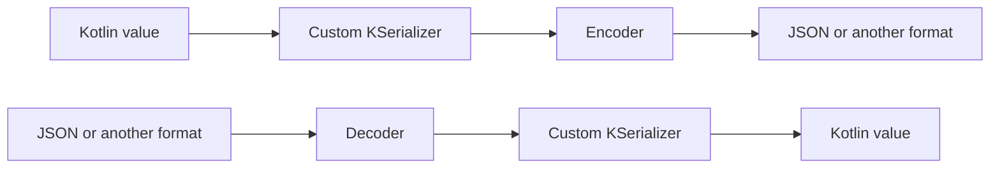
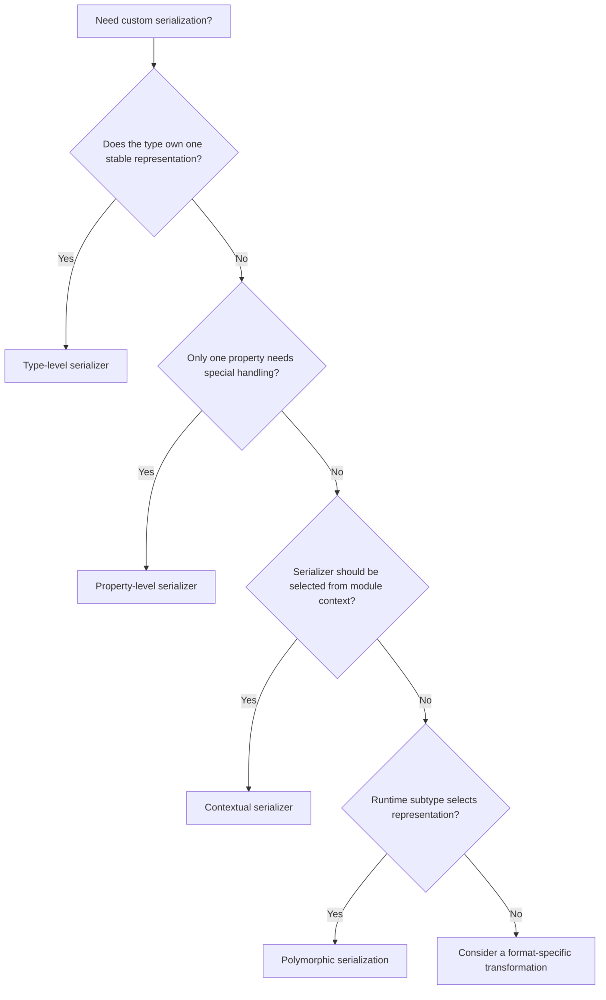
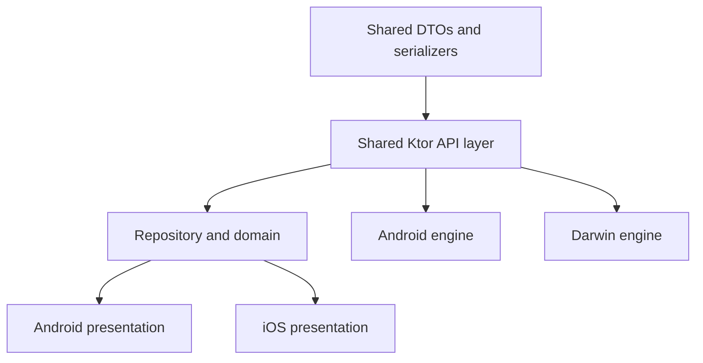

<div align="center">

# Chapter 18 — Serialization
## Part 4: Custom Serializers

[](https://kotlinlang.org/)
[](https://github.com/Kotlin/kotlinx.serialization)
[](#)
[](#)

**Taking control of how Kotlin values cross a serialization boundary**

</div>

---

## Table of Contents

- [1. Why Custom Serializers Matter](#1-why-custom-serializers-matter)
- [2. Serialization Descriptors and the Encoder/Decoder Contract](#2-serialization-descriptors-and-the-encoderdecoder-contract)
- [3. The Three Main Serializer Approaches](#3-the-three-main-serializer-approaches)
- [4. `KSerializer` Fundamentals](#4-kserializer-fundamentals)
- [5. A Serializer for a Value Class](#5-a-serializer-for-a-value-class)
- [6. Serializing Dates and Times](#6-serializing-dates-and-times)
- [7. Serializing Money Safely](#7-serializing-money-safely)
- [8. Serializing UUIDs and Identifiers](#8-serializing-uuids-and-identifiers)
- [9. Custom Enum Representations](#9-custom-enum-representations)
- [10. Nullable and Optional Values](#10-nullable-and-optional-values)
- [11. Structured Serializers](#11-structured-serializers)
- [12. Contextual Serialization](#12-contextual-serialization)
- [13. Polymorphic Serialization](#13-polymorphic-serialization)
- [14. JSON-Specific Serializers and `JsonTransformingSerializer`](#14-json-specific-serializers-and-jsontransformingserializer)
- [15. Registering and Using Serializers](#15-registering-and-using-serializers)
- [16. Custom Serializers in Kotlin Multiplatform](#16-custom-serializers-in-kotlin-multiplatform)
- [17. Error Handling and Validation](#17-error-handling-and-validation)
- [18. Testing Custom Serializers](#18-testing-custom-serializers)
- [19. Performance and Security Considerations](#19-performance-and-security-considerations)
- [20. Common Mistakes](#20-common-mistakes)
- [21. Production Checklist](#21-production-checklist)
- [22. Final Thoughts](#22-final-thoughts)

---

## 1. Why Custom Serializers Matter

Kotlin Serialization can generate serializers for many Kotlin types automatically. A normal data class with supported property types usually needs only `@Serializable`.

```kotlin
@Serializable
data class UserDto(
    val id: String,
    val name: String
)
```

But real APIs do not always represent values in the same way Kotlin models them.

A backend might send:

- A timestamp as an ISO-8601 string.
- A money amount as an integer number of minor units.
- A UUID as a string.
- An enum as a legacy code such as `"P"` or `"C"`.
- A value object as a primitive JSON string rather than an object.
- A date as an array or a custom numeric format.
- A polymorphic object with a discriminator that does not match Kotlin class names.

A generated serializer cannot infer every domain-specific conversion rule. A custom serializer defines that rule explicitly.

For example, the application may use a domain-friendly value:

```kotlin
@JvmInline
value class CustomerId(val value: String)
```

The API expects this JSON:

```json
"customer-1042"
```

Not this:

```json
{
  "value": "customer-1042"
}
```

A custom serializer can preserve the strongly typed Kotlin value while keeping the external JSON contract as a simple string.

### The central principle

> A custom serializer controls representation. It should not become a place for unrelated business logic.

Serialization is responsible for converting values between Kotlin objects and a wire format. Validation of business rules, authorization, persistence, and application decisions belong in their appropriate layers.

---

## 2. Serialization Descriptors and the Encoder/Decoder Contract

A custom serializer implements `KSerializer<T>`. It tells Kotlin Serialization:

1. What kind of value is being serialized.
2. How to describe its structure.
3. How to encode a Kotlin value.
4. How to decode a serialized value.

The core interface is conceptually:

```kotlin
interface KSerializer<T> {
    val descriptor: SerialDescriptor

    fun serialize(encoder: Encoder, value: T)

    fun deserialize(decoder: Decoder): T
}
```

The actual library API includes additional annotations and contracts, but these three members are the essential parts to understand.

### Serialization flow



### What is a descriptor?

A `SerialDescriptor` describes the serialized shape of a type. It provides metadata such as:

- Serial name.
- Kind of structure.
- Number of elements for structured types.
- Element names and descriptors.
- Optionality of elements.

For a primitive string representation, the descriptor should describe a string—not an object containing a string property.

For a structured representation, the descriptor should describe the structure the serializer actually reads and writes.

Descriptors are important for format independence, schema introspection, tooling, and correct interaction with serializers that inspect type metadata.

### Encoder and decoder

The encoder writes values using operations such as:

```kotlin
encoder.encodeString(value)
encoder.encodeLong(value)
encoder.encodeBoolean(value)
```

The decoder reads values using corresponding operations:

```kotlin
decoder.decodeString()
decoder.decodeLong()
decoder.decodeBoolean()
```

For structured values, serializers use structure-oriented APIs such as `beginStructure`, `encodeSerializableElement`, and `decodeSerializableElement`.

Use the format-neutral `Encoder` and `Decoder` APIs when a serializer should work across multiple serialization formats.

---

## 3. The Three Main Serializer Approaches

There are several ways to customize serialization. Choose the narrowest approach that matches the requirement.

| Approach | Best suited for | Example |
|---|---|---|
| Property-level serializer | One property needs a special representation | A timestamp field |
| Type-level custom serializer | A type always has one wire representation | `CustomerId` |
| Contextual serializer | A type is serialized differently depending on configured context | A third-party type |

There is also polymorphic serialization, which is useful when the runtime subtype determines the serializer.

### Decision guide



A property-level serializer is often the simplest choice when only one field needs a custom wire format.

---

## 4. `KSerializer` Fundamentals

A serializer is a reusable component that describes how one Kotlin type maps to a serialized representation.

The simplest example maps a Kotlin wrapper to a JSON string.

```kotlin
import kotlinx.serialization.KSerializer
import kotlinx.serialization.descriptors.PrimitiveKind
import kotlinx.serialization.descriptors.PrimitiveSerialDescriptor
import kotlinx.serialization.descriptors.SerialDescriptor
import kotlinx.serialization.encoding.Decoder
import kotlinx.serialization.encoding.Encoder

@JvmInline
value class CustomerId(val value: String)

object CustomerIdSerializer : KSerializer<CustomerId> {

    override val descriptor: SerialDescriptor =
        PrimitiveSerialDescriptor(
            serialName = "CustomerId",
            kind = PrimitiveKind.STRING
        )

    override fun serialize(
        encoder: Encoder,
        value: CustomerId
    ) {
        encoder.encodeString(value.value)
    }

    override fun deserialize(decoder: Decoder): CustomerId {
        return CustomerId(decoder.decodeString())
    }
}
```

This serializer defines the wire representation as a primitive string.

### Example

```kotlin
@Serializable
data class CustomerDto(
    @Serializable(with = CustomerIdSerializer::class)
    val id: CustomerId
)
```

The serialized JSON is:

```json
{
  "id": "customer-1042"
}
```

### Why the descriptor matters

This descriptor:

```kotlin
PrimitiveSerialDescriptor(
    serialName = "CustomerId",
    kind = PrimitiveKind.STRING
)
```

states that the serialized value is a string.

It would be incorrect to describe the type as a class structure if the serializer writes only a string. The descriptor and the encoder operations must agree.

### Serializer correctness rule

The following three things must describe the same representation:

- `descriptor`
- `serialize()`
- `deserialize()`

If the descriptor says “string” but the serializer writes a structure, the implementation is inconsistent and can break format interoperability or tooling.

---

## 5. A Serializer for a Value Class

Value classes are useful for expressing strongly typed identifiers without exposing raw strings throughout the application.

```kotlin
@JvmInline
value class OrderId(val value: String)

@Serializable
data class OrderDto(
    @Serializable(with = OrderIdSerializer::class)
    val orderId: OrderId
)
```

Serializer:

```kotlin
object OrderIdSerializer : KSerializer<OrderId> {

    override val descriptor: SerialDescriptor =
        PrimitiveSerialDescriptor(
            "OrderId",
            PrimitiveKind.STRING
        )

    override fun serialize(
        encoder: Encoder,
        value: OrderId
    ) {
        encoder.encodeString(value.value)
    }

    override fun deserialize(decoder: Decoder): OrderId =
        OrderId(decoder.decodeString())
}
```

### Add representation validation carefully

Suppose an order ID must not be blank:

```kotlin
private fun parseOrderId(raw: String): OrderId {
    require(raw.isNotBlank()) {
        "Order ID must not be blank"
    }
    return OrderId(raw)
}
```

Then use it during decoding:

```kotlin
override fun deserialize(decoder: Decoder): OrderId =
    parseOrderId(decoder.decodeString())
```

This is reasonable when the rule is a representation invariant required for the value to exist.

However, do not put complex business policies into the serializer. For example, checking whether an order exists on the server is not a serialization responsibility.

### Reuse versus property-level annotation

If every `OrderId` in the application has the same wire representation, a type-level serializer can be more convenient:

```kotlin
@Serializable(with = OrderIdSerializer::class)
@JvmInline
value class OrderId(val value: String)
```

Then properties can use `OrderId` without repeating the serializer annotation.

Choose the approach based on whether the representation belongs to the type itself or only to a particular API field.

---

## 6. Serializing Dates and Times

Date and time handling is a common reason to write a custom serializer.

The API may send:

```json
{
  "created_at": "2026-10-20T14:30:00Z"
}
```

The application may want to use a multiplatform date/time type instead of repeatedly handling raw strings.

For Kotlin Multiplatform, `kotlinx-datetime` provides common-compatible date and time types.

### Example using `Instant`

```kotlin
import kotlinx.datetime.Instant
import kotlinx.serialization.KSerializer
import kotlinx.serialization.descriptors.PrimitiveKind
import kotlinx.serialization.descriptors.PrimitiveSerialDescriptor
import kotlinx.serialization.descriptors.SerialDescriptor
import kotlinx.serialization.encoding.Decoder
import kotlinx.serialization.encoding.Encoder

object InstantIsoSerializer : KSerializer<Instant> {

    override val descriptor: SerialDescriptor =
        PrimitiveSerialDescriptor(
            "kotlinx.datetime.Instant",
            PrimitiveKind.STRING
        )

    override fun serialize(
        encoder: Encoder,
        value: Instant
    ) {
        encoder.encodeString(value.toString())
    }

    override fun deserialize(decoder: Decoder): Instant {
        val raw = decoder.decodeString()
        return Instant.parse(raw)
    }
}
```

Use it on a property:

```kotlin
@Serializable
data class AuditDto(
    @SerialName("created_at")
    @Serializable(with = InstantIsoSerializer::class)
    val createdAt: Instant
)
```

### What should be considered?

A timestamp contract must define:

- Whether the value includes a timezone or UTC offset.
- Whether it is UTC.
- Fractional-second precision.
- Whether epoch milliseconds or seconds are used.
- Whether the API accepts multiple formats.
- How invalid values should be handled.

`Instant.parse()` expects a supported ISO-8601 representation. If the backend uses a non-standard timestamp format, write a parser for that exact contract and test it with real examples.

### Epoch milliseconds representation

Some APIs send:

```json
{
  "created_at": 1792506600000
}
```

A serializer for epoch milliseconds can use `Long`:

```kotlin
object EpochMillisInstantSerializer : KSerializer<Instant> {

    override val descriptor: SerialDescriptor =
        PrimitiveSerialDescriptor(
            "InstantEpochMillis",
            PrimitiveKind.LONG
        )

    override fun serialize(
        encoder: Encoder,
        value: Instant
    ) {
        encoder.encodeLong(value.toEpochMilliseconds())
    }

    override fun deserialize(decoder: Decoder): Instant {
        return Instant.fromEpochMilliseconds(decoder.decodeLong())
    }
}
```

Do not confuse epoch seconds with epoch milliseconds. A unit mismatch can produce dates far outside the intended range.

---

## 7. Serializing Money Safely

Money is not simply a floating-point number. It has an amount and a currency, and the API must define how that amount is represented.

A robust API may send minor units:

```json
{
  "amount_minor": 129950,
  "currency": "INR"
}
```

Domain value:

```kotlin
data class Money(
    val amountMinor: Long,
    val currency: String
)
```

DTO:

```kotlin
@Serializable
data class MoneyDto(
    @SerialName("amount_minor")
    val amountMinor: Long,
    val currency: String
)
```

If the API expects a structured object, the generated serializer may already be sufficient. A custom serializer is useful when the domain type and wire representation differ.

### Serialize money as a decimal string

Some APIs use:

```json
"1299.50"
```

A domain type could preserve the exact decimal representation as a string-backed amount or use a multiplatform decimal library selected by the project.

Do not parse monetary amounts into `Double` merely because JSON supports numbers. Floating-point arithmetic can introduce rounding errors.

### Custom serializer example for a string-backed amount

```kotlin
@JvmInline
value class DecimalAmount(val value: String)

object DecimalAmountSerializer : KSerializer<DecimalAmount> {

    override val descriptor: SerialDescriptor =
        PrimitiveSerialDescriptor(
            "DecimalAmount",
            PrimitiveKind.STRING
        )

    override fun serialize(
        encoder: Encoder,
        value: DecimalAmount
    ) {
        encoder.encodeString(value.value)
    }

    override fun deserialize(decoder: Decoder): DecimalAmount {
        val raw = decoder.decodeString()

        require(DECIMAL_PATTERN.matches(raw)) {
            "Invalid decimal amount"
        }

        return DecimalAmount(raw)
    }

    private val DECIMAL_PATTERN =
        Regex("""-?\d+(?:\.\d+)?""")
}
```

This validates a basic decimal string shape. It does not implement arithmetic, currency scale, rounding, or financial business rules.

For production financial applications, use a decimal representation with explicitly defined precision and rounding behavior.

---

## 8. Serializing UUIDs and Identifiers

UUIDs are commonly transferred as strings:

```json
{
  "request_id": "550e8400-e29b-41d4-a716-446655440000"
}
```

If the project uses a multiplatform UUID type, a serializer can encode and decode its canonical string representation.

The exact UUID type and API depend on the library selected by the project. The pattern remains:

```kotlin
object UuidSerializer : KSerializer<Uuid> {

    override val descriptor: SerialDescriptor =
        PrimitiveSerialDescriptor(
            "Uuid",
            PrimitiveKind.STRING
        )

    override fun serialize(
        encoder: Encoder,
        value: Uuid
    ) {
        encoder.encodeString(value.toString())
    }

    override fun deserialize(decoder: Decoder): Uuid {
        return Uuid.parse(decoder.decodeString())
    }
}
```

Here, `Uuid` represents the UUID type provided by the UUID library used in the project. It is not a Kotlin standard-library type. Add the appropriate dependency and use the exact API for that library version.

### Identifier design guidance

- Do not assume identifiers are numeric.
- Preserve leading zeros when the API treats IDs as strings.
- Validate format only when the contract requires it.
- Avoid generating identifiers inside a deserializer.
- Keep identifier parsing deterministic.

---

## 9. Custom Enum Representations

A backend may represent an enum using codes rather than Kotlin enum names.

Example API:

```json
{
  "status": "P"
}
```

Kotlin enum:

```kotlin
enum class ShipmentStatus {
    PENDING,
    IN_PROGRESS,
    COMPLETED
}
```

A property-level serializer can map the external codes:

```kotlin
object ShipmentStatusSerializer : KSerializer<ShipmentStatus> {

    override val descriptor: SerialDescriptor =
        PrimitiveSerialDescriptor(
            "ShipmentStatus",
            PrimitiveKind.STRING
        )

    override fun serialize(
        encoder: Encoder,
        value: ShipmentStatus
    ) {
        val code = when (value) {
            ShipmentStatus.PENDING -> "P"
            ShipmentStatus.IN_PROGRESS -> "I"
            ShipmentStatus.COMPLETED -> "C"
        }

        encoder.encodeString(code)
    }

    override fun deserialize(decoder: Decoder): ShipmentStatus {
        return when (decoder.decodeString()) {
            "P" -> ShipmentStatus.PENDING
            "I" -> ShipmentStatus.IN_PROGRESS
            "C" -> ShipmentStatus.COMPLETED
            else -> throw SerializationException(
                "Unknown shipment status code"
            )
        }
    }
}
```

Use it:

```kotlin
@Serializable
data class ShipmentDto(
    @Serializable(with = ShipmentStatusSerializer::class)
    val status: ShipmentStatus
)
```

### What about unknown values?

Throwing on unknown values is appropriate when an unknown status makes the payload unusable or could lead to unsafe behavior.

For tolerant read-only data, another approach is to preserve the raw string in the DTO and map it to a domain enum with an `UNKNOWN` value.

```kotlin
fun String.toShipmentStatus(): ShipmentStatus =
    when (this) {
        "P" -> ShipmentStatus.PENDING
        "I" -> ShipmentStatus.IN_PROGRESS
        "C" -> ShipmentStatus.COMPLETED
        else -> ShipmentStatus.UNKNOWN
    }
```

The choice depends on the API's compatibility requirements. Never silently map an unknown value to a known state with different business meaning.

---

## 10. Nullable and Optional Values

Kotlin Serialization already supports nullable values through its generated serializers.

For example:

```kotlin
@Serializable
data class UserDto(
    val nickname: String? = null
)
```

You generally do not need a custom serializer just to support nullable properties.

### Nullable serializer composition

The serializer for a non-null type can be made nullable using the `nullable` extension:

```kotlin
val nullableStringSerializer = String.serializer().nullable
```

The exact imports depend on the serialization APIs in use.

### Missing versus explicit null

A nullable property with a default can represent both an absent field and a field explicitly set to `null` as the same Kotlin value.

For PATCH semantics, that may be insufficient. If the API distinguishes “not provided” from “clear this value,” use a dedicated representation and serializer strategy.

Do not create a custom nullable serializer unless the wire contract genuinely requires behavior beyond the built-in nullable handling.

---

## 11. Structured Serializers

Primitive serializers are straightforward. Structured serializers are useful when a type is represented as a JSON object or another compound structure.

Suppose the domain type is:

```kotlin
data class Coordinate(
    val latitude: Double,
    val longitude: Double
)
```

The API sends:

```json
{
  "lat": 12.9716,
  "lng": 77.5946
}
```

A structured serializer can define the external field names.

```kotlin
object CoordinateSerializer : KSerializer<Coordinate> {

    override val descriptor: SerialDescriptor =
        buildClassSerialDescriptor("Coordinate") {
            element<Double>("lat")
            element<Double>("lng")
        }

    override fun serialize(
        encoder: Encoder,
        value: Coordinate
    ) {
        encoder.encodeStructure(descriptor) {
            encodeDoubleElement(descriptor, 0, value.latitude)
            encodeDoubleElement(descriptor, 1, value.longitude)
        }
    }

    override fun deserialize(decoder: Decoder): Coordinate {
        var latitude: Double? = null
        var longitude: Double? = null

        decoder.decodeStructure(descriptor) {
            while (true) {
                when (val index = decodeElementIndex(descriptor)) {
                    0 -> latitude = decodeDoubleElement(descriptor, 0)
                    1 -> longitude = decodeDoubleElement(descriptor, 1)
                    CompositeDecoder.DECODE_DONE -> break
                    else -> throw SerializationException(
                        "Unexpected coordinate element index: $index"
                    )
                }
            }
        }

        return Coordinate(
            latitude = requireNotNull(latitude) {
                "Missing coordinate latitude"
            },
            longitude = requireNotNull(longitude) {
                "Missing coordinate longitude"
            }
        )
    }
}
```

Imports required by this example include:

```kotlin
import kotlinx.serialization.SerializationException
import kotlinx.serialization.descriptors.SerialDescriptor
import kotlinx.serialization.descriptors.buildClassSerialDescriptor
import kotlinx.serialization.descriptors.element
import kotlinx.serialization.encoding.CompositeDecoder
import kotlinx.serialization.encoding.decodeStructure
import kotlinx.serialization.encoding.encodeStructure
```

### Structured serializer considerations

- The descriptor must describe the actual serialized structure.
- Element indices must match the descriptor's declared order.
- Required fields should be checked after decoding.
- Optional fields need deliberate defaults.
- Unknown elements should be handled according to the format and compatibility policy.
- Do not assume every serialization format has JSON's object semantics.

A structured serializer is more complex than a primitive serializer. Prefer generated serialization when the DTO structure already matches the wire contract.

---

## 12. Contextual Serialization

Contextual serialization is useful when a type cannot or should not be annotated directly with a serializer.

For example, a third-party type may not be owned by the application. You cannot add `@Serializable` to that type.

Define a serializer:

```kotlin
object ExternalCodeSerializer : KSerializer<ExternalCode> {

    override val descriptor: SerialDescriptor =
        PrimitiveSerialDescriptor(
            "ExternalCode",
            PrimitiveKind.STRING
        )

    override fun serialize(
        encoder: Encoder,
        value: ExternalCode
    ) {
        encoder.encodeString(value.value)
    }

    override fun deserialize(decoder: Decoder): ExternalCode =
        ExternalCode(decoder.decodeString())
}
```

Here `ExternalCode` is a project or third-party type with a string property named `value`.

Register the serializer in a `SerializersModule`:

```kotlin
val appSerializersModule = SerializersModule {
    contextual(
        ExternalCode::class,
        ExternalCodeSerializer
    )
}
```

Use `@Contextual` on the property:

```kotlin
@Serializable
data class ExternalRecordDto(
    @Contextual
    val code: ExternalCode
)
```

Configure JSON:

```kotlin
val appJson = Json {
    serializersModule = appSerializersModule
}
```

### When contextual serialization is useful

- A type is owned by a third-party library.
- The model cannot be annotated.
- Serializer selection should be supplied by the application module.
- Different application configurations need different serializers for the same type.

### Contextual versus explicit serializer

| Explicit serializer | Contextual serializer |
|---|---|
| Declared directly on a property or type | Resolved through a serializers module |
| Easy to see at the usage site | Configuration is centralized |
| Good for a stable representation | Good for externally owned or configurable types |
| Less runtime lookup | Requires contextual registration |

Contextual serialization is not a reason to hide every serializer in a global module. Prefer explicit annotations when they make the contract easier to understand.

---

## 13. Polymorphic Serialization

Polymorphic serialization handles values whose runtime subtype determines their representation.

A sealed hierarchy is often appropriate:

```kotlin
@Serializable
sealed interface NotificationDto

@Serializable
@SerialName("email")
data class EmailNotificationDto(
    val address: String
) : NotificationDto

@Serializable
@SerialName("sms")
data class SmsNotificationDto(
    val phoneNumber: String
) : NotificationDto
```

JSON configuration can define the discriminator key:

```kotlin
val notificationJson = Json {
    classDiscriminator = "type"
}
```

Example JSON:

```json
{
  "type": "email",
  "address": "user@example.com"
}
```

### Customizing subtype selection

Use polymorphic registration for open hierarchies or when implementations are supplied from separate modules:

```kotlin
val notificationModule = SerializersModule {
    polymorphic(NotificationDto::class) {
        subclass(EmailNotificationDto::class)
        subclass(SmsNotificationDto::class)
    }
}
```

Then:

```kotlin
val notificationJson = Json {
    serializersModule = notificationModule
    classDiscriminator = "type"
}
```

Sealed hierarchies can often be handled through generated serializers without manual subtype registration. The exact configuration depends on the hierarchy and serialization version.

### Security and compatibility

Never use arbitrary class names supplied by untrusted input as a mechanism to instantiate arbitrary application classes.

Use an explicit, controlled set of known subtypes. Unknown discriminator behavior should be deliberate and tested.

---

## 14. JSON-Specific Serializers and `JsonTransformingSerializer`

Sometimes the API's JSON shape differs from the shape most convenient for the Kotlin model, but the transformation is specific to JSON.

`JsonTransformingSerializer` is designed for this kind of JSON tree transformation.

For example, an API may return a single object where the client wants to accept either one object or an array:

```json
{
  "id": "item-1",
  "name": "Scanner"
}
```

or:

```json
[
  {
    "id": "item-1",
    "name": "Scanner"
  }
]
```

A transforming serializer can normalize a single object into a one-element array before the underlying list serializer decodes it.

```kotlin
import kotlinx.serialization.KSerializer
import kotlinx.serialization.builtins.ListSerializer
import kotlinx.serialization.json.JsonArray
import kotlinx.serialization.json.JsonElement
import kotlinx.serialization.json.JsonTransformingSerializer

@Serializable
data class ItemDto(
    val id: String,
    val name: String
)

object ItemListSerializer :
    JsonTransformingSerializer<List<ItemDto>>(
        ListSerializer(ItemDto.serializer())
    ) {

    override fun transformDeserialize(
        element: JsonElement
    ): JsonElement {
        return when (element) {
            is JsonArray -> element
            else -> JsonArray(listOf(element))
        }
    }
}
```

Use it:

```kotlin
@Serializable
data class ItemsResponseDto(
    @Serializable(with = ItemListSerializer::class)
    val items: List<ItemDto>
)
```

This example assumes the `items` property contains either an object or an array. If the API wraps the collection in another object, the transformation must match that actual structure.

### Important limitation

`JsonTransformingSerializer` is JSON-specific. It depends on JSON tree types and should not be presented as a format-independent serializer.

Use it when the API has an inconsistent JSON shape that must be normalized. Do not use it to compensate for an unclear or unstable backend contract without documenting the compatibility behavior.

---

## 15. Registering and Using Serializers

There are several places to attach a custom serializer.

### 15.1 Property-level serializer

```kotlin
@Serializable
data class EventDto(
    @Serializable(with = InstantIsoSerializer::class)
    val occurredAt: Instant
)
```

Use this when only one property needs special handling.

### 15.2 Type-level serializer

```kotlin
@Serializable(with = CustomerIdSerializer::class)
@JvmInline
value class CustomerId(val value: String)
```

Use this when the type has one stable serialized representation throughout the application.

### 15.3 Contextual registration

```kotlin
val module = SerializersModule {
    contextual(ExternalCode::class, ExternalCodeSerializer)
}

val json = Json {
    serializersModule = module
}
```

Use this when serializer selection belongs to runtime configuration.

### 15.4 Use the configured JSON instance

```kotlin
val json = Json {
    ignoreUnknownKeys = true
    serializersModule = appSerializersModule
}
```

Then:

```kotlin
val encoded = json.encodeToString(dto)
val decoded = json.decodeFromString<EventDto>(encoded)
```

Use one deliberately configured serialization instance for the relevant API boundary. Avoid creating unrelated JSON configurations throughout the application, because different settings can lead to inconsistent behavior.

---

## 16. Custom Serializers in Kotlin Multiplatform

Custom serializers are particularly valuable in KMP when Android and iOS must interpret the same API representation consistently.

A serializer that uses only common Kotlin and `kotlinx.serialization` APIs can live in `commonMain`.

Example source-set organization:

```text
shared/
└── src/
    ├── commonMain/
    │   └── kotlin/
    │       └── serialization/
    │           ├── InstantIsoSerializer.kt
    │           ├── CustomerIdSerializer.kt
    │           └── AppSerializersModule.kt
    ├── commonTest/
    │   └── kotlin/
    │       └── serialization/
    │           └── CustomSerializerTest.kt
    ├── androidMain/
    └── iosMain/
```

### Keep serializers platform-neutral

A common serializer should not depend on:

- `java.time` unless isolated behind a platform abstraction.
- Android framework classes.
- UIKit types.
- Platform-specific file APIs.
- Platform-specific locale assumptions.

Prefer multiplatform types such as `kotlinx-datetime` when they fit the contract.

### Share behavior, not platform details

The serializer should define the wire representation. Platform-specific networking engines can remain separate while using the same common DTO and serializer.



### Build and dependency alignment

The Kotlin Serialization compiler plugin should use a version compatible with the Kotlin compiler in the project. Keep the serialization runtime version aligned with the project's compatibility requirements.

Do not copy a version number from an unrelated project. Confirm plugin and runtime compatibility for the Kotlin version used by the KMP build.

---

## 17. Error Handling and Validation

A custom deserializer can fail for several reasons:

- The JSON token has the wrong type.
- A required field is missing.
- A string cannot be parsed into a date or identifier.
- A numeric value is outside the valid range.
- An enum code is unknown.
- A structured payload violates its expected shape.

Use serialization exceptions for malformed serialized input.

```kotlin
throw SerializationException(
    "Invalid shipment status representation"
)
```

For a domain-specific parse failure, you can catch and wrap lower-level exceptions where it improves the error context:

```kotlin
override fun deserialize(decoder: Decoder): Instant {
    val raw = decoder.decodeString()

    return try {
        Instant.parse(raw)
    } catch (cause: IllegalArgumentException) {
        throw SerializationException(
            "Invalid ISO-8601 timestamp",
            cause
        )
    }
}
```

The exact exception types thrown by parsing functions can vary. Catch only the exceptions expected from the parser; do not catch every `Throwable`.

### Keep validation at the right level

| Validation | Best location |
|---|---|
| JSON token is a string | Serializer/decoder |
| Timestamp follows the wire format | Serializer or transport parser |
| Identifier is not blank | Value construction or boundary validation |
| User is allowed to update an order | Domain/application layer |
| Order exists on the server | Backend or application workflow |
| Quantity is valid for a business operation | Domain/use case |

A serializer should reject malformed representations, but should not perform network calls or application workflows.

---

## 18. Testing Custom Serializers

Custom serializers are code, not configuration. They deserve focused tests.

### 18.1 Test encoding

```kotlin
class CustomerIdSerializerTest {

    private val json = Json

    @Test
    fun customerId_encodesAsJsonString() {
        val result = json.encodeToString(
            CustomerIdSerializer,
            CustomerId("customer-1042")
        )

        assertEquals(
            "\"customer-1042\"",
            result
        )
    }
}
```

This verifies that the value is encoded as a primitive JSON string rather than an object.

### 18.2 Test decoding

```kotlin
@Test
fun customerId_decodesFromJsonString() {
    val result = json.decodeFromString(
        CustomerIdSerializer,
        "\"customer-1042\""
    )

    assertEquals(
        CustomerId("customer-1042"),
        result
    )
}
```

### 18.3 Test invalid input

```kotlin
@Test
fun invalidCustomerId_isRejected() {
    assertFailsWith<IllegalArgumentException> {
        json.decodeFromString(
            CustomerIdSerializer,
            "\"\""
        )
    }
}
```

This expectation assumes the serializer validates blank IDs with `require`. If the implementation wraps validation errors in `SerializationException`, assert that exception instead.

### 18.4 Test the complete DTO

```kotlin
@Test
fun eventDto_usesCustomInstantSerializer() {
    val payload = """
        {
          "occurredAt": "2026-10-20T14:30:00Z"
        }
    """.trimIndent()

    val result = json.decodeFromString<EventDto>(payload)

    assertEquals(
        Instant.parse("2026-10-20T14:30:00Z"),
        result.occurredAt
    )
}
```

### 18.5 Test round trips

```kotlin
@Test
fun customerId_roundTrips() {
    val original = CustomerId("customer-1042")

    val encoded = json.encodeToString(
        CustomerIdSerializer,
        original
    )

    val decoded = json.decodeFromString(
        CustomerIdSerializer,
        encoded
    )

    assertEquals(original, decoded)
}
```

Round-trip tests are useful, but not sufficient by themselves. If both encode and decode share the same incorrect assumption, a round trip can still pass.

### Recommended test matrix

| Test case | Expected result |
|---|---|
| Valid value encodes | Exact documented JSON shape |
| Valid value decodes | Expected Kotlin value |
| Round trip | Original value restored |
| Wrong JSON token type | Clear decoding failure |
| Empty or malformed value | Explicit validation behavior |
| Boundary numeric value | Correct range and precision |
| Unknown enum code | Documented fallback or failure |
| Null input | Correct nullable behavior |
| Nested DTO | Custom serializer used in context |
| KMP common test | Same behavior on supported targets |

Use `commonTest` for serializers that are fully multiplatform.

---

## 19. Performance and Security Considerations

Custom serialization adds code to the data path. Keep it predictable and efficient.

### Performance

- Prefer generated serializers when they already match the contract.
- Avoid parsing the same value repeatedly.
- Avoid unnecessary JSON tree transformations.
- Keep serializers stateless where possible.
- Avoid expensive regular expressions compiled repeatedly; keep reusable patterns as constants.
- Do not allocate intermediate objects without a reason.
- Benchmark only when serialization is a measured bottleneck.

### Security

- Treat all remote data as untrusted.
- Validate lengths and ranges where the contract requires limits.
- Avoid logging sensitive serialized values.
- Do not deserialize arbitrary class names into arbitrary runtime types.
- Avoid permissive fallback behavior for security-sensitive fields.
- Be careful with large arrays, deeply nested JSON, and unexpectedly large strings.
- Do not treat successful deserialization as proof that a value is authorized or safe for a business operation.

### Compatibility

A serializer is part of the application's interpretation of an external contract. Changes to its behavior can affect old cached payloads, persisted data, and API compatibility.

When changing a serializer, test both current API fixtures and any persisted serialized values that the application still needs to read.

---

## 20. Common Mistakes

| Mistake | Why it is problematic | Better practice |
|---|---|---|
| Descriptor says string but serializer writes an object | Metadata and behavior disagree | Match descriptor to actual representation |
| Custom serializer for every DTO | Adds unnecessary code | Use generated serializers by default |
| Business logic inside `deserialize()` | Couples transport parsing to application rules | Keep business rules in domain |
| Swallowing every parsing exception | Hides malformed data | Wrap expected parse failures with context |
| Assuming epoch units | Seconds and milliseconds differ greatly | Document and test the unit |
| Using `Double` for money | Precision can be lost | Use minor units or decimal representation |
| Mapping unknown status to a known status | Changes business meaning | Use explicit unknown handling |
| Registering contextual serializers but forgetting the module | Runtime serializer lookup can fail | Configure the `Json` instance |
| Using JSON transformation for all formats | `JsonTransformingSerializer` is JSON-specific | Use format-neutral APIs when needed |
| Testing only round trips | Can miss incorrect wire contracts | Assert exact JSON fixtures |
| Using platform APIs in common serializers | Breaks KMP portability | Use common-compatible APIs |
| Making serializers perform network or database work | Violates deterministic boundary behavior | Keep serializers pure |

---

## 21. Production Checklist

### Serializer design
- [ ] The custom serializer solves a real contract mismatch.
- [ ] Generated serialization is used where it is sufficient.
- [ ] The descriptor matches the actual encoded structure.
- [ ] Encode and decode operations are symmetrical where the contract permits.
- [ ] Nullability and defaults are deliberate.
- [ ] Invalid values produce clear, predictable failures.

### API contract
- [ ] Exact field names and token types are tested.
- [ ] Date/time format and timezone rules are documented.
- [ ] Numeric units and precision are explicit.
- [ ] Unknown enum and discriminator values have a policy.
- [ ] Request and response representations are tested independently.

### Kotlin Multiplatform
- [ ] Common serializers use common-compatible APIs.
- [ ] Serialization plugin and runtime versions are compatible.
- [ ] Contextual serializers are registered in the configured module.
- [ ] Shared serializer behavior is tested in `commonTest`.
- [ ] Platform-specific code remains outside common serialization logic.

### Reliability and security
- [ ] Remote values are treated as untrusted.
- [ ] Sensitive data is not logged.
- [ ] Large or malformed inputs are handled safely.
- [ ] No arbitrary runtime type loading is performed.
- [ ] Changes are tested against representative API fixtures.

---

## 22. Final Thoughts

Custom serializers give Kotlin developers precise control over the boundary between application types and external representations.

They are especially useful when the API's representation is not the representation the application should use internally: a string-backed identifier, an epoch timestamp, a legacy status code, or a third-party type.

But custom serialization should remain intentional. Generated serializers are the right default when the Kotlin model already matches the contract. A custom serializer should exist because it makes a real representation rule explicit—not simply because the library allows it.

In a Kotlin Multiplatform application, a well-designed common serializer keeps Android and iOS consistent at the data boundary while allowing each platform to maintain its own presentation and platform integrations.

**The goal is not to customize everything. The goal is to make every conversion rule explicit, testable, and predictable.**

---

<div align="center">

**End of Chapter 18 — Part 4: Custom Serializers**

*Reliable serialization starts with a clear contract—and custom serializers make the difficult representations explicit.*

</div>
