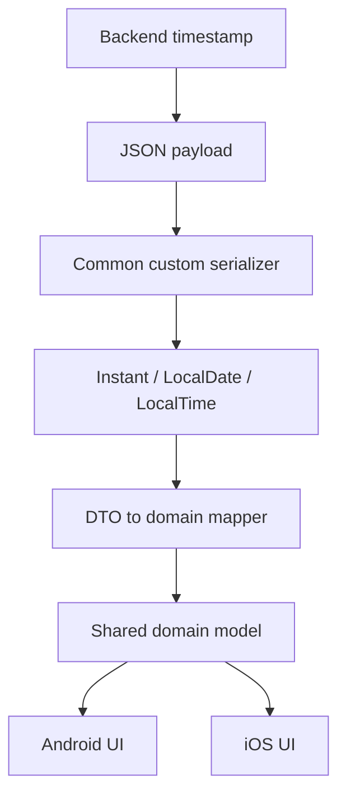

<div align="center">

# Chapter 18 — Serialization
## Part 6: Date and Time Serialization

[](https://kotlinlang.org/)
[](https://github.com/Kotlin/kotlinx.serialization)
[](#)
[](#)

**Handling timestamps, time zones, calendar dates, and API date formats across platforms**

</div>

---

## Table of Contents

- [1. Why Date and Time Serialization Is Difficult](#1-why-date-and-time-serialization-is-difficult)
- [2. Date, Time, and Timestamp Are Different Concepts](#2-date-time-and-timestamp-are-different-concepts)
- [3. Common API Date Representations](#3-common-api-date-representations)
- [4. Choosing the Right Kotlin Type](#4-choosing-the-right-kotlin-type)
- [5. Using `kotlinx-datetime` in KMP](#5-using-kotlinx-datetime-in-kmp)
- [6. Serializing `Instant` as ISO-8601](#6-serializing-instant-as-iso-8601)
- [7. Serializing Epoch Seconds and Milliseconds](#7-serializing-epoch-seconds-and-milliseconds)
- [8. Serializing a Calendar Date](#8-serializing-a-calendar-date)
- [9. Serializing Local Time](#9-serializing-local-time)
- [10. Serializing Local Date-Time and Time Zones](#10-serializing-local-date-time-and-time-zones)
- [11. Custom Date Formats](#11-custom-date-formats)
- [12. Handling Legacy and Inconsistent API Formats](#12-handling-legacy-and-inconsistent-api-formats)
- [13. Null, Missing, and Optional Date Values](#13-null-missing-and-optional-date-values)
- [14. Date Serialization in Request DTOs](#14-date-serialization-in-request-dtos)
- [15. Date and Time in Ktor Client](#15-date-and-time-in-ktor-client)
- [16. Kotlin Multiplatform Architecture](#16-kotlin-multiplatform-architecture)
- [17. Validation, Errors, and Edge Cases](#17-validation-errors-and-edge-cases)
- [18. Testing Date Serializers](#18-testing-date-serializers)
- [19. Security and Reliability Considerations](#19-security-and-reliability-considerations)
- [20. Common Date Serialization Mistakes](#20-common-date-serialization-mistakes)
- [21. Production Checklist](#21-production-checklist)
- [22. Final Thoughts](#22-final-thoughts)

---

## 1. Why Date and Time Serialization Is Difficult

Dates look simple until an application communicates with another system.

A backend sends:

```json
{
  "created_at": "2026-10-20T14:30:00Z"
}
```

The mobile application receives a string. But what does that string represent?

- A moment on the global timeline?
- A local wall-clock time?
- A calendar date?
- A date and time in a particular time zone?
- A timestamp whose precision is milliseconds, microseconds, or nanoseconds?

These are different concepts. Treating them as interchangeable creates bugs that are difficult to reproduce.

Consider a warehouse task scheduled for `2026-10-20`. That may be a calendar date with no time zone.

Now consider an audit event created at `2026-10-20T14:30:00Z`. That is a precise instant on the global timeline.

And consider a store opening time of `09:00`. That is a local time of day, not a globally unique instant.

A reliable serialization design starts by identifying the meaning of the value—not by choosing a date class based on the shape of the JSON.

### The key principle

> Serialize the temporal meaning defined by the API contract, not merely the characters that happen to represent it.

---

## 2. Date, Time, and Timestamp Are Different Concepts

Before writing a serializer, distinguish the common temporal concepts.

| Concept | Meaning | Example |
|---|---|---|
| Instant | A unique point on the global timeline | `2026-10-20T14:30:00Z` |
| Local date | A calendar date without time or zone | `2026-10-20` |
| Local time | Time of day without date or zone | `09:45:00` |
| Local date-time | Calendar date and wall-clock time without zone | `2026-10-20T09:45:00` |
| Time zone | Rules mapping local times to timeline offsets | `Asia/Kolkata` |
| UTC offset | Difference from UTC at a particular time | `+05:30` |
| Zoned date-time | Date and time interpreted in a specific zone | Local date-time + zone rules |

### Instant

An instant represents one exact point in time. It is appropriate for:

- Audit events.
- Server-generated creation timestamps.
- Payment completion timestamps.
- Message delivery timestamps.
- Expiration moments.

### Local date

A local date represents a calendar day. It is appropriate for:

- Date of birth.
- Delivery date.
- Booking date.
- Business date.
- Holiday date.

A local date should not be converted into midnight UTC unless the API contract explicitly defines that conversion.

### Local time

A local time represents a time on a clock, such as a daily opening time. It does not identify a unique instant without a date and time zone.

### Local date-time

A local date-time combines a date and clock time but still does not identify a unique instant without a time zone or offset.

### Time zone versus offset

`+05:30` is an offset. `Asia/Kolkata` is a time-zone identifier with rules.

An offset does not carry all the historical and future rules of a time zone. For locations with daylight-saving changes, a named time zone is often essential.

---

## 3. Common API Date Representations

APIs use several formats to represent temporal values.

| Format | Example | Meaning |
|---|---|---|
| ISO-8601 UTC | `2026-10-20T14:30:00Z` | Instant |
| ISO-8601 with offset | `2026-10-20T20:00:00+05:30` | Instant with stated offset |
| Date only | `2026-10-20` | Calendar date |
| Time only | `14:30:00` | Local time |
| Local date-time | `2026-10-20T14:30:00` | No zone or offset |
| Epoch seconds | `1792506600` | Seconds since Unix epoch |
| Epoch milliseconds | `1792506600000` | Milliseconds since Unix epoch |
| Custom string | `20/10/2026 14:30` | Contract-specific format |

### ISO-8601 examples

UTC timestamp:

```text
2026-10-20T14:30:00Z
```

Timestamp with offset:

```text
2026-10-20T20:00:00+05:30
```

Both identify the same instant.

Date only:

```text
2026-10-20
```

This does not identify a time of day.

Local date-time:

```text
2026-10-20T14:30:00
```

Without an offset or zone, this is not enough to identify a unique global instant.

### Epoch time

Unix epoch time counts from:

```text
1970-01-01T00:00:00Z
```

But the unit matters:

- Epoch seconds: `1792506600`
- Epoch milliseconds: `1792506600000`

A unit mismatch can shift a timestamp by a factor of one thousand.

Always document the unit in the API contract and in the DTO property name when possible.

---

## 4. Choosing the Right Kotlin Type

A good temporal model uses a type that expresses the value's meaning.

For Kotlin Multiplatform, `kotlinx-datetime` provides common-compatible temporal types.

| Requirement | Suggested type |
|---|---|
| Globally unique timestamp | `Instant` |
| Calendar date | `LocalDate` |
| Time of day | `LocalTime` |
| Local date and time | `LocalDateTime` |
| Named time-zone rules | `TimeZone` |
| Date-time interpreted in a zone | `LocalDateTime` + `TimeZone`, or a suitable zoned representation |

Example:

```kotlin
import kotlinx.datetime.Instant
import kotlinx.datetime.LocalDate
import kotlinx.datetime.LocalDateTime
import kotlinx.datetime.LocalTime
import kotlinx.datetime.TimeZone

data class Schedule(
    val eventInstant: Instant,
    val deliveryDate: LocalDate,
    val openingTime: LocalTime,
    val appointment: LocalDateTime,
    val timeZone: TimeZone
)
```

### Avoid using strings throughout the application

A DTO may reasonably hold a date string when it represents the exact wire format. But passing that raw string through repositories, use cases, and UI code spreads parsing assumptions everywhere.

Prefer converting it at the data boundary into a semantic type.

### Avoid using one type for every temporal value

Using `Instant` for a date of birth can introduce timezone shifts. Using `LocalDateTime` for a server event can lose the offset needed to identify the actual moment.

Choose the type from the domain meaning.

---

## 5. Using `kotlinx-datetime` in KMP

`kotlinx-datetime` is designed for Kotlin Multiplatform and provides temporal types and operations that can be used in common source sets.

A version-catalog entry may look like this:

```toml
[versions]
kotlinx-datetime = "<compatible-version>"

[libraries]
kotlinx-datetime = {
    module = "org.jetbrains.kotlinx:kotlinx-datetime",
    version.ref = "kotlinx-datetime"
}
```

Add it to the shared module's `commonMain` dependencies:

```kotlin
kotlin {
    sourceSets {
        commonMain.dependencies {
            implementation(libs.kotlinx.datetime)
        }
    }
}
```

The exact version should be selected to match the Kotlin and library compatibility requirements of the project.

### Common types

```kotlin
val instant = Instant.parse("2026-10-20T14:30:00Z")

val date = LocalDate.parse("2026-10-20")

val time = LocalTime.parse("14:30:00")

val dateTime = LocalDateTime.parse("2026-10-20T14:30:00")

val zone = TimeZone.of("Asia/Kolkata")
```

These parsing operations expect valid supported representations. Invalid input should be handled at the boundary where the API value is decoded.

### Why not use `java.time` in common code?

`java.time` is a JVM API. It is excellent for Android/JVM applications, but it is not directly available in `commonMain` for all KMP targets.

Using `kotlinx-datetime` in shared code avoids introducing a JVM-only dependency into common business and serialization logic.

---

## 6. Serializing `Instant` as ISO-8601

A common API representation for an instant is an ISO-8601 string.

Example:

```json
{
  "created_at": "2026-10-20T14:30:00Z"
}
```

A custom serializer can encode and decode `Instant`.

```kotlin
import kotlinx.datetime.Instant
import kotlinx.serialization.KSerializer
import kotlinx.serialization.descriptors.PrimitiveKind
import kotlinx.serialization.descriptors.PrimitiveSerialDescriptor
import kotlinx.serialization.descriptors.SerialDescriptor
import kotlinx.serialization.encoding.Decoder
import kotlinx.serialization.encoding.Encoder

object InstantIsoSerializer : KSerializer<Instant> {

    override val descriptor: SerialDescriptor =
        PrimitiveSerialDescriptor(
            serialName = "InstantIso8601",
            kind = PrimitiveKind.STRING
        )

    override fun serialize(
        encoder: Encoder,
        value: Instant
    ) {
        encoder.encodeString(value.toString())
    }

    override fun deserialize(decoder: Decoder): Instant {
        val rawValue = decoder.decodeString()
        return Instant.parse(rawValue)
    }
}
```

Use it on a DTO property:

```kotlin
@Serializable
data class AuditEventDto(
    @SerialName("created_at")
    @Serializable(with = InstantIsoSerializer::class)
    val createdAt: Instant
)
```

Example JSON:

```json
{
  "created_at": "2026-10-20T14:30:00Z"
}
```

### What does `Instant.toString()` produce?

It produces a normalized ISO-8601 representation supported by `kotlinx-datetime`. The exact formatting of fractional seconds may be normalized.

If the API requires a particular precision or exact textual shape, document and test that requirement rather than assuming every valid ISO timestamp will be reproduced byte-for-byte.

### Type-level serializer

If all `Instant` values in the application use the same wire format, you can define a type-level serializer using the library's supported annotation mechanism or register it contextually.

Use property-level annotations when only a particular API field needs this representation.

---

## 7. Serializing Epoch Seconds and Milliseconds

Some APIs use numbers instead of strings.

### Epoch milliseconds

```json
{
  "created_at": 1792506600000
}
```

Serializer:

```kotlin
object EpochMillisInstantSerializer : KSerializer<Instant> {

    override val descriptor: SerialDescriptor =
        PrimitiveSerialDescriptor(
            serialName = "InstantEpochMillis",
            kind = PrimitiveKind.LONG
        )

    override fun serialize(
        encoder: Encoder,
        value: Instant
    ) {
        encoder.encodeLong(value.toEpochMilliseconds())
    }

    override fun deserialize(decoder: Decoder): Instant {
        val epochMillis = decoder.decodeLong()
        return Instant.fromEpochMilliseconds(epochMillis)
    }
}
```

### Epoch seconds

```json
{
  "created_at": 1792506600
}
```

Serializer:

```kotlin
object EpochSecondsInstantSerializer : KSerializer<Instant> {

    override val descriptor: SerialDescriptor =
        PrimitiveSerialDescriptor(
            serialName = "InstantEpochSeconds",
            kind = PrimitiveKind.LONG
        )

    override fun serialize(
        encoder: Encoder,
        value: Instant
    ) {
        encoder.encodeLong(value.epochSeconds)
    }

    override fun deserialize(decoder: Decoder): Instant {
        val seconds = decoder.decodeLong()
        return Instant.fromEpochSeconds(seconds)
    }
}
```

### Precision considerations

Epoch milliseconds do not preserve sub-millisecond precision. If the original value contains finer precision, converting to milliseconds loses that detail.

Epoch seconds lose even more precision.

Use the precision required by the API contract. Do not silently convert a high-precision timestamp to milliseconds if the application needs to preserve sub-millisecond ordering.

### Naming matters

Prefer property names that reveal the unit:

```kotlin
@SerialName("created_at_epoch_ms")
val createdAtEpochMillis: Long
```

If you convert directly to `Instant`, make the serializer name and documentation explicit about the unit.

---

## 8. Serializing a Calendar Date

A date-only API field should usually map to `LocalDate`.

Example:

```json
{
  "delivery_date": "2026-10-20"
}
```

Serializer:

```kotlin
object LocalDateSerializer : KSerializer<LocalDate> {

    override val descriptor: SerialDescriptor =
        PrimitiveSerialDescriptor(
            serialName = "LocalDate",
            kind = PrimitiveKind.STRING
        )

    override fun serialize(
        encoder: Encoder,
        value: LocalDate
    ) {
        encoder.encodeString(value.toString())
    }

    override fun deserialize(decoder: Decoder): LocalDate {
        return LocalDate.parse(decoder.decodeString())
    }
}
```

DTO:

```kotlin
@Serializable
data class DeliveryDto(
    @SerialName("delivery_date")
    @Serializable(with = LocalDateSerializer::class)
    val deliveryDate: LocalDate
)
```

### Why not convert a date to midnight UTC?

Suppose the API says:

```text
2026-10-20
```

If the client converts this into midnight UTC and then displays it in a different timezone, it may appear as the previous calendar day.

A date-only value is not an instant. Preserve it as a date.

### Common use cases

- Birthdays.
- Delivery dates.
- Booking dates.
- Payroll dates.
- Business operating dates.
- Expiry dates defined by calendar day.

An expiry rule such as “valid through October 20” is not necessarily the same as an instant at midnight UTC. The business definition must be explicit.

---

## 9. Serializing Local Time

A time-only API value might look like:

```json
{
  "opens_at": "09:30:00"
}
```

Use `LocalTime`.

```kotlin
object LocalTimeSerializer : KSerializer<LocalTime> {

    override val descriptor: SerialDescriptor =
        PrimitiveSerialDescriptor(
            serialName = "LocalTime",
            kind = PrimitiveKind.STRING
        )

    override fun serialize(
        encoder: Encoder,
        value: LocalTime
    ) {
        encoder.encodeString(value.toString())
    }

    override fun deserialize(decoder: Decoder): LocalTime {
        return LocalTime.parse(decoder.decodeString())
    }
}
```

DTO:

```kotlin
@Serializable
data class StoreHoursDto(
    @SerialName("opens_at")
    @Serializable(with = LocalTimeSerializer::class)
    val opensAt: LocalTime
)
```

### A time alone does not identify an instant

`09:30` in Bengaluru and `09:30` in London occur at different moments.

A time-only value is useful for recurring local schedules, such as:

- Store opening hours.
- Daily shift start times.
- A recurring reminder time.
- A local operating window.

To calculate an instant, combine the date, local time, and appropriate time-zone rules.

---

## 10. Serializing Local Date-Time and Time Zones

An API may send a local date-time:

```json
{
  "appointment_time": "2026-10-20T09:30:00"
}
```

This has no offset or zone. It represents wall-clock time, not a unique instant.

Serializer:

```kotlin
object LocalDateTimeSerializer : KSerializer<LocalDateTime> {

    override val descriptor: SerialDescriptor =
        PrimitiveSerialDescriptor(
            serialName = "LocalDateTime",
            kind = PrimitiveKind.STRING
        )

    override fun serialize(
        encoder: Encoder,
        value: LocalDateTime
    ) {
        encoder.encodeString(value.toString())
    }

    override fun deserialize(decoder: Decoder): LocalDateTime {
        return LocalDateTime.parse(decoder.decodeString())
    }
}
```

### Include the zone when the meaning requires it

A more complete API contract might be:

```json
{
  "local_time": "2026-10-20T09:30:00",
  "time_zone": "Asia/Kolkata"
}
```

DTO:

```kotlin
@Serializable
data class ZonedAppointmentDto(
    @SerialName("local_time")
    @Serializable(with = LocalDateTimeSerializer::class)
    val localTime: LocalDateTime,

    @SerialName("time_zone")
    val timeZone: String
)
```

The application can resolve the zone:

```kotlin
val zone = TimeZone.of(dto.timeZone)
```

Then interpret the local date-time using the zone rules. Be aware that daylight-saving transitions can make a local time ambiguous or invalid in some time zones.

### Offset date-time versus zoned date-time

An offset identifies the difference from UTC at one moment. A zone identifies a rule set.

For audit events, an instant is usually the most useful domain representation. For future appointments tied to a location's clock, local date-time plus a named time zone may be necessary.

---

## 11. Custom Date Formats

Not every backend uses ISO-8601.

A legacy service may return:

```json
{
  "created_at": "20/10/2026 14:30"
}
```

A custom serializer can use an explicit formatter/parser.

The exact formatter API depends on the date-time library and version. One approach is to parse the known string format at the DTO boundary and convert it into a common temporal type.

For example, if the contract is a date-only value in `dd/MM/yyyy`, implement a dedicated parser with strict validation rather than guessing the format.

### Do not guess between ambiguous formats

These strings are ambiguous:

```text
04/05/2026
```

This could mean:

- April 5, 2026.
- May 4, 2026.

The API must define the format and locale. Avoid relying on the device's current locale to parse a machine-to-machine API value.

### Custom format serializer pattern

```kotlin
object LegacyDateSerializer : KSerializer<LocalDate> {

    override val descriptor: SerialDescriptor =
        PrimitiveSerialDescriptor(
            serialName = "LegacyDate_ddMMyyyy",
            kind = PrimitiveKind.STRING
        )

    override fun serialize(
        encoder: Encoder,
        value: LocalDate
    ) {
        val formatted = buildString {
            append(value.dayOfMonth.toString().padStart(2, '0'))
            append('/')
            append(value.monthNumber.toString().padStart(2, '0'))
            append('/')
            append(value.year.toString().padStart(4, '0'))
        }

        encoder.encodeString(formatted)
    }

    override fun deserialize(decoder: Decoder): LocalDate {
        val raw = decoder.decodeString()
        val parts = raw.split('/')

        if (parts.size != 3) {
            throw SerializationException(
                "Invalid legacy date format"
            )
        }

        val day = parts[0].toIntOrNull()
            ?: throw SerializationException("Invalid day")

        val month = parts[1].toIntOrNull()
            ?: throw SerializationException("Invalid month")

        val year = parts[2].toIntOrNull()
            ?: throw SerializationException("Invalid year")

        return try {
            LocalDate(year, month, day)
        } catch (cause: IllegalArgumentException) {
            throw SerializationException(
                "Invalid calendar date",
                cause
            )
        }
    }
}
```

This serializer is intentionally strict about `dd/MM/yyyy`. It does not accept alternate separators or locale-specific formats.

Use a dedicated serializer for a legacy contract rather than changing the entire application's date parsing rules.

---

## 12. Handling Legacy and Inconsistent API Formats

Some APIs return inconsistent date representations across endpoints.

For example:

Endpoint A:

```json
{
  "created_at": "2026-10-20T14:30:00Z"
}
```

Endpoint B:

```json
{
  "created_at": 1792506600000
}
```

Endpoint C:

```json
{
  "created_at": "20/10/2026 14:30"
}
```

Do not build one permissive parser that accepts anything unless the API contract explicitly requires it.

### Prefer endpoint-specific DTOs

```kotlin
@Serializable
data class EventIsoDto(
    @Serializable(with = InstantIsoSerializer::class)
    val createdAt: Instant
)

@Serializable
data class EventEpochDto(
    @Serializable(with = EpochMillisInstantSerializer::class)
    val createdAt: Instant
)

@Serializable
data class LegacyEventDto(
    @Serializable(with = LegacyDateTimeSerializer::class)
    val createdAt: Instant
)
```

Here `LegacyDateTimeSerializer` would be a separate serializer implementing the documented legacy format.

### Why endpoint-specific handling is safer

- The API contract remains visible.
- Each format can be tested independently.
- A change to one endpoint does not affect others.
- Invalid values fail at the correct boundary.
- There is less ambiguity about timezone and precision.

### If the backend genuinely accepts multiple formats

Use a deliberately designed parser that documents accepted formats, precedence, and failure behavior. Do not silently interpret ambiguous strings.

---

## 13. Null, Missing, and Optional Date Values

Date fields can be missing, explicitly null, or populated.

Example 1 — missing:

```json
{
  "id": "EVENT-1"
}
```

Example 2 — explicit null:

```json
{
  "id": "EVENT-1",
  "completed_at": null
}
```

Example 3 — populated:

```json
{
  "id": "EVENT-1",
  "completed_at": "2026-10-20T14:30:00Z"
}
```

DTO:

```kotlin
@Serializable
data class EventDto(
    val id: String,

    @SerialName("completed_at")
    @Serializable(with = InstantIsoSerializer::class)
    val completedAt: Instant? = null
)
```

This allows the field to be absent or explicitly null, with both represented as `null`.

### When missing and null have different meanings

For PATCH requests, these may mean different things:

- Missing: leave the existing value unchanged.
- Null: clear the existing value.
- Timestamp: set a new value.

A plain nullable property cannot express all three states. Use an explicit field-presence model or a request-specific serializer.

Do not assume that nullable date fields automatically preserve the distinction between absent and null.

---

## 14. Date Serialization in Request DTOs

Date serialization is not limited to API responses. Requests often send dates and timestamps too.

Example:

```json
{
  "delivery_date": "2026-10-20",
  "requested_at": "2026-10-20T14:30:00Z"
}
```

DTO:

```kotlin
@Serializable
data class CreateDeliveryRequestDto(
    @SerialName("delivery_date")
    @Serializable(with = LocalDateSerializer::class)
    val deliveryDate: LocalDate,

    @SerialName("requested_at")
    @Serializable(with = InstantIsoSerializer::class)
    val requestedAt: Instant
)
```

Encoding:

```kotlin
val request = CreateDeliveryRequestDto(
    deliveryDate = LocalDate(2026, 10, 20),
    requestedAt = Instant.parse("2026-10-20T14:30:00Z")
)

val payload = Json.encodeToString(request)
```

### Keep request semantics clear

Do not convert a date-only business value into an instant just because the API accepts a timestamp.

For example, a delivery date is usually a calendar commitment. A request timestamp may be an audit value indicating when the request was created.

They should remain separate properties with separate meanings.

### Avoid using device-local time as server time

If a request needs the current instant, use a well-defined clock abstraction or the appropriate current-time API. Do not construct a timestamp from a local date-time without an explicit time zone.

For deterministic tests, inject a clock or provide the instant as an input rather than reading the system clock deep inside business logic.

---

## 15. Date and Time in Ktor Client

Ktor Client uses the configured serialization library when the ContentNegotiation plugin is installed.

A typical client configuration:

```kotlin
val httpClient = HttpClient {
    install(ContentNegotiation) {
        json(
            Json {
                ignoreUnknownKeys = true
                serializersModule = appSerializersModule
            }
        )
    }
}
```

The `appSerializersModule` is optional unless the application uses contextual or polymorphic serializers that require registration.

A DTO can then be used with a typed request:

```kotlin
val event: AuditEventDto =
    httpClient.get("/events/123").body()
```

And a request can be sent:

```kotlin
httpClient.post("/deliveries") {
    contentType(ContentType.Application.Json)
    setBody(request)
}
```

### Keep serializer configuration centralized

Avoid creating a new JSON configuration for each API call. A shared configuration makes date behavior consistent and easier to test.

However, if two endpoints have genuinely different date contracts, use endpoint-specific DTO serializers rather than forcing one global parser to handle unrelated formats.

### Test the HTTP boundary

In addition to testing serializers directly, use Ktor's `MockEngine` to verify that:

- Response JSON is decoded into the expected temporal type.
- Request JSON contains the correct representation.
- Error payloads do not accidentally get parsed as successful date responses.
- Invalid timestamps produce the expected data-layer error.

---

## 16. Kotlin Multiplatform Architecture

A KMP application should keep common date parsing and serialization in shared code when the API contract is shared.

Suggested structure:

```text
shared/
└── src/
    ├── commonMain/
    │   └── kotlin/
    │       ├── data/
    │       │   ├── dto/
    │       │   │   └── AuditEventDto.kt
    │       │   └── serialization/
    │       │       ├── InstantIsoSerializer.kt
    │       │       ├── EpochMillisInstantSerializer.kt
    │       │       ├── LocalDateSerializer.kt
    │       │       └── AppJson.kt
    │       └── domain/
    │           └── AuditEvent.kt
    ├── commonTest/
    │   └── kotlin/
    │       └── serialization/
    │           └── DateSerializerTest.kt
    ├── androidMain/
    └── iosMain/
```

### Data flow



### Platform presentation

The same `Instant` can be displayed differently depending on the user's locale and preferences. Formatting for presentation is not the same responsibility as parsing the API contract.

Keep these responsibilities separate:

- **Serialization:** read and write the API format.
- **Domain:** represent the temporal meaning.
- **Presentation:** format values for the user.
- **Platform integration:** use platform-specific date pickers or localization APIs where appropriate.

### Avoid platform-specific date classes in common code

Do not expose `java.util.Date`, `Calendar`, or `java.time` types from `commonMain`. Use common-compatible temporal types and convert at platform boundaries only when required.

---

## 17. Validation, Errors, and Edge Cases

A date string can be syntactically valid but semantically unsuitable for the application's purpose.

Examples:

- A date is outside the supported business range.
- A timestamp uses the wrong epoch unit.
- A local time is ambiguous during a daylight-saving transition.
- A timezone identifier is unknown.
- A date string uses a different locale format.
- A timestamp contains unsupported precision.

### Serializer-level validation

A serializer should validate the representation:

```kotlin
override fun deserialize(decoder: Decoder): Instant {
    val raw = decoder.decodeString()

    return try {
        Instant.parse(raw)
    } catch (cause: IllegalArgumentException) {
        throw SerializationException(
            "Invalid timestamp representation",
            cause
        )
    }
}
```

### Domain-level validation

Business rules belong in the domain layer:

```kotlin
fun validateDeliveryDate(
    deliveryDate: LocalDate,
    today: LocalDate
) {
    require(deliveryDate >= today) {
        "Delivery date cannot be in the past"
    }
}
```

The example is illustrative; the source of `today` should be controlled by an injected clock or use-case input for deterministic behavior.

### Daylight-saving edge cases

Some time zones change their offset during the year. When converting a local date-time into an instant:

- A local time may not exist during a clock-forward transition.
- A local time may occur twice during a clock-back transition.

The application must define how to handle these cases. Do not assume that every local date-time maps to exactly one instant.

### Leap seconds and precision

Most application date-time libraries do not model every detail of civil time identically. If a domain requires specialized scientific or financial timekeeping, define the required time scale and precision explicitly rather than assuming a standard mobile timestamp is sufficient.

---

## 18. Testing Date Serializers

Date serializers should be tested with valid, invalid, and boundary values.

### 18.1 Test ISO instant decoding

```kotlin
@Test
fun instantSerializer_decodesIsoTimestamp() {
    val result = Json.decodeFromString(
        InstantIsoSerializer,
        "\"2026-10-20T14:30:00Z\""
    )

    assertEquals(
        Instant.parse("2026-10-20T14:30:00Z"),
        result
    )
}
```

### 18.2 Test ISO instant encoding

```kotlin
@Test
fun instantSerializer_encodesTimestamp() {
    val instant = Instant.parse("2026-10-20T14:30:00Z")

    val result = Json.encodeToString(
        InstantIsoSerializer,
        instant
    )

    assertEquals(
        "\"2026-10-20T14:30:00Z\"",
        result
    )
}
```

This exact string assertion is appropriate for the chosen UTC value. For values with fractional seconds, test the normalization behavior supported by the library version.

### 18.3 Test epoch milliseconds

```kotlin
@Test
fun epochMillisSerializer_roundTrips() {
    val original = Instant.fromEpochMilliseconds(1792506600000L)

    val encoded = Json.encodeToString(
        EpochMillisInstantSerializer,
        original
    )

    val decoded = Json.decodeFromString(
        EpochMillisInstantSerializer,
        encoded
    )

    assertEquals(original, decoded)
}
```

### 18.4 Test date-only values

```kotlin
@Test
fun localDateSerializer_decodesDate() {
    val result = Json.decodeFromString(
        LocalDateSerializer,
        "\"2026-10-20\""
    )

    assertEquals(
        LocalDate(2026, 10, 20),
        result
    )
}
```

### 18.5 Test invalid dates

```kotlin
@Test
fun localDateSerializer_rejectsInvalidDate() {
    assertFails {
        Json.decodeFromString(
            LocalDateSerializer,
            "\"2026-02-30\""
        )
    }
}
```

For production tests, assert the specific exception type expected by the serializer implementation.

### 18.6 Test offset equivalence

```kotlin
@Test
fun differentOffsetsCanRepresentSameInstant() {
    val utc = Instant.parse("2026-10-20T14:30:00Z")
    val offsetValue = Instant.parse("2026-10-20T20:00:00+05:30")

    assertEquals(utc, offsetValue)
}
```

### Recommended test matrix

| Scenario | What to verify |
|---|---|
| ISO UTC timestamp | Correct instant |
| Timestamp with offset | Same global instant |
| Epoch seconds | Correct unit |
| Epoch milliseconds | Correct unit and precision |
| Date-only string | No timezone shift |
| Time-only string | Correct local time |
| Local date-time | No invented timezone |
| Invalid calendar date | Clear failure |
| Invalid timezone | Controlled error |
| Missing date field | Default behavior |
| Explicit null | Nullability behavior |
| Request encoding | Exact API format |
| Fractional seconds | Precision policy |
| Legacy date string | Strict documented parser |

For KMP, place common serializer tests in `commonTest` so they can run against supported targets.

---

## 19. Security and Reliability Considerations

Dates can influence access, scheduling, financial operations, and workflow decisions. Incorrect parsing is not merely a display issue.

### Reliability

- Document whether timestamps are UTC or offset-based.
- Document epoch units.
- Preserve required precision.
- Avoid device-locale parsing for API strings.
- Avoid converting date-only values into instants.
- Define timezone behavior for future appointments.
- Reject malformed values rather than silently guessing.

### Security

- Treat remote timestamps as untrusted.
- Do not trust a client timestamp as proof of a server event.
- Do not use client time alone for authorization or payment expiry decisions.
- Validate date ranges where the application requires limits.
- Avoid logging sensitive scheduling or personal information unnecessarily.
- Do not let malformed date input trigger unbounded parsing or resource-heavy processing.

### Clock correctness

The device clock may be incorrect or manipulated. For security-sensitive expiry and authorization decisions, rely on trusted server-side validation or a carefully designed time synchronization strategy.

---

## 20. Common Date Serialization Mistakes

| Mistake | Why it causes problems | Better approach |
|---|---|---|
| Using `Instant` for a date-only value | Timezone conversion can change the calendar day | Use `LocalDate` |
| Using `LocalDateTime` for a global event | No zone or offset identifies the instant | Use `Instant` |
| Confusing epoch seconds and milliseconds | Timestamp can be shifted by 1000x | Document units |
| Parsing API values with device locale | Results vary by device settings | Use a fixed contract format |
| Treating offset as a time zone | Offset lacks full zone rules | Preserve named zone when required |
| Using `java.time` in common code | JVM-only dependency | Use `kotlinx-datetime` |
| Assuming all ISO strings are identical | Precision and offset can vary | Test supported contract |
| Silently accepting multiple formats | Ambiguous values can be misread | Use strict endpoint-specific parsing |
| Converting every date to midnight UTC | Changes date-only semantics | Preserve calendar dates |
| Using device clock for trusted server decisions | Device clock can be wrong | Use server validation |
| Formatting dates inside serializers for UI | Mixes transport and presentation | Format in presentation layer |

---

## 21. Production Checklist

### API contract
- [ ] Every date field has a documented temporal meaning.
- [ ] Instant, date-only, local time, and local date-time are distinguished.
- [ ] Timestamp timezone or offset rules are explicit.
- [ ] Epoch units are documented.
- [ ] Precision and fractional-second behavior are defined.
- [ ] Custom formats are unambiguous.

### Serialization
- [ ] The DTO uses the correct temporal type.
- [ ] Custom serializer descriptors match the wire representation.
- [ ] Invalid values produce controlled failures.
- [ ] Nullable and missing-field behavior is intentional.
- [ ] Request encoding matches the backend contract.
- [ ] Legacy formats have dedicated tests.

### Architecture
- [ ] Common temporal types are used in shared KMP code.
- [ ] DTO-to-domain conversion stays in the data boundary.
- [ ] Presentation formatting stays out of serializers.
- [ ] Platform-specific date APIs remain outside `commonMain`.
- [ ] Time-dependent business logic uses an injectable clock or explicit input.

### Reliability and security
- [ ] Timezone and daylight-saving edge cases are considered.
- [ ] Client timestamps are not trusted for security-sensitive decisions.
- [ ] Date ranges are validated where required.
- [ ] Representative API fixtures are covered by tests.
- [ ] Android and iOS share the same serialization contract.

---

## 22. Final Thoughts

Date and time serialization is not just about converting strings into date objects. It is about preserving meaning across system boundaries.

An `Instant` represents a point on the global timeline. A `LocalDate` represents a calendar day. A `LocalTime` represents a clock time. A `LocalDateTime` represents wall-clock date and time without a zone. Choosing the wrong type can create subtle bugs even when the JSON looks valid.

In Kotlin Multiplatform, `kotlinx-datetime` provides a common foundation for representing these concepts. Custom serializers make API-specific formats explicit, testable, and reusable across Android and iOS.

Keep the contract precise, the temporal type meaningful, and presentation formatting separate from transport parsing.

**A timestamp is only reliable when the application understands exactly what it represents.**

---

<div align="center">

**End of Chapter 18 — Part 6: Date and Time Serialization**

*Correct date handling begins with meaning, not formatting.*

</div>
