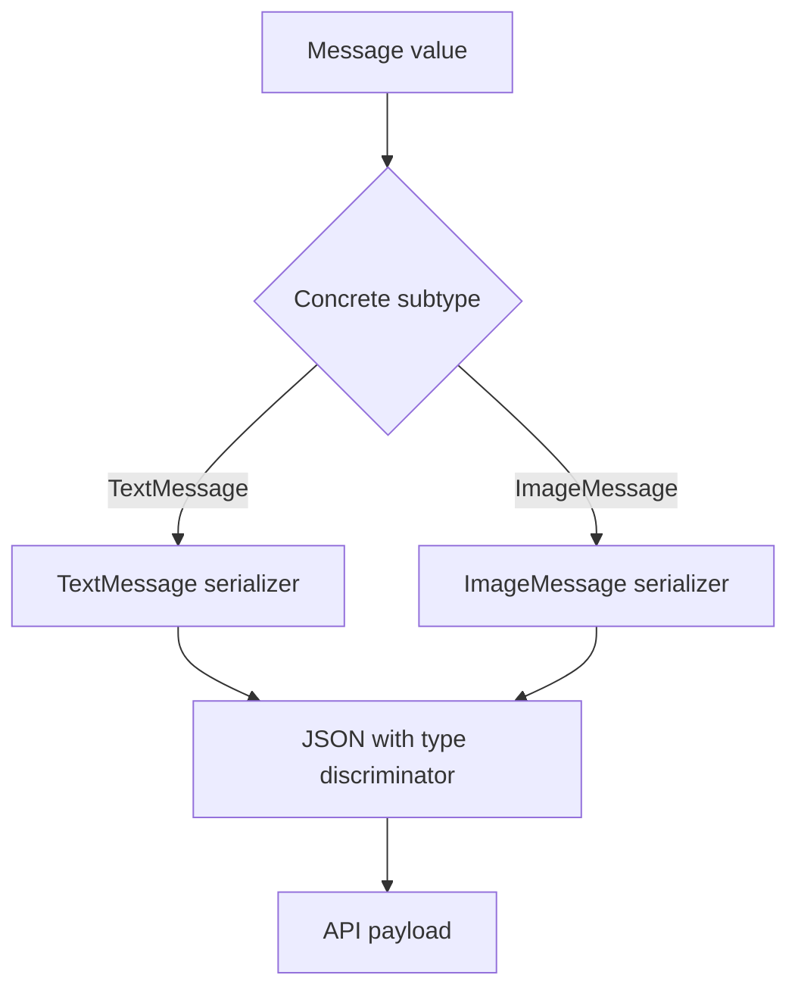
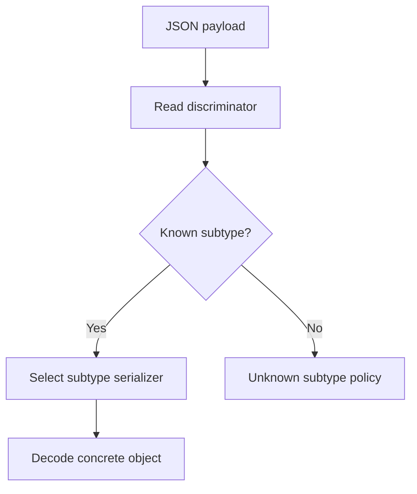
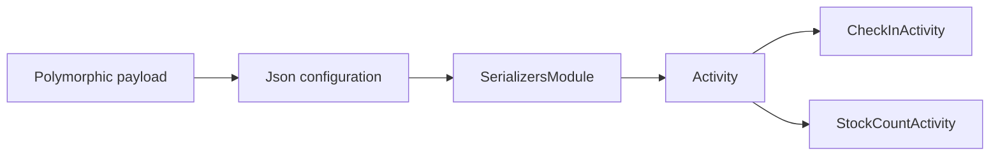
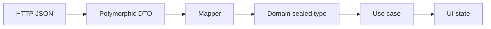
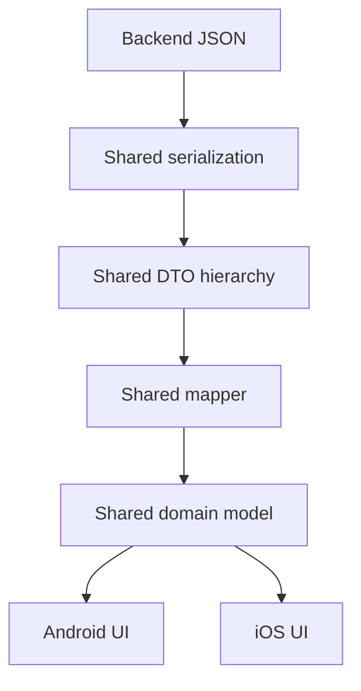
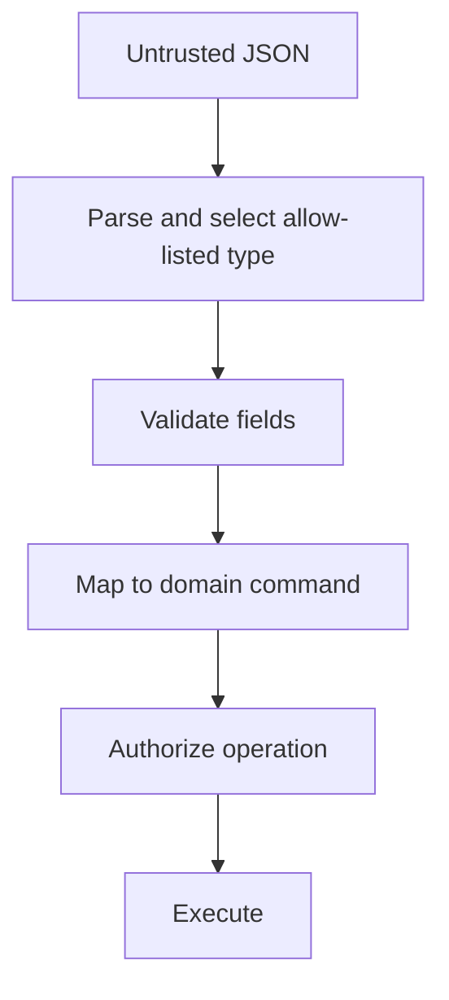

::: {align="center"}
# 📘 Chapter 18 --- Serialization

## Part 7: Polymorphism

**Kotlin · kotlinx.serialization · Kotlin Multiplatform**


*Modeling multiple concrete types behind one stable contract.*
:::

------------------------------------------------------------------------

## 📚 Table of Contents

-   [1. The Problem Polymorphism
    Solves](#1-the-problem-polymorphism-solves)
-   [2. Polymorphism in Serialization](#2-polymorphism-in-serialization)
-   [3. Sealed Classes and Sealed
    Interfaces](#3-sealed-classes-and-sealed-interfaces)
-   [4. Discriminator-Based JSON](#4-discriminator-based-json)
-   [5. Configuring the Discriminator](#5-configuring-the-discriminator)
-   [6. Registering Subtypes](#6-registering-subtypes)
-   [7. Open Polymorphism](#7-open-polymorphism)
-   [8. Nested and Collection
    Polymorphism](#8-nested-and-collection-polymorphism)
-   [9. Polymorphic Requests and
    Responses](#9-polymorphic-requests-and-responses)
-   [10. Unknown and Future Subtypes](#10-unknown-and-future-subtypes)
-   [11. Polymorphism Across API
    Versions](#11-polymorphism-across-api-versions)
-   [12. Custom Serializers and Content-Based
    Selection](#12-custom-serializers-and-content-based-selection)
-   [13. Kotlin Multiplatform
    Considerations](#13-kotlin-multiplatform-considerations)
-   [14. Testing Polymorphic
    Serialization](#14-testing-polymorphic-serialization)
-   [15. Security and Reliability](#15-security-and-reliability)
-   [16. Common Mistakes](#16-common-mistakes)
-   [17. Production Checklist](#17-production-checklist)
-   [18. Key Takeaways](#18-key-takeaways)

------------------------------------------------------------------------

## 1. The Problem Polymorphism Solves

A backend endpoint may return different kinds of content through the
same response field:

-   A text message
-   An image message
-   A document message
-   A system notification

Treating every response as one large data class full of nullable fields
weakens the model. It permits combinations that do not make sense, such
as an image message with document metadata and no image URL.

Polymorphism lets a program represent a common contract while preserving
each concrete type's data.

``` kotlin
@Serializable
sealed interface Message {
    val id: String
}

@Serializable
@SerialName("text")
data class TextMessage(
    override val id: String,
    val text: String
) : Message

@Serializable
@SerialName("image")
data class ImageMessage(
    override val id: String,
    val imageUrl: String,
    val caption: String? = null
) : Message
```

The consumer can work with `Message`, while each subtype retains its own
fields.

### The alternative: a nullable mega-model

``` kotlin
@Serializable
data class WeakMessageDto(
    val id: String,
    val type: String,
    val text: String? = null,
    val imageUrl: String? = null,
    val documentUrl: String? = null
)
```

This representation requires extra validation and allows invalid states.
A sealed hierarchy makes the supported variants explicit.

> **Design principle:** Use polymorphism when the payload represents one
> of several genuinely different shapes, not merely because two models
> share a few fields.

## 2. Polymorphism in Serialization

At runtime, a serializer must answer two questions:

1.  Which concrete subtype should be created when decoding?
2.  Which subtype-specific serializer should encode the value?

A common JSON solution is a **type discriminator**.

``` json
{
  "type": "image",
  "id": "msg-42",
  "imageUrl": "https://cdn.example.com/photo.jpg",
  "caption": "Warehouse arrival"
}
```

The `type` property identifies the concrete subtype. The remaining
properties belong to that subtype.

### Serialization flow



During decoding, the discriminator guides subtype selection:



The exact behavior depends on the configured serializers module, the
hierarchy, and the JSON configuration.

## 3. Sealed Classes and Sealed Interfaces

For a finite set of variants owned by your application, sealed types are
usually the clearest starting point.

``` kotlin
import kotlinx.serialization.SerialName
import kotlinx.serialization.Serializable

@Serializable
sealed interface PaymentMethod {
    val reference: String
}

@Serializable
@SerialName("card")
data class CardPayment(
    override val reference: String,
    val lastFourDigits: String
) : PaymentMethod

@Serializable
@SerialName("bank_transfer")
data class BankTransfer(
    override val reference: String,
    val bankCode: String
) : PaymentMethod
```

The compiler knows the sealed hierarchy. With `kotlinx.serialization`,
serializable sealed subclasses can be discovered as part of the
generated sealed serializer.

### Why use `@SerialName`?

Avoid exposing Kotlin implementation names as permanent wire-contract
values.

``` kotlin
@Serializable
@SerialName("bank_transfer")
data class BankTransfer(...)
```

If the class is later renamed to `BankTransferPayment`, the API value
can remain `bank_transfer`.

This reduces accidental coupling between source-code refactoring and
backend contracts.

### Exhaustive handling

``` kotlin
fun displayLabel(method: PaymentMethod): String =
    when (method) {
        is CardPayment -> "Card ending ${method.lastFourDigits}"
        is BankTransfer -> "Bank transfer"
    }
```

An exhaustive `when` helps ensure that newly added variants are
considered by the code that handles them.

## 4. Discriminator-Based JSON

`kotlinx.serialization` uses class discriminators for polymorphic JSON
by default. Consider this model:

``` kotlin
@Serializable
sealed interface UiNotice

@Serializable
@SerialName("success")
data class SuccessNotice(
    val title: String,
    val detail: String
) : UiNotice

@Serializable
@SerialName("warning")
data class WarningNotice(
    val title: String,
    val reason: String
) : UiNotice
```

A `Json` instance can encode and decode the hierarchy:

``` kotlin
val json = Json

val notice: UiNotice = SuccessNotice(
    title = "Saved",
    detail = "Your changes were saved."
)

val encoded = json.encodeToString<UiNotice>(notice)
val decoded = json.decodeFromString<UiNotice>(encoded)
```

The JSON output includes a discriminator identifying the concrete class.
The default discriminator property is `type`, unless configured
otherwise.

### Why the declared type matters

Polymorphic behavior is associated with the serialization strategy
selected for the declared type. When an API field is declared as the
base type, use that base type when encoding or decoding:

``` kotlin
val encoded = json.encodeToString<UiNotice>(notice)
```

Encoding only as the concrete type may select the concrete serializer
directly and produce different output from encoding through the
polymorphic base contract.

## 5. Configuring the Discriminator

A backend may use a property such as `kind`, `messageType`, or `event`.

``` kotlin
val apiJson = Json {
    classDiscriminator = "kind"
    ignoreUnknownKeys = true
    explicitNulls = false
}
```

The resulting payload may look like:

``` json
{
  "kind": "success",
  "title": "Saved",
  "detail": "Your changes were saved."
}
```

### Configuration guidance

  -----------------------------------------------------------------------
  Setting                 Purpose                 Consideration
  ----------------------- ----------------------- -----------------------
  `classDiscriminator`    Selects the             Must match the API
                          discriminator property  contract

  `ignoreUnknownKeys`     Ignores unrecognized    Does not automatically
                          object fields           support unknown
                                                  subtypes

  `explicitNulls`         Controls                Align with backend null
                          encoding/decoding of    semantics
                          explicit nulls          

  `isLenient`             Relaxes some JSON       Avoid enabling without
                          parsing rules           a contract need

  `coerceInputValues`     Applies defined         Not a general
                          coercion behavior to    unknown-subtype
                          certain invalid inputs  fallback
  -----------------------------------------------------------------------

Keep JSON configuration centralized. Different clients using different
discriminator settings can make the same payload behave inconsistently.

### Discriminator/property collisions

A subtype should not declare a normal property that conflicts with the
configured discriminator name in a way that makes the JSON ambiguous.
Choose a discriminator name that belongs to the wire format and is
reserved for type identification.

## 6. Registering Subtypes

Sealed hierarchies are convenient when the set of subtypes is known and
closed. Open polymorphism is different: implementations may live in
separate modules or be added independently.

Use `SerializersModule` to register known implementations for an open
base type.

``` kotlin
@Serializable
abstract class Activity

@Serializable
@SerialName("check_in")
data class CheckInActivity(
    val locationId: String
) : Activity()

@Serializable
@SerialName("stock_count")
data class StockCountActivity(
    val itemCount: Int
) : Activity()
```

Register the subclasses:

``` kotlin
val activityModule = SerializersModule {
    polymorphic(Activity::class) {
        subclass(CheckInActivity::class, CheckInActivity.serializer())
        subclass(StockCountActivity::class, StockCountActivity.serializer())
    }
}

val activityJson = Json {
    serializersModule = activityModule
    classDiscriminator = "type"
}
```

The module is part of the serialization configuration. If a subtype is
not registered, decoding it polymorphically cannot select its
serializer.

### Registration diagram



### Registration should be explicit

Register only implementations that the application intentionally
supports. Avoid broad or dynamic class loading based on untrusted type
names.

## 7. Open Polymorphism

Open polymorphism is useful when a base contract is extended across
module boundaries.

``` kotlin
interface AnalyticsEvent

@Serializable
@SerialName("screen_view")
data class ScreenViewEvent(
    val screenName: String
) : AnalyticsEvent
```

Because the base interface is not a sealed serializable hierarchy,
register the concrete subtype:

``` kotlin
val analyticsModule = SerializersModule {
    polymorphic(AnalyticsEvent::class) {
        subclass(
            ScreenViewEvent::class,
            ScreenViewEvent.serializer()
        )
    }
}
```

Then use the module:

``` kotlin
val analyticsJson = Json {
    serializersModule = analyticsModule
}
```

### Sealed vs. open polymorphism

  -----------------------------------------------------------------------
  Concern                 Sealed hierarchy        Open hierarchy
  ----------------------- ----------------------- -----------------------
  Subtype set             Closed and known        Extensible

  Registration            Generated sealed        Explicit module
                          hierarchy support       registration

  Exhaustive `when`       Usually possible        Not guaranteed

  Typical use             Domain variants, API    Plugin/module extension
                          unions                  points

  Main risk               Hierarchy changes       Missing or inconsistent
                          affect consumers        registrations
  -----------------------------------------------------------------------

Prefer sealed types unless extensibility is a real requirement.

## 8. Nested and Collection Polymorphism

Polymorphic values often appear inside lists or nested response objects.

``` kotlin
@Serializable
data class TimelineDto(
    val id: String,
    val entries: List<TimelineEntry>
)

@Serializable
sealed interface TimelineEntry {
    val timestamp: String
}

@Serializable
@SerialName("note")
data class NoteEntry(
    override val timestamp: String,
    val message: String
) : TimelineEntry

@Serializable
@SerialName("attachment")
data class AttachmentEntry(
    override val timestamp: String,
    val fileUrl: String
) : TimelineEntry
```

A payload can contain different entry types in one array:

``` json
{
  "id": "timeline-7",
  "entries": [
    {
      "type": "note",
      "timestamp": "2026-11-02T10:15:00Z",
      "message": "Picking started"
    },
    {
      "type": "attachment",
      "timestamp": "2026-11-02T10:18:00Z",
      "fileUrl": "https://cdn.example.com/label.pdf"
    }
  ]
}
```

The declared element type `TimelineEntry` provides the polymorphic
contract for every array element.

### Nested model design

Keep the hierarchy close to the concept it represents. Do not create one
enormous global hierarchy for unrelated payloads simply to reuse a
discriminator mechanism.

## 9. Polymorphic Requests and Responses

Polymorphism is not limited to response bodies. A request can also
represent one of several commands.

``` kotlin
@Serializable
sealed interface InventoryCommand

@Serializable
@SerialName("start_count")
data class StartCountCommand(
    val warehouseId: String
) : InventoryCommand

@Serializable
@SerialName("submit_count")
data class SubmitCountCommand(
    val sessionId: String,
    val quantity: Int
) : InventoryCommand
```

A repository can submit a command through a shared contract:

``` kotlin
interface InventoryRemoteDataSource {
    suspend fun submit(command: InventoryCommand): CommandResultDto
}
```

The Ktor request body can be serialized through the base type, provided
the configured client and serializer use the intended polymorphic
strategy:

``` kotlin
client.post("inventory/commands") {
    contentType(ContentType.Application.Json)
    setBody<InventoryCommand>(command)
}
```

The exact overload available depends on the Ktor version and configured
content negotiation. Keep the declared serialization type explicit when
the wire contract requires a discriminator.

### Separate wire models from domain behavior

A robust flow is:



The network DTO hierarchy describes the API contract. The domain
hierarchy describes application meaning. They may look similar, but they
have different responsibilities and should not be coupled automatically.

## 10. Unknown and Future Subtypes

A frequent production issue occurs when a server introduces a new
subtype before every client has been updated.

For example, an older client knows:

-   `text`
-   `image`

The server later starts returning:

-   `video`

Ignoring unknown object fields does not solve this problem. The client
does not know which subtype serializer to use.

### Option A: Add an explicit unknown domain case

For a finite API contract, one approach is to decode a transport
envelope first, inspect the type value, and map unrecognized values to
an `Unknown` domain representation.

``` kotlin
@Serializable
data class RawMessageDto(
    val type: String,
    val id: String,
    val payload: JsonObject
)

sealed interface Message {
    val id: String

    data class Text(
        override val id: String,
        val text: String
    ) : Message

    data class Unknown(
        override val id: String,
        val type: String,
        val rawPayload: JsonObject
    ) : Message
}
```

This is an alternative architecture, not an automatic fallback supplied
by sealed polymorphism. The mapper must validate and interpret the known
payload shapes.

### Option B: Use a custom deserialization boundary

For a stable external contract with evolving variants, implement a
custom serializer or a dedicated decoder that:

1.  Reads the discriminator.
2.  Selects a known subtype serializer.
3.  Decodes known types.
4.  Preserves a safe raw representation for unknown types, if the
    product requires it.

Do not silently convert malformed known payloads into unknown values.
Distinguish an unsupported type from invalid data for a supported type.

### Choose an explicit policy

  -----------------------------------------------------------------------
  Policy                  Benefit                 Cost
  ----------------------- ----------------------- -----------------------
  Fail fast               Strong contract         Older clients may
                          validation              reject new variants

  Unknown fallback        Better forward          Requires raw-payload
                          compatibility           handling

  Ignore unsupported item Keeps a collection      Data may be hidden from
                          usable                  users

  Server version          Predictable contracts   More operational
  negotiation                                     complexity
  -----------------------------------------------------------------------

The correct policy depends on whether the client can safely ignore the
new information.

## 11. Polymorphism Across API Versions

A discriminator is part of the public wire contract. Treat its values as
stable identifiers.

**Good contract values:**

``` text
text
image
bank_transfer
stock_count
```

**Risky contract values:**

``` text
com.company.app.network.ImageMessageDto
ImageMessageDto
image_v2_final
```

Avoid exposing package names or implementation details. They make
refactoring and client compatibility harder.

### Compatibility rules

-   Do not casually rename an existing discriminator.
-   Add new variants in a backward-compatible way only when older
    clients have a defined unknown-type policy.
-   Keep required fields stable for existing variants.
-   Prefer additive optional fields over changing field meaning.
-   Document whether absent, null, and unknown values have different
    meanings.
-   Coordinate rollout when clients cannot tolerate new variants.

### Versioned discriminator example

If an API genuinely has incompatible representations, model the version
explicitly:

``` json
{
  "schemaVersion": 2,
  "type": "image",
  "id": "msg-42",
  "url": "https://cdn.example.com/image.jpg"
}
```

Do not create version suffixes for every type unless the contract needs
them. Schema versioning and subtype identity solve different problems.

## 12. Custom Serializers and Content-Based Selection

Discriminator-based serialization is usually the simplest and clearest
approach. Some APIs, however, identify a variant through a field nested
inside the payload or through a legacy structure that cannot be changed.

In those cases, a custom serializer may be necessary.

A content-based strategy can inspect a JSON object and choose a subtype
based on a reliable marker:

``` json
{
  "event": {
    "eventCode": "PICK_COMPLETED",
    "taskId": "task-100",
    "completedQuantity": 12
  }
}
```

The serializer can inspect `eventCode` and delegate to the corresponding
concrete serializer.

### Custom serializer responsibilities

A custom serializer should:

-   Validate that the input is the expected JSON shape.
-   Identify the subtype using a documented, stable field.
-   Delegate to the subtype serializer instead of manually duplicating
    every field mapping.
-   Produce a clear error for unsupported or malformed payloads.
-   Avoid guessing a subtype from incidental fields.

### Prefer a discriminator when possible

Content-based selection is more fragile when fields overlap or evolve.
If you control the API, ask for an explicit discriminator rather than
building increasingly complicated inference logic.

## 13. Kotlin Multiplatform Considerations

Polymorphic models are a strong fit for `commonMain` when the data
contract is shared across platforms.

``` text
shared/
└── src/
    ├── commonMain/
    │   ├── model/
    │   │   ├── MessageDto.kt
    │   │   └── Message.kt
    │   ├── serialization/
    │   │   └── JsonConfiguration.kt
    │   └── data/
    │       └── MessageMapper.kt
    ├── androidMain/
    └── iosMain/
```

### Share the contract, not platform-specific behavior

Place these in `commonMain` when they are platform-independent:

-   Serializable DTO hierarchies
-   `SerializersModule` definitions
-   JSON configuration
-   DTO-to-domain mapping
-   Validation rules that do not depend on a platform API

Keep platform-specific concerns in platform source sets:

-   Secure storage
-   Platform logging
-   File access
-   Native networking engine configuration

### Shared JSON configuration

``` kotlin
// commonMain

val sharedJson = Json {
    classDiscriminator = "type"
    ignoreUnknownKeys = true
}
```

Use the same configuration for Android and iOS unless there is a
deliberate, documented platform difference. Divergent configurations can
cause platform-specific decoding bugs.

### Architecture boundary



Both platforms should agree on the meaning of a decoded variant. The UI
presentation can remain native.

## 14. Testing Polymorphic Serialization

Test more than a successful round trip. The wire contract is what
matters.

### Round-trip test

``` kotlin
class MessageSerializationTest {

    private val json = Json {
        classDiscriminator = "type"
    }

    @Test
    fun `encodes and decodes image message`() {
        val original: Message = ImageMessage(
            id = "msg-42",
            imageUrl = "https://cdn.example.com/photo.jpg",
            caption = "Arrival"
        )

        val encoded = json.encodeToString<Message>(original)
        val decoded = json.decodeFromString<Message>(encoded)

        assertEquals(original, decoded)
    }
}
```

### Contract test against expected JSON

``` kotlin
@Test
fun `uses stable discriminator value`() {
    val message: Message = TextMessage(
        id = "msg-1",
        text = "Hello"
    )

    val encoded = json.encodeToString<Message>(message)
    val element = json.parseToJsonElement(encoded).jsonObject

    assertEquals("text", element["type"]?.jsonPrimitive?.content)
    assertEquals("msg-1", element["id"]?.jsonPrimitive?.content)
}
```

### Decode a backend fixture

``` kotlin
@Test
fun `decodes image fixture`() {
    val fixture = """
        {
          "type": "image",
          "id": "msg-42",
          "imageUrl": "https://cdn.example.com/photo.jpg",
          "caption": "Arrival"
        }
    """.trimIndent()

    val result = json.decodeFromString<Message>(fixture)

    assertTrue(result is ImageMessage)
    assertEquals("msg-42", result.id)
}
```

### Test matrix

  Test                             What it protects
  -------------------------------- ------------------------------
  Each known subtype               Correct subtype selection
  Stable discriminator             Wire compatibility
  Missing discriminator            Clear failure behavior
  Unknown discriminator            Forward-compatibility policy
  Missing required subtype field   Payload validation
  Nullable and default fields      Contract semantics
  Nested polymorphic values        Correct recursive decoding
  Lists of mixed subtypes          Collection handling
  Android and iOS shared tests     Cross-platform consistency

### Test the failure path

``` kotlin
@Test
fun `rejects unknown subtype when no fallback is configured`() {
    val fixture = """
        {
          "type": "video",
          "id": "msg-99"
        }
    """.trimIndent()

    assertFailsWith<SerializationException> {
        json.decodeFromString<Message>(fixture)
    }
}
```

The exact exception type and message can vary with serializer
configuration and library version. Assert the failure category or
application-level result rather than depending on a brittle full error
string.

## 15. Security and Reliability

Polymorphic deserialization is a trust boundary. A payload may come from
a backend, a deep link, a local cache, or an imported file.

Follow these rules:

1.  **Allow-list subtype registrations.** Do not dynamically load
    arbitrary classes based on payload values.
2.  **Validate subtype fields.** Successful deserialization does not
    guarantee business validity.
3.  **Keep discriminator values stable.** Treat them as external
    contract identifiers.
4.  **Bound payload size.** Large nested or deeply structured JSON can
    consume excessive resources.
5.  **Avoid leaking raw payloads.** They may contain tokens, personal
    data, or internal identifiers.
6.  **Handle unsupported types deliberately.** Do not accidentally crash
    a critical workflow or silently discard meaningful data.
7.  **Separate parsing from authorization.** A valid `AdminAction`
    payload does not mean the caller is authorized to execute it.

A safe pipeline is:



Serialization determines how data becomes an object. It does not
establish that the object is trustworthy or permitted.

## 16. Common Mistakes

  -----------------------------------------------------------------------
  Mistake                 Why it hurts            Better approach
  ----------------------- ----------------------- -----------------------
  Using Kotlin class      Refactoring can break   Use stable
  names as API values     clients                 `@SerialName` values

  Assuming                Unknown subtype         Define an explicit
  `ignoreUnknownKeys`     selection still fails   unknown-type policy
  handles new subtypes                            

  Using open polymorphism Runtime decoding cannot Register
  without registration    find a subtype          implementations in
                          serializer              `SerializersModule`

  Encoding through the    Discriminator output    Serialize through the
  wrong declared type     may differ              base contract

  Sharing DTOs directly   API changes leak into   Map DTOs to domain
  with UI                 presentation            models

  Creating one hierarchy  Coupling grows across   Keep hierarchies
  for unrelated concepts  features                bounded by domain
                                                  concept

  Guessing subtype from   Ambiguous payloads      Use an explicit
  optional fields         decode incorrectly      discriminator

  Treating parsed data as Valid syntax is not     Validate and authorize
  trusted                 business validation     after decoding

  Testing only round      Both sides can share    Assert exact contract
  trips                   the same wrong          fixtures
                          assumption              
  -----------------------------------------------------------------------

## 17. Production Checklist

### Model design

-   [ ] Use sealed types for finite, controlled variants.
-   [ ] Use open polymorphism only when extension is required.
-   [ ] Give every wire subtype a stable `@SerialName`.
-   [ ] Keep unrelated concepts in separate hierarchies.
-   [ ] Keep DTOs separate from domain models where the boundary
    matters.

### Configuration

-   [ ] Match the discriminator property to the backend contract.
-   [ ] Register every open subtype explicitly.
-   [ ] Centralize the `Json` instance and serializers module.
-   [ ] Review null, missing-field, and unknown-key behavior.
-   [ ] Ensure Android and iOS use compatible shared configuration.

### Compatibility

-   [ ] Define behavior for unknown discriminator values.
-   [ ] Treat discriminator names as public API.
-   [ ] Test representative payloads from the backend.
-   [ ] Coordinate new variants with older client behavior.
-   [ ] Avoid coupling wire names to Kotlin package or class names.

### Quality and security

-   [ ] Test every known subtype.
-   [ ] Test malformed and unsupported payloads.
-   [ ] Validate business constraints after decoding.
-   [ ] Restrict subtype registration to trusted implementations.
-   [ ] Avoid logging sensitive raw payloads.
-   [ ] Test shared serialization behavior in common tests.

## 18. Key Takeaways

-   Polymorphism represents multiple concrete data shapes behind one
    common contract.
-   A discriminator tells the serializer which subtype a payload
    represents.
-   Sealed hierarchies are ideal for finite sets of variants.
-   Open polymorphism requires explicit subtype registration through
    `SerializersModule`.
-   `@SerialName` keeps wire identifiers stable when Kotlin classes
    change.
-   `ignoreUnknownKeys` does not automatically make unknown polymorphic
    subtypes decodable.
-   Unknown-type behavior must be a deliberate compatibility decision.
-   In KMP, share serialization contracts and configuration while
    keeping platform behavior at platform boundaries.
-   Test exact JSON contracts, not only encode/decode round trips.

------------------------------------------------------------------------

::: {align="center"}
**End of Chapter 18 · Part 7**

*Next in the serialization journey: robust polymorphic contracts,
compatibility, and production-safe data handling.*
:::
