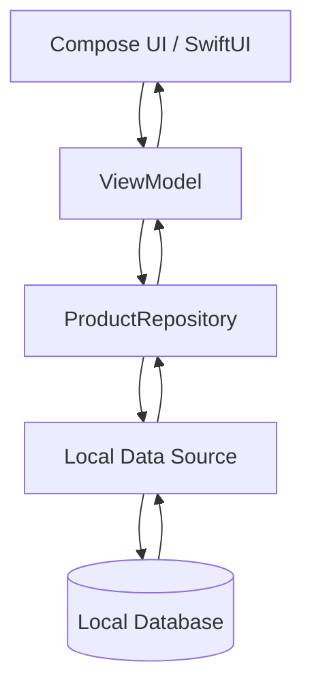
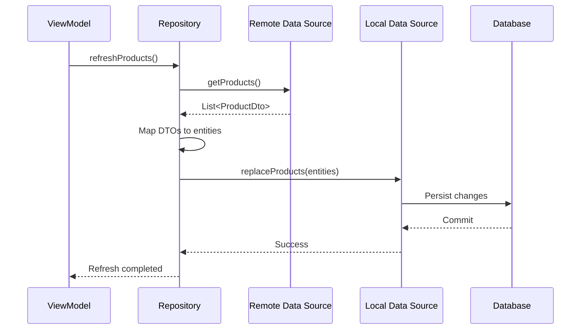
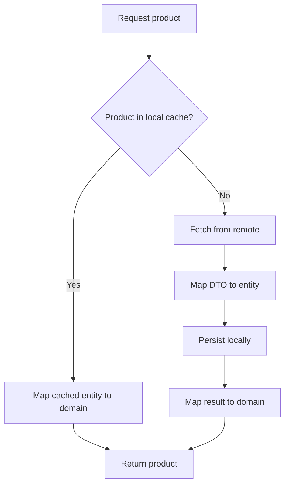
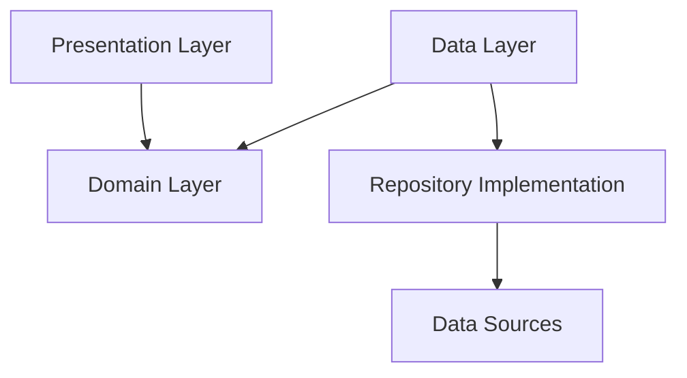

<div align="center">

# Chapter 19 — Repository Pattern

### Part 1: The Parts

**Kotlin Multiplatform · Architecture · Data Layer**


*A repository is not merely a class that calls an API. It is the boundary that gives the rest of your application a dependable way to access data.*

</div>

---

## Table of Contents

- [1. Why the Repository Pattern Exists](#1-why-the-repository-pattern-exists)
- [2. What Is a Repository?](#2-what-is-a-repository)
- [3. The Core Parts](#3-the-core-parts)
  - [3.1 Repository Contract](#31-repository-contract)
  - [3.2 Repository Implementation](#32-repository-implementation)
  - [3.3 Data Sources](#33-data-sources)
  - [3.4 Models and Mapping](#34-models-and-mapping)
  - [3.5 Consumers](#35-consumers)
- [4. The Complete Data Flow](#4-the-complete-data-flow)
- [5. Repository vs. Data Source](#5-repository-vs-data-source)
- [6. Repository Responsibilities](#6-repository-responsibilities)
- [7. What Does Not Belong in a Repository?](#7-what-does-not-belong-in-a-repository)
- [8. Repository and Clean Architecture](#8-repository-and-clean-architecture)
- [9. Repository in Kotlin Multiplatform](#9-repository-in-kotlin-multiplatform)
- [10. A Practical KMP Example](#10-a-practical-kmp-example)
- [11. Choosing the Right Return Type](#11-choosing-the-right-return-type)
- [12. Error Handling at the Repository Boundary](#12-error-handling-at-the-repository-boundary)
- [13. Testing the Repository](#13-testing-the-repository)
- [14. Common Repository Design Mistakes](#14-common-repository-design-mistakes)
- [15. When Do You Need a Repository?](#15-when-do-you-need-a-repository)
- [16. Production Readiness Checklist](#16-production-readiness-checklist)
- [17. Key Takeaways](#17-key-takeaways)

---

## 1. Why the Repository Pattern Exists

Consider a feature that displays a user's profile.

At first, the implementation may look straightforward:

1. A ViewModel calls an API service.
2. The API returns JSON.
3. The response is converted into a Kotlin object.
4. The ViewModel exposes the result to the UI.

That approach can work for a small feature. The difficulty appears when the feature grows.

The product team now wants:

- Cached profile data when the device is offline.
- A refresh action that fetches the latest profile.
- A local database as the source for the initial screen.
- A way to update profile information.
- Consistent behavior across Android and iOS.
- Unit tests that do not require a real backend.
- The ability to replace one API or storage implementation without rewriting the UI.

If the ViewModel directly knows about Retrofit, Ktor, SQLDelight, Room, or platform-specific storage, it gradually becomes coupled to implementation details.

```kotlin
class ProfileViewModel(
    private val api: ProfileApi,
    private val database: ProfileDatabase,
) {
    // Network calls, database queries, mapping,
    // cache rules and UI state all start collecting here.
}
```

The issue is not that these dependencies are inherently bad. The issue is that the presentation layer now has to coordinate several data mechanisms and understand how they work.

The Repository Pattern introduces a boundary between the application and the mechanisms that provide data.

Instead of asking *where does this data come from?*, a consumer asks *what profile data do I need?*

```kotlin
class ProfileViewModel(
    private val repository: ProfileRepository,
) {
    // The ViewModel depends on a capability,
    // not on a particular networking or database library.
}
```

The repository becomes the application's data-access coordinator. It can decide whether data comes from a remote service, local database, memory cache, or a combination of sources.

> **The architectural benefit:** consumers depend on a stable data contract while the details of retrieving and persisting data remain behind that contract.

---

## 2. What Is a Repository?

A repository is an abstraction that provides application data to its consumers while hiding the details of the underlying data sources.

It presents a domain-oriented API. Its callers should not need to know whether a value came from:

- A remote HTTP API.
- A local database.
- A file.
- A platform key-value store.
- An in-memory cache.
- A combination of multiple sources.

A repository is not necessarily a database wrapper, an API wrapper, or a class with one method per endpoint. It represents a meaningful data capability from the application's point of view.

For example:

```kotlin
interface ProfileRepository {
    suspend fun getProfile(userId: String): Profile
    suspend fun updateProfile(profile: Profile): Profile
}
```

The contract describes operations that make sense to the application. It does not expose `HttpResponse`, SQL queries, Retrofit annotations, or database entities.

### 2.1 The repository as a boundary

```text
┌──────────────────────────────┐
│       Presentation           │
│   ViewModel / UI State       │
└──────────────┬───────────────┘
               │
               ▼
┌──────────────────────────────┐
│      Repository Contract     │
│      ProfileRepository       │
└──────────────┬───────────────┘
               │
               ▼
┌──────────────────────────────┐
│   Repository Implementation  │
│   Cache · Mapping · Policy   │
└──────────────┬───────────────┘
               │
        ┌──────┴──────┐
        ▼             ▼
┌────────────┐  ┌────────────┐
│ Remote     │  │ Local      │
│ DataSource │  │ DataSource │
└────────────┘  └────────────┘
```

The diagram shows a common design, not a mandatory class hierarchy. A simple feature may have one source. A more complex feature may have several.

### 2.2 Repository is a role, not a framework

Kotlin, Android, and Kotlin Multiplatform do not require a particular repository base class or annotation.

A repository can be a plain Kotlin interface and implementation:

```kotlin
interface ProductRepository {
    suspend fun getProduct(id: String): Product
}

class DefaultProductRepository(
    private val remote: ProductRemoteDataSource,
) : ProductRepository {

    override suspend fun getProduct(id: String): Product {
        return remote.getProduct(id).toDomain()
    }
}
```

The important part is the responsibility and the boundary—not the name of the class or the library used to construct it.

---

## 3. The Core Parts

A repository-based data layer is usually made from several collaborating parts. Understanding their individual responsibilities prevents the repository from becoming a second ViewModel or a giant service class.

### 3.1 Repository Contract

The repository contract defines what the application can do with a particular category of data.

```kotlin
interface ProductRepository {
    suspend fun getProduct(id: String): Product
    fun observeProducts(): Flow<List<Product>>
    suspend fun refreshProducts()
}
```

A good contract:

- Uses application or domain concepts.
- Exposes operations rather than infrastructure details.
- Avoids leaking database entities and transport DTOs.
- Makes asynchronous behavior explicit.
- Is small enough for consumers to understand.
- Can be implemented differently in tests or on different platforms.

The contract should reflect actual application needs. Do not add methods merely because a data source happens to expose a matching function.

**Avoid infrastructure leakage:**

```kotlin
// Avoid exposing a transport-layer response.
interface ProductRepository {
    suspend fun getProduct(id: String): HttpResponse
}
```

Prefer:

```kotlin
interface ProductRepository {
    suspend fun getProduct(id: String): Product
}
```

`HttpResponse` belongs to the networking boundary. The application should receive a meaningful result, not a networking library's response object.

#### Where should the interface live?

In a Clean Architecture arrangement, the interface often lives in the domain module because use cases depend on it. In a simpler layered application, it may live in a shared data contract or feature module.

There is no universal folder rule. The deciding question is dependency direction:

**Which layer needs to own the abstraction so that higher-level policy does not depend on lower-level implementation details?**

### 3.2 Repository Implementation

The implementation fulfills the repository contract and coordinates data sources.

```kotlin
class DefaultProductRepository(
    private val remote: ProductRemoteDataSource,
    private val local: ProductLocalDataSource,
) : ProductRepository {

    override suspend fun getProduct(id: String): Product {
        val cached = local.getProduct(id)

        if (cached != null) {
            return cached.toDomain()
        }

        val remoteProduct = remote.getProduct(id)
        local.saveProduct(remoteProduct.toLocal())
        return remoteProduct.toDomain()
    }

    override fun observeProducts(): Flow<List<Product>> {
        return local.observeProducts()
            .map { entities -> entities.map(ProductEntity::toDomain) }
    }

    override suspend fun refreshProducts() {
        val products = remote.getProducts()
        local.replaceProducts(products.map(ProductDto::toLocal))
    }
}
```

This example illustrates one possible cache policy. It is not a universal recommendation to always return cached data first.

The repository implementation is the place to coordinate rules such as:

- Which source should be queried first?
- When should a remote result update local storage?
- Should a failed refresh preserve cached data?
- How should duplicate or stale records be handled?
- Which representation should be returned to consumers?

These decisions belong here only when they are data-access or data-consistency policies. Business workflows with broader application meaning may belong in a use case or domain service.

### 3.3 Data Sources

A data source is a focused component that communicates with one particular data mechanism.

Typical examples:

| Data source | Responsibility | Example technology |
|---|---|---|
| Remote | Communicates with a backend | Ktor Client, Retrofit |
| Local | Reads and writes structured local data | SQLDelight, Room |
| Preferences | Stores simple settings | DataStore, multiplatform settings |
| File | Reads or writes files | Platform file APIs |
| Memory | Holds short-lived in-memory values | Map, cache implementation |

A remote data source might look like this:

```kotlin
class ProductRemoteDataSource(
    private val api: ProductApi,
) {
    suspend fun getProduct(id: String): ProductDto {
        return api.getProduct(id)
    }

    suspend fun getProducts(): List<ProductDto> {
        return api.getProducts()
    }
}
```

A local data source might look like this:

```kotlin
class ProductLocalDataSource(
    private val queries: ProductQueries,
) {
    suspend fun getProduct(id: String): ProductEntity? {
        return queries.selectById(id).executeAsOneOrNull()
    }

    fun observeProducts(): Flow<List<ProductEntity>> {
        return queries.selectAll()
            .asFlow()
            .mapToList(Dispatchers.IO)
    }

    suspend fun saveProduct(product: ProductEntity) {
        queries.insertOrReplace(
            id = product.id,
            name = product.name,
            price = product.price,
        )
    }
}
```

`ProductApi`, `ProductQueries`, and the mapping functions are illustrative project-defined types. The exact database APIs depend on the selected library and version.

A data source should generally focus on communicating with its mechanism. It should not independently decide the application's overall cache strategy or combine unrelated remote and local sources.

### 3.4 Models and Mapping

A repository-based architecture often contains more than one representation of the same information.

| Model | Purpose | Typical owner |
|---|---|---|
| DTO | Matches the API payload | Remote data layer |
| Entity | Matches local persistence needs | Local data layer |
| Domain model | Represents application concepts | Domain layer |
| UI model | Represents presentation needs | Presentation layer |

For example, an API may return:

```kotlin
@Serializable
data class ProductDto(
    val product_id: String,
    val display_name: String,
    val amount_in_minor_units: Long,
)
```

The local database may use:

```kotlin
data class ProductEntity(
    val id: String,
    val name: String,
    val priceMinorUnits: Long,
)
```

The application may use a domain model:

```kotlin
data class Product(
    val id: String,
    val name: String,
    val price: Money,
)
```

Mapping functions keep these representations separate:

```kotlin
fun ProductDto.toDomain(): Product {
    return Product(
        id = product_id,
        name = display_name,
        price = Money(amountInMinorUnits = amount_in_minor_units),
    )
}

fun ProductDto.toLocal(): ProductEntity {
    return ProductEntity(
        id = product_id,
        name = display_name,
        priceMinorUnits = amount_in_minor_units,
    )
}

fun ProductEntity.toDomain(): Product {
    return Product(
        id = id,
        name = name,
        price = Money(amountInMinorUnits = priceMinorUnits),
    )
}
```

`Money` is a project-defined value type in this example.

Mapping is not busywork. It prevents a backend field rename or a database schema change from automatically becoming a change to every consumer.

However, separate models should be introduced for a reason. If a small application has no meaningful difference between its API and application model, duplicating every class can create maintenance cost without improving isolation.

### 3.5 Consumers

Consumers use repository contracts to access application data.

Common consumers include:

- ViewModels.
- Use cases or interactors.
- Background workers.
- Coordinators or application services.

A ViewModel should normally depend on the repository abstraction rather than directly coordinating HTTP and database operations.

```kotlin
class ProductViewModel(
    private val repository: ProductRepository,
) {
    fun observeProducts(): Flow<List<Product>> {
        return repository.observeProducts()
    }
}
```

In a use-case-oriented design, the use case depends on the repository:

```kotlin
class ObserveProductsUseCase(
    private val repository: ProductRepository,
) {
    operator fun invoke(): Flow<List<Product>> {
        return repository.observeProducts()
    }
}
```

Do not add a use case solely to forward a method without adding policy, composition, validation, or a meaningful application operation. Architecture should clarify responsibility, not multiply pass-through classes.

---

## 4. The Complete Data Flow

The repository sits between consumers and data mechanisms. The exact flow depends on the operation and the consistency policy.

### 4.1 Read from a local source

For an offline-first screen, the database can be the observable source of truth.



The UI observes data changes through the ViewModel. The repository does not need to know whether the UI is Compose or SwiftUI.

### 4.2 Refresh from a remote source

A refresh operation may retrieve remote data and persist it locally:



A separate database observation can then deliver the updated list to the UI.

### 4.3 Cache-first read

A cache-first strategy checks local storage before calling the backend:



This is useful when cached data is acceptable. It is not sufficient for every product requirement.

For example, an inventory availability check, payment status, or time-sensitive authorization decision may require a fresh server response. The repository's policy must reflect the data's actual consistency requirements.

---

## 5. Repository vs. Data Source

These terms are often used interchangeably, but they represent different responsibilities.

| Repository | Data source |
|---|---|
| Represents an application-facing data capability | Represents one mechanism that provides data |
| Can coordinate multiple sources | Usually focuses on one source |
| Applies data-access and consistency policy | Performs source-specific operations |
| Maps source models into application models | Commonly works with DTOs or entities |
| Hides source selection from consumers | Knows about its underlying technology |

Think of a shopping application.

A `CartRepository` may combine:

- A local data source for the current cart.
- A remote data source for server-side validation.
- A preferences data source for a small local setting.

The ViewModel should not need to call all three independently just to display the cart.

A repository can use a single data source. There is no requirement to create a separate data-source class for every repository. Introduce that extra boundary when it makes responsibilities clearer, enables reuse, or isolates infrastructure.

---

## 6. Repository Responsibilities

A repository should have a clear, bounded set of responsibilities.

### 6.1 Data-source coordination

It decides which source or sources participate in an operation.

```kotlin
class DefaultSettingsRepository(
    private val remote: SettingsRemoteDataSource,
    private val local: SettingsLocalDataSource,
) : SettingsRepository {

    override suspend fun refresh() {
        val settings = remote.fetchSettings()
        local.save(settings.toEntity())
    }
}
```

### 6.2 Data mapping

It can translate transport and persistence models into the representation expected by the application.

Keep mapping functions small and deterministic. Complex transformations may deserve dedicated mapper types.

### 6.3 Cache and consistency policy

It can coordinate cache reads, writes, refreshes, invalidation, and conflict handling.

Examples:

- Local-first reads.
- Network-first reads.
- Stale-while-revalidate.
- Explicit refresh.
- Cache invalidation after an update.
- Last-write-wins or server-authoritative conflict resolution.

These are product and data-consistency decisions. Do not choose a policy simply because it is easy to implement.

### 6.4 Data-access error translation

It can translate low-level failures into stable application-level failures.

For example, a networking timeout should not force every ViewModel to import a Ktor exception type.

### 6.5 Exposing observable data

For data that changes over time, a repository can expose `Flow`:

```kotlin
interface CartRepository {
    fun observeCart(): Flow<Cart>
}
```

The repository should define what the stream represents: local persisted state, remote updates, or a combination. A clear stream contract avoids surprising consumers.

### 6.6 Transaction boundaries

When an operation requires multiple related database writes to succeed or fail together, the repository or a dedicated persistence component can coordinate a transaction.

The transaction itself should be implemented using the database's supported transaction mechanism. Avoid pretending that a sequence of independent writes is atomic.

---

## 7. What Does Not Belong in a Repository?

The repository is an important boundary, but it should not become the home for every piece of application logic.

| Responsibility | Better location |
|---|---|
| Compose layout and UI state rendering | UI layer |
| SwiftUI view composition | iOS presentation layer |
| Button click handling | UI / ViewModel |
| Screen-specific formatting | Presentation mapper or UI layer |
| HTTP request construction | Remote data source / API client |
| SQL query definitions | Local data source / database layer |
| Business rules spanning multiple capabilities | Domain use case or domain service |
| Navigation decisions | Presentation or navigation layer |
| Platform-specific permission prompts | Platform integration / presentation boundary |
| Dependency graph construction | Composition root / DI setup |

There are legitimate design variations. For example, a repository may enforce a data-specific invariant such as refusing to persist an invalid identifier. But a multi-step business workflow involving orders, payments, and notifications should not automatically be placed inside `OrderRepository`.

A useful question is:

> Is this behavior about retrieving and maintaining this data, or is it an application workflow that happens to use this data?

That distinction helps prevent repositories from turning into large service classes.

---

## 8. Repository and Clean Architecture

The Repository Pattern and Clean Architecture complement each other, but they are not the same thing.

- **Repository Pattern** describes a way to abstract access to data.
- **Clean Architecture** describes how responsibilities and dependencies are organized across layers.

A common dependency arrangement looks like this:



A more explicit view of the dependency direction:

```text
Presentation
    |
    v
Domain
    ^
    |
Data (implements domain contracts)
```

The domain layer owns the repository abstraction when domain use cases need to depend on it. The data layer implements that abstraction.

```kotlin
// Domain module
interface UserRepository {
    suspend fun getUser(id: String): User
}
```

```kotlin
// Data module
class DefaultUserRepository(
    private val remote: UserRemoteDataSource,
) : UserRepository {

    override suspend fun getUser(id: String): User {
        return remote.getUser(id).toDomain()
    }
}
```

The domain module does not import the data module. The data implementation depends on the domain contract.

### 8.1 Does every application need a domain module?

No. A small application can use a simpler structure:

```text
feature/
├── presentation/
├── data/
│   ├── repository/
│   ├── remote/
│   └── local/
└── model/
```

As the application grows, the repository contract may move to a domain module or a dedicated contract module.

The objective is not to maximize the number of modules. It is to keep dependency direction understandable and change localized.

---

## 9. Repository in Kotlin Multiplatform

Kotlin Multiplatform makes the repository boundary particularly useful because the same application capability may be consumed by Android and iOS while the underlying platform integrations differ.

A shared repository contract can be defined in `commonMain`:

```kotlin
// commonMain
interface AccountRepository {
    suspend fun getAccount(accountId: String): Account
    fun observeAccount(accountId: String): Flow<Account?>
}
```

The domain model can also live in shared code:

```kotlin
// commonMain
data class Account(
    val id: String,
    val displayName: String,
)
```

If the data sources and their dependencies are multiplatform-compatible, the repository implementation can also live in `commonMain`:

```kotlin
// commonMain
class DefaultAccountRepository(
    private val remote: AccountRemoteDataSource,
    private val local: AccountLocalDataSource,
) : AccountRepository {

    override suspend fun getAccount(accountId: String): Account {
        val cached = local.getAccount(accountId)

        if (cached != null) {
            return cached.toDomain()
        }

        val dto = remote.getAccount(accountId)
        local.saveAccount(dto.toEntity())
        return dto.toDomain()
    }

    override fun observeAccount(accountId: String): Flow<Account?> {
        return local.observeAccount(accountId)
            .map { entity -> entity?.toDomain() }
    }
}
```

The same implementation can serve both platforms:

```text
                 commonMain
        ┌──────────────────────────┐
        │ AccountRepository        │
        │ DefaultAccountRepository │
        │ Account                  │
        └─────────────┬────────────┘
                      │
             ┌────────┴────────┐
             ▼                 ▼
          Android              iOS
       Compose UI           SwiftUI
       ViewModel            ViewModel /
                            Observable adapter
```

The platform presentation layers do not need to know which database or HTTP engine is used.

### 9.1 Shared repository, platform-specific data source

Sometimes the repository policy is shared but a dependency is platform-specific.

For example, secure credential storage may use Android Keystore-backed storage and Apple's Keychain. The repository can depend on a common interface:

```kotlin
// commonMain
interface SecureTokenStore {
    suspend fun readAccessToken(): String?
    suspend fun writeAccessToken(token: String)
    suspend fun clear()
}
```

Platform source sets provide implementations or platform-specific factories.

```text
commonMain
    SecureTokenStore (contract)
             |
      ┌──────┴──────┐
      ▼             ▼
  androidMain     iosMain
  Android secure  Keychain-backed
  implementation implementation
```

Do not put Android framework classes or Apple APIs directly into a shared repository implementation. Keep those behind a multiplatform contract or platform composition boundary.

### 9.2 Where should repository code live?

A practical starting point:

| Code | Suggested source set |
|---|---|
| Repository contracts | `commonMain` |
| Domain models | `commonMain` |
| Repository implementation | `commonMain`, when dependencies allow |
| Ktor client configuration | Shared or platform-specific as required by engine |
| SQLDelight database access | Shared when configured for supported targets |
| Android-only persistence integration | `androidMain` |
| Keychain integration | `iosMain` |
| Android ViewModel / Compose UI | Android presentation module |
| SwiftUI presentation | iOS application |

The source set should follow the actual portability of the code and dependencies—not an assumption that every data-layer class must be shared.

---

## 10. A Practical KMP Example

Let's build a small product feature that reads product details from a remote API and stores them locally.

### 10.1 Suggested package structure

```text
shared/
└── src/
    ├── commonMain/
    │   └── kotlin/
    │       └── product/
    │           ├── domain/
    │           │   ├── model/
    │           │   │   └── Product.kt
    │           │   └── repository/
    │           │       └── ProductRepository.kt
    │           └── data/
    │               ├── mapper/
    │               │   └── ProductMapper.kt
    │               ├── remote/
    │               │   ├── ProductApi.kt
    │               │   └── ProductRemoteDataSource.kt
    │               ├── local/
    │               │   └── ProductLocalDataSource.kt
    │               └── repository/
    │                   └── DefaultProductRepository.kt
    ├── androidMain/
    └── iosMain/
```

This is an illustrative organization. A project may separate domain and data into Gradle modules instead of packages.

### 10.2 Domain model

```kotlin
data class Product(
    val id: String,
    val name: String,
    val description: String,
)
```

### 10.3 Repository contract

```kotlin
interface ProductRepository {
    suspend fun getProduct(id: String): Product
    fun observeProducts(): Flow<List<Product>>
    suspend fun refreshProducts()
}
```

### 10.4 Remote data source

```kotlin
class ProductRemoteDataSource(
    private val api: ProductApi,
) {
    suspend fun getProduct(id: String): ProductDto {
        return api.getProduct(id)
    }

    suspend fun getProducts(): List<ProductDto> {
        return api.getProducts()
    }
}
```

`ProductApi` is a project-defined API abstraction. It could be implemented using Ktor Client.

### 10.5 Local data source

```kotlin
class ProductLocalDataSource(
    private val queries: ProductQueries,
) {
    suspend fun getProduct(id: String): ProductEntity? {
        return queries.selectById(id).executeAsOneOrNull()
    }

    fun observeProducts(): Flow<List<ProductEntity>> {
        return queries.selectAll()
            .asFlow()
            .mapToList(Dispatchers.Default)
    }

    suspend fun replaceProducts(products: List<ProductEntity>) {
        queries.transaction {
            queries.deleteAll()

            products.forEach { product ->
                queries.insertOrReplace(
                    id = product.id,
                    name = product.name,
                    description = product.description,
                )
            }
        }
    }
}
```

The query names and generated APIs depend on the SQLDelight schema and version. The example communicates the responsibility rather than prescribing a generated API signature for every project.

### 10.6 Repository implementation

```kotlin
class DefaultProductRepository(
    private val remote: ProductRemoteDataSource,
    private val local: ProductLocalDataSource,
) : ProductRepository {

    override suspend fun getProduct(id: String): Product {
        val cached = local.getProduct(id)

        if (cached != null) {
            return cached.toDomain()
        }

        val response = remote.getProduct(id)
        local.replaceProducts(listOf(response.toEntity()))

        return response.toDomain()
    }

    override fun observeProducts(): Flow<List<Product>> {
        return local.observeProducts()
            .map { entities ->
                entities.map { entity -> entity.toDomain() }
            }
    }

    override suspend fun refreshProducts() {
        val response = remote.getProducts()
        local.replaceProducts(response.map { it.toEntity() })
    }
}
```

This implementation deliberately uses a simple cache-first read and explicit refresh. A production implementation must also define what happens when:

- The cache contains stale data.
- The network is unavailable.
- A refresh fails after cached data has been loaded.
- Two refresh operations happen concurrently.
- A remote response is incomplete or invalid.
- A user updates a product while a refresh is in progress.

Those are not incidental edge cases. They are part of the repository's data-consistency contract.

### 10.7 Consumer

```kotlin
class ProductViewModel(
    private val repository: ProductRepository,
) {
    val products: Flow<List<Product>> =
        repository.observeProducts()

    suspend fun refresh() {
        repository.refreshProducts()
    }
}
```

The ViewModel does not know whether products are stored in SQLDelight, fetched through Ktor, or cached in memory.

---

## 11. Choosing the Right Return Type

Repository APIs should communicate whether an operation is one-time, observable, or expected to produce a recoverable outcome.

| Return type | Appropriate use |
|---|---|
| `T` | Synchronous in-memory result |
| `suspend fun (): T` | One-time asynchronous operation |
| `Flow<T>` | Observable stream of values over time |
| `Flow<T?>` | Observable value that may not exist |
| `Result<T>` | Explicit success/failure value when its semantics are sufficient |
| Domain-specific outcome | Operations with meaningful business outcomes |

### 11.1 One-time operation

```kotlin
interface UserRepository {
    suspend fun getUser(id: String): User
}
```

This is appropriate when the caller needs one result.

### 11.2 Observable operation

```kotlin
interface UserRepository {
    fun observeUser(id: String): Flow<User?>
}
```

This is appropriate when changes to the underlying data should be reflected over time.

### 11.3 Avoid exposing a stream when a one-time value is enough

Not every repository method should return `Flow`. A one-time command such as submitting a payment or requesting a report may be better represented by a suspending function.

Likewise, do not use `Flow` simply because the application uses coroutines. Choose the return type based on the behavior consumers need.

### 11.4 `Result<T>` is not a complete error strategy by itself

Kotlin's `Result<T>` can represent success or failure, but it does not automatically define:

- Which failures are retryable.
- Which failures are user-correctable.
- Whether a missing record is an error.
- Whether a validation failure is a business outcome.
- Whether cancellation should be propagated.

For important operations, a domain-specific result can make expected outcomes explicit.

```kotlin
sealed interface UpdateProfileResult {
    data object Success : UpdateProfileResult
    data object InvalidName : UpdateProfileResult
    data object Conflict : UpdateProfileResult
}
```

This type is illustrative and should include only outcomes that the application genuinely needs to distinguish.

---

## 12. Error Handling at the Repository Boundary

A repository should prevent low-level infrastructure exceptions from becoming the application's public data contract.

For example, a Ktor timeout exception or a SQLDelight-specific failure should not be required knowledge for a ViewModel.

A simple application-level error model might be:

```kotlin
sealed interface DataError {
    data object NetworkUnavailable : DataError
    data object Unauthorized : DataError
    data object NotFound : DataError
    data object Serialization : DataError
    data object Storage : DataError
    data object Unknown : DataError
}
```

A result wrapper can carry either data or an error:

```kotlin
sealed interface DataResult<out T> {
    data class Success<T>(val value: T) : DataResult<T>
    data class Failure(val error: DataError) : DataResult<Nothing>
}
```

A repository method can then expose the result:

```kotlin
interface ProductRepository {
    suspend fun getProduct(id: String): DataResult<Product>
}
```

A production error model should be designed around the application's needs. Avoid translating every exception into `Unknown`, because doing so removes useful distinctions. At the same time, do not expose raw exception messages to users or leak internal server details.

### 12.1 Preserve coroutine cancellation

Cancellation is control flow, not an ordinary data failure. A broad catch block must not silently convert cancellation into a generic error.

```kotlin
suspend fun loadProduct(id: String): DataResult<Product> {
    return try {
        DataResult.Success(repositoryFetch(id))
    } catch (cancellation: CancellationException) {
        throw cancellation
    } catch (exception: Exception) {
        DataResult.Failure(exception.toDataError())
    }
}
```

`repositoryFetch` and `toDataError` are illustrative project-defined functions.

The same principle applies when catching exceptions inside repository implementations: rethrow `CancellationException` unless there is a very specific, well-justified reason to do otherwise.

### 12.2 Cached data and refresh errors

A common offline-first contract is:

- The local database remains observable.
- A refresh attempts to update it.
- A failed refresh does not erase valid cached data.
- The UI can communicate that the displayed data may be stale.

The repository API should make refresh status observable or return a meaningful result if consumers need to display that status. Do not overload the data stream with undocumented signals.

---

## 13. Testing the Repository

The repository boundary makes it possible to test data coordination without requiring a real backend or production database.

A repository test should verify behavior, not merely that a method delegates to another method.

### 13.1 Test cache-first behavior

```kotlin
class FakeProductRemoteDataSource : ProductRemoteDataSourceContract {
    var getProductCalls = 0

    override suspend fun getProduct(id: String): ProductDto {
        getProductCalls++
        return ProductDto(
            product_id = id,
            display_name = "Keyboard",
            amount_in_minor_units = 4999,
        )
    }
}
```

A fake local source can return a cached product. Then the test can verify that the repository returns cached data and does not call the remote source.

The exact fake interfaces are project-defined. The important point is to make dependencies controllable.

### 13.2 Test refresh persistence

Verify that:

1. The remote source returns a known list.
2. The repository maps the DTOs correctly.
3. The local source receives the expected entities.
4. A remote failure does not accidentally clear existing data.

### 13.3 Test observable mapping

Given a stream of local entities, verify that the repository emits the corresponding domain models.

```kotlin
@Test
fun `observe products maps local entities to domain models`() = runTest {
    val entities = listOf(
        ProductEntity(
            id = "p-1",
            name = "Keyboard",
            description = "Wireless keyboard",
        ),
    )

    val local = FakeProductLocalDataSource(
        products = flowOf(entities),
    )

    val repository = createRepository(local = local)

    val result = repository.observeProducts().first()

    assertEquals("p-1", result.single().id)
    assertEquals("Keyboard", result.single().name)
}
```

`FakeProductLocalDataSource`, `createRepository`, and the model constructors are illustrative. A real test must match the project's actual interfaces and dependencies.

### 13.4 What should be tested?

| Scenario | Expected behavior |
|---|---|
| Cache hit | Cached value is returned according to policy |
| Cache miss | Remote source is queried |
| Successful refresh | Local data is updated |
| Remote failure | Existing cache is preserved if that is the contract |
| Empty response | Empty-state behavior is deterministic |
| Mapping | DTO/entity values map correctly |
| Cancellation | Cancellation propagates |
| Concurrent refresh | No unintended data corruption |
| Local observation | Changes are emitted as expected |

For KMP projects, put common repository tests in `commonTest` whenever the implementation and test dependencies support it. Platform-specific storage and integration tests can live in the relevant platform test source sets.

---

## 14. Common Repository Design Mistakes

### Mistake 1: Turning the repository into an API wrapper

```kotlin
class UserRepository(
    private val api: UserApi,
) {
    suspend fun getUser(id: String) = api.getUser(id)
    suspend fun updateUser(user: UserDto) = api.updateUser(user)
    suspend fun deleteUser(id: String) = api.deleteUser(id)
}
```

This may be acceptable as a small boundary in a simple application, but it does not provide much abstraction if it simply mirrors every endpoint and exposes transport models.

**Improve it:** expose application-facing models and coordinate sources or policies when the feature needs them. Do not add complexity if a thin adapter is genuinely all the application requires.

### Mistake 2: Returning DTOs to the presentation layer

```kotlin
interface UserRepository {
    suspend fun getUser(id: String): UserDto
}
```

This couples consumers to the backend payload shape.

**Improve it:** return a domain or application model when the application needs an independent representation.

### Mistake 3: Putting all business logic into repositories

A repository that handles order creation, payment authorization, inventory validation, notification scheduling, and navigation has too many reasons to change.

**Improve it:** use cases or domain services to coordinate broader workflows. Let repositories provide the data capabilities those workflows require.

### Mistake 4: One giant repository for the whole application

```kotlin
interface AppRepository {
    suspend fun getUser()
    suspend fun getProducts()
    suspend fun getOrders()
    suspend fun getPayments()
    suspend fun getSettings()
    suspend fun getNotifications()
}
```

This creates a broad contract with unrelated responsibilities.

**Improve it:** organize repository contracts around cohesive application capabilities, such as `UserRepository`, `ProductRepository`, and `OrderRepository`.

### Mistake 5: Creating a repository for every table

A one-to-one repository for every database table can produce a large amount of pass-through code without creating meaningful application boundaries.

**Improve it:** design around use cases and data capabilities. A repository may coordinate several tables when they represent one cohesive feature.

### Mistake 6: Treating the cache policy as an implementation detail

Returning cached data first, always fetching remotely, or overwriting local edits are observable product behaviors.

**Improve it:** document and test consistency rules. The repository contract should make important behavior understandable to consumers.

### Mistake 7: Swallowing exceptions

```kotlin
suspend fun getProduct(id: String): Product? {
    return try {
        remote.getProduct(id).toDomain()
    } catch (exception: Exception) {
        null
    }
}
```

Returning `null` for every failure makes "not found", "offline", "unauthorized", and "server error" indistinguishable.

**Improve it:** model expected failures explicitly and preserve cancellation.

### Mistake 8: Making everything shared in KMP

A repository does not become multiplatform merely because its interface is in `commonMain`. Its implementation and dependencies must also be compatible with the targets.

**Improve it:** share portable policy and contracts; isolate platform-only mechanisms behind common interfaces or platform factories.

### Mistake 9: Testing only the happy path

A repository may work when the API responds successfully but fail when local persistence fails, refreshes overlap, or cancellation occurs.

**Improve it:** test the data policy and failure behavior, not just the successful mapping path.

---

## 15. When Do You Need a Repository?

The Repository Pattern is useful when it reduces coupling or centralizes meaningful data behavior. It is not a mandatory class for every endpoint.

| Situation | Repository value |
|---|---|
| Feature reads from remote and local sources | High |
| Application needs offline-first behavior | High |
| Multiple consumers need the same data policy | High |
| Data access must be tested independently | High |
| Platform-specific storage must be hidden | High |
| One small screen calls one endpoint with no additional policy | May be modest |
| Repository only renames an API call and adds no boundary value | Reconsider the abstraction |

A practical decision rule:

**Introduce a repository when consumers should not need to understand the underlying data mechanism or when data coordination deserves an explicit owner.**

If a repository adds no useful boundary, no policy, no testability, and no clarity, a simpler design may be better.

---

## 16. Production Readiness Checklist

Use this checklist when reviewing a repository design.

### Contract and ownership

- [ ] The repository represents a cohesive application data capability.
- [ ] Its contract uses application/domain concepts.
- [ ] Transport and persistence types do not leak unnecessarily.
- [ ] The abstraction lives in a module that preserves dependency direction.
- [ ] Method names and return types communicate their behavior.

### Implementation

- [ ] Remote and local responsibilities are separated where useful.
- [ ] Mapping is explicit and testable.
- [ ] Cache and consistency policies are documented.
- [ ] Transactions are used where atomicity is required.
- [ ] Concurrent operations have a defined behavior.
- [ ] Failures do not silently destroy valid cached data.

### Coroutines and Flow

- [ ] One-time work uses suspending functions where appropriate.
- [ ] Observable state uses `Flow` when the consumer needs updates.
- [ ] Cancellation is propagated.
- [ ] Dispatcher decisions are deliberate and compatible with the libraries used.
- [ ] Streams have clear ownership and lifecycle expectations.

### Kotlin Multiplatform

- [ ] Shared code uses APIs supported by all intended targets.
- [ ] Platform-only integrations stay behind suitable boundaries.
- [ ] Common repository behavior is tested in `commonTest` where possible.
- [ ] Android and iOS consumers use the same application-facing contract.
- [ ] Dependency construction is handled at the appropriate platform or shared composition root.

### Quality

- [ ] Cache hit and cache miss behavior are tested.
- [ ] Refresh success and failure are tested.
- [ ] Mapping and empty-state behavior are tested.
- [ ] Error translation is predictable.
- [ ] The repository is not a giant application service.
- [ ] The abstraction provides real value rather than unnecessary indirection.

---

## 17. Key Takeaways

The Repository Pattern is about controlling the boundary between application behavior and data mechanisms.

The most important ideas from this chapter are:

1. **A repository exposes application-facing data operations.** Consumers should not need to understand HTTP clients, SQL queries, or platform storage.
2. **A data source and a repository have different roles.** Data sources communicate with mechanisms; repositories coordinate them according to application data policy.
3. **Models have different purposes.** DTOs, database entities, domain models, and UI models should not be coupled without a reason.
4. **A repository can own cache and consistency policy.** Those rules should be explicit and tested.
5. **Clean Architecture and Repository Pattern are complementary.** The repository abstraction helps preserve dependency direction; it does not define the entire architecture.
6. **KMP encourages shared contracts and portable implementations.** Platform-specific integrations should remain behind appropriate boundaries.
7. **Testing is a major benefit.** Fake data sources make repository behavior testable without real infrastructure.
8. **Abstraction should earn its place.** Avoid giant repositories and unnecessary one-to-one wrappers.

A well-designed repository gives the rest of the application a simple promise:

> Ask for the data you need. The data layer is responsible for how that data is obtained, coordinated, and maintained.

---

<div align="center">

**Chapter 19 — Repository Pattern · Part 1: The Parts**

*Build a clear data boundary. Keep infrastructure replaceable. Let application code focus on application behavior.*

</div>
