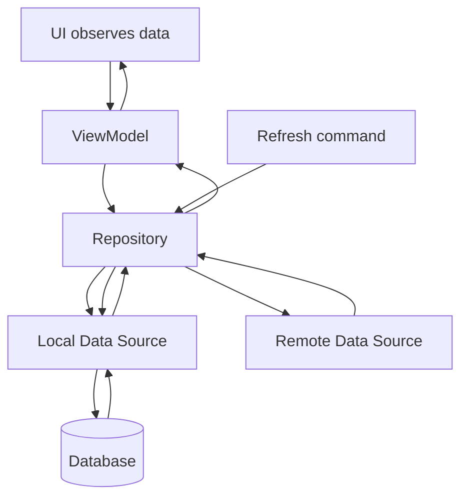

<div align="center">

# Chapter 19 — Repository Pattern

### Part 2: Repository

**Kotlin Multiplatform · Data Architecture · Production Design**


*The repository is where data sources become a coherent application capability.*

</div>

---

## Table of Contents

- [1. The Repository's Place in the Data Layer](#1-the-repositorys-place-in-the-data-layer)
- [2. Designing a Repository Contract](#2-designing-a-repository-contract)
- [3. Implementing the Repository](#3-implementing-the-repository)
- [4. Repository as a Coordinator](#4-repository-as-a-coordinator)
- [5. Choosing a Source-of-Truth Strategy](#5-choosing-a-source-of-truth-strategy)
- [6. Offline-First Repository Design](#6-offline-first-repository-design)
- [7. Cache Policies and Freshness](#7-cache-policies-and-freshness)
- [8. Mapping and Model Boundaries](#8-mapping-and-model-boundaries)
- [9. Repository API Design with Coroutines and Flow](#9-repository-api-design-with-coroutines-and-flow)
- [10. Error Translation and Cancellation](#10-error-translation-and-cancellation)
- [11. Writes, Transactions, and Consistency](#11-writes-transactions-and-consistency)
- [12. Concurrency and Duplicate Requests](#12-concurrency-and-duplicate-requests)
- [13. Repository Design in Kotlin Multiplatform](#13-repository-design-in-kotlin-multiplatform)
- [14. Dependency Injection and Repository Lifetimes](#14-dependency-injection-and-repository-lifetimes)
- [15. Testing Repository Behavior](#15-testing-repository-behavior)
- [16. Observability and Performance](#16-observability-and-performance)
- [17. Common Implementation Anti-Patterns](#17-common-implementation-anti-patterns)
- [18. Production Review Checklist](#18-production-review-checklist)
- [19. Key Takeaways](#19-key-takeaways)

---

## 1. The Repository's Place in the Data Layer

A repository is not simply a class placed between a ViewModel and an API service. Its value comes from giving the application one coherent way to access a particular capability, even when that capability depends on several mechanisms.

Consider a product catalog:

- The backend owns the authoritative product catalog.
- A local database stores products for offline access.
- A memory cache may retain recently accessed details.
- The UI observes local changes.
- A refresh operation synchronizes remote data into local storage.

Without a repository, each consumer may need to understand these sources and their coordination rules. That spreads data policy across ViewModels, workers, and screens.

A repository centralizes those decisions.

```text
                  Application Consumers
             ┌────────────┬─────────────┐
             │            │             │
          ViewModel    Use Case     Background Worker
             │            │             │
             └────────────┴─────────────┘
                          │
                          ▼
                 ProductRepository
                          │
                 Data Coordination
                 ┌────────┼────────┐
                 │        │        │
                 ▼        ▼        ▼
               Remote   Local    Memory
               Source   Source   Cache
```

The repository is responsible for the contract between consumers and data access. It should not become a container for every business rule in the feature.

### 1.1 The repository's key questions

A well-designed repository implementation answers questions such as:

1. Which source is appropriate for this operation?
2. Which model should cross the repository boundary?
3. When should local data be updated?
4. What should happen when the network is unavailable?
5. How should concurrent requests be handled?
6. Which failures are meaningful to the caller?
7. What does the returned `Flow` represent?
8. Which operations must be atomic?

If those answers are scattered across consumers, the data layer has no clear owner for its behavior.

---

## 2. Designing a Repository Contract

The contract is the most important part of repository design. It defines what consumers can request and what they can expect in return.

Start with application capabilities, not API endpoints or database queries.

### 2.1 Model operations around use cases

```kotlin
interface ProductRepository {
    suspend fun getProduct(id: ProductId): Product?
    fun observeProducts(): Flow<List<Product>>
    suspend fun refreshProducts(): RefreshResult
    suspend fun updateProduct(product: Product): UpdateResult
}
```

`ProductId`, `RefreshResult`, and `UpdateResult` are application-defined types.

This contract communicates:

- A product may not exist.
- The catalog can be observed over time.
- Refresh is an explicit operation.
- Updating a product can produce a meaningful outcome.

It does not expose which HTTP endpoint is called or which SQL statement is executed.

### 2.2 Avoid endpoint-shaped contracts

A repository that mirrors the backend API can become a transport wrapper:

```kotlin
// Endpoint-shaped API: often a sign that transport details
// are leaking into the application boundary.
interface ProductRepository {
    suspend fun getProductsEndpoint(): ProductResponseDto
    suspend fun postProductEndpoint(request: ProductRequestDto): ProductResponseDto
}
```

Prefer names that describe application intent:

```kotlin
interface ProductRepository {
    suspend fun getProducts(): List<Product>
    suspend fun createProduct(product: NewProduct): Product
}
```

The repository implementation can translate these operations into one or several API calls.

### 2.3 Make absence explicit

Use nullable results only when absence is a normal and meaningful outcome.

```kotlin
suspend fun findProduct(id: ProductId): Product?
```

This communicates that a missing product is expected.

By contrast, if the caller requests a product that must exist for the operation to proceed, a not-found failure may be more appropriate:

```kotlin
suspend fun getRequiredProduct(id: ProductId): Product
```

The naming and error contract should make the distinction clear. Avoid using `null` to represent network failures, database failures, and missing records at the same time.

### 2.4 Avoid exposing infrastructure types

A repository contract should generally not expose:

- `HttpResponse` or engine-specific networking objects.
- SQLDelight generated query types.
- Room entities.
- Retrofit response wrappers.
- Platform-specific file handles.
- Android `Context` or UIKit objects.

Those types make consumers dependent on implementation details and reduce the portability of a shared KMP contract.

### 2.5 Keep contracts cohesive

Do not create a single repository for unrelated capabilities.

```kotlin
interface ApplicationRepository {
    suspend fun getProfile(): Profile
    suspend fun getProducts(): List<Product>
    suspend fun getOrders(): List<Order>
    suspend fun getPaymentMethods(): List<PaymentMethod>
    suspend fun getNotifications(): List<Notification>
}
```

Prefer contracts that group operations around a coherent application concept:

```kotlin
interface ProfileRepository
interface ProductRepository
interface OrderRepository
interface PaymentMethodRepository
interface NotificationRepository
```

A repository may coordinate multiple tables or endpoints when they support one capability. Cohesion matters more than a one-class-per-table rule.

---

## 3. Implementing the Repository

A repository implementation depends on abstractions for its data sources and fulfills the application-facing contract.

The following example uses a remote source and a local source.

### 3.1 Define the domain contract

```kotlin
interface ProductRepository {
    suspend fun getProduct(id: String): Product?
    fun observeProducts(): Flow<List<Product>>
    suspend fun refreshProducts(): RefreshResult
}
```

### 3.2 Define source contracts

```kotlin
interface ProductRemoteDataSource {
    suspend fun fetchProduct(id: String): ProductDto
    suspend fun fetchProducts(): List<ProductDto>
}

interface ProductLocalDataSource {
    suspend fun findProduct(id: String): ProductEntity?
    fun observeProducts(): Flow<List<ProductEntity>>
    suspend fun replaceProducts(products: List<ProductEntity>)
}
```

These source interfaces are useful when they make the repository easier to test or allow different implementations. A small project may use concrete source classes directly if another abstraction would add no value.

### 3.3 Implement the repository

```kotlin
class DefaultProductRepository(
    private val remote: ProductRemoteDataSource,
    private val local: ProductLocalDataSource,
) : ProductRepository {

    override suspend fun getProduct(id: String): Product? {
        val cached = local.findProduct(id)

        if (cached != null) {
            return cached.toDomain()
        }

        val remoteProduct = remote.fetchProduct(id)
        local.replaceProducts(listOf(remoteProduct.toEntity()))

        return remoteProduct.toDomain()
    }

    override fun observeProducts(): Flow<List<Product>> {
        return local.observeProducts()
            .map { entities ->
                entities.map(ProductEntity::toDomain)
            }
    }

    override suspend fun refreshProducts(): RefreshResult {
        return try {
            val remoteProducts = remote.fetchProducts()
            val entities = remoteProducts.map(ProductDto::toEntity)

            local.replaceProducts(entities)
            RefreshResult.Success
        } catch (cancellation: CancellationException) {
            throw cancellation
        } catch (exception: Exception) {
            RefreshResult.Failure(exception.toRepositoryError())
        }
    }
}
```

The example uses project-defined mapping functions and result types. It demonstrates the coordination boundary, not a universal cache strategy.

A production implementation should distinguish failures carefully and define whether a failed refresh leaves existing local data untouched. It should also ensure that replacing the catalog is atomic if the storage technology supports transactions.

### 3.4 Keep orchestration readable

A repository method should read like a description of its data policy:

```kotlin
override suspend fun refreshProducts(): RefreshResult {
    val response = remote.fetchProducts()
    val products = response.map(ProductDto::toEntity)
    local.replaceProducts(products)
    return RefreshResult.Success
}
```

If the implementation contains deeply nested conditionals, multiple unrelated workflows, and extensive UI-specific decisions, its responsibilities may be too broad.

Extract focused collaborators when they improve clarity:

- A mapper for complex transformations.
- A cache policy component for sophisticated freshness rules.
- A synchronizer for multi-step synchronization.
- A transaction boundary for atomic persistence.
- A domain use case for cross-capability business workflows.

Do not extract a class for every three-line block. A collaborator should represent a meaningful responsibility.

---

## 4. Repository as a Coordinator

The repository's distinctive job is often coordination.

### 4.1 One source

A simple repository may delegate to one source and map the result:

```kotlin
class DefaultProfileRepository(
    private val remote: ProfileRemoteDataSource,
) : ProfileRepository {

    override suspend fun getProfile(id: String): Profile {
        return remote.fetchProfile(id).toDomain()
    }
}
```

This can still provide a useful boundary if it protects consumers from transport models and networking details.

### 4.2 Multiple sources

A more complex repository may coordinate local and remote sources:

```kotlin
class DefaultProfileRepository(
    private val remote: ProfileRemoteDataSource,
    private val local: ProfileLocalDataSource,
) : ProfileRepository {

    override suspend fun refreshProfile(id: String) {
        val dto = remote.fetchProfile(id)
        local.save(dto.toEntity())
    }

    override fun observeProfile(id: String): Flow<Profile?> {
        return local.observeProfile(id)
            .map { entity -> entity?.toDomain() }
    }
}
```

Here, local storage is the observable source for the screen. A refresh updates that source, and the stream emits the new value.

### 4.3 Multiple remote calls

Sometimes one application capability requires several endpoints.

```kotlin
class DefaultDashboardRepository(
    private val accountRemote: AccountRemoteDataSource,
    private val ordersRemote: OrdersRemoteDataSource,
) : DashboardRepository {

    override suspend fun getDashboard(): Dashboard {
        val account = accountRemote.fetchAccount()
        val orders = ordersRemote.fetchRecentOrders()

        return Dashboard(
            account = account.toDomain(),
            recentOrders = orders.map(OrderDto::toDomain),
        )
    }
}
```

This is reasonable if the repository represents a cohesive dashboard data capability.

If the operation contains business decisions such as eligibility, pricing rules, or approval workflows, a use case may be a better coordinator. The repository should not absorb domain policy merely because it is convenient to call two sources from one class.

### 4.4 Parallel requests

Independent remote requests may be executed concurrently when doing so is safe and useful:

```kotlin
override suspend fun getDashboard(): Dashboard = coroutineScope {
    val accountDeferred = async { accountRemote.fetchAccount() }
    val ordersDeferred = async { ordersRemote.fetchRecentOrders() }

    Dashboard(
        account = accountDeferred.await().toDomain(),
        recentOrders = ordersDeferred.await().map(OrderDto::toDomain),
    )
}
```

Use structured concurrency. If one operation fails, understand how cancellation affects the other. Parallelism is appropriate only when the requests are independent and the backend can handle them.

---

## 5. Choosing a Source-of-Truth Strategy

A repository must have a clear answer to the question: which source determines the value consumers see?

There is no single correct answer for every feature.

### 5.1 Network as source of truth

```text
Consumer
   |
   v
Repository
   |
   v
Remote API
   |
   v
Domain model
```

Useful when:

- Data must be fresh for each operation.
- Local persistence is unnecessary.
- The backend owns the entire lifecycle.
- The feature is a simple command or lookup.

Trade-offs:

- Offline access is limited.
- Every read depends on network availability.
- Repeated requests may increase latency and backend traffic.

### 5.2 Database as source of truth

```text
Consumer
   |
   v
Repository
   |
   v
Local Database
   |
   v
Domain model stream
```

Useful when:

- The UI should work offline.
- Data is observed over time.
- Local writes should immediately update the UI.
- The app needs predictable rendering from persisted state.

The remote source updates the database, but consumers observe the database rather than directly rendering network responses.

### 5.3 Memory cache as an optimization

A memory cache can reduce repeated reads, but it should not silently become a second source of truth.

Consider:

- How entries are invalidated.
- Whether cached values survive account changes.
- Whether the cache is safe under concurrent access.
- Whether memory pressure can remove entries.
- Whether stale values are acceptable.

For many applications, a database is sufficient as the durable source while memory caching is used only as a performance optimization.

### 5.4 Make the choice explicit

| Feature | Possible source of truth |
|---|---|
| Product catalog with offline browsing | Local database |
| Live payment authorization | Backend |
| User preferences | Local storage, with sync if required |
| Authentication session validity | Server plus secure local token storage |
| Search suggestions | Memory cache or remote API |
| Inventory count in a warehouse workflow | Server-authoritative value, optionally cached for display |
| Draft form | Local database or in-memory state |

The data's business meaning determines the consistency requirement. A cached display value and an authoritative transaction value are not interchangeable.

---

## 6. Offline-First Repository Design

Offline-first behavior is not achieved by adding a database and returning cached values. The application needs an explicit synchronization model.

A common approach is:

1. Consumers observe local data.
2. A refresh fetches remote data.
3. The repository maps and persists the response.
4. The database emits the updated state.
5. Consumers render the new state.



### 6.1 Observe local data

```kotlin
override fun observeProducts(): Flow<List<Product>> {
    return local.observeProducts()
        .map { entities -> entities.map(ProductEntity::toDomain) }
}
```

The consumer can begin observing immediately. If the database is empty, it can emit an empty list while a refresh runs separately.

### 6.2 Refresh local data

```kotlin
override suspend fun refreshProducts(): RefreshResult {
    return try {
        val response = remote.fetchProducts()
        local.replaceProducts(response.map(ProductDto::toEntity))
        RefreshResult.Success
    } catch (cancellation: CancellationException) {
        throw cancellation
    } catch (exception: Exception) {
        RefreshResult.Failure(exception.toRepositoryError())
    }
}
```

The UI observes the database, so a failed refresh does not require the repository to invent a replacement list. Existing data remains available if the persistence operation was not destructive.

### 6.3 Represent refresh state separately

Data and synchronization status are different concepts.

A product list may be available while a refresh is running or has failed.

```kotlin
data class ProductScreenData(
    val products: List<Product>,
    val refreshStatus: RefreshStatus,
)

sealed interface RefreshStatus {
    data object Idle : RefreshStatus
    data object Refreshing : RefreshStatus
    data object Failed : RefreshStatus
}
```

This is a presentation model example. The repository can expose refresh results or a synchronization status stream; the ViewModel can combine that information with observed products.

Avoid replacing valid cached content with a full-screen error merely because a background refresh failed.

### 6.4 Offline writes and synchronization

Offline writes introduce additional complexity.

For example, a user may update a product quantity while disconnected. The application must decide whether to:

- Reject the operation until online.
- Save a pending local command.
- Optimistically update local state and synchronize later.
- Mark the item as pending or conflicted.

A robust offline write model may need an outbox table:

```text
User action
    |
    v
Local transaction
    ├── Update local product state
    └── Insert pending operation
             |
             v
       Sync worker
             |
             v
         Remote API
             |
       ┌─────┴─────┐
       ▼           ▼
    Success      Failure
       |           |
       v           v
  Mark synced   Retry / conflict
```

This is a synchronization architecture, not simply a repository method with a `try/catch`. The repository may expose the operation, while a dedicated synchronization component owns retry scheduling and outbox processing.

---

## 7. Cache Policies and Freshness

Caching is a policy decision. It should not be hidden in arbitrary `if` statements.

### 7.1 Cache-first

Read local data first and use the network only when the cache is missing.

```kotlin
suspend fun getProduct(id: String): Product {
    val cached = local.findProduct(id)

    if (cached != null) return cached.toDomain()

    val remoteProduct = remote.fetchProduct(id)
    local.save(remoteProduct.toEntity())

    return remoteProduct.toDomain()
}
```

**Good for:** data where an existing cached value is acceptable.

**Risk:** cached data can remain stale indefinitely without an invalidation or refresh policy.

### 7.2 Network-first

Fetch remote data first, then update local storage.

```kotlin
suspend fun getProduct(id: String): Product {
    val fresh = remote.fetchProduct(id)
    local.save(fresh.toEntity())
    return fresh.toDomain()
}
```

**Good for:** data where freshness is more important than immediate offline availability.

**Risk:** the operation fails when the network is unavailable, even if useful cached data exists.

### 7.3 Stale-while-revalidate

Return cached data quickly and refresh in the background.

```text
Request
  |
  v
Read cache ──────────────> Return cached value
  |
  └── Start refresh
          |
          v
      Fetch remote
          |
          v
      Update local
          |
          v
      Observable stream emits fresh value
```

This works well when stale data is acceptable for initial rendering and the UI can update when fresh data arrives.

### 7.4 Time-based freshness

A cache record may store when it was last refreshed:

```kotlin
data class CachedProduct(
    val product: ProductEntity,
    val fetchedAtEpochMillis: Long,
)
```

A policy can determine whether the entry is fresh:

```kotlin
fun isFresh(
    fetchedAtEpochMillis: Long,
    nowEpochMillis: Long,
    maxAgeMillis: Long,
): Boolean {
    return nowEpochMillis - fetchedAtEpochMillis < maxAgeMillis
}
```

In production, consider clock changes and invalid timestamps. For elapsed durations within a running process, a monotonic clock may be more appropriate than wall-clock time. Persisted timestamps usually need a wall-clock representation and a clearly defined time basis.

### 7.5 Cache invalidation

A cache needs a lifecycle.

Possible invalidation triggers include:

- Explicit user refresh.
- Successful mutation.
- Account logout or account switch.
- Server version changes.
- Expiration time.
- Data deletion.
- A synchronization conflict.

A common bug is retaining user-specific data after logout. Repository and cache lifetimes must be scoped to the correct account or session.

### 7.6 Avoid one global cache policy

Different data has different freshness requirements. A product description may tolerate a longer cache lifetime than a payment status or available inventory quantity.

Model policy by data capability, not by one arbitrary application-wide timeout.

---

## 8. Mapping and Model Boundaries

The repository is a natural boundary for translating source-specific representations into application models.

### 8.1 DTO to domain

```kotlin
@Serializable
data class ProductDto(
    @SerialName("product_id")
    val id: String,
    @SerialName("display_name")
    val name: String,
    val description: String?,
)

data class Product(
    val id: String,
    val name: String,
    val description: String,
)

fun ProductDto.toDomain(): Product {
    return Product(
        id = id,
        name = name,
        description = description.orEmpty(),
    )
}
```

The mapping decides how transport nullability is interpreted by the application. That decision should reflect product requirements; `orEmpty()` is not automatically correct for every nullable field.

### 8.2 Entity to domain

```kotlin
data class ProductEntity(
    val id: String,
    val name: String,
    val description: String?,
)

fun ProductEntity.toDomain(): Product {
    return Product(
        id = id,
        name = name,
        description = description.orEmpty(),
    )
}
```

### 8.3 Do not hide meaningful validation inside mapping

Mapping should primarily translate representations. If incoming data requires business validation, keep that rule explicit and testable.

For example, a negative quantity may be structurally valid JSON but invalid for a particular domain operation. Do not silently normalize it unless that is the defined business behavior.

### 8.4 Avoid excessive model duplication

Separate DTO, entity, domain, and UI models when they have different responsibilities or change for different reasons.

Do not duplicate every model automatically. In a small feature, a single model may be sufficient. The goal is to isolate change, not to increase the number of files.

---

## 9. Repository API Design with Coroutines and Flow

Repository APIs should communicate whether an operation is a command, a one-time query, or an observable query.

### 9.1 Suspending query

```kotlin
interface ProfileRepository {
    suspend fun getProfile(id: String): Profile?
}
```

Use this when the consumer needs one result.

### 9.2 Observable query

```kotlin
interface ProfileRepository {
    fun observeProfile(id: String): Flow<Profile?>
}
```

Use this when updates should continue to reach the consumer.

### 9.3 Command

```kotlin
interface ProfileRepository {
    suspend fun updateProfile(profile: Profile): UpdateResult
}
```

Use a suspending command when completion or failure matters to the caller.

### 9.4 Do not expose mutable flows

Avoid returning a `MutableStateFlow` owned by the repository:

```kotlin
// Avoid exposing mutation to every consumer.
val products: MutableStateFlow<List<Product>>
```

Prefer a read-only stream:

```kotlin
val products: StateFlow<List<Product>>
```

Or expose `Flow` when consumers do not need state-holder semantics.

The repository should retain control over mutations. Consumers should not be able to change repository state without going through a defined operation.

### 9.5 Be deliberate about stream errors

A `Flow<T>` can complete exceptionally. Decide whether a repository stream:

- Emits data and terminates on storage failure.
- Exposes a typed state that includes loading and error.
- Uses a separate status stream.
- Recovers from transient errors.

Do not use `catch { emit(emptyList()) }` as a universal recovery strategy. An empty list is valid data and should not be confused with a failed database observation.

### 9.6 Dispatcher ownership

A repository should not blindly wrap every suspend call in `withContext(Dispatchers.IO)`.

Many libraries already manage their own execution context. For blocking work, make dispatcher ownership explicit and inject a dispatcher when that improves testability.

```kotlin
class FileBackedRepository(
    private val ioDispatcher: CoroutineDispatcher,
    private val fileSource: BlockingFileSource,
) {
    suspend fun read(): String = withContext(ioDispatcher) {
        fileSource.readText()
    }
}
```

This is appropriate when `readText()` is genuinely blocking. It is unnecessary for every suspending networking or database API.

---

## 10. Error Translation and Cancellation

A repository should translate infrastructure failures into errors that consumers can understand without importing implementation-specific exception types.

### 10.1 Define an application-facing error model

```kotlin
sealed interface RepositoryError {
    data object NetworkUnavailable : RepositoryError
    data object Unauthorized : RepositoryError
    data object NotFound : RepositoryError
    data object InvalidResponse : RepositoryError
    data object StorageFailure : RepositoryError
    data object Unknown : RepositoryError
}
```

This is a sample model. A real application should include only distinctions that affect behavior.

### 10.2 Use typed outcomes where expected failures are part of the contract

```kotlin
sealed interface RefreshResult {
    data object Success : RefreshResult
    data class Failure(
        val error: RepositoryError,
    ) : RefreshResult
}
```

A method may instead throw documented exceptions. Neither approach is universally correct. Choose one convention and apply it consistently.

### 10.3 Preserve cancellation

Coroutine cancellation must not be swallowed by a broad exception handler.

```kotlin
try {
    remote.fetchProducts()
} catch (cancellation: CancellationException) {
    throw cancellation
} catch (exception: Exception) {
    return RefreshResult.Failure(exception.toRepositoryError())
}
```

Cancellation is how structured concurrency stops work when a caller no longer needs it. Converting it into an ordinary network failure can cause unwanted retries, stale updates, and work continuing after a screen or operation has been cancelled.

### 10.4 Do not leak exception messages

Avoid sending raw server messages or exception strings directly to the UI. They may contain internal details, implementation names, or sensitive information.

Translate technical failures into stable application outcomes. Log useful diagnostic context through a safe logging mechanism, with credentials and personal data redacted.

---

## 11. Writes, Transactions, and Consistency

Read operations are only part of repository design. Writes introduce consistency requirements.

### 11.1 Remote-first write

```text
Consumer
   |
   v
Repository
   |
   v
Remote API
   |
   v
Persist confirmed response locally
```

Use this when the backend must approve the mutation before the application treats it as committed.

Example: submitting a payment or confirming an inventory transaction.

### 11.2 Local-first write

```text
Consumer
   |
   v
Repository
   |
   v
Persist local change
   |
   v
Return local result
   |
   v
Synchronize later
```

Use this when the product supports offline mutation and has a reliable synchronization mechanism.

### 11.3 Optimistic update

An optimistic update changes local state before the server confirms the operation.

```text
User action
    |
    v
Update local state immediately
    |
    v
Send remote command
    |
  ┌─┴─────────────┐
  ▼               ▼
Success          Failure
  |               |
  ▼               ▼
Keep state     Reconcile / rollback
```

The application must define how to reconcile failures and conflicts. A rollback may be incorrect if another update has occurred in the meantime.

### 11.4 Transactional persistence

If a refresh replaces multiple related records, perform the changes atomically where supported:

```kotlin
suspend fun replaceCatalog(products: List<ProductEntity>) {
    database.transaction {
        productQueries.deleteAll()

        products.forEach { product ->
            productQueries.insertOrReplace(
                id = product.id,
                name = product.name,
                description = product.description,
            )
        }
    }
}
```

`database.transaction` and `productQueries` are illustrative. Use the actual transaction API of the chosen database.

Without a transaction, a crash halfway through replacement may leave the local catalog partially updated.

### 11.5 Idempotency

A retryable write should be safe to repeat where possible.

For commands that create or process important server-side operations, use backend-supported idempotency keys or operation identifiers. A repository cannot guarantee idempotency by itself if the server treats every retry as a new operation.

---

## 12. Concurrency and Duplicate Requests

Repositories are often shared by several consumers. Two screens, a worker, or multiple collectors may request the same data at nearly the same time.

### 12.1 Duplicate refreshes

Without coordination:

```text
Screen A ── refresh ──> API request 1
Screen B ── refresh ──> API request 2
Worker   ── refresh ──> API request 3
```

This may waste network and database resources.

Possible strategies:

- Accept duplicate requests when they are inexpensive and harmless.
- Serialize refresh operations with a `Mutex`.
- Share an in-flight request.
- Deduplicate at a lower networking or data-source layer.
- Use a single synchronization worker for background refresh.

### 12.2 Serialize a critical refresh

```kotlin
class DefaultProductRepository(
    private val remote: ProductRemoteDataSource,
    private val local: ProductLocalDataSource,
) : ProductRepository {

    private val refreshMutex = Mutex()

    override suspend fun refreshProducts(): RefreshResult {
        return refreshMutex.withLock {
            performRefresh()
        }
    }

    private suspend fun performRefresh(): RefreshResult {
        return try {
            val response = remote.fetchProducts()
            local.replaceProducts(response.map(ProductDto::toEntity))
            RefreshResult.Success
        } catch (cancellation: CancellationException) {
            throw cancellation
        } catch (exception: Exception) {
            RefreshResult.Failure(exception.toRepositoryError())
        }
    }
}
```

This prevents concurrent refresh executions through this repository instance. It does not coordinate across multiple processes, multiple repository instances, or devices. Those cases require a broader mechanism.

### 12.3 Protect shared mutable state

If a repository maintains an in-memory mutable cache, define its concurrency behavior.

A plain mutable map is not automatically safe for concurrent access. Use an appropriate synchronization mechanism or a thread-safe implementation, and consider whether the cache is worth the added complexity.

### 12.4 Avoid unstructured background work

Do not launch detached coroutines inside repositories without a clear lifecycle:

```kotlin
// Avoid: the scope and lifetime are unclear.
fun refresh() {
    GlobalScope.launch {
        remote.fetchProducts()
    }
}
```

Prefer suspending methods whose caller owns the operation, or inject a clearly scoped application-level scope for work that must outlive a screen. Durable background synchronization should normally be owned by a platform-appropriate scheduler or worker.

---

## 13. Repository Design in Kotlin Multiplatform

The repository pattern fits KMP because contracts and portable data policies can be shared while platform-specific mechanisms remain isolated.

### 13.1 Shared contract

```kotlin
// commonMain
interface SessionRepository {
    suspend fun currentUser(): User?
    suspend fun signOut()
}
```

### 13.2 Shared implementation with portable dependencies

```kotlin
// commonMain
class DefaultSessionRepository(
    private val remote: SessionRemoteDataSource,
    private val tokenStore: SecureTokenStore,
) : SessionRepository {

    override suspend fun currentUser(): User? {
        val token = tokenStore.readAccessToken() ?: return null
        return remote.fetchCurrentUser(token).toDomain()
    }

    override suspend fun signOut() {
        try {
            remote.revokeSession()
        } finally {
            tokenStore.clear()
        }
    }
}
```

This example assumes the project has defined the secure token contract and remote behavior. Production logout semantics should specify what happens if revocation fails, whether local credentials must always be cleared, and how other cached account data is invalidated.

### 13.3 Platform-specific secure storage

```kotlin
// commonMain
interface SecureTokenStore {
    suspend fun readAccessToken(): String?
    suspend fun writeAccessToken(token: String)
    suspend fun clear()
}
```

```text
                 commonMain
              SecureTokenStore
                     |
          ┌──────────┴──────────┐
          ▼                     ▼
      androidMain             iosMain
   Android secure storage   Keychain adapter
```

The Android implementation may use Android platform security facilities. The iOS implementation may use Keychain. The shared repository only depends on the contract.

### 13.4 Share policy, not platform assumptions

A common repository can be shared when all of its dependencies are available for the intended targets.

Keep platform-specific concerns outside shared code:

- Android `Context`.
- Android-only database APIs.
- UIKit or SwiftUI types.
- Keychain framework calls.
- Platform-specific file access.
- Platform-specific lifecycle objects.

A platform-specific source can be injected into a shared repository through a common interface. Alternatively, the repository implementation itself can be platform-specific when its behavior genuinely depends on the platform.

### 13.5 Android and iOS consumers

```text
                    commonMain
          ┌────────────────────────────┐
          │ Repository contract        │
          │ Domain models              │
          │ Shared implementation      │
          └──────────────┬─────────────┘
                         │
               ┌─────────┴─────────┐
               ▼                   ▼
           Android                 iOS
        ViewModel / Compose    SwiftUI adapter
               │                   │
               └─────────┬─────────┘
                         ▼
                  Shared repository
```

Android and iOS presentation layers can consume the same application-facing behavior without sharing UI frameworks.

### 13.6 KMP source-set guidance

| Component | Typical location |
|---|---|
| Repository contract | `commonMain` |
| Domain model | `commonMain` |
| Portable repository implementation | `commonMain` |
| Ktor API abstraction and DTOs | `commonMain`, when configured for targets |
| SQLDelight shared queries | `commonMain`, when configured for targets |
| Android secure-storage adapter | `androidMain` |
| Keychain adapter | `iosMain` |
| Platform composition root | Platform application module |
| Shared repository tests | `commonTest` |

The exact arrangement depends on Gradle modules, target support, and library configuration. A source set is not a substitute for verifying that every dependency supports every target.

---

## 14. Dependency Injection and Repository Lifetimes

A repository is usually constructed by a composition root or dependency injection container.

The repository should receive its dependencies through its constructor:

```kotlin
class DefaultProductRepository(
    private val remote: ProductRemoteDataSource,
    private val local: ProductLocalDataSource,
) : ProductRepository
```

Avoid constructing networking clients or databases inside the repository:

```kotlin
// Avoid: the repository now owns infrastructure construction.
class ProductRepository {
    private val client = HttpClient()
    private val database = createDatabase()
}
```

This makes lifecycle, configuration, and testing harder.

### 14.1 Manual construction

```kotlin
val productRepository: ProductRepository =
    DefaultProductRepository(
        remote = productRemoteDataSource,
        local = productLocalDataSource,
    )
```

### 14.2 Koin-style registration

```kotlin
val productModule = module {
    single<ProductRepository> {
        DefaultProductRepository(
            remote = get(),
            local = get(),
        )
    }
}
```

The exact Koin DSL and module setup should be checked against the version used by the project.

### 14.3 Repository lifetime

A repository's lifetime should match the state and dependencies it owns.

| Lifetime | When it may fit |
|---|---|
| Application / singleton | Stateless coordinator or shared cache with app lifetime |
| Account/session scoped | Data tied to a signed-in user |
| Feature scoped | Temporary feature-specific state |
| Short-lived factory | Operation-specific object with no shared state |

A singleton repository is not automatically correct. If it holds user-specific memory cache, switching accounts must invalidate that cache. If it owns no mutable state and depends on application-scoped sources, a singleton may be appropriate.

### 14.4 Avoid service locator access inside repositories

Prefer constructor injection over calling a global container from repository methods.

```kotlin
// Avoid hidden dependency lookup.
class DefaultOrderRepository {
    suspend fun getOrders(): List<Order> {
        val api = GlobalContainer.get<OrderApi>()
        return api.fetchOrders().map(OrderDto::toDomain)
    }
}
```

Explicit constructor dependencies make the graph visible and tests straightforward.

---

## 15. Testing Repository Behavior

Repository tests should verify policy and observable behavior. They should not require a live backend.

### 15.1 Fake data sources

```kotlin
class FakeProductRemoteDataSource : ProductRemoteDataSource {
    var products = emptyList<ProductDto>()
    var failure: Throwable? = null
    var fetchCount = 0

    override suspend fun fetchProducts(): List<ProductDto> {
        fetchCount++
        failure?.let { throw it }
        return products
    }

    override suspend fun fetchProduct(id: String): ProductDto {
        fetchCount++
        failure?.let { throw it }
        return products.first { it.id == id }
    }
}
```

A fake local source can keep products in memory and expose them as a `Flow`.

```kotlin
class FakeProductLocalDataSource : ProductLocalDataSource {
    private val state = MutableStateFlow<List<ProductEntity>>(emptyList())

    override suspend fun findProduct(id: String): ProductEntity? {
        return state.value.firstOrNull { it.id == id }
    }

    override fun observeProducts(): Flow<List<ProductEntity>> = state

    override suspend fun replaceProducts(products: List<ProductEntity>) {
        state.value = products
    }
}
```

These fakes are illustrative. Real implementations should match the project's exact model and interface definitions.

### 15.2 Test cache hit

Given a cached product:

- `getProduct()` should return the cached domain model.
- The remote source should not be called if the defined policy is cache-first.
- The mapping should produce the expected domain value.

### 15.3 Test cache miss

Given no cached product:

- The remote source should be called.
- The result should be mapped.
- The local source should receive the expected entity.
- The returned value should match the repository contract.

### 15.4 Test refresh failure

Verify that:

- The error is translated according to the repository contract.
- Cancellation is rethrown.
- Existing local data is preserved when the refresh fails before persistence.
- No partial replacement is visible if the persistence operation is transactional.

### 15.5 Test observable behavior

```kotlin
@Test
fun `observe products emits domain models from local source`() = runTest {
    val local = FakeProductLocalDataSource()
    val repository = DefaultProductRepository(
        remote = FakeProductRemoteDataSource(),
        local = local,
    )

    val emissions = mutableListOf<List<Product>>()
    val job = backgroundScope.launch {
        repository.observeProducts().toList(emissions)
    }

    local.replaceProducts(
        listOf(
            ProductEntity(
                id = "p-1",
                name = "Keyboard",
                description = "Wireless",
            ),
        ),
    )

    runCurrent()

    assertEquals("Keyboard", emissions.last().single().name)
    job.cancel()
}
```

This is a conceptual test example; imports and test scheduler setup depend on the project's coroutine-test version and conventions.

### 15.6 Test matrix

| Scenario | Verify |
|---|---|
| Cache hit | No remote request under cache-first policy |
| Cache miss | Remote request and local persistence |
| Refresh success | Correct replacement or merge behavior |
| Refresh failure | Existing data remains consistent |
| Mapping | DTO/entity to domain conversion |
| Missing record | Defined not-found behavior |
| Cancellation | Cancellation propagates |
| Concurrent refresh | No unintended duplicate or corrupt writes |
| Account switch | User-specific cache is cleared or isolated |
| Flow observation | Local changes are emitted |
| Transaction failure | No partial state is exposed |

Use fakes for policy tests and integration tests for the actual database and HTTP adapter. A fake cannot prove that a SQL query, transaction, or platform storage implementation works correctly.

---

## 16. Observability and Performance

A repository is a useful place to record data-operation metrics because it knows which application capability is being executed. Instrumentation should not compromise the abstraction or leak sensitive data.

### 16.1 Useful measurements

Consider tracking:

- Operation name.
- Duration.
- Data source used.
- Cache hit or miss.
- Refresh success or failure.
- Retry count.
- Number of records processed.
- Synchronization lag.
- Cancellation count.

Use structured events where possible:

```text
event: repository_operation
repository: ProductRepository
operation: refreshProducts
source: remote_then_local
duration_ms: 284
outcome: success
items_updated: 42
```

This is an illustrative event shape, not a prescribed logging schema.

### 16.2 Avoid sensitive logs

Never log:

- Access tokens or refresh tokens.
- Passwords.
- Full payment details.
- Sensitive personal information.
- Unredacted request or response bodies.

Prefer identifiers that are safe for the environment and policy, and redact or hash values where appropriate.

### 16.3 Avoid unnecessary work

Repository performance problems often come from:

- Repeated mapping of large collections.
- Fetching the same data concurrently.
- Replacing an entire table for a small change.
- Running blocking work on a shared dispatcher.
- Unbounded in-memory caches.
- Excessive serialization and deserialization.
- Observing broad queries when only one record is needed.

Measure before optimizing. A repository should remain understandable; speculative caching and concurrency machinery can cost more than the work they save.

---

## 17. Common Implementation Anti-Patterns

### 17.1 Repository owns the HTTP client

```kotlin
class ProductRepository {
    private val client = HttpClient()
}
```

**Why it hurts:** configuration, engine selection, lifecycle, test replacement, and platform setup become hidden inside the repository.

**Better:** inject a configured API or remote data source.

### 17.2 Repository returns transport DTOs

```kotlin
suspend fun getProduct(id: String): ProductDto
```

**Why it hurts:** backend payload changes can spread into consumers.

**Better:** map to an application-facing model when the boundary requires independent evolution.

### 17.3 Repository becomes a god object

A repository that handles unrelated users, products, payments, navigation, and notifications has no cohesive responsibility.

**Better:** split contracts around application capabilities and use domain services for workflows that coordinate several capabilities.

### 17.4 Every method catches every exception

```kotlin
suspend fun getProducts(): List<Product> {
    return try {
        remote.fetchProducts().map(ProductDto::toDomain)
    } catch (exception: Exception) {
        emptyList()
    }
}
```

**Why it hurts:** an empty catalog becomes indistinguishable from a failed request. Cancellation may also be swallowed.

**Better:** preserve cancellation and expose a documented error contract.

### 17.5 Hidden global dependencies

Using a service locator or global singleton from inside a repository conceals the dependency graph.

**Better:** constructor injection.

### 17.6 Mutable state exposed to consumers

Returning a `MutableStateFlow` lets consumers bypass repository operations.

**Better:** expose read-only `Flow` or `StateFlow`.

### 17.7 Unbounded memory cache

A repository that stores every fetched object indefinitely can grow without limit and retain data across account changes.

**Better:** define capacity, eviction, invalidation, and account isolation—or use durable storage as the source of truth.

### 17.8 Unclear refresh semantics

A method named `getProducts()` that sometimes returns stale cache, sometimes waits for network, and sometimes launches background work is difficult to reason about.

**Better:** make operations explicit, such as `observeProducts()` and `refreshProducts()`, and document the contract.

### 17.9 Repository launches detached work

Using `GlobalScope` or an undocumented scope can allow work to outlive its intended owner.

**Better:** use structured concurrency or a deliberately scoped application worker.

### 17.10 Overengineering a simple feature

A single endpoint with no caching, mapping, reuse, or policy may not need several layers of interfaces and adapters.

**Better:** add boundaries when they improve clarity, replaceability, or testing.

---

## 18. Production Review Checklist

### Contract

- [ ] Methods represent application capabilities rather than endpoint names.
- [ ] Return types communicate absence, streaming, and failure semantics.
- [ ] Infrastructure types do not leak into shared contracts.
- [ ] The interface is cohesive and owned by the appropriate module.

### Coordination and consistency

- [ ] The source of truth is explicit.
- [ ] Cache policy and freshness are documented.
- [ ] Refresh behavior is separate from observation where appropriate.
- [ ] Failed refreshes do not destroy valid data.
- [ ] Writes use the correct remote-first, local-first, or optimistic policy.
- [ ] Related persistence operations use transactions when needed.
- [ ] Concurrent operations have defined behavior.
- [ ] Account-specific data is isolated and invalidated correctly.

### Coroutines and errors

- [ ] Cancellation is propagated.
- [ ] Blocking work uses an appropriate dispatcher.
- [ ] Flow errors have a defined contract.
- [ ] Expected failures are represented consistently.
- [ ] Retries are safe and respect idempotency.
- [ ] No detached coroutine has an unclear lifecycle.

### KMP

- [ ] Shared implementation dependencies support all intended targets.
- [ ] Platform APIs remain behind platform boundaries.
- [ ] Secure storage is platform-appropriate.
- [ ] Shared contracts do not expose Android or Apple framework types.
- [ ] Common behavior is covered by `commonTest` where practical.

### Quality and operations

- [ ] Cache hits and misses are tested.
- [ ] Refresh success and failure are tested.
- [ ] Mapping and persistence are verified.
- [ ] Integration tests cover actual source adapters.
- [ ] Metrics and logs avoid sensitive data.
- [ ] Performance optimizations are measurement-driven.
- [ ] The repository has one clear reason to change.

---

## 19. Key Takeaways

A repository implementation is the coordinator of an application's data access—not a dumping ground for every operation that touches data.

Keep these principles in mind:

1. **Design the contract first.** Expose application capabilities, not endpoint-shaped methods.
2. **Coordinate sources deliberately.** The repository should own the data-access policy that consumers should not have to repeat.
3. **Choose a source of truth.** Network, database, and memory cache have different consistency guarantees.
4. **Make offline behavior explicit.** Observation, refresh, pending writes, and synchronization are separate concerns.
5. **Treat cache freshness as product behavior.** Stale data may be acceptable in one feature and dangerous in another.
6. **Preserve model boundaries.** Map transport and persistence representations into application concepts where that separation provides value.
7. **Use coroutines and Flow intentionally.** Distinguish commands, one-time queries, and observable queries.
8. **Preserve cancellation.** Cancellation is not an ordinary application error.
9. **Design writes for consistency.** Transactions, idempotency, and conflict handling matter.
10. **Share portable policy in KMP.** Keep platform-only integrations behind common contracts.
11. **Test behavior, not just delegation.** Verify cache rules, refreshes, errors, mapping, and concurrency.
12. **Keep the repository cohesive.** If it coordinates unrelated business workflows, move those responsibilities to appropriate domain components.

A repository earns its place when it gives every consumer the same dependable answer to a simple question:

> What does it mean for this application to access and maintain this data?

---

<div align="center">

**Chapter 19 — Repository Pattern · Part 2: Repository**

*One clear contract. Deliberate data policies. A data layer that can evolve without leaking its complexity.*

</div>
