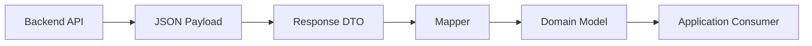
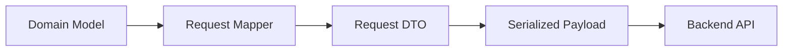

<div align="center">

# Chapter 19 — Repository Pattern

### Part 4: DTO — Data Transfer Object

**Kotlin Multiplatform · API Contracts · Serialization Boundaries**


*A DTO is the shape of data exchanged across a boundary. It should describe the contract—not become the model for your entire application.*

</div>

---

## Table of Contents

- [1. Understanding DTOs](#1-understanding-dtos)
- [2. Why DTOs Matter](#2-why-dtos-matter)
- [3. DTO vs. Domain Model vs. Entity](#3-dto-vs-domain-model-vs-entity)
- [4. Anatomy of a Kotlin DTO](#4-anatomy-of-a-kotlin-dto)
- [5. Designing DTOs for JSON APIs](#5-designing-dtos-for-json-apis)
- [6. Nullability, Defaults, and Missing Fields](#6-nullability-defaults-and-missing-fields)
- [7. Request DTOs and Response DTOs](#7-request-dtos-and-response-dtos)
- [8. Nested DTOs and API Envelopes](#8-nested-dtos-and-api-envelopes)
- [9. Collections, Pagination, and Large Responses](#9-collections-pagination-and-large-responses)
- [10. Enum and Polymorphic DTOs](#10-enum-and-polymorphic-dtos)
- [11. Dates, Money, IDs, and Special Values](#11-dates-money-ids-and-special-values)
- [12. DTOs and API Evolution](#12-dtos-and-api-evolution)
- [13. DTOs in Ktor Client](#13-dtos-in-ktor-client)
- [14. DTOs in Kotlin Multiplatform](#14-dtos-in-kotlin-multiplatform)
- [15. Mapping DTOs to Domain Models](#15-mapping-dtos-to-domain-models)
- [16. DTO Validation and Error Responses](#16-dto-validation-and-error-responses)
- [17. Testing DTOs and Serialization](#17-testing-dtos-and-serialization)
- [18. Common DTO Design Mistakes](#18-common-dto-design-mistakes)
- [19. Production DTO Checklist](#19-production-dto-checklist)
- [20. Key Takeaways](#20-key-takeaways)

---

## 1. Understanding DTOs

A **Data Transfer Object (DTO)** is a model designed to carry data across a boundary.

In a mobile application, that boundary is commonly the network boundary between the client and a backend service. A DTO describes the data structure that the application expects to send or receive.

For example, a backend might return:

```json
{
  "product_id": "P-1001",
  "display_name": "Wireless Scanner",
  "price_minor": 129900,
  "is_available": true
}
```

A Kotlin DTO can represent that payload:

```kotlin
@Serializable
data class ProductDto(
    @SerialName("product_id")
    val productId: String,
    @SerialName("display_name")
    val displayName: String,
    @SerialName("price_minor")
    val priceMinor: Long,
    @SerialName("is_available")
    val isAvailable: Boolean,
)
```

The DTO is intentionally shaped around the API contract. It does not need to look exactly like the application's domain model or local database entity.

### 1.1 Where DTOs sit in the data flow



For an outgoing request, the direction is reversed:



Serialization converts between a DTO and a wire representation. Mapping converts between a DTO and another application representation. These are related steps, but they solve different problems.

### 1.2 DTOs are boundary models

A DTO should answer:

- What fields does this API operation send or receive?
- What are the field names and data types?
- Which fields may be absent or `null`?
- What nested structures can appear?
- Which values represent backend-defined states?
- What serialization rules apply?

A DTO should not automatically answer:

- How should the UI display the value?
- Is the user allowed to perform an operation?
- Which database table should store it?
- What is the application's business meaning for every backend status?

Those concerns belong to other layers.

---

## 2. Why DTOs Matter

Without DTOs, developers often allow backend payloads to flow directly into ViewModels, domain logic, and UI components.

That can seem convenient initially, but it creates coupling between the application and the backend's implementation details.

### 2.1 Backend changes become application changes

Imagine the backend changes this field:

```json
{
  "display_name": "Wireless Scanner"
}
```

to:

```json
{
  "product_label": "Wireless Scanner"
}
```

If the DTO is the only model that knows about the wire format, the change can remain localized:

```kotlin
@Serializable
data class ProductDto(
    @SerialName("product_label")
    val displayName: String,
)
```

The domain model can remain unchanged:

```kotlin
data class Product(
    val name: String,
)
```

The mapper still creates the same application model.

### 2.2 DTOs support API-specific structures

A backend may return fields that are not useful to the domain:

- Trace identifiers.
- Pagination cursors.
- Server-generated timestamps.
- Backend-only status descriptions.
- Nested metadata.
- Deprecation indicators.
- Internal links or resource references.

The DTO can represent these fields without forcing the domain model to carry them.

### 2.3 DTOs separate request and response contracts

An API may return a large object but accept only a few fields when creating or updating it.

Using separate request and response DTOs prevents accidental submission of server-owned fields.

### 2.4 DTOs improve testability

A DTO can be created directly in a unit test. Its mapping can be tested without a live backend. Serialization can be tested independently with representative JSON payloads.

### 2.5 DTOs support multiple backend representations

A mobile application may integrate with several services that represent the same business concept differently.

For example:

- Service A uses `customer_id`.
- Service B uses `clientReference`.
- Service C returns a nested customer object.

Each service can have its own DTO, while all of them map to one shared domain model.

---

## 3. DTO vs. Domain Model vs. Entity

These models may contain similar properties, but their responsibilities differ.

| Model | Main purpose | Changes when |
|---|---|---|
| DTO | Represents a remote contract | API payload changes |
| Domain model | Represents application concepts | Business requirements change |
| Entity | Represents persisted data | Database schema changes |
| UI model | Represents presentation needs | Screen or design requirements change |

### 3.1 DTO example

```kotlin
@Serializable
data class ProductDto(
    @SerialName("product_id")
    val productId: String,
    @SerialName("display_name")
    val displayName: String,
    @SerialName("price_minor")
    val priceMinor: Long,
    @SerialName("is_available")
    val isAvailable: Boolean,
)
```

### 3.2 Domain model example

```kotlin
data class Product(
    val id: ProductId,
    val name: String,
    val price: Money,
    val availability: ProductAvailability,
)

@JvmInline
value class ProductId(val value: String)

data class Money(
    val amountMinor: Long,
)

enum class ProductAvailability {
    AVAILABLE,
    UNAVAILABLE,
}
```

### 3.3 Entity example

```kotlin
data class ProductEntity(
    val id: String,
    val name: String,
    val priceMinor: Long,
    val isAvailable: Boolean,
    val lastUpdatedAtMillis: Long?,
)
```

The entity includes a local synchronization timestamp. The API DTO may not contain that field, and the domain model may not need it.

### 3.4 UI model example

```kotlin
data class ProductUiModel(
    val title: String,
    val priceText: String,
    val statusText: String,
    val isActionEnabled: Boolean,
)
```

The UI model may contain localized strings or display-specific flags. It should not be used as a network payload.

### 3.5 Is a separate DTO always required?

No. If an application is small, a model may serve more than one role without causing meaningful coupling.

Introduce separate models when they protect a boundary or have different reasons to change. Avoid both extremes:

- One universal model used everywhere.
- A separate class for every layer even when no meaningful distinction exists.

Architecture should make change safer, not create ceremony.

---

## 4. Anatomy of a Kotlin DTO

A Kotlin DTO is often a `data class` annotated for serialization.

```kotlin
@Serializable
data class UserDto(
    val id: String,
    val name: String,
    val email: String?,
)
```

The `@Serializable` annotation is provided by `kotlinx.serialization`.

### 4.1 Why data classes?

Data classes provide:

- Constructor-based data representation.
- Generated `equals()` and `hashCode()`.
- `toString()`.
- `copy()`.
- Component functions for destructuring.

These features make DTOs easy to create and test.

### 4.2 Keep DTOs focused on data

Avoid putting business workflows into DTOs:

```kotlin
// Avoid: a transport model should not own application behavior.
@Serializable
data class ProductDto(
    val id: String,
    val price: Double,
) {
    fun purchase() {
        // Network calls or business decisions do not belong here.
    }
}
```

A small derived property may be harmless if it is purely structural, but API-to-domain conversion should normally be explicit in a mapper.

### 4.3 Serialization annotations belong at the boundary

```kotlin
@Serializable
data class UserDto(
    @SerialName("user_id")
    val userId: String,
    @SerialName("full_name")
    val fullName: String,
)
```

The domain model does not need to know that the backend uses snake_case:

```kotlin
data class User(
    val id: String,
    val name: String,
)
```

This keeps wire-format rules out of application policy.

### 4.4 DTO visibility

In a modular project, keep DTOs internal to the data or networking module when possible. Expose domain contracts to consumers rather than making every transport type globally available.

---

## 5. Designing DTOs for JSON APIs

A good DTO reflects the JSON contract accurately.

### 5.1 JSON object

Payload:

```json
{
  "id": "U-101",
  "name": "Alex"
}
```

DTO:

```kotlin
@Serializable
data class UserDto(
    val id: String,
    val name: String,
)
```

### 5.2 JSON arrays

Payload:

```json
[
  { "id": "P-1", "name": "Keyboard" },
  { "id": "P-2", "name": "Mouse" }
]
```

DTO:

```kotlin
@Serializable
data class ProductDto(
    val id: String,
    val name: String,
)
```

The API function can return:

```kotlin
suspend fun getProducts(): List<ProductDto>
```

### 5.3 Nested objects

Payload:

```json
{
  "id": "O-100",
  "customer": {
    "id": "C-10",
    "name": "Alex"
  }
}
```

DTOs:

```kotlin
@Serializable
data class OrderDto(
    val id: String,
    val customer: CustomerDto,
)

@Serializable
data class CustomerDto(
    val id: String,
    val name: String,
)
```

Prefer reusable nested DTOs when the nested structure is a meaningful API concept used in multiple responses. Avoid extracting every two-field object into a separate file if that makes the model harder to navigate.

### 5.4 Field names that differ

Use `@SerialName` when the JSON field name differs from the Kotlin property name.

```kotlin
@Serializable
data class EmployeeDto(
    @SerialName("employee_id")
    val employeeId: String,
    @SerialName("joining_date")
    val joiningDate: String,
)
```

Do not rename Kotlin properties to match awkward backend naming conventions unless there is a strong reason.

### 5.5 Naming strategy

`Json` can be configured with a naming strategy such as `SnakeCase` in supported kotlinx.serialization versions. If a project uses a global naming strategy, document it and avoid redundant annotations where the strategy already handles the field.

Explicit `@SerialName` annotations are useful for exceptions and for contracts where exact field names should be obvious during review.

---

## 6. Nullability, Defaults, and Missing Fields

DTO nullability must represent the actual API contract—not merely the developer's preference.

### 6.1 Required field

```kotlin
@Serializable
data class AccountDto(
    val accountId: String,
)
```

If the JSON omits `accountId`, decoding normally fails because the field is required and has no default.

This is appropriate when the backend guarantees the field.

### 6.2 Nullable field

```kotlin
@Serializable
data class AccountDto(
    val accountId: String,
    val nickname: String?,
)
```

This allows an explicit JSON `null`, but the field is still required to be present unless it has a default.

### 6.3 Optional field with a default

```kotlin
@Serializable
data class AccountDto(
    val accountId: String,
    val nickname: String? = null,
)
```

Now the field can be absent or explicitly null.

### 6.4 Non-null default

```kotlin
@Serializable
data class ProductDto(
    val id: String,
    val tags: List<String> = emptyList(),
)
```

This is useful when an omitted `tags` field is contractually equivalent to an empty collection.

### 6.5 Missing vs. explicit null

These payloads are not necessarily equivalent:

```json
{}
```

```json
{
  "nickname": null
}
```

A DTO declaration with a nullable default may collapse both cases into the same Kotlin value. If the application needs to distinguish "not provided" from "explicitly cleared", the model must preserve that distinction.

This is especially important for PATCH operations.

### 6.6 Do not use defaults to hide contract violations

Avoid this:

```kotlin
@Serializable
data class PaymentDto(
    val transactionId: String = "",
    val amountMinor: Long = 0,
)
```

If the transaction identifier or amount is required, silently substituting empty or zero values can create invalid application state.

Use defaults only when the API contract defines the default meaning.

---

## 7. Request DTOs and Response DTOs

Incoming and outgoing payloads often have different shapes. Model them separately.

### 7.1 Response DTO

```kotlin
@Serializable
data class UserResponseDto(
    val id: String,
    val name: String,
    val email: String,
    val createdAt: String,
    val isVerified: Boolean,
)
```

### 7.2 Create request DTO

```kotlin
@Serializable
data class CreateUserRequestDto(
    val name: String,
    val email: String,
)
```

The server generates the identifier, timestamp, and verification state. Those fields do not belong in the create request.

### 7.3 Update request DTO

```kotlin
@Serializable
data class UpdateUserRequestDto(
    val name: String,
    val email: String,
)
```

The update contract may differ from the create contract. Use the backend's actual semantics.

### 7.4 PATCH semantics

A PATCH endpoint may distinguish:

- Field omitted: do not change it.
- Field set to `null`: clear it.
- Field set to a value: update it.

A plain nullable property may not preserve all three states.

One possible application representation:

```kotlin
sealed interface PatchField<out T> {
    data object Unchanged : PatchField<Nothing>
    data object Clear : PatchField<Nothing>
    data class Set<T>(val value: T) : PatchField<T>
}
```

A custom serializer or request-building strategy is needed to encode these states exactly as the API expects. The type alone does not define the wire format.

### 7.5 Avoid sending server-owned fields

Do not reuse a response DTO as a request merely because the properties look similar.

Sending server-owned fields can:

- Cause validation failures.
- Accidentally overwrite backend-managed state.
- Couple the client to fields it should not control.
- Create security or mass-assignment risks if the server accepts unexpected fields.

The backend must validate authorization and allowed fields independently. Client DTO design is not a security boundary by itself.

---

## 8. Nested DTOs and API Envelopes

Many APIs wrap their payload in a response envelope.

### 8.1 Standard response envelope

```json
{
  "success": true,
  "message": "Products loaded",
  "data": [
    {
      "id": "P-1",
      "name": "Keyboard"
    }
  ]
}
```

DTOs:

```kotlin
@Serializable
data class ApiResponseDto<T>(
    val success: Boolean,
    val message: String? = null,
    val data: T,
)

@Serializable
data class ProductDto(
    val id: String,
    val name: String,
)
```

Usage:

```kotlin
val response: ApiResponseDto<List<ProductDto>> =
    api.getProducts()
```

Generic serialization support depends on the serializer generated for the concrete type and the API method's declared return type. Keep the actual Ktor and kotlinx.serialization setup consistent.

### 8.2 Pagination envelope

```kotlin
@Serializable
data class PageDto<T>(
    val items: List<T>,
    val page: Int,
    val pageSize: Int,
    val totalItems: Long,
    val nextCursor: String? = null,
)
```

A repository can translate this transport shape into an application-facing page model:

```kotlin
data class Page<T>(
    val items: List<T>,
    val nextCursor: String?,
    val hasMore: Boolean,
)
```

Do not expose backend pagination fields to every screen unless they are part of the application's pagination contract.

### 8.3 Avoid over-generalizing envelopes

Some APIs return different metadata or error structures for different endpoints. A generic envelope is useful only when the wire contract is genuinely consistent.

Do not force unrelated response formats into one generic DTO merely to reduce class count.

---

## 9. Collections, Pagination, and Large Responses

DTO design affects memory usage and how the repository processes data.

### 9.1 Lists

```kotlin
@Serializable
data class ProductListDto(
    val products: List<ProductDto>,
)
```

For a small response, decoding the entire list is usually reasonable.

### 9.2 Cursor pagination

```kotlin
@Serializable
data class ProductPageDto(
    val items: List<ProductDto>,
    val nextCursor: String?,
)
```

The next request can use the cursor:

```kotlin
interface ProductApi {
    suspend fun getProducts(
        cursor: String?,
    ): ProductPageDto
}
```

The API interface is project-defined; the exact Ktor implementation depends on the project's client configuration.

### 9.3 Offset pagination

Some backends use page number and page size:

```kotlin
@Serializable
data class ProductPageDto(
    val items: List<ProductDto>,
    val page: Int,
    val pageSize: Int,
    val totalPages: Int,
)
```

Do not assume cursor and offset pagination are interchangeable. They have different consistency and navigation behavior.

### 9.4 Large payloads

For large responses:

- Prefer server-side pagination.
- Avoid retaining multiple full copies of the payload.
- Map each page at the repository boundary.
- Consider database upserts rather than replacing all rows.
- Measure decoding and mapping cost.
- Avoid logging complete payloads.

A DTO should represent the payload accurately. Performance improvements should be made at the request, decoding, mapping, and persistence levels rather than by distorting the contract model.

---

## 10. Enum and Polymorphic DTOs

Backend values can evolve. DTOs must account for unknown values and variant payloads.

### 10.1 Enum DTO

```kotlin
@Serializable
enum class OrderStatusDto {
    @SerialName("created")
    CREATED,

    @SerialName("processing")
    PROCESSING,

    @SerialName("completed")
    COMPLETED,
}
```

This is concise when the backend guarantees a closed set of values.

### 10.2 Unknown enum values

A strict enum can fail to decode when the server adds a new value.

One option is to receive a raw string:

```kotlin
@Serializable
data class OrderDto(
    val id: String,
    val status: String,
)
```

Then map it explicitly:

```kotlin
enum class OrderStatus {
    CREATED,
    PROCESSING,
    COMPLETED,
    UNKNOWN,
}

fun String.toOrderStatus(): OrderStatus {
    return when (lowercase()) {
        "created" -> OrderStatus.CREATED
        "processing" -> OrderStatus.PROCESSING
        "completed" -> OrderStatus.COMPLETED
        else -> OrderStatus.UNKNOWN
    }
}
```

Another option is a custom serializer or a library configuration that safely handles unknown enum values. The right choice depends on whether the raw value must be preserved.

### 10.3 Polymorphic DTO

A response may have several variants:

```kotlin
@Serializable
@JsonClassDiscriminator("type")
sealed interface NotificationDto {

    @Serializable
    @SerialName("order")
    data class OrderNotification(
        val orderId: String,
        val message: String,
    ) : NotificationDto

    @Serializable
    @SerialName("promotion")
    data class PromotionNotification(
        val campaignId: String,
        val message: String,
    ) : NotificationDto
}
```

The discriminator and annotations must match the actual JSON payload and the project's serialization configuration.

### 10.4 Unknown polymorphic subtype

A sealed DTO hierarchy is not automatically forward-compatible with arbitrary future variants. If the backend adds a new subtype, decoding may fail before mapping begins.

Possible solutions:

- Keep the API version contract strict and coordinate releases.
- Add a custom fallback representation.
- Preserve unknown JSON through a raw payload model.
- Use a stable envelope that separates the type identifier from the payload.

Unknown subtype handling must be designed at the serialization boundary, not only in the mapper.

---

## 11. Dates, Money, IDs, and Special Values

DTOs should represent the wire format faithfully. Conversion into stronger application types can happen in the mapper.

### 11.1 Date strings

```kotlin
@Serializable
data class ShipmentDto(
    val id: String,
    val expectedDeliveryAt: String,
)
```

The backend may send an ISO-8601 timestamp. The domain model may use `kotlinx.datetime.Instant`.

```kotlin
data class Shipment(
    val id: String,
    val expectedDeliveryAt: Instant,
)
```

The mapper parses the string and should handle malformed values according to the API contract.

Do not store a timestamp as a formatted display string in the domain merely because the backend sends text.

### 11.2 Epoch values

A backend may return a timestamp as seconds or milliseconds:

```kotlin
@Serializable
data class EventDto(
    val id: String,
    val createdAtEpochMillis: Long,
)
```

The unit must be explicit. A value in seconds interpreted as milliseconds produces a completely different date.

Prefer names that communicate units:

- `createdAtEpochSeconds`
- `createdAtEpochMillis`

### 11.3 Money

```kotlin
@Serializable
data class PriceDto(
    val amountMinor: Long,
    val currencyCode: String,
)
```

Do not convert financial values to `Double` merely for convenience. Preserve integer minor units or use a carefully designed decimal representation.

The domain layer can validate the currency code and create a typed money value.

### 11.4 Identifiers

A DTO may use primitive strings or numbers because that is what the API sends:

```kotlin
@Serializable
data class OrderDto(
    val orderId: String,
    val customerId: String,
)
```

Map them to typed IDs in the domain:

```kotlin
@JvmInline
value class OrderId(val value: String)

@JvmInline
value class CustomerId(val value: String)
```

### 11.5 Binary data

If an API sends binary content, use the representation defined by the protocol:

- A download response with a binary content type.
- A Base64 string in JSON.
- A multipart upload.
- A URL to a separately hosted resource.

Do not assume every binary value should be stored as a Base64 string inside a DTO. Large files are usually better transferred through dedicated streaming or multipart mechanisms.

---

## 12. DTOs and API Evolution

A mobile client can remain installed for months or years. The backend may deploy several API changes during that time.

DTOs are one of the main places where compatibility is handled.

### 12.1 Additive fields

A backend adds:

```json
{
  "id": "P-1",
  "name": "Keyboard",
  "subtitle": "Wireless device"
}
```

An older DTO that does not declare `subtitle` may ignore the unknown key when the JSON configuration permits it.

For kotlinx.serialization, `ignoreUnknownKeys` is a `Json` configuration option:

```kotlin
val json = Json {
    ignoreUnknownKeys = true
}
```

This setting helps tolerate additional fields. It does not make missing required fields or incompatible type changes safe.

### 12.2 Missing new fields

When a backend adds a field that older payloads do not contain, a default can preserve compatibility:

```kotlin
@Serializable
data class ProductDto(
    val id: String,
    val name: String,
    val subtitle: String? = null,
)
```

The default should reflect the field's intended semantics.

### 12.3 Renamed fields

If the backend renames a JSON field, `@SerialName` or a compatibility strategy can isolate the wire change.

However, supporting both old and new names may require a custom serializer or a transitional DTO. Do not assume one property can automatically decode multiple alternative JSON keys.

### 12.4 Type changes

Changing a field from a number to a string can break decoding:

```json
{ "quantity": 12 }
```

versus:

```json
{ "quantity": "12" }
```

A custom serializer or transitional representation may be required. Avoid broad coercion unless the API contract explicitly permits it.

### 12.5 Versioned DTOs

For substantially different API versions, separate DTOs can be clearer:

```kotlin
data class ProductV1Dto(...)
data class ProductV2Dto(...)
```

Both can map into one domain model:

```text
ProductV1Dto ──┐
               ├──> Product
ProductV2Dto ──┘
```

This prevents version-specific transport details from spreading into the application.

### 12.6 Compatibility is a contract shared with the backend

Client-side defaults and tolerant parsing cannot compensate for every breaking server change. API evolution should be coordinated through schema documentation, contract tests, versioning policy, and backend compatibility guarantees.

---

## 13. DTOs in Ktor Client

Ktor Client commonly uses `ContentNegotiation` with kotlinx.serialization to convert JSON payloads into DTOs and DTOs into request bodies.

### 13.1 Gradle dependencies

A typical shared module configuration includes compatible versions of Ktor Client and kotlinx.serialization:

```kotlin
plugins {
    kotlin("multiplatform")
    kotlin("plugin.serialization")
}

kotlin {
    sourceSets {
        commonMain.dependencies {
            implementation("io.ktor:ktor-client-core:<ktor-version>")
            implementation("io.ktor:ktor-client-content-negotiation:<ktor-version>")
            implementation("io.ktor:ktor-serialization-kotlinx-json:<ktor-version>")
            implementation("org.jetbrains.kotlinx:kotlinx-serialization-json:<serialization-version>")
        }
    }
}
```

Use versions compatible with the Kotlin compiler and Ktor version selected by the project. Keep Ktor artifacts on a consistent version.

### 13.2 Configure JSON content negotiation

```kotlin
val httpClient = HttpClient {
    install(ContentNegotiation) {
        json(
            Json {
                ignoreUnknownKeys = true
                isLenient = false
                explicitNulls = false
            },
        )
    }
}
```

The settings shown are examples, not universal defaults:

- `ignoreUnknownKeys` allows additional response fields.
- `isLenient` controls acceptance of non-standard JSON syntax.
- `explicitNulls` affects null encoding and decoding behavior in relevant cases.

Choose settings based on the API contract. In particular, do not disable strictness simply to make malformed responses appear successful.

### 13.3 Decode a response DTO

```kotlin
class ProductApi(
    private val client: HttpClient,
) {
    suspend fun getProduct(id: String): ProductDto {
        return client.get("/products/$id").body()
    }
}
```

`ProductDto` is deserialized from the response body.

### 13.4 Encode a request DTO

```kotlin
class ProductApi(
    private val client: HttpClient,
) {
    suspend fun updateProduct(
        id: String,
        request: UpdateProductRequestDto,
    ): ProductDto {
        return client.put("/products/$id") {
            contentType(ContentType.Application.Json)
            setBody(request)
        }.body()
    }
}
```

The request DTO is serialized into JSON by the configured content negotiation plugin.

### 13.5 Keep Ktor types out of domain contracts

The API layer can return DTOs. The repository maps those DTOs into domain models.

```text
Ktor Client
    |
    v
ProductApi
    |
    v
ProductDto
    |
    v
ProductRepository implementation
    |
    v
Product
```

A ViewModel should not need to import Ktor's `HttpResponse` or serialization-specific classes merely to display a product.

---

## 14. DTOs in Kotlin Multiplatform

KMP allows shared DTOs and serialization logic to be used across supported targets.

### 14.1 Shared DTO

```kotlin
// commonMain
@Serializable
data class AccountDto(
    @SerialName("account_id")
    val accountId: String,
    @SerialName("display_name")
    val displayName: String,
)
```

If the API contract is shared by Android and iOS, the DTO can live in `commonMain`.

### 14.2 Shared serialization configuration

A shared JSON configuration can also live in `commonMain`:

```kotlin
// commonMain
val apiJson = Json {
    ignoreUnknownKeys = true
    explicitNulls = false
}
```

Use a configuration that is consistent with the backend's actual contract. Different API services may need different configurations; one global `Json` instance is not always appropriate.

### 14.3 Shared API model, platform-specific engine

Ktor can use different engines on different platforms while sharing the DTO and API interface where dependencies permit.

```text
                 commonMain
             ┌────────────────┐
             │ ProductDto     │
             │ ProductApi     │
             │ JSON config    │
             └───────┬────────┘
                     |
             ┌───────┴────────┐
             ▼                ▼
         Android             iOS
         Engine             Darwin
```

The DTO does not need to know which engine performs the request.

### 14.4 Platform SDK response models

If an integration uses a platform-specific SDK rather than a shared HTTP client, convert its response into a shared DTO or directly into a shared domain model at the platform boundary.

Do not make a common DTO depend on Android framework or Apple framework types.

### 14.5 Suggested source-set placement

| Component | Typical location |
|---|---|
| Shared API DTOs | `commonMain` |
| Shared serialization configuration | `commonMain` |
| Shared Ktor API interfaces | `commonMain`, when dependencies allow |
| Android-only SDK DTO adapter | `androidMain` |
| iOS-only SDK DTO adapter | `iosMain` |
| DTO serialization tests | `commonTest` |
| Platform adapter tests | Platform test source sets |

The exact location depends on the libraries and targets configured in the project.

---

## 15. Mapping DTOs to Domain Models

DTOs should normally stop at the data boundary. The repository or a dedicated mapper converts them into domain models.

### 15.1 DTO

```kotlin
@Serializable
data class ProductDto(
    @SerialName("product_id")
    val productId: String,
    @SerialName("display_name")
    val displayName: String,
    @SerialName("price_minor")
    val priceMinor: Long,
    @SerialName("is_available")
    val isAvailable: Boolean,
)
```

### 15.2 Domain model

```kotlin
data class Product(
    val id: ProductId,
    val name: String,
    val price: Money,
    val availability: ProductAvailability,
)
```

### 15.3 Mapper

```kotlin
fun ProductDto.toDomain(): Product {
    return Product(
        id = ProductId(productId),
        name = displayName,
        price = Money(priceMinor),
        availability = if (isAvailable) {
            ProductAvailability.AVAILABLE
        } else {
            ProductAvailability.UNAVAILABLE
        },
    )
}
```

### 15.4 Repository implementation

```kotlin
class DefaultProductRepository(
    private val api: ProductApi,
) : ProductRepository {

    override suspend fun getProduct(id: ProductId): Product {
        val dto = api.getProduct(id.value)
        return dto.toDomain()
    }
}
```

The repository exposes `Product`, not `ProductDto`.

### 15.5 Multiple APIs, one domain model

If two services provide product data differently:

```text
CatalogServiceDto ──> CatalogMapper ──┐
                                      ├──> Product
InventoryServiceDto ─> InventoryMapper┘
```

This is a useful reason to keep DTOs service-specific and domain models application-oriented.

---

## 16. DTO Validation and Error Responses

Not every JSON response represents successful business data. APIs also return error payloads, validation details, and sometimes inconsistent error formats.

### 16.1 Error DTO

```kotlin
@Serializable
data class ApiErrorDto(
    val code: String? = null,
    val message: String? = null,
    val details: List<ApiErrorDetailDto> = emptyList(),
)

@Serializable
data class ApiErrorDetailDto(
    val field: String? = null,
    val reason: String? = null,
)
```

The error DTO describes the backend's error payload. It should be mapped into an application error model rather than exposed directly to the UI.

### 16.2 Domain-facing error

```kotlin
sealed interface ApiFailure {
    data object Unauthorized : ApiFailure
    data object NotFound : ApiFailure
    data class Validation(
        val fields: List<FieldFailure>,
    ) : ApiFailure
    data object ServerFailure : ApiFailure
    data object Unknown : ApiFailure
}

data class FieldFailure(
    val field: String?,
    val reason: String?,
)
```

The mapping can use HTTP status codes and the error DTO together. A backend message should not automatically be displayed directly to the user.

### 16.3 Structural validity vs. business validity

A DTO can deserialize successfully and still contain invalid business data.

For example:

```json
{
  "product_id": "",
  "price_minor": -10
}
```

The JSON is structurally valid. Whether it can become a valid domain product is a separate question.

Keep the stages distinct:

1. JSON syntax decoding.
2. DTO construction.
3. Mapping and structural validation.
4. Domain/business validation.
5. Application operation.

### 16.4 Do not trust client-side DTO validation as security

The backend must validate all incoming requests. A mobile client can be modified, bypassed, or run with stale code. DTO validation improves client correctness; it does not replace server authorization or validation.

---

## 17. Testing DTOs and Serialization

DTO tests should verify both the Kotlin model and its wire representation.

### 17.1 Serialization test

```kotlin
class ProductDtoSerializationTest {

    private val json = Json {
        ignoreUnknownKeys = true
    }

    @Test
    fun `decodes product payload`() {
        val payload = """
            {
              "product_id": "P-1001",
              "display_name": "Wireless Scanner",
              "price_minor": 129900,
              "is_available": true
            }
        """.trimIndent()

        val result = json.decodeFromString<ProductDto>(payload)

        assertEquals("P-1001", result.productId)
        assertEquals("Wireless Scanner", result.displayName)
        assertEquals(129900L, result.priceMinor)
        assertTrue(result.isAvailable)
    }
}
```

### 17.2 Unknown key test

```kotlin
@Test
fun `ignores an additional backend field when configured`() {
    val payload = """
        {
          "product_id": "P-1001",
          "display_name": "Wireless Scanner",
          "price_minor": 129900,
          "is_available": true,
          "new_backend_field": "future"
        }
    """.trimIndent()

    val result = json.decodeFromString<ProductDto>(payload)

    assertEquals("P-1001", result.productId)
}
```

This test proves behavior for the selected JSON configuration. It does not mean every unknown field or type mismatch is safe.

### 17.3 Missing required field test

```kotlin
@Test
fun `fails when required product id is missing`() {
    val payload = """
        {
          "display_name": "Wireless Scanner",
          "price_minor": 129900,
          "is_available": true
        }
    """.trimIndent()

    assertFailsWith<SerializationException> {
        json.decodeFromString<ProductDto>(payload)
    }
}
```

The exact exception type may depend on the serialization API and version. The important assertion is that a required contract field does not silently become a fabricated value.

### 17.4 Request serialization test

```kotlin
@Test
fun `encodes update request using API field names`() {
    val request = UpdateProductRequestDto(
        displayName = "Wireless Scanner",
        priceMinor = 129900,
    )

    val encoded = json.encodeToString(request)

    assertTrue(encoded.contains("\"display_name\""))
    assertTrue(encoded.contains("\"price_minor\""))
}
```

For robust tests, decode the encoded JSON into a `JsonObject` and assert its structure rather than relying only on string fragments.

### 17.5 Contract fixtures

Maintain representative JSON fixtures for:

- Successful responses.
- Empty collections.
- Nullable fields.
- Missing optional fields.
- Unknown fields.
- Unknown enum values.
- Error responses.
- Paginated responses.
- Polymorphic variants.

Fixtures should come from documented API examples or agreed contract samples. Avoid copying production payloads containing personal or sensitive data into source control.

### 17.6 Test source sets in KMP

Serialization tests for shared DTOs can live in `commonTest` when the test dependencies support all configured targets. Platform-specific SDK adapters should be tested in their platform test source sets.

---

## 18. Common DTO Design Mistakes

### Mistake 1: Using one model for every layer

```kotlin
@Serializable
data class Product(
    val id: String,
    val name: String,
    val price: Double,
)
```

The same type is used for JSON, persistence, domain logic, and UI.

**Why it hurts:** every layer becomes coupled to one structure and one set of serialization rules.

**Better:** separate representations when they have different responsibilities.

### Mistake 2: Reusing response DTOs for requests

A response may include server-generated fields that should not be submitted by the client.

**Better:** define request DTOs that contain only fields accepted for that operation.

### Mistake 3: Making every field nullable

```kotlin
@Serializable
data class ProductDto(
    val id: String? = null,
    val name: String? = null,
    val price: Long? = null,
)
```

**Why it hurts:** invalid payloads become difficult to distinguish from valid incomplete data.

**Better:** model required fields as required. Use nullability only when the API permits absence or null.

### Mistake 4: Using empty strings as universal defaults

An empty identifier or amount can hide a broken contract.

**Better:** default only fields whose omission has a defined meaning.

### Mistake 5: Exposing DTOs to ViewModels

**Why it hurts:** presentation code becomes coupled to backend field names and serialization details.

**Better:** map DTOs into domain models inside the data boundary.

### Mistake 6: Assuming unknown JSON keys solve all compatibility problems

`ignoreUnknownKeys` handles additional object keys. It does not automatically handle missing required fields, incompatible types, unknown polymorphic variants, or changed business semantics.

**Better:** test each compatibility scenario explicitly.

### Mistake 7: Putting business logic inside DTOs

DTOs should not decide eligibility, authorization, pricing policy, or workflow state.

**Better:** map data into domain concepts and apply business rules in the appropriate domain/application component.

### Mistake 8: Using `Double` for money

Floating-point values can introduce precision errors.

**Better:** preserve integer minor units or use a well-defined decimal representation.

### Mistake 9: Ignoring request serialization

A response DTO may decode correctly while the outgoing request uses incorrect field names or null behavior.

**Better:** test both decoding and encoding.

### Mistake 10: Assuming a DTO is automatically multiplatform

A DTO can be placed in `commonMain` only if its types, annotations, and dependencies are supported by all intended targets.

**Better:** keep common DTOs platform-neutral and isolate SDK-specific response models.

---

## 19. Production DTO Checklist

### API contract

- [ ] DTO fields match the documented API payload.
- [ ] JSON names are explicit where required.
- [ ] Required fields are not accidentally nullable.
- [ ] Optional fields have intentional defaults.
- [ ] Missing and explicit-null behavior is understood.
- [ ] Request and response DTOs are separated when contracts differ.
- [ ] Error and pagination payloads are modeled accurately.

### Serialization

- [ ] The serialization plugin and runtime versions are compatible.
- [ ] `@Serializable` is applied where required.
- [ ] `@SerialName` matches the wire contract.
- [ ] Unknown-key behavior is deliberate.
- [ ] Enum and polymorphic compatibility is considered.
- [ ] Date, number, and special-value formats are tested.
- [ ] Request encoding is covered by tests.

### Architecture

- [ ] DTOs remain inside the data/network boundary.
- [ ] Repositories expose application-facing models.
- [ ] Mapping is separate from serialization.
- [ ] Business rules do not live in DTOs.
- [ ] Server-owned fields are not sent unnecessarily.
- [ ] DTO visibility is limited to the appropriate module.

### Kotlin Multiplatform

- [ ] Shared DTOs use multiplatform-compatible types.
- [ ] Platform SDK models remain platform-specific.
- [ ] Serialization configuration is appropriate for each API contract.
- [ ] Shared DTO tests run in `commonTest` where possible.

### Security and quality

- [ ] Sensitive payloads are not logged.
- [ ] Client-side validation is not treated as server security.
- [ ] Fixtures do not contain production personal data.
- [ ] Compatibility cases are tested.
- [ ] Large responses are paginated or processed deliberately.

---

## 20. Key Takeaways

DTOs are a small part of the codebase with a large architectural responsibility: they protect the application from the shape and evolution of external data contracts.

Remember these principles:

1. **A DTO represents a transfer contract.** It should reflect the API payload, not the entire application.
2. **Keep DTOs separate from domain models when their responsibilities differ.** Backend changes should not automatically change application behavior.
3. **Use request and response DTOs deliberately.** They often have different fields and security implications.
4. **Model nullability accurately.** Missing, explicit null, and default values can have different meanings.
5. **Treat serialization and mapping as separate steps.** JSON becomes a DTO; the DTO becomes a domain model.
6. **Plan for API evolution.** Additional fields, unknown enums, and versioned payloads need explicit compatibility policies.
7. **Use types that preserve meaning.** Dates, money, identifiers, and measurements deserve careful representation.
8. **Keep DTOs platform-neutral in KMP.** Platform SDK models should be adapted at platform boundaries.
9. **Test both directions.** Response decoding and request encoding are equally important.
10. **Keep business policy out of transport models.** DTOs carry data; domain and application layers decide what it means.

A well-designed DTO boundary gives the application a useful form of independence:

> The backend can change how it transfers data without forcing every layer of the application to change with it.

---

<div align="center">

**Chapter 19 — Repository Pattern · Part 4: DTO**

*Model the contract. Protect the domain. Keep API evolution at the edge of the application.*

</div>
