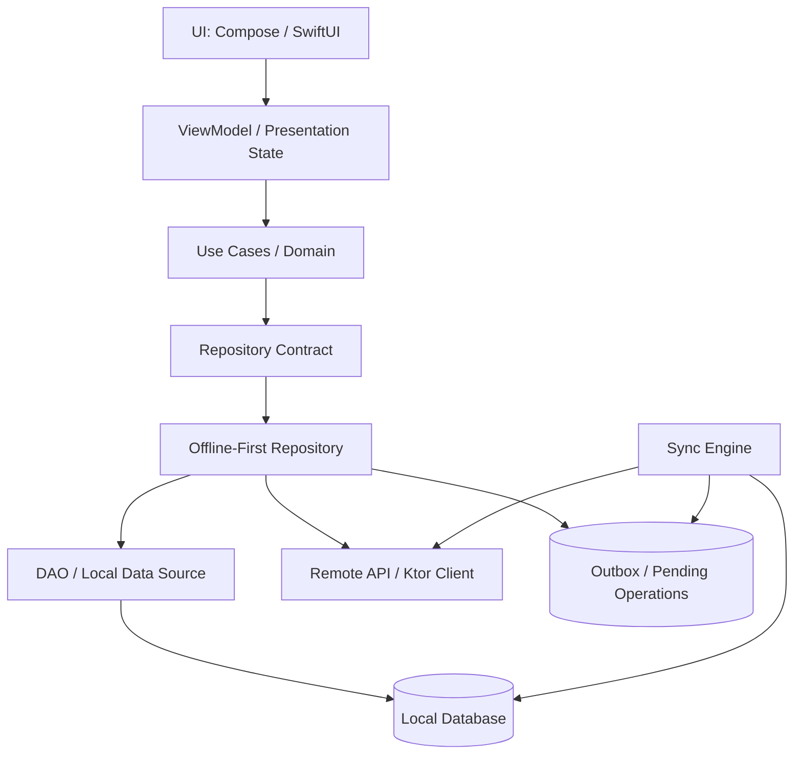
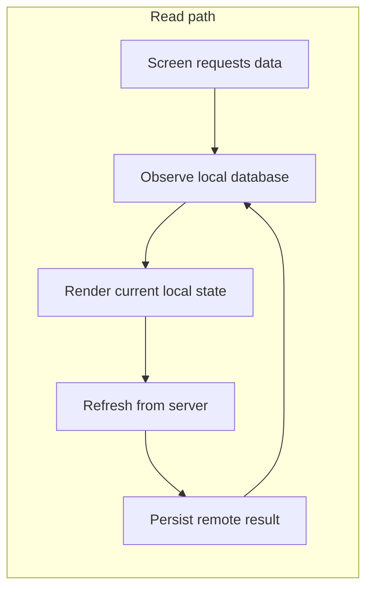
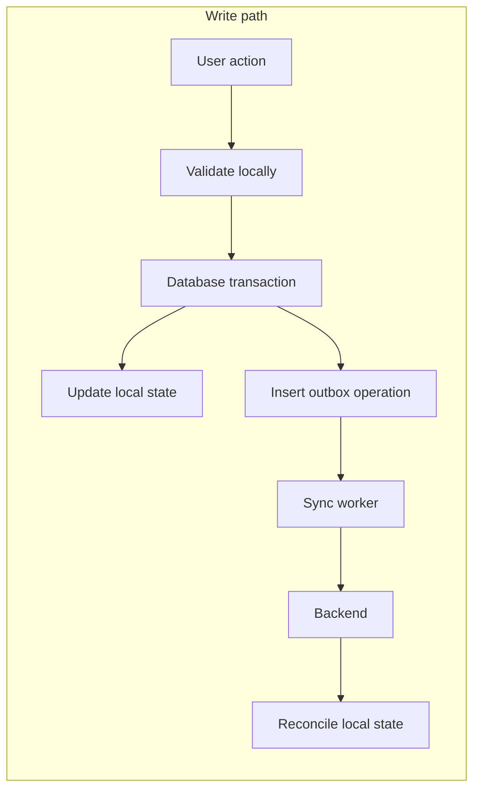
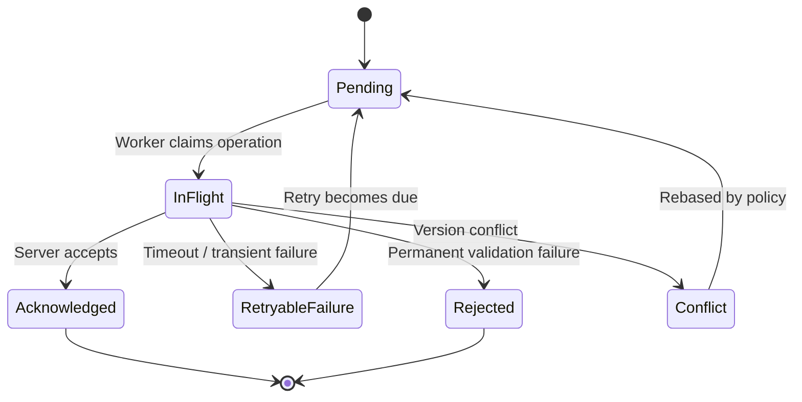

<div align="center">

# Chapter 19 — Repository Pattern
## Part 5: Offline-First Architecture

**Kotlin Multiplatform · Clean Architecture · Repository Design · Data Consistency**


*Build applications that remain useful when the network does not.*

</div>

---

## Table of Contents

- [1. The Offline-First Mindset](#1-the-offline-first-mindset)
- [2. Offline-First Is Not the Same as Caching](#2-offline-first-is-not-the-same-as-caching)
- [3. The Architecture](#3-the-architecture)
- [4. The Local Database as the Source of Truth](#4-the-local-database-as-the-source-of-truth)
- [5. Designing Repository Contracts](#5-designing-repository-contracts)
- [6. Read Flows: Local First, Network Second](#6-read-flows-local-first-network-second)
- [7. Write Flows: Local Writes and Synchronization](#7-write-flows-local-writes-and-synchronization)
- [8. Modeling Pending Operations](#8-modeling-pending-operations)
- [9. Synchronization Engine](#9-synchronization-engine)
- [10. Conflict Resolution](#10-conflict-resolution)
- [11. Connectivity Is a Hint, Not a Guarantee](#11-connectivity-is-a-hint-not-a-guarantee)
- [12. Pagination and Incremental Sync](#12-pagination-and-incremental-sync)
- [13. Deletions and Tombstones](#13-deletions-and-tombstones)
- [14. Failure Handling and Retry Policies](#14-failure-handling-and-retry-policies)
- [15. Kotlin Multiplatform Implementation](#15-kotlin-multiplatform-implementation)
- [16. UI State and Repository Boundaries](#16-ui-state-and-repository-boundaries)
- [17. Security and Sensitive Local Data](#17-security-and-sensitive-local-data)
- [18. Testing Offline-First Systems](#18-testing-offline-first-systems)
- [19. Observability and Operational Metrics](#19-observability-and-operational-metrics)
- [20. Common Design Mistakes](#20-common-design-mistakes)
- [21. Production Readiness Checklist](#21-production-readiness-checklist)
- [22. Final Thoughts](#22-final-thoughts)

---

## 1. The Offline-First Mindset

A mobile application does not control its network environment. A user can enter an elevator, move through a warehouse with weak Wi-Fi, travel through an area with no signal, or switch between networks while an operation is in progress.

If every screen depends directly on a successful HTTP response, the application is only as reliable as the current connection.

An **offline-first application** treats local data as the primary interface for application reads. Network communication updates that local data and synchronizes local changes with the server.

The user interacts with a responsive local representation of the application state. Synchronization happens as a separate process.

### The central principle

> The UI observes local data. The repository coordinates local and remote data. Synchronization reconciles the two.

This is a design principle, not a requirement that every operation must always succeed offline. Some operations genuinely require server authorization, a live price, or a server-generated decision. The application should make those constraints explicit rather than pretending every feature is available without a network.

### A practical example

Consider a warehouse picking application:

1. A picker opens an assigned task.
2. The task is loaded from the local database.
3. The picker scans an item.
4. The local database records the scan immediately.
5. The UI reflects the updated quantity.
6. A synchronization worker sends the pending operation to the warehouse backend.
7. The backend confirms or rejects the operation.
8. The local record is updated with the authoritative result.

The picker does not need to wait for a round trip before seeing the result of every interaction. However, the application must distinguish a locally recorded action from a server-confirmed action.

---

## 2. Offline-First Is Not the Same as Caching

Caching and offline-first architecture solve related but different problems.

| Concern | Traditional cache | Offline-first |
|---|---|---|
| Primary read source | Often network | Local database |
| Network failure | May show stale or no data | Existing local data remains usable |
| Writes | Usually sent directly to server | Can be recorded locally and synchronized |
| Pending operations | Usually not modeled | Explicitly tracked |
| Conflict handling | Often outside the cache | Part of synchronization design |
| Data consistency | Cache invalidation focused | Local/server reconciliation |
| User feedback | Loading/error states | Local, pending, synced, conflict states |

A cache can improve performance, but it does not automatically provide durable offline writes, operation ordering, conflict resolution, or recovery after process death.

Offline-first architecture requires a deliberate data consistency model.

### Questions to answer before implementation

- Which data must be available without a network?
- Which user actions can be accepted locally?
- Which actions require immediate server confirmation?
- How long can local changes remain pending?
- What happens if the same record changes on another device?
- How does the application recover after being terminated during synchronization?
- How does the user distinguish saved locally from confirmed remotely?

These decisions define the behavior of the system more than the choice of database library.

---

## 3. The Architecture

A reliable offline-first design separates presentation, domain behavior, persistence, remote communication, and synchronization.



### Responsibilities

| Component | Responsibility |
|---|---|
| UI | Render data and synchronization status |
| ViewModel | Convert domain state into screen state |
| Use case | Express application-specific operations |
| Repository contract | Define domain-facing data operations |
| Repository implementation | Coordinate local and remote sources |
| Local data source | Persist and observe application data |
| Remote data source | Communicate with backend services |
| Outbox | Persist operations waiting to be synchronized |
| Sync engine | Deliver pending operations and reconcile results |

The repository is the coordination boundary. It should not become a giant class that owns scheduling, connectivity monitoring, database schema migration, HTTP details, and every conflict policy. Those responsibilities can be delegated to focused collaborators.

### Read and write paths





The database transaction is important: the local change and its pending synchronization operation must be committed together. Otherwise, the application could show a change that it has no durable record of sending.

---

## 4. The Local Database as the Source of Truth

In a typical offline-first read path, the local database is the source of truth for what the UI displays.

This does not mean the local database is the ultimate business authority. The backend may still own authorization, inventory availability, financial balances, or other authoritative decisions.

It means that the UI reads a consistent local representation instead of independently combining network responses and cached values.

### Why a database instead of an in-memory cache?

An in-memory cache disappears when the process is killed. A durable database provides:

- State that survives process death and device restart.
- Observable queries for reactive screens.
- Transactional updates.
- Indexed lookup and filtering.
- A place to store pending operations.
- A consistent representation shared by multiple screens.

### Example local model

```kotlin
data class PickingTaskEntity(
    val id: String,
    val status: String,
    val assignedQuantity: Int,
    val pickedQuantity: Int,
    val serverVersion: Long?,
    val updatedAtEpochMillis: Long,
    val syncState: String
)
```

The entity is a persistence model. It should not automatically become the domain model or API DTO.

A domain-facing model might be:

```kotlin
data class PickingTask(
    val id: String,
    val status: PickingTaskStatus,
    val assignedQuantity: Int,
    val pickedQuantity: Int,
    val synchronization: SynchronizationState
)

enum class SynchronizationState {
    Synced,
    Pending,
    Failed,
    Conflict
}
```

Mapping keeps database-specific representation out of the domain layer:

```kotlin
fun PickingTaskEntity.toDomain(): PickingTask =
    PickingTask(
        id = id,
        status = PickingTaskStatus.fromStorage(status),
        assignedQuantity = assignedQuantity,
        pickedQuantity = pickedQuantity,
        synchronization = when (syncState) {
            "PENDING" -> SynchronizationState.Pending
            "FAILED" -> SynchronizationState.Failed
            "CONFLICT" -> SynchronizationState.Conflict
            else -> SynchronizationState.Synced
        }
    )
```

The `fromStorage` function is an application-defined conversion. In production, unknown persisted values should have an explicit fallback or migration strategy rather than silently mapping every unknown value to a valid business state.

### Observe database changes

A DAO can expose a stream:

```kotlin
interface PickingTaskLocalDataSource {
    fun observeTask(taskId: String): Flow<PickingTaskEntity?>

    suspend fun upsert(task: PickingTaskEntity)

    suspend fun updatePickedQuantity(
        taskId: String,
        quantity: Int
    )
}
```

The concrete implementation may use Room, SQLDelight, or another persistence solution. The contract belongs to the module that owns the abstraction.

---

## 5. Designing Repository Contracts

A repository API should describe application behavior, not expose implementation details such as SQL queries, HTTP responses, or worker scheduling.

For example:

```kotlin
interface PickingTaskRepository {
    fun observeTask(taskId: String): Flow<PickingTask?>

    suspend fun refreshTask(taskId: String): Result<Unit>

    suspend fun recordPick(
        taskId: String,
        itemId: String,
        quantity: Int
    ): Result<Unit>

    suspend fun synchronizePendingChanges(): Result<Unit>
}
```

This contract exposes four distinct capabilities:

- Observe the current local representation.
- Request a remote refresh.
- Record a user operation.
- Request synchronization.

Depending on the application, synchronization may be owned by a dedicated coordinator rather than exposed through every feature repository. The key is to keep the domain contract intentional.

### Avoid leaking transport and persistence types

Avoid contracts such as:

```kotlin
interface BadPickingTaskRepository {
    suspend fun getTaskResponse(id: String): HttpResponse

    suspend fun getTaskEntity(id: String): PickingTaskEntity

    suspend fun insertSqlRow(entity: PickingTaskEntity)
}
```

These signatures couple consumers to infrastructure. A domain-facing repository should return domain models and domain-level outcomes.

### Model outcomes explicitly

A local write can succeed even while remote synchronization remains pending. A simple `Result<Unit>` may not communicate enough detail to the UI.

Consider a result model:

```kotlin
sealed interface WriteOutcome {
    data object SavedLocally : WriteOutcome
    data object AlreadyApplied : WriteOutcome
    data class Rejected(val reason: String) : WriteOutcome
}
```

The UI can show “Saved on this device — waiting to sync” for `SavedLocally`. Do not label that state “Completed” if the backend has not confirmed the operation.

Use a richer domain result when the business workflow needs to distinguish validation, authorization, conflict, and transient network failure.

---

## 6. Read Flows: Local First, Network Second

A common offline-first read strategy is:

1. Observe local data immediately.
2. Trigger a refresh when appropriate.
3. Fetch remote data.
4. Map the response into local entities.
5. Persist the remote result.
6. Let the database stream emit the updated value.

The UI does not need to know whether the latest value came from an earlier sync or a just-completed request.

### Repository implementation

```kotlin
class DefaultPickingTaskRepository(
    private val local: PickingTaskLocalDataSource,
    private val remote: PickingTaskRemoteDataSource,
    private val mapper: PickingTaskMapper
) : PickingTaskRepository {

    override fun observeTask(
        taskId: String
    ): Flow<PickingTask?> =
        local.observeTask(taskId)
            .map { entity -> entity?.let(mapper::toDomain) }

    override suspend fun refreshTask(
        taskId: String
    ): Result<Unit> = runCatching {
        val dto = remote.getTask(taskId)
        local.upsert(mapper.toEntity(dto))
    }

    // Other operations are implemented in later sections.
}
```

This is a simplified example. A production repository should account for server versions, pending local changes, transactional writes, cancellation, and error classification.

### Do not overwrite pending local work blindly

Suppose a picker has locally recorded a quantity of 8, but the server refresh returns quantity 6 from an older snapshot.

A naïve `upsert()` can erase the user's pending work.

The refresh operation must know whether the local record has pending operations and apply a reconciliation policy. For example:

- Update server-owned fields from the remote response.
- Preserve locally pending fields.
- Rebase pending operations on the latest server version when supported.
- Mark the record as conflicted if safe reconciliation is impossible.

A refresh is not simply “replace local rows with API rows.”

### Staleness policy

Refresh decisions should be explicit. Possible triggers include:

- On screen entry.
- Pull to refresh.
- Application foreground.
- A scheduled background sync.
- A domain event that invalidates the local snapshot.
- A time-to-live threshold.

A timestamp can support a freshness policy:

```kotlin
fun shouldRefresh(
    lastSuccessfulSyncMillis: Long?,
    nowMillis: Long,
    maxAgeMillis: Long
): Boolean {
    if (lastSuccessfulSyncMillis == null) return true

    return nowMillis - lastSuccessfulSyncMillis >= maxAgeMillis
}
```

The clock source should be injectable for deterministic tests. A freshness threshold is a product decision; it should not be hard-coded independently in several screens.

---

## 7. Write Flows: Local Writes and Synchronization

Offline-first writes require more care than offline-first reads.

A robust local write should:

1. Validate what can be validated locally.
2. Start a database transaction.
3. Update the local representation.
4. Insert an outbox operation.
5. Commit both changes atomically.
6. Notify or schedule the synchronization system.

### Why an outbox?

Imagine the app updates the local database and then crashes before scheduling a worker. If the pending operation exists durably, the next synchronization opportunity can still discover it.

The outbox is the durable record of work that has not yet been acknowledged by the server.

### Example operation

```kotlin
data class PendingOperationEntity(
    val operationId: String,
    val aggregateId: String,
    val operationType: String,
    val payload: String,
    val createdAtEpochMillis: Long,
    val attemptCount: Int,
    val nextAttemptAtEpochMillis: Long?,
    val state: String
)
```

`operationId` should be stable across retries. It can be sent to the backend as an idempotency key if the backend supports that contract.

### Atomic local update

```kotlin
interface PickingTaskTransaction {
    suspend fun updatePickedQuantity(
        taskId: String,
        quantity: Int
    )

    suspend fun insertPendingOperation(
        operation: PendingOperationEntity
    )
}

interface PickingTaskLocalDataSource {
    suspend fun <T> transaction(
        block: suspend PickingTaskTransaction.() -> T
    ): T

    fun observeTask(taskId: String): Flow<PickingTaskEntity?>
}
```

Then the repository can perform both writes in one transaction:

```kotlin
override suspend fun recordPick(
    taskId: String,
    itemId: String,
    quantity: Int
): Result<Unit> = runCatching {
    require(quantity > 0) { "Quantity must be positive" }

    val operation = PendingOperationEntity(
        operationId = operationIdGenerator.newId(),
        aggregateId = taskId,
        operationType = "RECORD_PICK",
        payload = operationSerializer.encode(
            RecordPickPayload(itemId, quantity)
        ),
        createdAtEpochMillis = clock.nowMillis(),
        attemptCount = 0,
        nextAttemptAtEpochMillis = null,
        state = "PENDING"
    )

    local.transaction {
        updatePickedQuantity(taskId, quantity)
        insertPendingOperation(operation)
    }

    syncScheduler.requestSync()
}
```

`operationIdGenerator`, `operationSerializer`, `clock`, and `syncScheduler` are application-defined collaborators. The example illustrates the boundary; the concrete transaction API depends on the selected database.

**Important:** if scheduling fails after the transaction commits, the operation must remain pending. A later startup, foreground, or periodic synchronization pass should discover it. The durable outbox—not a successful scheduler call—is the source of truth for pending work.

### Command versus state synchronization

There are two broad ways to represent local changes.

**State-based synchronization** sends the latest desired state:

```json
{
  "taskId": "TASK-42",
  "pickedQuantity": 8
}
```

This can work when the backend accepts replacement state and concurrent updates are manageable.

**Operation-based synchronization** sends the user's action:

```json
{
  "operationId": "op-9d2",
  "taskId": "TASK-42",
  "type": "RECORD_PICK",
  "itemId": "ITEM-7",
  "quantity": 2
}
```

Operation-based synchronization preserves intent and is often better for inventory movements, payments, audit trails, and workflows where each action matters.

Do not choose one representation by habit. The backend contract and business invariants determine the right model.

---

## 8. Modeling Pending Operations

A pending operation should contain enough information to retry safely and diagnose failure.

A useful lifecycle is:



Possible states:

| State | Meaning |
|---|---|
| `PENDING` | Waiting to be attempted |
| `IN_FLIGHT` | Claimed by a synchronization worker |
| `RETRYABLE_FAILURE` | Failed temporarily; retry may succeed |
| `ACKNOWLEDGED` | Server accepted the operation |
| `REJECTED` | Server permanently rejected the operation |
| `CONFLICT` | Operation requires reconciliation |

Some systems can remove acknowledged rows after retaining the necessary audit information elsewhere. Others keep them for diagnostics. Define retention and cleanup rules.

### Idempotency is essential

A network timeout does not prove the server failed to process a request.

Example:

1. The client sends operation `op-123`.
2. The server processes it.
3. The response is lost.
4. The client retries.
5. The server receives `op-123` again.

Without idempotency, the operation may be applied twice.

The client should reuse the same operation identifier for retries. The backend should persist or otherwise enforce idempotency for the relevant operation scope and retention period.

Client-side deduplication alone cannot guarantee exactly-once processing across an unreliable network.

---

## 9. Synchronization Engine

The synchronization engine is responsible for delivering pending operations, handling outcomes, and updating local state.

It should be independent from a screen's lifecycle. A user navigating away from a screen must not silently abandon durable pending work.

### Basic synchronization loop

```kotlin
class SyncEngine(
    private val outbox: OutboxDataSource,
    private val remote: PickingTaskRemoteDataSource,
    private val reconciler: SyncReconciler,
    private val clock: Clock
) {
    suspend fun synchronize() {
        val operations = outbox.getDueOperations(limit = 50)

        for (operation in operations) {
            try {
                outbox.markInFlight(operation.operationId)

                val response = remote.submit(
                    operationId = operation.operationId,
                    operation = operation
                )

                reconciler.onAcknowledged(operation, response)
            } catch (cancelled: CancellationException) {
                throw cancelled
            } catch (error: Throwable) {
                reconciler.onFailure(
                    operation = operation,
                    error = error,
                    nowMillis = clock.nowMillis()
                )
            }
        }
    }
}
```

This is illustrative pseudocode. Production implementations need atomic claiming, lease recovery, bounded concurrency, error classification, and protection against two workers sending the same operation simultaneously.

### Claim operations atomically

Two workers must not both claim the same pending operation.

A database-backed claim can use a conditional update:

```sql
UPDATE pending_operation
SET state = 'IN_FLIGHT',
    claimed_at_epoch_millis = :now
WHERE operation_id = :id
  AND state IN ('PENDING', 'RETRYABLE_FAILURE');
```

The caller must verify that exactly one row was updated before sending the request.

A lease or timeout is also needed for operations left `IN_FLIGHT` after process death. Once the lease expires, a later worker can safely reclaim the operation, provided the server-side operation is idempotent.

### Preserve ordering where the domain requires it

Some operations are independent. Others must be processed in order.

For example, a task may require:

1. Start task.
2. Record item picks.
3. Complete task.

Sending “complete task” before earlier pick operations can produce invalid server state.

Possible ordering strategies:

- Process operations sequentially per aggregate.
- Store an aggregate sequence number.
- Block later operations while an earlier operation is unresolved.
- Allow parallel processing only for independent aggregates.

Global sequential processing is simple but can reduce throughput. Global parallel processing is fast but can violate business ordering. Choose the smallest ordering scope that preserves the domain invariants.

### Keep the sync engine focused

A useful split is:

- `OutboxDataSource`: persist, claim, retry, and acknowledge operations.
- `RemoteOperationSender`: translate operations into API calls.
- `SyncReconciler`: update local domain state based on server outcomes.
- `SyncScheduler`: arrange future execution.
- `SyncEngine`: coordinate a synchronization pass.

This keeps a single synchronization class from becoming an untestable collection of infrastructure concerns.

---

## 10. Conflict Resolution

A conflict occurs when the local and remote versions cannot be reconciled automatically under the application's consistency rules.

Consider two devices editing the same task:

- Device A reads version 10.
- Device B reads version 10.
- Device A updates the task and creates version 11.
- Device B submits a change based on version 10.

The server must decide whether to accept, reject, merge, or otherwise reconcile the stale update.

### Optimistic concurrency

A common approach uses a version number or ETag.

```kotlin
data class UpdateTaskRequest(
    val taskId: String,
    val expectedVersion: Long,
    val pickedQuantity: Int
)
```

The server accepts the update only if the current version matches `expectedVersion`. Otherwise, it returns a conflict response with enough information for the client to refresh and decide what to do.

The version must be issued and validated by the authoritative backend. A client-generated timestamp is not a substitute for a concurrency token.

### Conflict strategies

| Strategy | Behavior | Appropriate use |
|---|---|---|
| Last-write-wins | Newer timestamp wins | Low-risk preferences, with trustworthy ordering assumptions |
| Server-wins | Remote state replaces local state | Server-authoritative fields |
| Client-wins | Local state replaces remote state | Rare; only when product rules explicitly permit |
| Field-level merge | Merge independent fields | Records with separable updates |
| Operation replay | Reapply intent on latest state | Counters and domain operations with safe semantics |
| Manual resolution | Ask user or supervisor | High-impact ambiguous changes |

### Why last-write-wins is not universally safe

Device clocks can drift. A device can be offline for hours. A timestamp may describe when a change was made, not whether it is valid against current business state.

For inventory, financial balances, reservations, and task completion, blindly selecting the newest timestamp can corrupt business meaning.

Prefer server-issued versions, domain-specific operations, and explicit conflict responses.

### Rebase operations when possible

If the server reports a version conflict, the client may:

1. Fetch the latest authoritative record.
2. Re-evaluate the pending operation against that record.
3. Rebuild the request using the latest version.
4. Retry with the same operation identity if the backend contract permits it.

Not every operation can be rebased. If the original intent is no longer valid, mark it as a conflict or rejection and expose a clear resolution path.

---

## 11. Connectivity Is a Hint, Not a Guarantee

A connectivity monitor can tell the application that a network interface appears available. It cannot guarantee that the backend is reachable or that a request will succeed.

A device may report connectivity while:

- DNS resolution fails.
- The server is unavailable.
- A VPN blocks the endpoint.
- Authentication has expired.
- A captive portal intercepts requests.
- The connection drops after the request begins.

Therefore:

> Do not make correctness depend on a connectivity check immediately before an HTTP request.

Attempt the operation and handle the actual result. Use connectivity signals to decide when to schedule or prioritize work, not to prove that synchronization will succeed.

### A platform-neutral abstraction

```kotlin
interface NetworkStatusProvider {
    fun observe(): Flow<NetworkStatus>
}

enum class NetworkStatus {
    Available,
    Unavailable,
    Unknown
}
```

`Unknown` is useful when the platform cannot provide a reliable status. The shared domain should not need to know about Android's network APIs or Apple's path-monitoring types.

---

## 12. Pagination and Incremental Sync

Large datasets should not be downloaded in full every time the application starts.

Offline-first systems often use incremental synchronization.

### Cursor-based synchronization

The server returns a cursor representing the point up to which changes have been delivered.

```kotlin
data class SyncPage<T>(
    val items: List<T>,
    val nextCursor: String?,
    val hasMore: Boolean
)
```

A typical flow:

1. Read the last committed cursor.
2. Request changes after that cursor.
3. Apply the page to the local database.
4. Commit the new cursor in the same transaction as the page.
5. Request the next page if available.

The cursor must not advance before the corresponding data is safely committed. Otherwise, a crash could cause the client to skip records permanently.

### Transactional page application

```kotlin
suspend fun applySyncPage(
    page: SyncPage<TaskDto>,
    nextCursor: String?
) {
    database.transaction {
        page.items.forEach { dto ->
            taskDao.upsert(dto.toEntity())
        }

        syncMetadataDao.saveCursor(nextCursor)
    }
}
```

The exact transaction syntax depends on the database. The important invariant is that the data and its cursor advance together.

### Full sync versus incremental sync

| Full sync | Incremental sync |
|---|---|
| Easier initial implementation | More complex protocol |
| Transfers more data | Transfers only changes |
| Useful for small datasets | Useful for large or frequently changing datasets |
| Can repair local drift | Requires reliable cursor semantics |
| May be expensive on mobile networks | Reduces bandwidth and processing |

A production system often uses both: an initial snapshot, incremental updates, and occasional full reconciliation.

### Deletions require special treatment

If a server record disappears, the client must learn that it was deleted. A query that returns only existing records cannot communicate every deletion.

Use deletion events, tombstones, or a versioned change feed. See the next section.

---

## 13. Deletions and Tombstones

A local database cannot infer that a remote record was deleted merely because it is absent from the latest page.

A **tombstone** is a durable marker that records a deletion.

```kotlin
data class TaskEntity(
    val id: String,
    val title: String,
    val isDeleted: Boolean,
    val serverVersion: Long
)
```

When a deletion event arrives, mark the local record as deleted or remove it according to the retention policy.

Tombstones are especially important when multiple devices synchronize at different times. If a deletion marker is removed too early, an older device may upload its stale copy and unintentionally resurrect the record.

Define:

- How long tombstones are retained.
- Which synchronization checkpoint proves all relevant clients have passed the deletion.
- Whether deleted records are hidden immediately or retained for audit.
- How pending local edits interact with a remote deletion.
- Whether the backend supports restore or undelete operations.

Deletion is a synchronization event, not merely a local SQL `DELETE`.

---

## 14. Failure Handling and Retry Policies

Not all failures should be retried in the same way.

| Failure | Typical handling |
|---|---|
| Timeout | Retry with backoff |
| Temporary server error | Retry with backoff |
| Rate limited | Respect server retry guidance |
| Authentication expired | Refresh credentials, then retry when safe |
| Validation error | Mark rejected; do not retry unchanged |
| Permission denied | Surface an authorization outcome |
| Version conflict | Reconcile or request resolution |
| Serialization/schema error | Quarantine and investigate; avoid endless retry |

### Exponential backoff with jitter

A common retry delay is:

\[
d_n = \min(d_{\max}, d_0 \times 2^n) + J
\]

Where:

- \(d_0\) is the initial delay.
- \(n\) is the retry attempt.
- \(d_{\max}\) is the maximum base delay.
- \(J\) is a random jitter value within a configured range.

Jitter prevents many clients from retrying at exactly the same time after a service outage.

Illustrative policy:

```kotlin
data class RetryPolicy(
    val initialDelayMillis: Long = 1_000,
    val maxDelayMillis: Long = 5 * 60 * 1_000,
    val maxAttempts: Int = 8
)
```

The exact limits should reflect the product's service-level expectations and operation criticality. Some operations should remain pending beyond a fixed attempt count and require user or operator intervention rather than being silently discarded.

### Respect cancellation

Coroutine cancellation is control flow, not an ordinary network failure.

```kotlin
try {
    remote.submit(operation)
} catch (cancelled: CancellationException) {
    throw cancelled
} catch (error: IOException) {
    // Classify as a potentially retryable transport failure.
}
```

Do not catch `Throwable` and convert every failure into a retry. That can hide programming errors and fatal conditions.

### Dead-letter or quarantined operations

An operation that repeatedly fails due to invalid payload, unsupported schema, or an unrecoverable business rule should not block every later operation forever.

A quarantine or dead-letter state allows the system to:

- Preserve the failed payload for diagnosis.
- Prevent endless retries.
- Continue independent work where ordering rules permit.
- Expose a meaningful recovery path.
- Record a reason and diagnostic identifier.

Do not delete a failed operation merely to make the pending count look healthy.

---

## 15. Kotlin Multiplatform Implementation

KMP allows the domain contracts and much of the offline-first coordination to live in shared code. Platform-specific storage, scheduling, and connectivity integration can remain behind abstractions.

### Suggested source-set responsibilities

```text
shared/
└── src/
    ├── commonMain/
    │   ├── domain/
    │   │   ├── model/
    │   │   ├── repository/
    │   │   └── usecase/
    │   ├── data/
    │   │   ├── repository/
    │   │   ├── mapper/
    │   │   ├── sync/
    │   │   └── outbox/
    │   └── platform/
    │       ├── Clock.kt
    │       └── NetworkStatusProvider.kt
    ├── commonTest/
    │   └── ...
    ├── androidMain/
    │   ├── database/
    │   ├── worker/
    │   └── platform/
    └── iosMain/
        ├── database/
        ├── background/
        └── platform/
```

The exact source-set structure depends on the chosen database, networking library, and scheduler. Keep shared business rules in `commonMain` only when their dependencies are supported by all intended targets.

### Shared contracts

```kotlin
interface SyncScheduler {
    fun requestSync()
}

interface Clock {
    fun nowMillis(): Long
}

interface OperationIdGenerator {
    fun newId(): String
}
```

These abstractions allow common code to express intent without importing Android or Apple framework types.

### Android scheduling

On Android, WorkManager is commonly used for deferrable, persistent background work. Constraints can express requirements such as network availability, and unique work can help avoid scheduling duplicate jobs.

However, WorkManager does not guarantee an exact execution time. The OS controls when eligible work runs, and work can be delayed or stopped. The synchronization engine must therefore be safe to resume and retry.

### iOS scheduling

On iOS, background execution is system-managed. Background task APIs can provide opportunities to perform work, but the system decides when and whether the app receives execution time.

Do not design iOS synchronization as though it has an always-running background service. Persist pending operations and synchronize when the app receives an appropriate execution opportunity, including foreground entry where suitable.

### Platform comparison

| Concern | Android | iOS |
|---|---|---|
| Deferred background work | WorkManager | BackgroundTasks APIs |
| Execution timing | OS scheduled | OS scheduled |
| Durable pending operations | Shared database/outbox | Shared database/outbox |
| Network status | Connectivity APIs | Network framework APIs |
| Main reliability mechanism | Idempotent resumable sync | Idempotent resumable sync |

The common architecture should not promise identical background execution guarantees across platforms.

### Database choice

Common KMP options include SQLDelight and Room's multiplatform capabilities, depending on the versions and targets in use. Evaluate:

- Supported targets and compiler compatibility.
- Transaction and flow support.
- Migration tooling.
- Query observability.
- Test support.
- Performance on large datasets.
- Integration with your dependency injection setup.

Do not place platform-only database APIs in shared contracts.

---

## 16. UI State and Repository Boundaries

An offline-first screen should communicate both business state and synchronization state.

For example:

```kotlin
data class PickingTaskUiState(
    val task: PickingTask?,
    val isLoading: Boolean,
    val syncMessage: String?,
    val errorMessage: String?
)
```

A more expressive model may avoid unrelated booleans:

```kotlin
sealed interface SyncUiState {
    data object Synced : SyncUiState
    data object Pending : SyncUiState
    data object Syncing : SyncUiState
    data class Failed(val message: String) : SyncUiState
    data object Conflict : SyncUiState
}
```

### Example user-facing labels

| Internal state | Possible UI message |
|---|---|
| Local data available | Available offline |
| Pending operation | Saved on this device |
| In flight | Syncing |
| Acknowledged | Synced |
| Retryable failure | Waiting to retry |
| Rejected | Could not be accepted |
| Conflict | Needs review |

The UI should not expose raw HTTP status codes or database state strings.

### Compose example

```kotlin
@Composable
fun SyncStatus(state: SyncUiState) {
    when (state) {
        SyncUiState.Synced -> Text("Synced")
        SyncUiState.Pending -> Text("Saved on this device")
        SyncUiState.Syncing -> Text("Syncing…")
        is SyncUiState.Failed -> Text("Waiting to retry")
        SyncUiState.Conflict -> Text("Needs review")
    }
}
```

A SwiftUI screen can consume the same domain state through the application's chosen KMP interop strategy.

### Do not put synchronization policy in composables

A composable should render state and emit user events. It should not:

- Create HTTP clients.
- Directly write outbox rows.
- Decide retry delays.
- Resolve version conflicts.
- Start an unstructured background loop.

Those responsibilities belong to the repository and synchronization layer.

---

## 17. Security and Sensitive Local Data

Offline-first architecture increases the amount of data stored on the device. That makes local data security part of the design, not an afterthought.

Consider:

- Store only data required for the offline workflow.
- Use platform-appropriate secure storage for credentials and cryptographic keys.
- Do not store access tokens in ordinary database tables or logs.
- Apply database encryption when the threat model and platform requirements call for it.
- Protect backups and define whether sensitive application data should be excluded.
- Clear or revoke local data appropriately on logout, account removal, or device deprovisioning.
- Avoid logging full pending-operation payloads.
- Apply retention limits to old records and diagnostic data.
- Consider shared-device scenarios and account switching.

### Logout is a data lifecycle event

If a user signs out while operations are pending, the application needs a deliberate policy:

- Attempt synchronization before logout when allowed.
- Preserve encrypted pending work for the same account, if the product supports it.
- Block account switching until pending work is resolved, if required.
- Discard local data only when business and audit rules permit it.
- Never upload one user's pending operations under another user's credentials.

The correct choice depends on the data sensitivity and business workflow. It must be explicit and tested.

---

## 18. Testing Offline-First Systems

Offline-first behavior cannot be validated only with repository tests that mock every dependency as successful.

Tests should cover local persistence, process interruption, duplicate delivery, ordering, conflicts, and recovery.

### Repository tests

Verify that:

- Local data is emitted without a network request.
- A refresh persists remote data.
- A refresh does not overwrite pending local edits.
- A local write and outbox insertion are atomic.
- A failed scheduler request does not lose the pending operation.
- Domain mapping handles unknown or legacy storage values.

### Synchronization tests

Verify that:

- Pending operations are discovered after a simulated restart.
- An operation keeps the same idempotency key across retries.
- Acknowledged operations are not sent again unnecessarily.
- A transient failure schedules a later retry.
- A permanent rejection is not retried forever.
- An expired in-flight lease can be reclaimed.
- Per-aggregate ordering is preserved.
- One failed operation does not block unrelated aggregates unless required by policy.
- Server conflicts follow the defined resolution strategy.

### Example test sketch

```kotlin
@Test
fun `local write creates pending operation`() = runTest {
    repository.recordPick(
        taskId = "TASK-42",
        itemId = "ITEM-7",
        quantity = 2
    )

    val task = localDataSource.getTask("TASK-42")
    val pending = outboxDataSource.getPendingOperations()

    assertEquals(2, task?.pickedQuantity)
    assertEquals(1, pending.size)
    assertEquals("RECORD_PICK", pending.first().operationType)
}
```

The APIs in this test are illustrative and depend on the test fakes and data-source contracts in the project.

### Test crash boundaries

A particularly valuable set of tests simulates interruption at each boundary:

1. Before the local transaction.
2. During the transaction.
3. After local commit but before scheduling.
4. After the request reaches the server but before the response arrives.
5. After server acknowledgement but before local acknowledgement is committed.

These cases expose data-loss and duplicate-processing bugs that ordinary happy-path tests miss.

### Use deterministic time

Inject a clock and retry policy. Avoid tests that wait for real seconds or depend on the device clock.

A fake clock makes it possible to test:

- Staleness thresholds.
- Retry due times.
- Lease expiry.
- Tombstone retention.
- Conflict timestamps where relevant.

### Test the backend contract too

Client tests cannot prove server idempotency or concurrency behavior. Contract and integration tests should verify:

- Repeated operation IDs do not apply the same action twice.
- Stale versions return the documented conflict result.
- Cursor pagination does not skip changes.
- Deletion events are retained long enough for supported clients.
- Authentication and authorization failures are classified correctly.

---

## 19. Observability and Operational Metrics

A synchronization system can appear healthy while pending operations quietly accumulate. Production observability should measure the state of the pipeline without exposing sensitive payloads.

Useful metrics include:

| Metric | Why it matters |
|---|---|
| Pending operation count | Shows synchronization backlog |
| Oldest pending operation age | Reveals work stuck for too long |
| Sync success rate | Measures delivery reliability |
| Retry count distribution | Highlights unstable endpoints |
| Conflict rate | Reveals concurrency or workflow issues |
| Rejection rate | Highlights validation or contract mismatches |
| Sync duration | Helps identify performance regressions |
| Cursor lag | Measures distance from server state |
| Quarantined operation count | Identifies work requiring intervention |

### Correlation identifiers

Use a stable operation ID and, where appropriate, a trace or correlation ID across:

- Local outbox record.
- Client request.
- Backend logs.
- Server acknowledgement.
- Local reconciliation.

This makes it possible to investigate an operation without logging its full business payload.

### Alert on age, not only count

A backlog of 100 operations may be normal during a short network outage. One operation pending for several days may indicate a permanent failure.

Track both volume and age. Define thresholds based on business impact and expected connectivity patterns.

---

## 20. Common Design Mistakes

### 1. Treating a cache as an offline-first system

A cached response does not provide durable writes, a synchronization queue, or conflict resolution.

**Better:** use a durable local database and an explicit synchronization protocol.

### 2. Updating local data without an outbox record

A crash between local persistence and request scheduling can lose the operation.

**Better:** write the local change and outbox entry in one database transaction.

### 3. Assuming a timeout means the server did nothing

The server may have completed the request before the response was lost.

**Better:** use stable operation IDs and backend idempotency.

### 4. Replacing local rows with every API response

This can erase pending user changes.

**Better:** reconcile remote snapshots with pending operations and server versions.

### 5. Using timestamps as the only conflict mechanism

Device clocks are not authoritative and do not capture business validity.

**Better:** use server-issued versions and domain-specific conflict rules.

### 6. Running synchronization from a screen lifecycle

Navigation or process death can interrupt the work.

**Better:** persist pending operations and use a resumable scheduler/coordinator.

### 7. Retrying every failure forever

Validation errors and authorization failures will not become successful through repeated requests.

**Better:** classify failures and use retry, rejection, conflict, and quarantine states.

### 8. Ignoring operation ordering

A completion operation may arrive before the actions it depends on.

**Better:** define ordering per aggregate or workflow.

### 9. Assuming background execution is guaranteed

Android and iOS both control background scheduling.

**Better:** design for deferred execution and synchronize at multiple legitimate opportunities.

### 10. Hiding synchronization state from users

Users may repeat actions when they cannot tell whether a change was saved locally.

**Better:** communicate local persistence, pending sync, server confirmation, and conflict distinctly.

### 11. Letting infrastructure leak into domain contracts

Returning `HttpResponse`, database entities, or platform worker types couples the domain to implementation details.

**Better:** expose domain models and meaningful outcomes.

### 12. Deleting failed operations to clear the queue

This hides data loss instead of solving it.

**Better:** retain diagnostic state and define a recovery process.

---

## 21. Production Readiness Checklist

### Data and persistence

- [ ] Local database is the read source for offline-capable screens.
- [ ] Database migrations are tested.
- [ ] Local writes survive process death.
- [ ] Pending operations are stored durably.
- [ ] Local update and outbox insertion are atomic.
- [ ] Remote refresh preserves pending local intent.
- [ ] Cursor updates are committed with downloaded data.
- [ ] Deletions use a defined tombstone or change-feed policy.

### Synchronization

- [ ] Operation IDs remain stable across retries.
- [ ] Backend idempotency behavior is documented and tested.
- [ ] Operations are claimed atomically.
- [ ] Stale in-flight operations can be recovered.
- [ ] Required ordering is enforced.
- [ ] Retry policy uses bounded backoff and jitter.
- [ ] Permanent failures are not retried forever.
- [ ] Conflicts have explicit domain policies.
- [ ] Synchronization can resume after process termination.

### KMP and platforms

- [ ] Shared code contains platform-neutral contracts.
- [ ] Platform scheduling is implemented behind an abstraction.
- [ ] Android background work is treated as deferred.
- [ ] iOS background execution is treated as opportunistic.
- [ ] Database and networking dependencies support all target source sets.
- [ ] Common tests cover domain and synchronization behavior.

### UX and operations

- [ ] UI distinguishes local save from server acknowledgement.
- [ ] Users receive meaningful conflict and rejection feedback.
- [ ] Pending work is visible where the workflow requires it.
- [ ] Sensitive data is protected at rest.
- [ ] Logout and account switching have explicit pending-work policies.
- [ ] Metrics track backlog age, failures, retries, and conflicts.
- [ ] Logs use correlation IDs without exposing sensitive payloads.

---

## 22. Final Thoughts

Offline-first architecture is not a fallback screen for when the internet disappears. It is a deliberate way to design data ownership, user experience, and synchronization.

The local database gives the application a dependable state to render. The repository coordinates local and remote data. The outbox preserves user intent. The synchronization engine delivers operations safely. Conflict policies protect business invariants when multiple versions of the same data exist.

For Kotlin Multiplatform, the strongest approach is to share the domain rules and synchronization model while keeping platform scheduling and system integrations behind clear boundaries.

The most important production question is not simply, “Can the app work offline?”

It is:

**Can the app preserve user intent, recover from interruption, and converge safely when connectivity returns?**

That is the standard an offline-first system should meet.

---

<div align="center">

**End of Chapter 19 — Part 5: Offline-First Architecture**

*Reliable applications are not built by assuming the network will always be there.*

</div>
